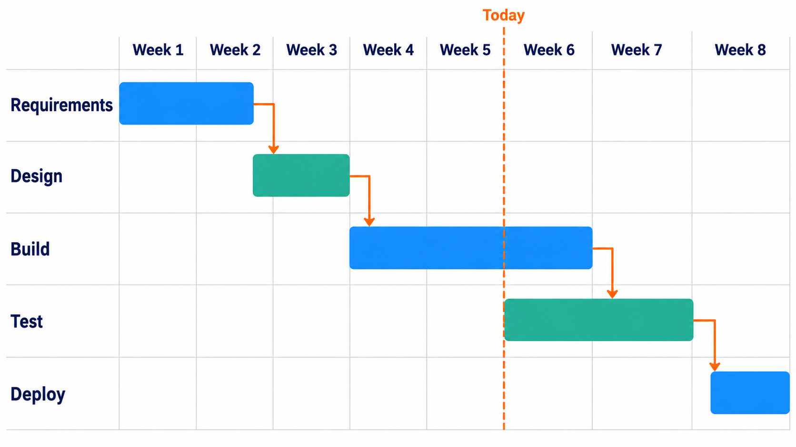
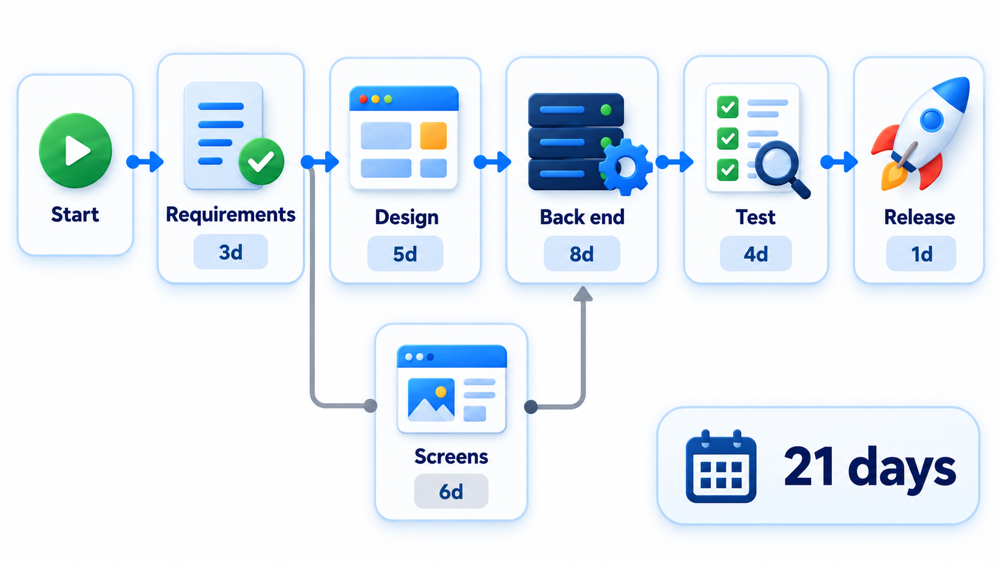
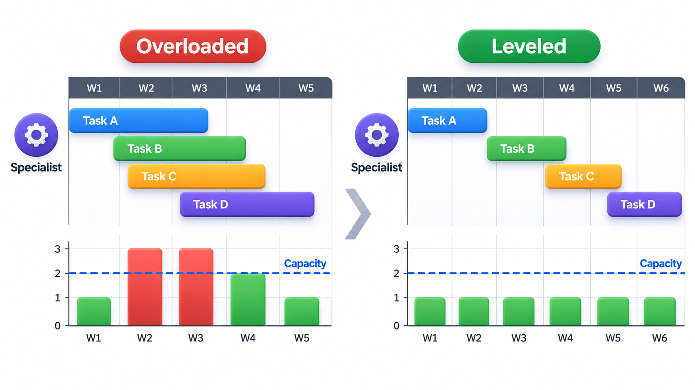
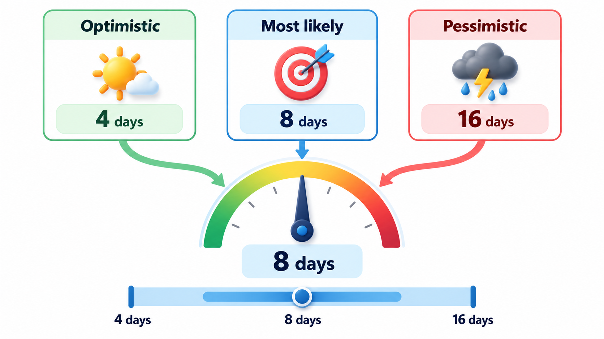
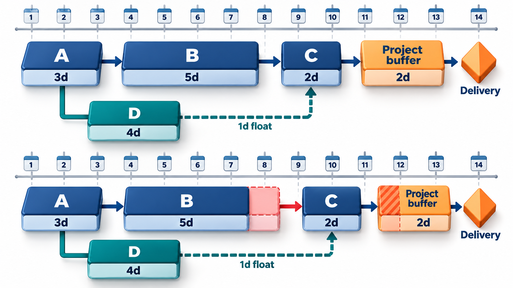

## Some Delays Matter and Some Do Not

In a project made of many tasks that depend on each other, a slip in one task does not always delay the end. Some tasks sit on the longest chain of dependencies, and any delay in them moves the finish date. Others have room to spare and can slip without anyone noticing. A manager who treats all tasks as equally urgent wastes attention on the wrong ones.

Two closely related techniques, **PERT** and **CPM** (the Critical Path Method), were developed in the 1950s to plan large projects with hundreds of dependent tasks. PERT treats durations as uncertain; CPM works with durations that are better known. They share a central insight: in a network of tasks, only some decide how long the whole project takes, and knowing which are which tells a manager where to look.

A schedule answers a deceptively simple question: when will it be done? To answer it a manager needs three things: the list of tasks, how long each takes, and which tasks must finish before others can start. From those three, mathematics can say which sequence of tasks sets the end date, how much room each other task has, and what happens if something slips. That is what PERT and CPM supply.

## Gantt Charts: Tasks on a Calendar

Before the network methods, there was the chart devised by the American engineer Henry Gantt around 1910. A **Gantt chart** lists tasks down the left side and shows each as a bar along a time axis. It makes a schedule easy to read: what starts when, how long it lasts, what overlaps, and where we are today. Most project tools produce one.

Its weakness is that a bar chart does not show *why* tasks sit where they do. A task bar that must wait for another is not obviously linked to it. For that, one needs the dependency network.

<!-- Visual: a Gantt chart with five tasks as horizontal bars on a weekly axis, some overlapping, with arrows from finishing tasks to those that depend on them and a vertical line for today. Save as images/36_gantt_chart.png. -->

## Kinds of Dependency

Tasks depend on each other in a few ways, and naming them avoids confusion.

| Type | Meaning | Example |
| --- | --- | --- |
| **Finish to start** | B cannot start until A finishes | Testing cannot start until the code is built |
| **Start to start** | B cannot start until A starts | Writing user documentation can begin once the design starts |
| **Finish to finish** | B cannot finish until A finishes | Final testing cannot finish until last-minute fixes finish |
| **Start to finish** | B cannot finish until A starts | Rare; the old system cannot be switched off until the new one starts |

Most dependencies are finish to start, and the examples that follow use only these. A **lag** adds a waiting time ("paint dries for two days before the next coat") and a **lead** lets a successor start early ("start testing when the first module is done"). Dependencies also differ in why they exist. A *hard* dependency is forced by the nature of the work. A *soft* one is a preference, such as doing the screens before the reports because the team likes that order, and soft dependencies can be rearranged if they are in the way.

## The Network and the Critical Path

PERT and CPM draw the project as a network. Each task has a duration and a list of tasks that must finish first. Two passes through the network give each task its timings.

The **forward pass** works from the start. A task can begin as soon as all its predecessors are finished, so its *earliest finish* is the latest earliest-finish among its predecessors plus its own duration. The last task's earliest finish is the length of the project.

The **backward pass** works from the end. A task's *latest finish* is how late it can finish without delaying the project. The difference between latest and earliest finish is the task's **slack** (also called float). Tasks with zero slack form the **critical path**: any delay in them delays the whole project. Tasks with slack can slip by that amount without cost.

## Finding the Critical Path

For a network with only a few routes, the answer can be found by listing every route from start to finish and adding up its days. Take a five-task project: design 3 days, database 4, screens 5, logic 6 and testing 3.

| Route | Days | Result |
| --- | --- | --- |
| Design, database, logic, testing | 3 + 4 + 6 + 3 = 16 | Longest route: the critical path |
| Design, screens, testing | 3 + 5 + 3 = 11 | 5 days of slack |

A project cannot finish before its longest route is done, so the project length is 16 days. The longest route is the **critical path**. The other route has 5 days of **slack**, the amount any task on it can slip without moving the end date: the screens could be five days late and nothing else would change. A real project has many more routes, and tools find them automatically. The practical message for a manager is what to protect. Watch the tasks on the critical path, because they carry the date, and treat the slack on the screens as a place to borrow people from.

<!-- Visual: a 21-day critical path through dependent project tasks. -->

## The Forward and Backward Passes on the Example

The same answer comes from the two passes, which is the method tools use when routes are too many to list. Design (A) must come first; database (B) and screens (C) both follow design; logic (D) follows the database; testing (E) follows both logic and screens.

| Task | Duration | Earliest start | Earliest finish | Latest finish | Latest start | Slack |
| --- | --- | --- | --- | --- | --- | --- |
| A Design | 3 | 0 | 3 | 3 | 0 | 0 |
| B Database | 4 | 3 | 7 | 7 | 3 | 0 |
| C Screens | 5 | 3 | 8 | 13 | 8 | 5 |
| D Logic | 6 | 7 | 13 | 13 | 7 | 0 |
| E Testing | 3 | 13 | 16 | 16 | 13 | 0 |

In the forward pass, testing can start only when both logic (finishing at day 13) and screens (day 8) are done, so it starts at day 13, the later of the two. In the backward pass, testing must finish by day 16, so it must start by day 13; screens must therefore finish by day 13, five days after they could. The five days are its slack. Tasks A, B, D and E have zero slack and form the critical path.

## Resources Change the Picture

The network assumes that people are available whenever a task is ready. In practice resources are limited. Two parallel tasks that each need the same specialist cannot both run at once, so the schedule stretches. **Resource levelling** adjusts the plan to avoid overloading anyone, usually by delaying tasks that have slack. A schedule that looks fine on the network can be impossible once the real people are assigned, and the critical path may change. A sound plan therefore checks the network against the team's actual availability, including holidays, part-time staff and competing work.

## Crashing and Fast-Tracking: Buying Time

When the critical path is too long, a manager can try **crashing**: spending extra money, by adding people or overtime, to shorten certain tasks. The rule is simple and often forgotten: only shortening tasks *on the critical path* shortens the project. Speeding up the screens in the example above, which have slack, saves nothing.

Crashing also has limits. Shorten the logic task from 6 days to 4 for an extra cost, and the project becomes 14 days. But now the path through the screens (11 days) is closer, and a further cut in the critical path will meet a second near-critical path that must also be shortened. Each step costs more than the last, and eventually a different path becomes critical. The manager picks the cheapest task to shorten on the critical path, watches whether the path changes, and stops when the extra cost outweighs the benefit of the earlier date.

A second technique, **fast-tracking**, shortens the schedule by doing in parallel tasks that were planned in sequence, for example starting build work before the design is fully signed off. It costs little money but adds risk, since early work may have to be redone if the earlier task changes.

| | Crashing | Fast-tracking |
| --- | --- | --- |
| What it does | Adds resources to shorten a task | Overlaps tasks that were sequential |
| Cost | Higher direct cost | Little direct cost |
| Risk | Diminishing returns; more communication | Rework if the earlier task changes |
| Best used on | Critical tasks that can use more people | Tasks whose dependency is soft |

## PERT: When Durations Are Uncertain

CPM treats each duration as a known number. PERT gives each task three estimates, optimistic, most likely and pessimistic, and computes an expected duration as (optimistic + 4 × most likely + pessimistic) / 6. The expected values are then run through the same network calculation. An important result follows: because many paths run in parallel, the chance of finishing by the date computed from expected values is often well under 50 per cent. A near-critical path with high uncertainty can easily become the real critical path.

Hence the practice of adding a **buffer** at the end of the project, and not padding every task. Padding each task invites people to use all the time they were given. A single shared buffer, sized to the uncertainty, protects the milestone and shows how much of it has been used.

<!-- Visual: a project buffer protects the milestone from critical-path variation. -->

## Keeping the Schedule Alive

A schedule is useful only while it matches reality. Once work is under way, the manager updates it regularly: recording actual start and finish dates, re-estimating the remaining work and recalculating the critical path. Three signals deserve attention.

- **Tasks on the critical path that are late.** Any day lost here is a day lost on the project.
- **Slack that is being used up.** A non-critical task that has consumed most of its slack is about to become critical.
- **Milestones.** Fixed checkpoints, such as "design approved" or "first release to users", give the team and the sponsor clear moments to compare plan with reality.

The network also helps when things go wrong. If a supplier is late, the schedule shows at once whether the delay hits the critical path and by how much, and which options (crash, fast-track, reduce scope) are available.

## Using the Tools Sensibly

Network scheduling pays off on projects with many dependencies and a hard date. For a small agile team working in short iterations, a full network is more effort than it is worth, and a board with limits does the job. Even then the idea survives: know which tasks block others, and give them to your most reliable people first.

## Five Misreadings of Scheduling

**"The critical path is the most important work."** It is the work that determines the date. Other work may matter a lot, but delay in it does not move the end.

**"Put people on every task to go faster."** Only critical tasks shorten the schedule. Extra people on a task with slack cost money and gain nothing.

**"A Gantt chart is a network diagram."** A Gantt shows time. A network shows dependency. Good tools show both, and both can mislead if they are not kept up to date.

**"The critical path never changes."** When tasks slip or are crashed, another path can become critical. Recalculate often.

**"Pad every estimate to be safe."** Padding is absorbed by the task. A shared buffer is more efficient and more visible.
