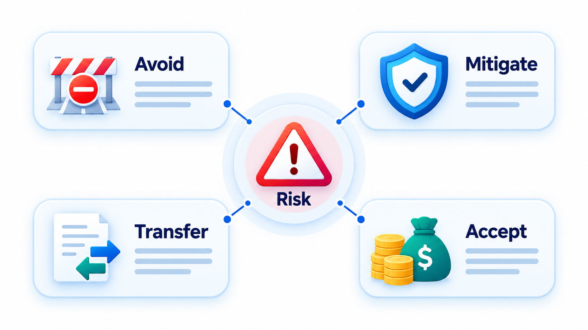
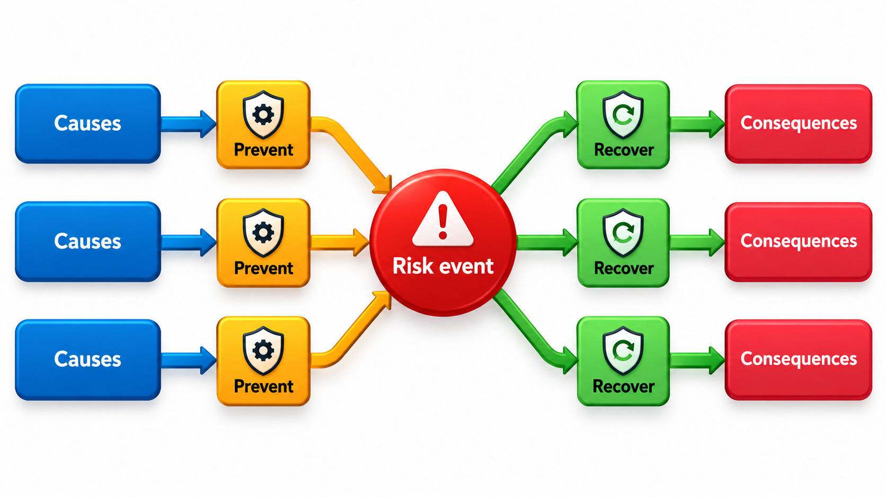
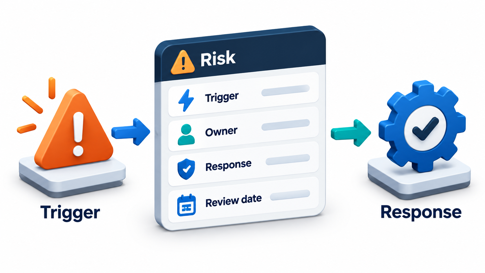
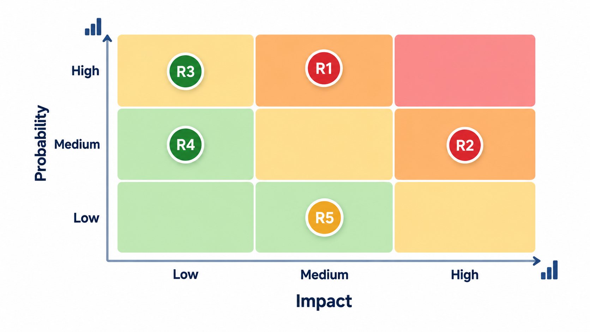
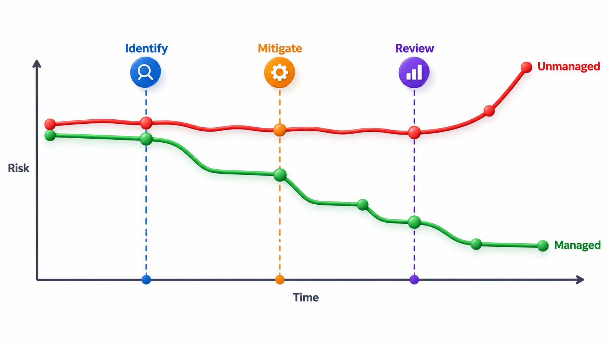

## The Risk You Name Is Cheaper Than the Risk That Names Itself

Every project carries risks: a supplier may be late, a key person may leave, the requirements may change, the technology may not behave. Most of these are visible in advance to someone on the team. What differs between projects is whether anyone writes them down, judges how much each matters, and decides what to do before it happens. A risk handled early costs a conversation; the same risk arriving unannounced costs a crisis.

**Risk management** is the practice of finding what could go wrong, judging how much it matters, and deciding in advance what to do. This topic walks through the steps, and gives a form for keeping the answers.

Software projects are unusually exposed to risk because so much of the work is new. Each project involves a unique combination of people, technology and requirements, and no amount of past experience removes all the unknowns. The mature response is neither to ignore risk nor to be paralysed by it, but to treat it as a normal part of planning: a list of things that might go wrong, each with a plan.

## What a Risk Is

A **risk** is an uncertain event that, if it happens, affects the project's goals. The word *uncertain* separates a risk from a problem. A risk may or may not happen, and a problem is already here. The gateway approval that might be late is a risk. The approval that has been refused is a problem. Managing risk is the work of turning future problems into present decisions.

Risks have two measurable parts: how likely the event is (its **probability**) and how bad it would be (its **impact**). Multiplying them gives the **exposure**, the expected loss. A 50 per cent chance of a 15-day delay has an exposure of 7.5 days.

Risks are not always negative. An **opportunity** is an uncertain event that would help, for example a vendor releasing a feature that saves months of work. Good managers look for these too and prepare to exploit them, but most of the practical work concerns threats.

## Where Risks Come From

It helps to look for risks in families, since each family points to different questions.

| Family | Examples | Questions to ask |
| --- | --- | --- |
| **Requirements** | Unclear, incomplete or changing needs | Which requirements are we least sure of? Who might change their mind? |
| **Technology** | New tools, integration with unfamiliar systems, performance limits | Have we used this before? What would we do if it failed? |
| **People** | Key person leaves, skills missing, conflicts | Who holds knowledge that nobody else has? Can we staff it in time? |
| **Estimation and schedule** | Optimistic estimates, hard deadlines | What is the largest source of uncertainty in the estimate? |
| **External** | Suppliers, regulators, partners, the market | Who do we depend on and what if they are late? |
| **Organisation** | Changes in priorities, funding, sponsors | Who could cancel or change this project? |
| **Operations and security** | Failure in use, data breach, outage | What is the worst thing that could happen after release? |

## The Cycle

The process is a loop.

1. **Identify.** List what could go wrong. Use checklists from past projects, ask the team, look at each part of the plan. People are better at spotting risks in a group than alone.
2. **Analyse.** Estimate probability and impact for each. Rough values are enough. The aim is to rank, not to be exact.
3. **Plan responses.** Decide what to do about the high ones.
4. **Monitor.** Watch for the signs that a risk is becoming real, and review the list regularly, since new risks appear as old ones are resolved.

## Ways to Find Risks

No single technique finds every risk, so teams combine a few.

| Technique | How it works | Strength |
| --- | --- | --- |
| **Checklists** | Walk through a list of common risks from past projects | Quick; captures experience |
| **Brainstorming** | The team lists everything that could go wrong, without judging | Draws on many viewpoints |
| **Pre-mortem** | Imagine that the project has failed a year from now and ask what caused it | Frees people to voice worries they would otherwise keep quiet |
| **Assumption analysis** | List what the plan assumes (a supplier will deliver, the user will be available) and ask what if each is false | Finds risks hiding in the plan |
| **Interviews with experts** | Ask people who have done similar work | Finds risks the team has never met |
| **Review of past projects** | Read lessons-learned records | Shows what actually went wrong before |

The pre-mortem is worth singling out. People are often reluctant to criticise a plan they are enthusiastic about. By starting from the assumption that it has already failed, the technique turns the conversation from "is this a good plan?" to "why did it fail?", and the answers come freely.

## Four Responses

For each important risk, a manager can choose one of four responses.

| Response | Meaning | Example |
| --- | --- | --- |
| **Avoid** | Change the plan so the risk cannot occur | Drop the dependency on the unproven gateway and use a well-known one |
| **Mitigate** | Reduce the probability or the impact | Start the approval paperwork in week one and keep a spare developer informed |
| **Transfer** | Move the consequence to someone else | Buy insurance, or put the risk on the supplier through a contract |
| **Accept** | Do nothing now, perhaps with a reserve | Keep five days of buffer for the unlikely server delay |

Mitigation is the workhorse. It usually costs a little now and saves a lot if the risk happens. Acceptance is legitimate, but it should be a decision, recorded, and not a default.

<!-- Visual: four strategies for responding to project risk. -->

A response has a cost, and a good manager compares it with the exposure. Spending Rs 50,000 to reduce an exposure of Rs 20,000 is a poor trade; spending Rs 50,000 to remove an exposure of Rs 8,00,000 is a good one. Responses can also create new risks: moving a task to a supplier removes a staffing risk but adds a dependency on the supplier. These **secondary risks** must be added to the register, and what remains after a response is called the **residual risk**.

## A Risk Register in Practice

The tool for holding all of this is the **risk register**: a table of risks with their ratings, owners and responses. Exposure is probability multiplied by impact, here in days of delay. A small register looks like this.

| Risk | Probability | Impact (days) | Exposure (days) | Owner |
| --- | --- | --- | --- | --- |
| Payment gateway approval is late | 0.5 | 15 | 7.5 | Asha |
| Key developer leaves | 0.2 | 30 | 6.0 | Ravi |
| Requirements change after design | 0.6 | 10 | 6.0 | Meena |
| Server not ready for testing | 0.3 | 5 | 1.5 | Kiran |
| **Total expected delay** | | | **21.0** | |

Every risk has a named owner, because a risk that belongs to nobody is looked at by nobody. The largest exposure is the gateway approval, so that is the risk to deal with first. The total, 21 days, is the expected delay if nothing is done, and a schedule with no buffer for it has already been planned to fail. The ranking is not always what a gut feeling suggests: the developer leaving feels the scariest, yet it ranks level with changing requirements. The numbers push the discussion toward the gateway, which can be mitigated today by starting the paperwork.

A fuller register adds columns for the response, the trigger, the status and the date of the last review, so that each line is a small plan and not only a worry.

## Qualitative Scales When Numbers Are Unknown

Often a team has no data for probabilities in percentages. A common substitute is a simple scale with agreed meanings.

| Score | Probability | Impact |
| --- | --- | --- |
| 1 | Very unlikely (under 10%) | Negligible: a day or two of delay, no effect on users |
| 2 | Unlikely (10 to 30%) | Minor: a week of delay, small cost |
| 3 | Possible (30 to 50%) | Moderate: a few weeks of delay, noticeable cost |
| 4 | Likely (50 to 70%) | Major: a month or more, missed commitments |
| 5 | Very likely (over 70%) | Severe: project fails or serious harm results |

Probability multiplied by impact gives a score from 1 to 25. Risks scoring above about 12 need an active response, those between 6 and 12 are watched with a plan, and those under 6 are noted. The point is consistency: the same words should mean the same thing to every member of the team.

## Triggers and Review

A risk entry is more useful with a **trigger**: an observable sign that the risk is becoming real. For the gateway approval, the trigger might be "no response to the application by the end of week three". When the trigger fires, the pre-agreed response begins at once, without waiting for a meeting. Triggers turn watching into action.

Review is the last piece. Every week or fortnight the team looks at the register. Which risks have gone away? Which have become problems? Which new ones have appeared? A register that is written once and filed is a document and not a tool.

<!-- Visual: an actionable risk record connects trigger owner response and review date. -->

## Plotting Risks

A risk matrix places each risk on a grid of probability against impact. The risks in the top right corner (likely and serious) get immediate attention, while those in the bottom left (unlikely and minor) are noted and left. It is a quick way to show a group where the attention should go.

<!-- Visual: project risks positioned by probability and impact. -->

## Reserves: Paying for Risks in Advance

Some risks will happen despite everything, and the project should have resources to absorb them. A **contingency reserve** is time or money set aside for identified risks, sized from their exposure. In the register above the total exposure is 21 days, so a reserve of about that size, held as a visible buffer, is a defensible figure. A **management reserve** is a further amount held by the sponsor for unidentified risks, released only on request. Keeping reserves visible and separate stops them from being quietly absorbed into task estimates, and lets the sponsor see how much has been used.

## Risk in Agile and Iterative Projects

Short cycles reduce risk by their nature, since a wrong direction costs a few weeks. Agile teams still manage risk, but with lighter tools: a short list of top risks reviewed in planning or retrospective, the riskiest stories done early, and spikes (short experiments) to settle technical unknowns before committing. A **risk burn-down** chart shows total exposure falling over time as risks are retired; a project whose exposure is not falling is not learning.

## Five Misreadings of Risk Management

**"Risk management is pessimism."** It is a way of making sure that optimism is backed by a plan. A team that has thought about what could go wrong is calmer when something does.

**"A risk list is made once at the start."** New risks appear as the project proceeds, and old ones disappear. The register is reviewed throughout.

**"The biggest risk is always technical."** People, suppliers, requirements and organisational support are often larger. Many large projects fail from these causes, not from the technology.

**"If a risk is accepted, nothing more is needed."** Accepting means choosing not to act yet. The risk is still watched, with a trigger and a reserve.

**"Precise numbers are needed."** Rough values are enough to rank. A debate about whether a probability is 0.3 or 0.4 misses the point; the debate that matters is whether it is nearer 0.1 or 0.6.
