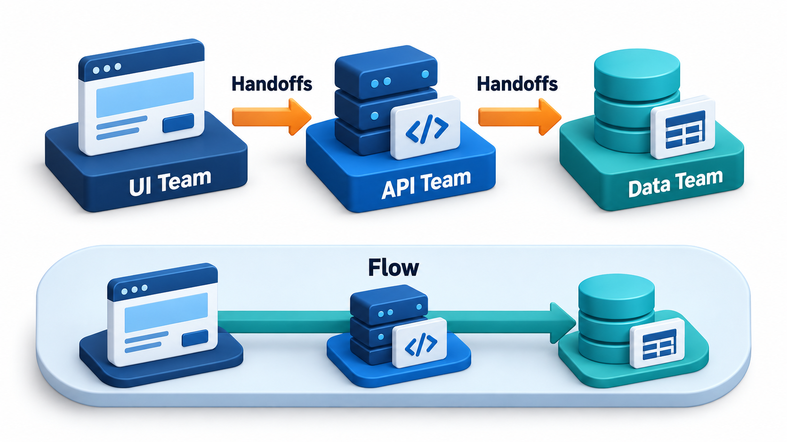
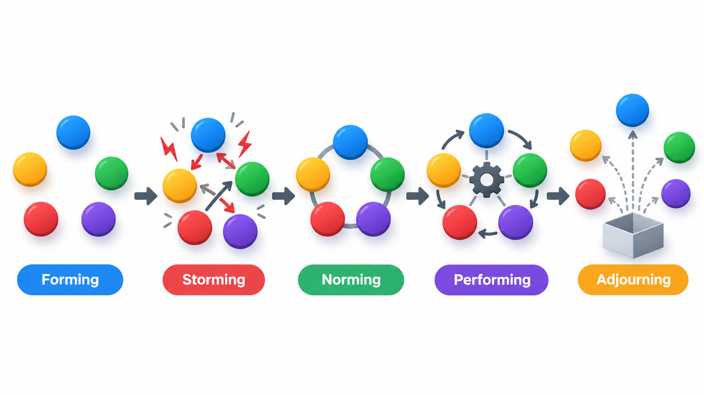
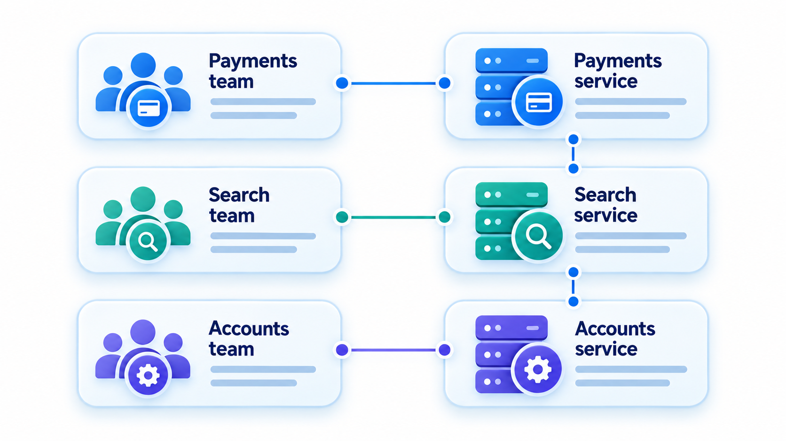
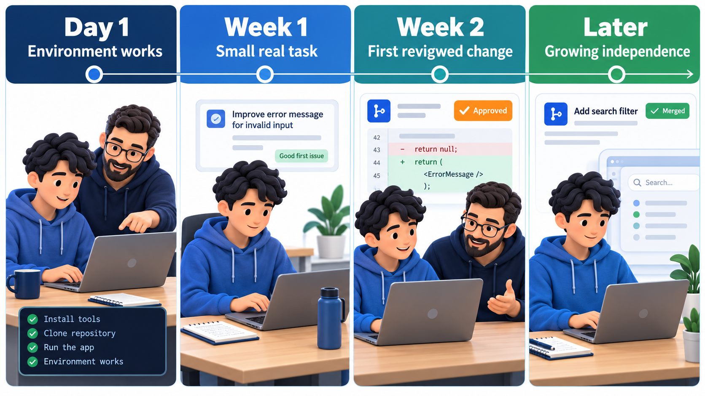

## The Shape of a Team Shapes the Software

A project's success depends on how the people are arranged: how many, in which groups, with what ways of working together. Three ideas do most of the work. The first is that adding people adds communication, so a bigger team is not proportionately faster. The second, known as **Conway's law**, says that organisations that design systems produce designs that mirror their own communication structure: four teams tend to build a system with four main parts. The third is that team size has practical limits.

None of these is a rule anyone chose. They are forces, and teams that ignore them find their plans and architecture bent out of shape. A practical matter every team also meets is bringing new people on board without losing the time of the people already there.

Team organisation is often treated as a matter of org charts and job titles, to be settled by managers before the real work begins. It is better seen as part of the design of the project itself. Who talks to whom, who decides what, and who is responsible for which part determine how fast information moves, how quickly mistakes are noticed and how well the finished product hangs together. A team arranged badly will fail even with excellent individuals, and a team arranged well can get more from ordinary ones.

## Communication Is the Cost of Adding People

Fred Brooks, in his 1975 book on the OS/360 project, noted that if every person on a team must coordinate with every other, the number of communication channels grows much faster than the team does. A team of n people has n × (n − 1) / 2 pairs. Three people have 3 channels, five have 10, ten have 45, twenty have 190. Each channel costs time, in meetings, messages, questions and misunderstanding.

The practical consequence is **Brooks's law**: adding people to a late software project makes it later. A newcomer must be taught, which takes the time of someone who was working. The work must be divided again, and some of it cannot be divided. And the new channels add overhead for everyone. In the short term, the project slows before it speeds up, if it speeds up at all.

Model the effect with two assumptions: each person gives 8 hours a day, and each pair of people spends 12 minutes a day keeping each other informed. A team of n people has n x (n - 1) / 2 pairs.

| Team size | Pairs | Hours lost a day | Useful hours | Useful hours per person |
| --- | --- | --- | --- | --- |
| 3 | 3 | 0.6 | 23.4 | 7.8 |
| 5 | 10 | 2.0 | 38.0 | 7.6 |
| 8 | 28 | 5.6 | 58.4 | 7.3 |
| 12 | 66 | 13.2 | 82.8 | 6.9 |
| 20 | 190 | 38.0 | 122.0 | 6.1 |

A team of five loses 2 hours a day, but a team of twenty loses 38 hours, nearly five people's whole day. The useful hours still rise with team size, so adding people does help, but each person adds less than the one before. The per-person figure falls from 7.8 hours to 6.1: a team of twenty is paying a fifth of its time in coordination before it has built anything. The 12 minutes is an assumption. A team whose members work on separate things pays far less than one that must all agree on everything. The model shows the shape, and a real team measures its own numbers.

<!-- Visual: communication channels growing rapidly with team size. -->

## Small Teams, Clear Ownership

For these reasons, effective software organisations favour small teams. Scrum recommends ten people or fewer. Amazon is known for the "two-pizza team" rule: a team should be small enough to be fed with two pizzas. The numbers are not magic, but the pattern is consistent. Past about eight or nine, people start to leave conversations early, decisions slow down, and some members fade into the background.

Small teams work best when they own a meaningful piece of the product from end to end: they can change it, test it, release it and see how it runs, without waiting for another team. A **cross-functional** team includes the skills it needs, such as development, testing, design and operations, so that work does not have to be handed from group to group.

<!-- Visual: a feature passing through four separate specialist teams with waiting between each, beside a single cross-functional team carrying it from idea to release. -->

## Ways to Structure a Team

Over the decades, several models of team structure have been tried, each with a different balance of control and autonomy.

| Model | How it works | Strength | Weakness |
| --- | --- | --- | --- |
| **Hierarchical** | A manager at the top, leads below, staff below them; decisions flow down | Clear authority, easy to plan | Slow decisions; information is filtered on the way up |
| **Chief programmer** | One expert designs and writes the core; others support (testers, librarians, assistants) | Coherent design; fast with a strong lead | Dependent on one person; a hard model to repeat |
| **Egoless team** | Code belongs to the group; everyone reviews and criticises work impersonally | Quality through shared scrutiny; learning | Needs trust and maturity; can drift without direction |
| **Matrix** | People report to a functional manager (skills) and a project manager (work) | Efficient use of specialists across projects | Two bosses; conflicting priorities |
| **Self-organising (agile)** | A small cross-functional team decides how to do its work, with a product owner setting direction | Fast decisions, ownership, adaptability | Needs capable people and a supportive organisation |

No model fits every case. A short, urgent project with a strong technical lead may do well with a chief-programmer style; a long-lived product may need the shared ownership of an egoless or self-organising team; a company with many projects and scarce specialists may use a matrix. The mistake is to adopt a model for fashion and ignore the match between it and the people and the work.

## How Teams Develop

A new team does not perform at its best straight away. A well-known description, by the psychologist Bruce Tuckman, names four stages that most teams pass through, with a fifth added later.

| Stage | What is happening | What the leader can do |
| --- | --- | --- |
| **Forming** | People are polite and uncertain; roles and goals are unclear | Give clear goals; help people get to know each other |
| **Storming** | Disagreements surface about methods, roles and leadership | Allow disagreement, mediate, keep it about the work |
| **Norming** | The team settles on ways of working and trusts each other more | Reinforce good habits; write down agreements |
| **Performing** | The team works smoothly and solves its own problems | Step back; remove obstacles; protect the team |
| **Adjourning** | The project ends and the team disbands | Recognise the achievement; capture lessons |

The practical lesson is that storming is normal, not a sign of failure. A manager who panics when a new team argues, and who changes the membership at every flare-up, keeps the team in the early stages for ever. Changing people also resets the process, so stable teams are usually more productive than frequently reshuffled ones.

## What Motivates Technical People

Pay and conditions matter, but studies of knowledge workers repeatedly find three further drivers: **autonomy** (having a say in how the work is done), **mastery** (the chance to improve at something worthwhile) and **purpose** (knowing why the work matters and who it helps). A team given a clear goal, trusted to decide the method and shown the effect of its work on users tends to outperform one that is told what to do in detail and kept ignorant of the reason.

Several common management habits damage these. Micromanagement removes autonomy. Constant switching of priorities removes the sense of progress. Long periods of overtime wear down people and produce errors. Credit given to the manager for the team's work removes recognition. A manager's job in this view is less to direct than to clear the path: protect the team from interruption, supply what it lacks, and keep its goal clear.

## Handling Conflict

Disagreement in a team is healthy when it is about ideas, and harmful when it becomes personal. Task conflict, about what to build or how, improves decisions if it is aired and settled. Relationship conflict, about who is to blame or who is respected, damages trust. Useful habits include discussing disagreements early and in person, separating the person from the issue, asking each side to state the other's view fairly, and agreeing how a decision will be made before it is needed, whether by consensus, by the person responsible, or by a vote. Where conflict persists, a third party can help, and in the end someone with authority must decide so that the work can continue.

## Using Conway's Law on Purpose

If the structure of the teams will shape the structure of the system anyway, a team should choose the structure it wants. The idea, sometimes called the *inverse Conway manoeuvre*, is to arrange teams so that the boundaries between them match the boundaries wanted in the architecture. A company that wants a payment service separate from the catalogue service should give each to its own team, with a defined interface between them. A company that splits teams by technology, one for the database, one for the web pages, one for the servers, will find that every feature needs three teams to agree and the design will have three layers whatever else was planned.

Seeing the law at work is also diagnostic. If two parts of a system are tangled, ask whether the teams that own them talk too much, or too little, or are really the same team that has been split.

<!-- Visual: team boundaries mirrored by software-service boundaries. -->

## Bringing New People On

Every team meets onboarding. A new member takes time to become useful, often several months for a complex system, and during that time costs the existing members some of their own. A good onboarding is planned and does not rely on luck. It gives the newcomer a working environment on day one, a first small task that is real but safe, a named person to ask, and written guides that are kept up to date. The fastest test of a codebase's health is how long it takes a new developer to ship their first change. If the answer is a month, something about setup, documentation or ownership is wrong.

Onboarding is also when documentation proves its value. A guide that a new person can follow without help is worth more than any amount of explanation given in person, since it works for the next newcomer too.

<!-- Visual: a timeline of a newcomer's first weeks: environment working on day one, a small real task in week one, a first reviewed change in week two, and growing independence after. Save as images/38_onboarding_timeline.png. -->

## Keeping Knowledge in the Team

People leave, and what they know leaves with them unless the team has taken care to share it. Practices that spread knowledge include pair programming and rotation of tasks so that no part of the system has a single owner, code review as a way to learn what colleagues are doing, short written records of decisions and their reasons, and shared documentation maintained as part of normal work. A simple health check is to ask, for each important part of the system, whether two people could fix it tomorrow if the usual owner were away. Where the answer is no, a quiet risk is waiting.

## Five Misreadings of Team Organisation

**"More people finish sooner."** Only if the work divides cleanly and the team is not already stretched by coordination. For a late project, adding people usually delays it first.

**"Conway's law is a joke."** It began as an observation and has been confirmed many times. Ignore it and the org chart shapes the design anyway.

**"Specialist teams are more efficient."** They can be, within their specialty. But features that cross several specialist teams wait in queues. Cross-functional teams often deliver faster.

**"A big team can be managed like a small one."** Past a certain size, communication needs structure, such as splitting into teams with clear interfaces. Treating twenty people as one team is a recipe for silence.

**"Onboarding is the new person's problem."** It is a team process. A hard-to-join team is paying a hidden cost on every hire.
