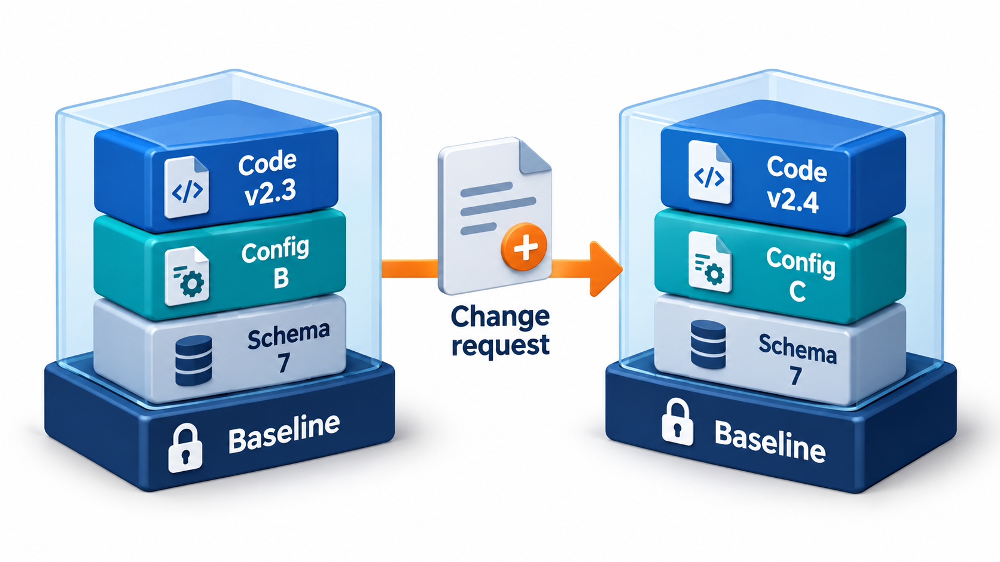
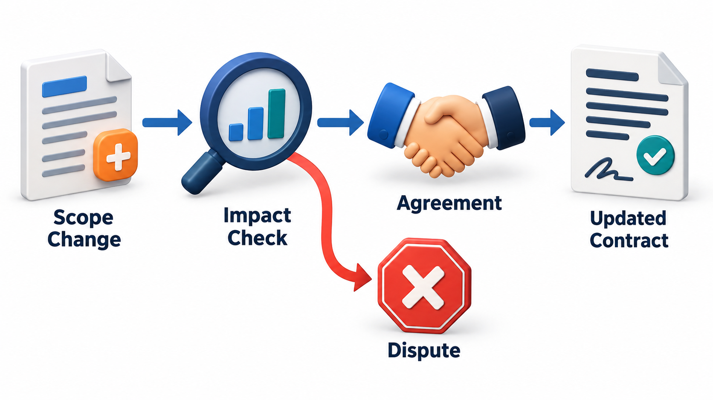
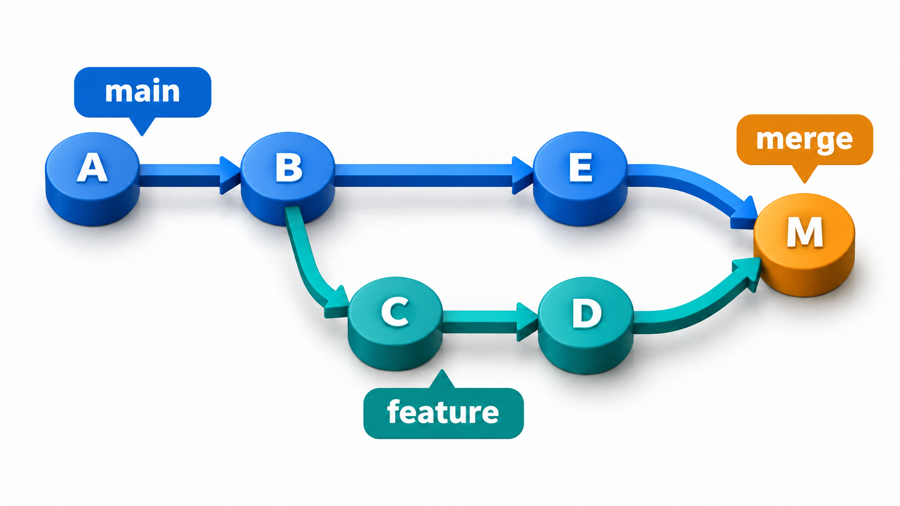
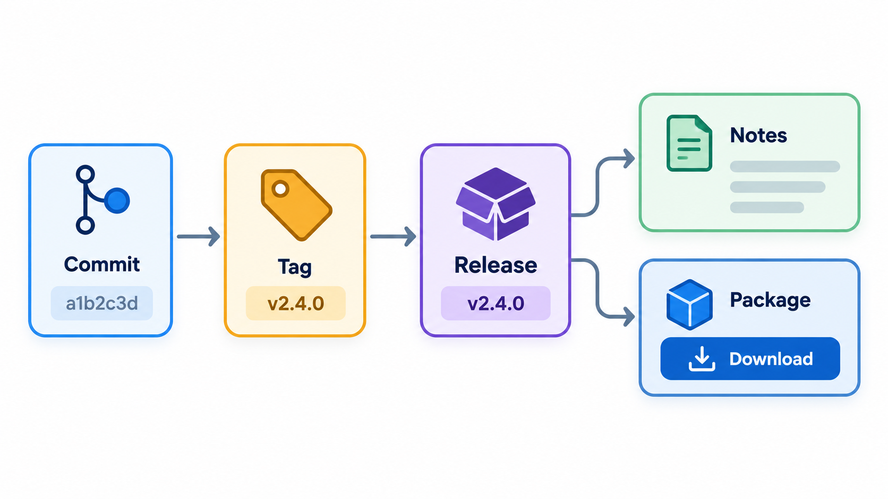
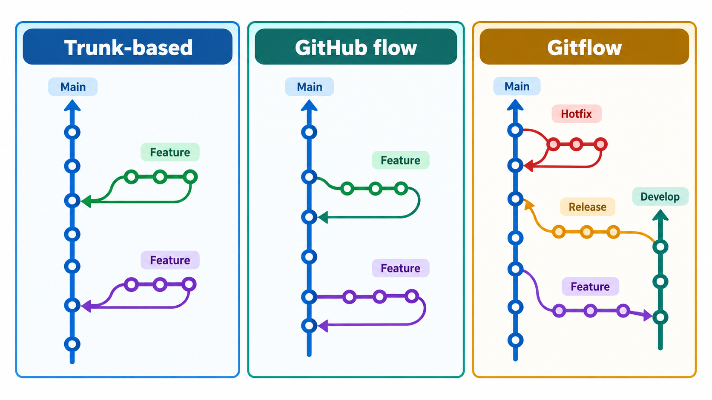

## Knowing Exactly What Is in the Box

A product is made of many parts: source files, settings, libraries, documents, databases. Over time, many people change them. Unless the team can say exactly which version of each part went into a given release, who changed what, when and why, it cannot reproduce a release, trace a fault to its cause, or tell whether a change was authorised.

**Software configuration management**, or SCM, is the discipline of knowing exactly what is in your software, how it got that way, and who changed it. Most of the time it is dull and keeps the project orderly. Occasionally it is the thing that stands between a project and disaster, because an unrecorded change is also how an unauthorised one slips in unseen.

Think of a restaurant that serves a famous dish. If the recipe is kept only in the head of the chef, and several cooks adjust it as they please, nobody can say what the dish is supposed to be, why it tasted different on Tuesday, or how to recreate the version a customer loved last year. Writing down the recipe, giving each version a name, and agreeing who may change it and how, is configuration management for food. Software needs the same care, with the added problem that a change takes a second to make and may touch thousands of files.

## What Is Being Managed

A software system is a collection of many things: source files, build scripts, libraries it depends on, documents, test data, configuration files, database schemas. Together, these form the **configuration**. SCM answers four questions about it.

- **Identification.** What are the items, and how is each one named and versioned?
- **Control.** How are changes proposed, reviewed, approved and made?
- **Status accounting.** What is the current state? Which versions exist, and which changes are approved, pending or done?
- **Audit.** Does what has been built match what was approved? Can we prove it?

Without these, a team cannot answer simple questions. Which version is running in production? What changed between last week's release and this one? Why does the customer's copy behave differently from ours?

## Configuration Items

The things placed under control are called **configuration items**. A useful rule is that anything that can change and can affect the behaviour or understanding of the product is a candidate.

| Kind of item | Examples | What goes wrong if uncontrolled |
| --- | --- | --- |
| **Source code** | Application files, scripts | Lost changes, conflicting edits, no way back |
| **Build and deployment files** | Build scripts, packaging recipes, container definitions | The release cannot be rebuilt the same way |
| **Third-party components** | Libraries, frameworks, tools, with exact versions | An update silently changes behaviour |
| **Configuration data** | Settings for each environment | The system works in test and fails in production |
| **Data definitions** | Database schemas, migration scripts | Code and database fall out of step |
| **Documents** | Requirements, designs, test plans, user guides | Documents describe a system that no longer exists |
| **Tests and test data** | Automated tests, sample data | Tests drift from the product they check |

## Naming and Versioning

Each item needs an identity that does not change and a version that does. A common scheme for released software uses three numbers, major, minor and patch. A change that breaks compatibility raises the major number; one that adds features without breaking anything raises the minor; a fix raises the patch. Between releases, teams also use build numbers that rise with every automatic build, so that any binary can be traced to the exact source that produced it.

| Version | What it tells the reader |
| --- | --- |
| 2.3.1 to 2.3.2 | A bug fix; safe to take |
| 2.3.2 to 2.4.0 | New features, nothing removed; probably safe |
| 2.4.0 to 3.0.0 | A breaking change; read the notes before upgrading |

Good names do more than label. They let anyone look at a version number and know roughly how risky the change is, and they let support staff ask a customer "which version are you running?" and get an answer that points to a definite set of files.

## Baselines: Freezing a Known State

A **baseline** is a version of the configuration that has been formally reviewed and agreed, and that serves as the basis for further work. After a baseline is set, it is changed only through a controlled process. A team might baseline the requirements when they are signed off, the design when it is approved, and the code at each release.

The value of a baseline is that it gives everyone a fixed point. The question "has this changed since we approved it?" has a definite answer, and "what changed?" can be answered by comparing. A common way to detect change is to compute a **fingerprint** of each file, a short value made from its contents by a hash function. If even one character changes, the fingerprint changes completely.

A baseline records a fingerprint of every file at the moment it was approved. A fingerprint is a short code computed from a file's contents: the same contents always give the same code, and any change gives a different one. The baseline need not keep the files themselves to detect a change. Later, the working copy is compared with it.

| File | In the baseline? | Fingerprint matches? | Verdict |
| --- | --- | --- | --- |
| Fee calculation file | Yes | No: a rate was changed from 5 to 50 | Changed since the baseline, needs a change request |
| Report file | Yes | Yes | Unchanged |
| Notes file | No | n/a | New file, not in the baseline |

That, in miniature, is what a version-control system does with every change. Modern systems such as Git identify each version by a fingerprint of its contents, which is why a tampered file is so hard to hide: a change nobody recorded shows up as a mismatch.

<!-- Visual: a baseline freezes a known combination of code configuration and schema. -->

## Change Requests and the Change Control Board

For a change to a baselined item, SCM uses a **change request**: a record that says what is proposed, why, and what it will affect. Someone assesses its impact on cost, schedule and other items. A person or group with authority decides. In large or regulated projects that group is called the **change control board**, or CCB. It typically includes the project manager, a technical lead, a tester and a representative of the customer. In a small team, it might be two people agreeing in a chat.

The aim is not to slow things down. It is to ensure that each change is deliberate, visible and traceable, and that nobody discovers at the last minute that an unreviewed change has gone into a release.

<!-- Visual: controlled change management prevents contract disputes. -->

## How Git Makes This Concrete

Modern teams do SCM largely through a version-control system such as Git, and the older vocabulary maps onto its features.

<!-- Visual: a feature branch diverges from main and later merges back. -->

| SCM idea | In Git and a hosting service |
| --- | --- |
| **Configuration item** | A file or directory in a repository |
| **Version identifier** | A commit hash |
| **Baseline** | A tag on a commit, such as `v2.3.0`, or a protected release branch |
| **Change request** | An issue, and a pull request that proposes the change |
| **Change control board** | Required reviewers, code owners and branch protection rules |
| **Controlled change** | A rule that nothing reaches the main branch except through a reviewed pull request |
| **Release line** | A release branch, receiving only approved fixes |
| **Audit trail** | The commit history, which records who changed what, when and why |

Branches deserve a special mention. A **feature branch** lets a change be developed in isolation and merged only when reviewed. A **release branch** freezes a version for stabilisation, taking only critical fixes. A **hotfix** is a small, urgent change made on the release line and then brought back into the main line. These are all ways to make change controlled and visible, in the same spirit as the older formal process.

<!-- Visual: tags identify exact commits that become documented releases. -->

## Branching Strategies Compared

Teams organise their branches in different ways, and the choice affects how often work is integrated and how risky each merge is.

| Strategy | How it works | Suits | Watch out for |
| --- | --- | --- | --- |
| **Trunk-based** | Everyone commits to one main line, in small steps, often several times a day; unfinished work is hidden behind switches | Teams with strong automated tests and frequent releases | Needs discipline and good tests |
| **Feature branches** | Each feature has its own branch, merged through review when done | Teams that want review of each change | Long-lived branches drift and cause painful merges |
| **Release branches** | The main line continues; a separate branch is cut to stabilise each release | Products with several supported versions | Fixes must be applied in more than one place |
| **Git Flow style** | Several long-lived branches (main, develop, release, hotfix) with strict rules | Products shipped in explicit versions | Heavy for web services released continuously |

The recurring problem is the long-lived branch. The longer work stays apart from the main line, the more the main line moves, and the harder the merge. A **merge conflict** occurs when two people change the same lines in different ways, and a human must decide which change wins. Keeping branches short, merging often and communicating about who is changing what are the best defences.

## Releases Need Names

A released version must be reproducible. Six months later, when a customer reports a problem, the team has to be able to recreate exactly what they received. That means tagging the release, recording the build, and keeping the dependencies that went into it. A release that cannot be rebuilt is a risk.

A reproducible release needs four things recorded: the exact version of the source, the exact versions of every library and tool, the configuration used for the build, and the build instructions themselves. When these are kept together, any release can be rebuilt on demand, which is essential for fixing faults in old versions, for proving what was shipped to an auditor and for recovering after a disaster.

<!-- Visual: three branching strategies organise work with different levels of structure. -->

## Configuration That Differs Between Environments

Software runs in several environments, such as a developer's machine, a test server and production. The code is the same; the settings differ, for example the address of the database or the key for a payment service. A common source of failure is mixing the two. The principle is to keep the **code** identical across environments and keep the **settings** outside it, supplied to each environment separately and stored under the same care. Settings that are secret, such as passwords and keys, need extra protection and must never be placed in the repository. Treating configuration as a controlled item stops the classic failure in which the system works in testing and breaks in production because someone changed a setting by hand.

## The SCM Plan

In larger projects the arrangements are written in a short **SCM plan**. It names the items under control and how they are named, the tools and repository layout, the rules for branches and for approving changes, who sits on the change board, how builds and releases are made and tagged, and how audits are done. The plan need not be long. Its value is that new members can read the rules in one place and the team can notice when practice drifts from them.
