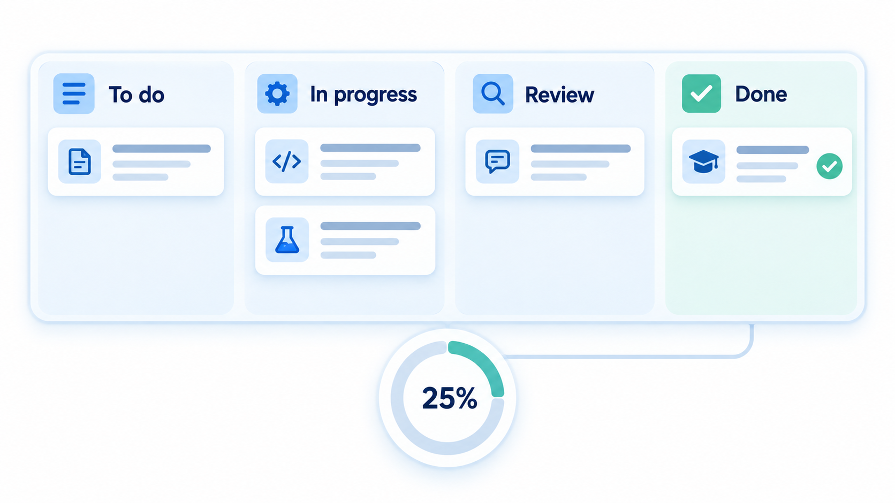
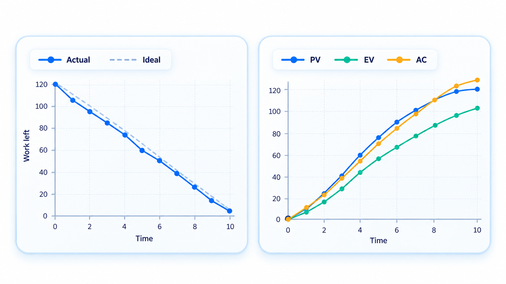
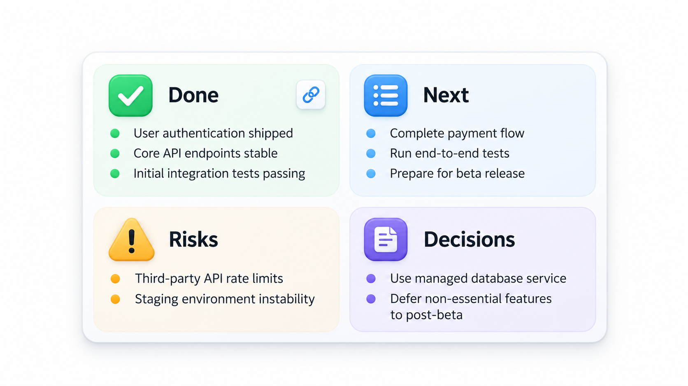
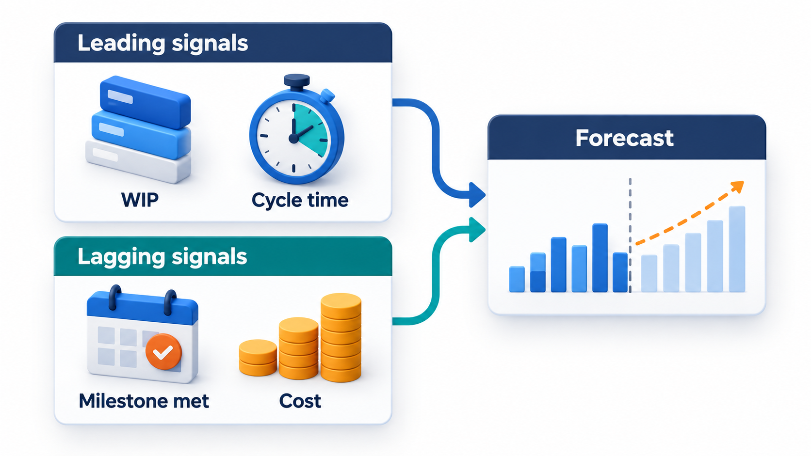
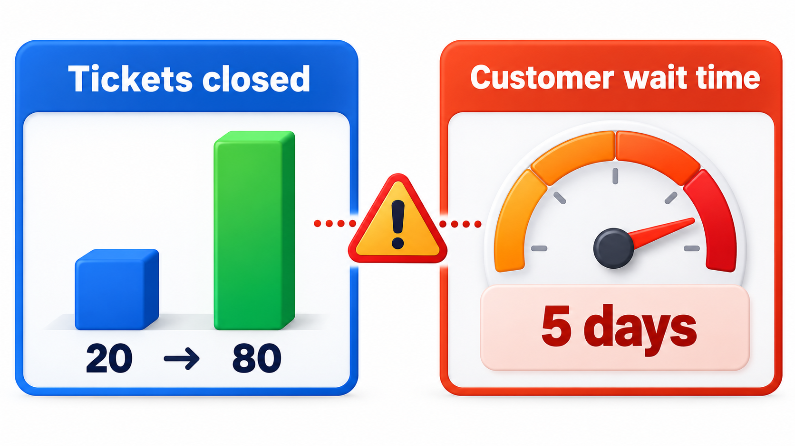

## A Project Becomes a Year Late One Day at a Time

A project does not become a year late in a day. It becomes late through a day lost to an illness, another to a changed requirement, a half-day waiting for a decision. No single slip is worth raising an alarm about, and so none is. A year later, the slips have added up.

The deeper problem is that people who are behind often do not say so. Reports are positive for months, then turn suddenly red at the end. Managers call this a *watermelon* project: green on the outside and red inside. The cure is a way of measuring progress that does not depend on how anyone feels about it. This topic covers the main measures, from the simplest chart to the formulas that combine schedule and cost.

Monitoring is the half of project management that closes the loop. A plan states what should happen; monitoring finds out what did happen; control decides what to do about the difference. A team that plans well and never looks is flying with a map and no instruments. A team that measures a great deal but never acts is an expensive way to watch a failure. The aim is a small set of honest measures, looked at regularly, that trigger decisions while there is still time to make them.

## Start With the Question

Metrics are tools, and a tool is chosen for a job. A helpful discipline, known as goal-question-metric, starts from what the team is trying to achieve, asks what it needs to know to tell whether it is succeeding, and only then picks the measures.

| Goal | Question | Measure |
| --- | --- | --- |
| Deliver the release on the planned date | Are we on course to finish by then? | Work remaining against time; trend in finished items per week |
| Stay within budget | Are we spending at the planned rate for the value delivered? | Cost index; spend against earned value |
| Ship reliable software | Is quality improving or declining? | Defects found per release; defects that escape to users |
| Work at a pace we can keep up | Is the team healthy? | Overtime; unplanned work; team sentiment in retrospectives |

A measure that does not answer a real question is noise. Asking "which decision will this number help me make?" before collecting it saves much effort.

## Three Kinds of Measure

Measures are usually grouped by what they describe.

| Kind | What it measures | Examples |
| --- | --- | --- |
| **Project** | Progress, cost, schedule, risk | Work remaining, spend, milestones met |
| **Process** | How the team works | Cycle time, review turnaround, deployments per week |
| **Product** | The thing being built | Size, defects, test coverage, performance |

A balanced dashboard draws from all three. A project can look healthy on schedule while the product is quietly decaying, or deliver a strong product at a cost the team cannot sustain.

## Measure Finished Work, Not Effort Spent

The first principle is to count what is done, not what has been worked on. A task that is "90 per cent complete" for three weeks is a familiar story; the last tenth is where the testing and fixing live. Measures that count only items that meet the agreed definition of done avoid it. A story is either finished or it is not.

<!-- Visual: only finished work contributing to measured progress. -->

## Burn-down: How Much Is Left

A **burn-down chart** plots the work remaining against time. The ideal line goes from the total at the start straight down to zero at the end. The actual line shows reality. If it sits above the ideal, the team is behind. If the line runs flat, nothing is being finished. If the actual line suddenly drops near the end, a lot of work was left to the last moment. Agile teams use burn-down charts for a sprint or for a whole release. A related **burn-up** chart plots work completed against the total scope, which has the advantage that a change in scope shows as a change in the target line and not as a hidden rise in the backlog.

Reading the shapes is a skill. A line that falls steadily with small wobbles is a healthy team. A staircase, with long flat steps and sudden drops, suggests work is started together and finished together, hiding the true state until the end. A line that falls and then rises means new work is entering faster than old is finishing. A line that stays above the ideal and does not converge is a forecast of a missed date, visible weeks before the date arrives.

## Flow Measures: Cycle Time and Throughput

For teams working as a continuous stream, the useful measures are how long an item takes and how many are finished. **Cycle time** is the time from starting an item to finishing it. **Throughput** is the number finished per week. Plotting cycle times shows whether the team is predictable: a tight cluster means reliable forecasts, and a long tail of very slow items means something is getting stuck. Both measures use only data the team already has, and they require no estimates.

These measures support honest forecasts. If 85 per cent of past items finished within eight days, then a new item can be promised in eight days with that level of confidence. If the team finishes about 12 items a week and 60 remain, the work will take about five weeks, give or take. Neither forecast needs anyone to estimate individual tasks, which is why many teams find them more accurate than estimates.

## Earned Value: Schedule and Cost Together

On larger projects, a method called **earned value management** combines schedule and cost in one set of numbers. It was developed for large defence programmes in the 1960s. It uses three quantities.

| Quantity | Meaning |
| --- | --- |
| **Planned value (PV)** | The budgeted cost of the work that should have been done by now |
| **Earned value (EV)** | The budgeted cost of the work actually completed |
| **Actual cost (AC)** | The money actually spent so far |

From them come two indices. The **schedule performance index**, SPI = EV / PV, says how fast the work is going compared with the plan. Below 1 means behind. The **cost performance index**, CPI = EV / AC, says how much value is earned for each rupee spent. Below 1 means over budget.

Take a project with a budget of Rs 1,00,000 over a 10-week plan, measured after week 4. The plan said 40 per cent should be done by now; the team has actually completed 30 per cent, and has spent Rs 45,000.

| Measure | Working | Result |
| --- | --- | --- |
| Planned value | 40% of Rs 1,00,000 | Rs 40,000 |
| Earned value | 30% of Rs 1,00,000 | Rs 30,000 |
| Actual cost | Money spent so far | Rs 45,000 |
| Schedule index | 30,000 / 40,000 | 0.75 (below 1 means behind) |
| Cost index | 30,000 / 45,000 | 0.67 (below 1 means over budget) |
| Forecast final cost | 1,00,000 / 0.67 | about Rs 1,50,000 |

The 10,000 gap between planned and earned value is progress that has not been made. The schedule index says the team is working at three quarters of the planned pace. The cost index says each rupee is buying only about 67 paise of progress. The last line is a warning, not a verdict: if the efficiency stays at 0.67, the project will cost near Rs 1,50,000. Seeing that at week 4 allows a decision to be made at week 4.

Two simple variances say the same thing in money. The *schedule variance* is EV minus PV (here minus Rs 10,000) and the *cost variance* is EV minus AC (here minus Rs 15,000). Negative numbers mean behind schedule and over budget. The forecast at completion, budget divided by the cost index, assumes the current efficiency continues; a more optimistic forecast would assume the cause of the overrun has been fixed and add only the overspend so far to the original budget. Showing both gives the sponsor a range, from about Rs 1,15,000 to Rs 1,50,000.

<!-- Visual: burn-down and earned-value views of project progress. -->

## Honest Status Reporting

Reports are only as good as the culture behind them. A common format is the traffic-light status: green for on track, amber for at risk, red for off track. It is quick, and it is easily abused, because amber is socially awkward and red is career-threatening, so everything stays green until it is suddenly red. Three habits improve it.

- **Define the colours by evidence, not feeling.** For example: green means within 5 per cent of plan, amber means 5 to 15 per cent behind with a recovery plan, red means more than 15 per cent behind or a milestone at risk.
- **Report the trend and the reason, not only the colour.** "Amber, because the gateway approval is two weeks late; we are trying two alternatives; decision on Friday."
- **Reward early bad news.** A manager who thanks the person who reports a problem gets more reports and earlier ones. One who shoots the messenger gets surprises.

## Leading and Lagging Signals

A good dashboard has a mix of signals. **Lagging** measures such as finished work, defects found in production, and cost to date describe what has already happened. **Leading** measures such as the size of the backlog of unreviewed changes, the age of open blockers, and the trend in cycle time suggest what will happen next. A project is easier to steer when it watches both.

<!-- Visual: leading and lagging signals combine into a better forecast. -->

## Delivery Metrics: A Short Look at DORA

A research programme called DORA studied thousands of software teams and found four measures that distinguish high performers: how often they deploy, how long a change takes from commit to production (**lead time for changes**), what fraction of deployments cause a failure (**change failure rate**), and how quickly they recover (**time to restore service**). The first two measure speed, the last two measure stability, and the finding that the best teams are strong on both is useful for anyone who thinks speed and quality are opposites. They are measures of how well the *delivery system* works, and they describe a team's process and not individual people.

## Metrics Can Mislead

A measure becomes a target, and when it does, people adapt to it, not to the goal. Count lines of code, and code grows longer. Reward the number of tickets closed, and tickets are split into tiny pieces. Track velocity as a performance score, and the estimates inflate. The defence is to choose measures that are hard to game, to use them for learning and not for judging individuals, and to look at several together. A measure should answer a question the team really has, such as "will we make the date?" or "are we getting faster at delivery?".

<!-- Visual: a metric being used as a target, with the measure rising while the actual goal stays flat, labelled "the number improves, the outcome does not". Save as images/40_metric_gaming.png. -->

## Acting on What the Numbers Say

A measure matters only if it leads to a decision. When monitoring shows a gap, the manager has a short list of responses.

| Situation | Possible responses |
| --- | --- |
| Behind schedule on the critical path | Remove obstacles, add focused help, reduce scope, move the date |
| Over budget at a steady rate | Cut scope, find cheaper ways, ask for more money with evidence |
| Quality declining | Slow feature work to fix causes; add tests and reviews |
| Scope growing | Re-baseline with the sponsor; apply change control |
| Team strained | Reduce work in progress; protect time; reset the pace |

The choice should be made with the sponsor and the team, with the numbers visible. The worst response is silence: continuing as if nothing has changed and hoping the data are wrong.

## Five Misreadings of Project Metrics

**"Percent complete tells you where you are."** It is usually a guess. Count finished items against an agreed definition of done.

**"Green status means the project is healthy."** Status is what someone chose to report. Trends in finished work and cycle time are harder to colour.

**"More metrics means better control."** A few measures that the team understands and uses beat a dashboard nobody reads.

**"Earned value is only for big government projects."** The core idea, comparing finished value with planned value and with spending, works at any scale and takes a few lines of arithmetic.

**"Productivity metrics should rank people."** They describe a system. Ranking individuals by them rewards gaming and damages cooperation.
