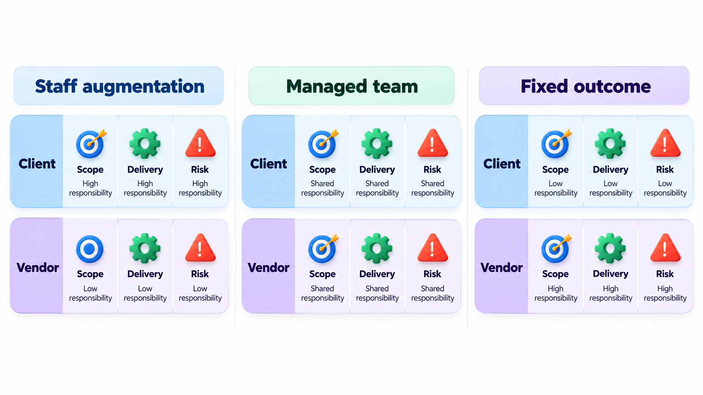
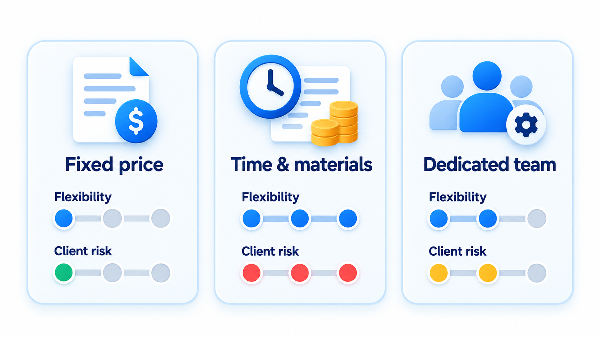
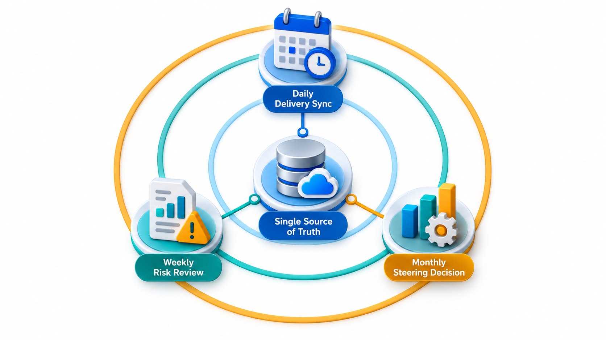
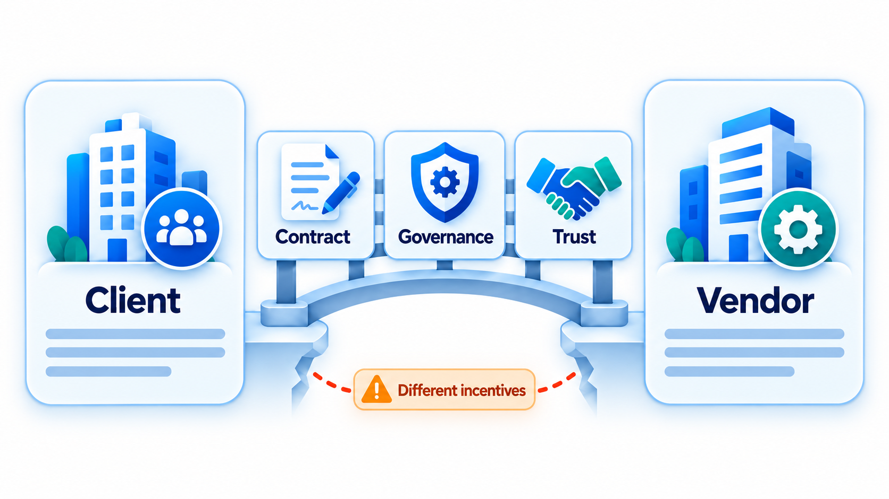
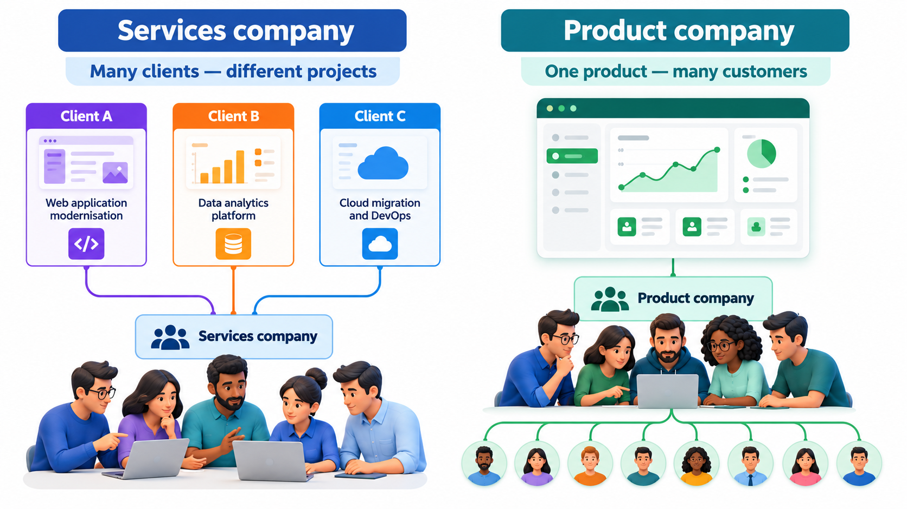

## Buying Someone Else's Hours

Every organisation faces a simple question: should we do this work ourselves, or pay someone else to do it? And if someone else, on what terms? The terms matter as much as the choice, because they determine who carries the risk when estimates turn out wrong. Outsourcing grew into a global industry because many companies found that a capable external team, working to well-defined tasks at lower cost, was worth more than building the capability in-house.

This topic looks at the common ways of engaging an outside team and what each one does to cost, control and risk.

For a student entering the Indian software industry the topic is more than academic. A large share of the sector's work is done for clients elsewhere under exactly the arrangements described below, and many graduates begin careers inside a services company working to a contract. Understanding how those contracts allocate risk explains many things about the daily life of such work: why scope is guarded, why time is recorded, why changes need approval and why a project that goes wrong produces an argument as well as a delay.

## Why Organisations Outsource

The usual reasons are cost, access to skills, speed and focus. A company may find that building a payments integration outside its core business is cheaper and quicker with a specialist. It may need forty engineers for six months, not a permanent team. Or it may want its own people to concentrate on what makes it different. There are also reasons not to. Outsourcing can hide knowledge outside the company, add coordination, and put the company at the mercy of a supplier's priorities. The knowledge of the business, the part of the work nobody writes down, stays with the people who do it.

A useful way to decide is to separate what is *core* from what is *context*. Core work is what makes the organisation different and gives it an advantage, such as the matching algorithm of a tutoring platform; it is usually kept close. Context work is necessary but not distinctive, such as running servers or building a standard admin portal; it is a natural candidate for buying. The risk is misjudging the line: work that looks like context today may become core tomorrow, and handing it away is hard to undo.

## Where the Work Is Done

Outsourcing is also described by location.

| Option | Where the team sits | Strength | Weakness |
| --- | --- | --- | --- |
| **In-house** | In the organisation's own offices | Full control; knowledge stays | Cost and speed of hiring; fixed headcount |
| **Onshore** | An external firm in the same country | Same time zone, language and law | Higher rates than offshore |
| **Nearshore** | An external firm in a neighbouring country or similar time zone | Reasonable overlap with lower cost | Cultural and legal differences remain |
| **Offshore** | An external firm far away, often in a lower-cost country | Lowest rates; large talent pools | Time-zone gaps, communication effort, distance from the user |
| **Captive centre** | The organisation's own subsidiary in another country | Control and low cost together | Needs investment and management at scale |

Many arrangements mix them. A product may be designed by a small in-house team and built by an offshore partner, with a nearshore team handling testing, so that the working hours overlap in a chain.

## Three Common Engagement Models

**Fixed price.** The supplier agrees to deliver a defined scope for a set price. The client knows the cost in advance. The supplier takes the risk of overrun, so it adds a margin, and it resists changes, since each costs it money. Fixed price suits work that is well specified and unlikely to change. It is a poor fit for work where the requirements are uncertain, because the arguments over scope can sour the relationship.

**Time and materials.** The client pays for the hours worked at agreed rates. Flexibility is high, as the client can change direction at any time. But the client carries the risk of overrun, and the supplier has no direct incentive to finish sooner. It suits uncertain work and long relationships, provided there is trust and good visibility of the work.

**Dedicated team (and variants).** The supplier provides a team that works only for the client for a long period, at a monthly cost, and the client directs its work. It is close to hiring staff without the employment. A variant called *build-operate-transfer* has the supplier set up and run a team, and later transfer it to the client's ownership.

A fourth style, **outcome-based pricing**, ties payment to results such as tickets resolved or sales generated. It is attractive in principle but needs measures both sides trust.

| | Fixed price | Time and materials | Dedicated team | Outcome-based |
| --- | --- | --- | --- | --- |
| **Client's cost certainty** | High | Low | Medium (monthly cost is known) | Medium |
| **Flexibility to change** | Low | High | High | Medium |
| **Who bears overrun risk** | Vendor | Client | Client | Shared |
| **Needs a clear scope** | Yes | No | No | Needs clear measures |
| **Best for** | Well-defined work | Exploratory work | Long-running product work | Operations and support with measurable results |

## Who Carries the Risk?

The best way to see the difference between fixed price and time and materials is to compare them when the estimate turns out wrong. Assume an estimate of 1,000 days at Rs 5,000 a day. The fixed price includes a 20 per cent margin for taking on the risk: 1,000 x 5,000 x 1.2 = Rs 60,00,000, and it does not change whatever happens to the effort. Time and materials is simply the real days times the rate.

| Real effort | Client pays, fixed price | Client pays, time and materials | Vendor margin under fixed price |
| --- | --- | --- | --- |
| 800 days | Rs 60,00,000 | Rs 40,00,000 | Rs 20,00,000 |
| 1,000 days | Rs 60,00,000 | Rs 50,00,000 | Rs 10,00,000 |
| 1,300 days | Rs 60,00,000 | Rs 65,00,000 | Rs -5,00,000 (loss) |
| 1,600 days | Rs 60,00,000 | Rs 80,00,000 | Rs -20,00,000 (loss) |

If the work takes 800 days, the client pays Rs 20,00,000 more under fixed price than the work cost. At 1,000 days the client still pays Rs 10,00,000 more, which is the premium for certainty. If the work takes 1,300 days, the picture flips: time and materials costs the client Rs 65,00,000, and the fixed price is cheaper. At 1,600 days the vendor loses Rs 20,00,000, and a vendor facing a loss tends to cut corners, argue about scope or reduce the team. The point applies well beyond this example: risk does not disappear when it is transferred. It is priced, and it changes behaviour. Choose the model that suits how well the work is understood.

<!-- Visual: flexibility and client risk across three contract models. -->

## Choosing a Vendor

Selecting a supplier is a project of its own. Price is only one of several criteria, and often not the best.

| Criterion | What to look for |
| --- | --- |
| **Relevant experience** | Similar projects in the same domain; references the client can speak to |
| **Technical capability** | The skills the work needs; evidence in their code, designs and people |
| **Process maturity** | How they plan, test, review and report; certifications as a rough signal |
| **Team stability** | Low turnover; the people proposed are the people who will work |
| **Communication** | Language, time-zone overlap, responsiveness during the selling process |
| **Security and compliance** | How they protect data and meet the legal duties of the client's industry |
| **Financial health** | Whether they will still exist for the length of the contract |
| **Cultural fit** | How they handle bad news, disagreement and change |

A common mistake is to select on the lowest bid. A bid that is far below the others usually reflects a misunderstanding of the scope, an expectation of charging for changes later, or a plan to staff the project with the least experienced people. A small paid pilot, in which two candidates do the same real piece of work, is a reliable way to compare them.

## What the Contract Should Cover

Beyond price and scope, a software contract usually contains several clauses that deserve attention.

| Clause | What it settles |
| --- | --- |
| **Scope and deliverables** | What exactly will be delivered, in what form |
| **Acceptance criteria** | How the client will decide that a deliverable is acceptable |
| **Service levels** | Measurable standards, such as response time to faults, availability, bugs fixed within a number of days |
| **Change procedure** | How changes are requested, priced and approved |
| **Intellectual property** | Who owns the code and the designs produced |
| **Confidentiality and data protection** | What the vendor may and may not do with client data |
| **Warranty and liability** | Who fixes defects after delivery and at whose cost; limits on damages |
| **Exit and transition** | How the work is handed back or to another vendor, including code, documents and knowledge |

The exit clause is the one most often forgotten and most often needed. Without a right to the code, the documentation and a period of help with handover, a client can find itself locked in, unable to leave a poor supplier without starting again.

## Governance and Trust

A contract alone does not make an outsourcing relationship work. The relationship also needs a few working arrangements. The client needs a named person who owns the relationship. There should be a regular rhythm of meetings and reports, a clear route for changes, shared access to the work as it progresses (not just final deliveries), and an agreed way to resolve disagreements. Incentives matter: a vendor paid per hour wants more hours, a vendor paid a fixed price wants fewer, and a good arrangement acknowledges both.

<!-- Visual: contract, governance and trust bridging client and vendor incentives. -->

## Risks and How to Reduce Them

Outsourced projects fail in familiar ways, and each failure has a standard defence.

| Risk | What it looks like | Defence |
| --- | --- | --- |
| **Misunderstood requirements** | The vendor builds what was written, not what was meant | Frequent demonstrations; a client-side product owner; examples in the specification |
| **Quality problems** | Defects found late; weak testing | Acceptance tests owned by the client; code access and reviews |
| **Loss of knowledge** | Nobody in the client understands the system | Documentation as a deliverable; client staff paired with the vendor |
| **Lock-in** | Switching is too costly | Ownership of code and data; standard technologies; exit clause |
| **Security and confidentiality** | Data leaves the client's control | Access limits, audits, contractual duties |
| **Communication gaps** | Time zones and language slow decisions | Overlap hours, written decisions, regular video calls |
| **Hidden costs** | Change requests and coordination mount | Clear change procedure; count the client's own management time |

## Services Companies and Product Companies

Software companies in India and elsewhere differ in what they sell, and this shapes the work and the careers within them.

| | Services company | Product company |
| --- | --- | --- |
| **Sells** | Engineering time and expertise to clients | Software that many customers use |
| **Revenue** | Per project, per hour or per team | Subscriptions, licences, usage or advertising |
| **Who decides what to build** | The client, within the contract | The company, from its view of the market |
| **Scale of the work** | Many different clients, many technologies | One product, deepened over years |
| **Typical risk** | Estimates, scope disputes, utilisation of staff | Whether customers want the product |
| **Examples** | Large IT services firms and consultancies | A company that makes and sells its own app or platform |

Neither is better; they train different strengths. A services engineer sees many kinds of system quickly and learns to work to a client's needs. A product engineer sees one system deeply and learns to live with its long-term consequences. Many careers include both.

<!-- Visual: a services company serving several clients with different projects, beside a product company serving many customers with one product. Save as images/41_services_vs_product.png. -->

