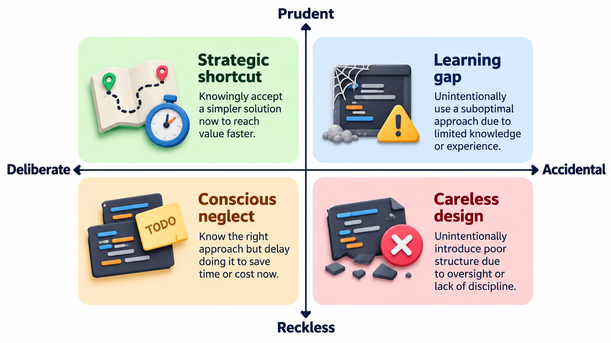
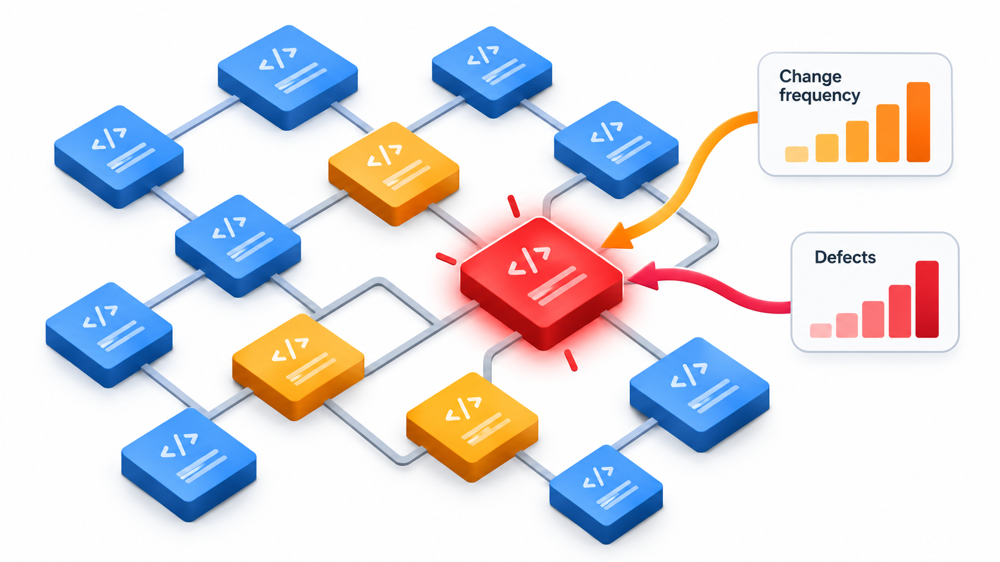
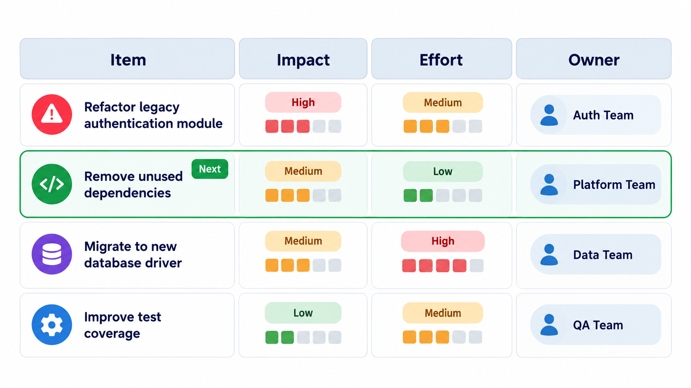
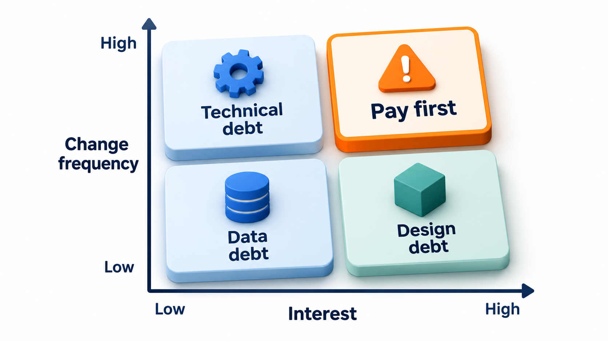
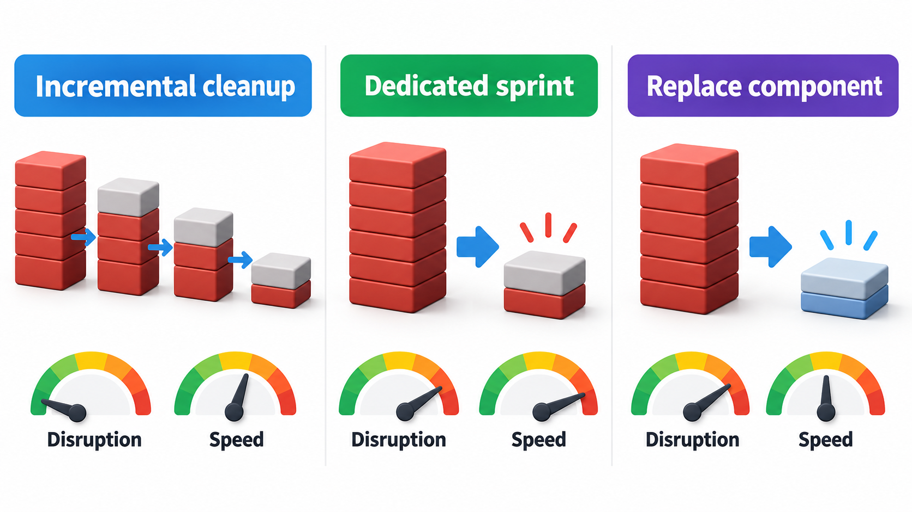
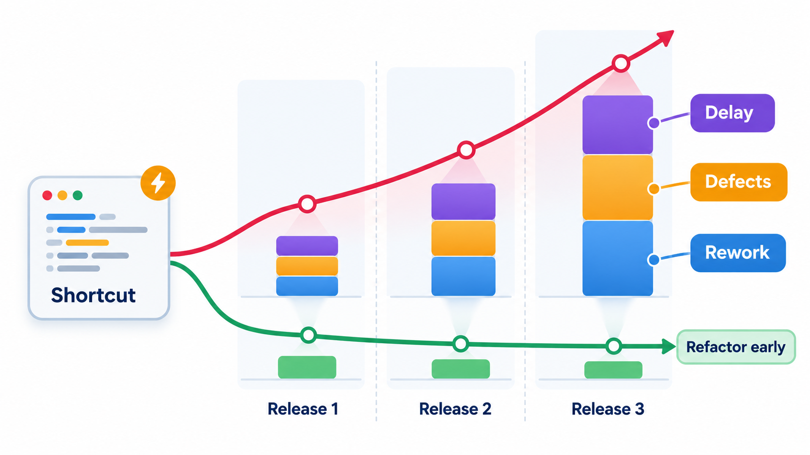

## Borrowing From the Future

Every shortcut in software is a loan. Skipping a clean design, copying a block instead of sharing it, leaving a confusing name: each saves time today and costs time on every later change, like interest on a debt. A small amount of debt, taken knowingly, can speed up a first release. The danger comes from never repaying it, because the interest is paid on every change made nearby, whether or not anyone notices.

This is the idea behind **technical debt**, a metaphor introduced by Ward Cunningham to explain such decisions to non-programmers. It gives a team a language to talk to managers about something that is otherwise invisible: the cost of the past on the future. Managing it means making the debt visible, deciding which items are worth repaying first, and negotiating time for repayment.

Of all the topics in this unit, this is the one most directly connected to the daily experience of working on real software. Almost every codebase a graduate will join carries debt: parts nobody dares touch, tests that are missing or flaky, libraries two versions behind, documents that describe a system that no longer exists. The skill that distinguishes a mature engineer is not avoiding all of it, which is impossible, but knowing which debt is cheap to carry, which is dangerous, and how to make a case for dealing with it.

## Why the Debt Metaphor Works

A loan has three features: the amount borrowed, the interest, and the chance to repay. Each has a counterpart in code.

- The **principal** is the work needed to fix the shortcut: the cost of cleaning up or redesigning.
- The **interest** is the extra cost paid every time someone works in that area: slower changes, more bugs, more time spent understanding.
- The **repayment** is the clean-up itself.

The crucial point is that interest is paid on *use*. Debt in code nobody touches costs almost nothing. Debt in the code that changes every week costs a great deal. This tells a team where to put its effort: not in the ugliest code, but in the ugly code that is touched the most.

The metaphor also explains something that is easy to miss: debt compounds. A shortcut makes the next change harder, so the next change is more likely to be done with another shortcut, which makes the one after harder still. Left alone, a small amount of debt grows into a state in which every change is slow and risky and nobody can say how the system got there.

## Kinds of Debt

Not all debt is equal. Martin Fowler sorted it by two questions: was it chosen deliberately or by accident, and was it prudent or reckless?

| | Prudent | Reckless |
| --- | --- | --- |
| **Deliberate** | "We must ship now and will deal with the consequences" | "We have no time for design" |
| **Inadvertent** | "Now we know how we should have built it" | "What is layering?" |

A deliberate, prudent debt is a legitimate business decision, like a loan taken to seize an opportunity, as long as it is recorded and there is a plan to repay. Reckless debt comes from carelessness or ignorance. Inadvertent but prudent debt is a natural result of learning, and every successful system has plenty.

## Where Debt Lives

Debt is not only in code. It collects in every part of a software product, and each place has its own interest.

| Place | Examples | The interest it charges |
| --- | --- | --- |
| **Code** | Duplicated logic, long tangled functions, unclear names | Slow, error-prone changes |
| **Design and architecture** | Parts that depend on each other in circles; a structure that no longer fits the problem | Features that touch many places; changes that ripple |
| **Tests** | Missing, slow or unreliable tests | Fear of change; bugs escaping; slow releases |
| **Documentation** | Missing, wrong or out of date | Slow onboarding; repeated questions; wrong decisions |
| **Build and release** | Manual steps; fragile scripts; long build times | Slow feedback; risky releases |
| **Dependencies** | Old libraries, unsupported frameworks | Security exposure; forced big upgrades later |
| **Infrastructure** | Hand-configured servers, unrecorded settings | Slow recovery; outages that cannot be reproduced |
| **Knowledge** | Understanding held by one person | Delays and risk when they are away or leave |

Some of these are more dangerous than others. Dependencies and infrastructure debt can turn a quiet problem into an urgent one overnight, when a library loses support or a security flaw is announced. Knowledge debt is invisible until the person leaves.

## How Debt Arises

Debt has causes, and knowing them helps prevent it.

- **Deadline pressure.** The most common and most honest cause: a choice to ship now.
- **Changing understanding.** The problem turned out different from what the design assumed.
- **Lack of skill or knowledge.** Reckless or inadvertent: the team did not know a better way.
- **Entropy through change.** Many small changes, each reasonable, gradually bend the structure out of shape.
- **Neglected maintenance.** Libraries, tools and documents age if no one looks after them.
- **Lack of ownership.** Parts that belong to no one decay.

## Spotting Debt

Debt is found by looking, and a few reliable signals show where.

| Signal | What it suggests |
| --- | --- |
| Developers say "nobody wants to touch that part" | High interest; fear of breakage |
| The same files appear in many bug reports | A hotspot where debt and change meet |
| A small change needs edits in many places | Duplication or tangled structure |
| New joiners take a long time to make a first change | Documentation or structure debt |
| Releases are slow, manual and nervous | Build and release debt |
| Tests fail at random or take hours | Test debt |
| Warnings from tools are ignored for months | Accumulating code-quality debt |

Combining two kinds of data is especially effective. Tools can measure how complex or tangled each file is, and the version-control history shows how often each file changes. The files that are both complex and frequently changed are the **hotspots**, where interest is highest and clean-up pays best. A complicated file that has not changed in three years can safely be left alone.

## Making Debt Visible

The central problem is that debt is invisible to everyone outside the team, and often to people inside it. The first step is to write it down in a **debt register**: a list with a short description of each item, where it lives, what it costs per month in extra effort or risk, and what fixing it would take. Without the list, a request for time to "clean things up" is a request on trust. With it, the request becomes "this module is touched twelve times a quarter and each change costs an extra day, so fixing it for six days pays back in two quarters."

A useful register entry has a handful of fields.

| Field | Example |
| --- | --- |
| **Item** | Fee rules duplicated in five places |
| **Where** | Receipts, reports, export, reminders and the payment page |
| **Interest** | About two extra days each time a fee rule changes, which is six times a year; two bugs last year from places missed |
| **Principal** | Roughly eight days to move the rules into one place and add tests |
| **Risk if ignored** | Wrong amounts shown to students; audit findings |
| **Suggested time to repay** | Next quarter, before the new scholarship rules |

<!-- Visual: a visible debt register helps teams choose what to repay next. -->

## Deciding When to Repay

Repaying debt is an investment, and it makes sense when the saving exceeds the cost. Suppose a shortcut saved 5 days when it was taken. Now every change in that area costs one extra day, and repairing it would take 8 days.

| Changes made in that area | Interest paid so far | Cost of repaying | Position |
| --- | --- | --- | --- |
| 1 | 1 day | 8 days | Living with it is cheaper |
| 2 | 2 days | 8 days | Living with it is cheaper |
| 4 | 4 days | 8 days | Living with it is cheaper |
| 6 | 6 days | 8 days | Living with it is cheaper |
| 8 | 8 days | 8 days | Break-even |

After 8 changes the interest paid equals the cost of repaying. If the team expects more than 8 changes to this area, repaying wins. If it expects fewer, living with the debt is cheaper. A module changed twice a month passes the break-even in four months. A module changed twice a year would take four years, and repaying it is not worth doing yet. The model is simple on purpose: real interest also includes bugs and slow onboarding, which can make repayment worth more. But a team that can say "we expect 20 changes here this year" has a basis to argue for the clean-up.

<!-- Visual: technical debt is prioritized by its interest and frequency of change. -->

## Ranking Several Items

A team usually faces many items and can repay only a few. A simple way to rank them is by the ratio of benefit to effort, with risk as a tie-breaker. Take four items from a register.

| Item | Extra effort per quarter (interest) | Days to fix (principal) | Pays back in | Risk | Order |
| --- | --- | --- | --- | --- | --- |
| Fee rules duplicated in five places | 12 days | 8 days | Under one quarter | Wrong amounts | 1 |
| Payment library two major versions old | 2 days | 10 days | Five quarters | Security exposure, forced upgrade | 2, because of the risk |
| Slow, flaky test suite | 8 days | 15 days | Two quarters | Bugs escaping | 3 |
| Old reporting module, rarely changed | 0.5 days | 12 days | Over six quarters | Low | 4, or leave |

The fee rules come first: large interest, cheap to repay. The old payment library ranks second not because of its interest but because of the risk of a security flaw or an enforced upgrade at a bad time. The reporting module is ugly but quiet, and the sensible decision is to leave it. The table is a prompt for discussion, not an answer, but it makes the discussion about evidence.

## Ways to Pay Debt Down

Different debts call for different repayment strategies.

| Strategy | How it works | Best for |
| --- | --- | --- |
| **Tidy as you pass** | Leave each file a little cleaner than you found it when working there for another reason | Small, scattered code debt |
| **A steady share of capacity** | Reserve a fixed portion of every cycle, often 10 to 20 per cent, for debt work | Keeping the balance from growing |
| **A focused clean-up task** | Plan a specific item with a goal and a result | Hotspots where the payoff is clear |
| **Incremental replacement** | Replace an old component piece by piece behind a stable interface, while the old one keeps running | Large architectural debt |
| **Automate the manual** | Script builds, releases and checks | Build, release and infrastructure debt |
| **Upgrade on a schedule** | Keep dependencies within one or two versions of current | Dependency debt |
| **Write it down** | Add missing documentation and records of decisions | Knowledge debt |

Large rewrites are the most tempting strategy and the least reliable. They take longer than planned, they deliver no value until finished, and they often reproduce the old problems because the old system contained knowledge nobody wrote down. Replacing piece by piece, while the system keeps working, is slower to start and much safer.

## Negotiating Time for Repayment

Getting time to pay debt down is a conversation with the people who control the schedule, and it goes better with evidence. Useful approaches are to tie repayment to a business goal ("this module blocks the payment feature we promised"), to show the interest ("this area has caused five of our last ten bugs"), to propose small and regular repayment, such as a fixed share of each sprint, rather than a large rewrite, and to repay in the course of other work, tidying code as you pass through it. A team that never asks for time for debt will, in the end, be given no time for anything else.

Equally, debt should not be repaid for its own sake. Perfecting code that is stable and untouched is waste. Debt is a tool and not a sin, and the aim is to hold it at a level the team can carry.

<!-- Visual: technical debt adds weight to every later feature. -->

## Preventing Unwanted Debt

Repayment is half the answer; the other half is to take on less debt that nobody chose. Practices that help include a clear definition of done that includes tests and review, so that "finished" does not mean "finished with a shortcut"; code review, where a second pair of eyes questions the shortcut; automated checks that fail the build for new serious problems; design discussions before large changes; regular upgrades so that dependencies never fall far behind; and recording every deliberate shortcut, with the reason and a date by which to revisit it. A shortcut that is written down is a loan; one that is not is a leak.
