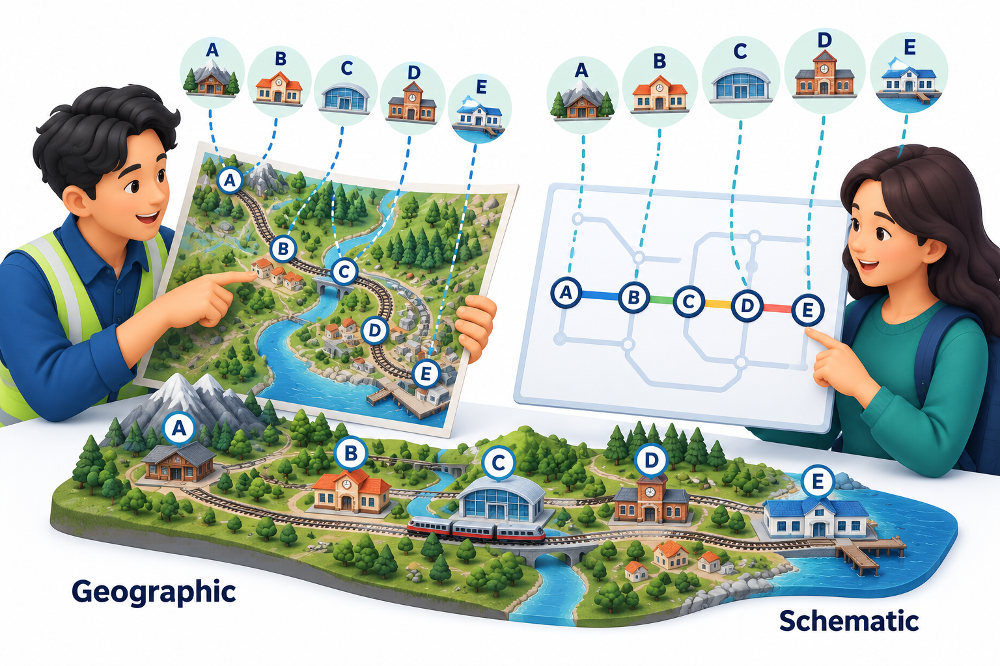
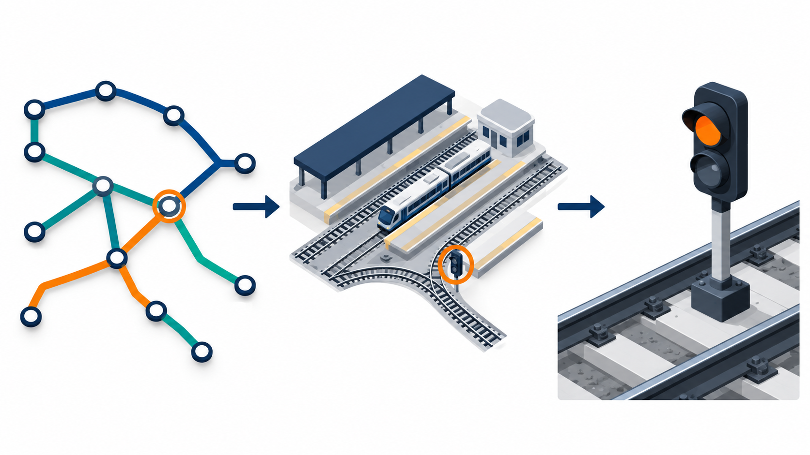
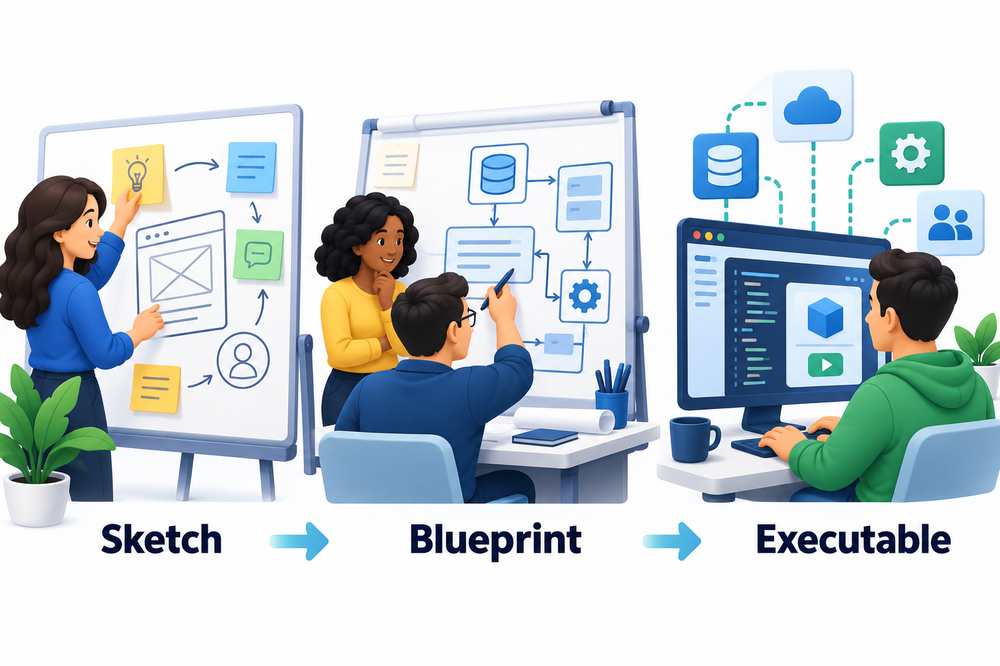
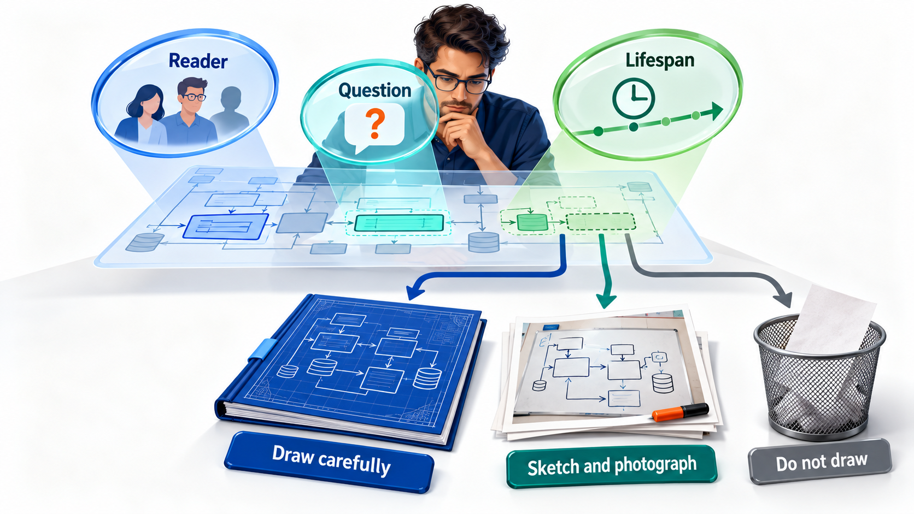

## A Model Is Wrong on Purpose

The most famous map of an underground railway is wrong about almost everything a normal map shows. Distances are distorted, curves are straightened, the crowded centre is spread out and the suburbs are squeezed in. It succeeds anyway, because a passenger on a train does not care how far apart stations are on the surface. They care about two things: the order of the stations on each line, and where they can change to another.

That diagram is a **model**: a simplified representation of something real, built to answer particular questions. By leaving out what the traveller does not need, it makes what the traveller does need easy to see. That is the whole philosophy of modelling, and it applies to software as much as to a railway.

Modelling is older than software and wider than diagrams. Engineers build scale models of bridges and test them in wind tunnels; architects make cardboard models of buildings; economists write equations to stand for a market. In each case something too large, too costly or too complicated to experiment with directly is replaced by something smaller that behaves like it in the ways that matter. Software engineering borrows the idea and adds a reason of its own: software has no physical form, so a model is often the only way to see it.

## What a Model Is For

Software is invisible. A bridge can be photographed and a building walked through, but a program of a million lines has no shape to look at. A model gives it one. Engineers draw models for four main reasons.

- **To understand.** Drawing a system forces you to decide what its parts are and how they relate. Gaps in understanding show up as parts of the picture you cannot draw.
- **To communicate.** A diagram on a whiteboard gets a team of five to agree on one design in ten minutes, where a page of prose would be read five different ways.
- **To decide.** It is cheaper to find that a design is flawed on a sketch than in code. Several alternatives can be drawn and compared in an afternoon.
- **To document.** Months later, a model can show a new person how the system fits together without reading every file.

A model is a means, not an end. A diagram that nobody reads, or that is never updated, has wasted its cost.

<!-- Visual: two maps of the same railway, one geographic with accurate distances and one schematic showing only lines and interchanges. -->

## Models of What Exists and Models of What Will Exist

Models serve two directions of work. A **descriptive** model captures a system that already exists, to understand it: a drawing of how an old billing system's parts connect, made so that a new team can safely change it. A **prescriptive** model describes a system that has not yet been built, to guide its construction: the design from which developers will work. Most projects need both. A team replacing a legacy system describes the old one and prescribes the new, and the difference between the two models is, in effect, the work to be done.

The distinction matters because the standards differ. A descriptive model is judged by how faithfully it matches reality; if it is wrong the team will be misled. A prescriptive model is judged by how well it guides construction and how readily it can be checked against the result.

## Abstraction: Deciding What to Leave Out

The skill underneath all modelling is **abstraction**: choosing which details matter for the question and ignoring the rest. The railway map abstracts away distance. A software engineer drawing a library system decides that a `Book` has a title and the number of copies, and ignores its weight and colour. A different model of the same library, made for a delivery company, would keep the weight and ignore the title.

Take a small metro with three lines, and keep only the order of stations on each.

| Line | Stations in order |
| --- | --- |
| Red | Central, Market, Park, Airport |
| Blue | Harbour, Market, University |
| Green | University, Park, Stadium |

That is the whole model. There are no distances, no coordinates and no street names. From it alone, the passenger's question can be answered: where must I change?

| Station | Lines serving it | What the traveller learns |
| --- | --- | --- |
| Central | Red | Only the Red line |
| Market | Red, Blue | Change here between Red and Blue |
| Park | Red, Green | Change here between Red and Green |
| University | Blue, Green | Change here between Blue and Green |
| Stadium | Green | Only the Green line |

That is all a traveller needs to plan a journey from Central to Stadium: take the Red line to Park and change to Green. The model answers its question and ignores everything else. A model with more detail, such as real distances, would answer more questions but would also be harder to read and to keep up to date. Each addition has a price.

## Three Kinds of Abstraction

Modellers use abstraction in three distinct ways, and recognising them helps in both drawing and reading.

| Kind | What it does | Example |
| --- | --- | --- |
| **Hiding detail** | Leaves out what the question does not need | Showing a payment service as one box, hiding its internals |
| **Grouping** | Treats a collection as one thing | A "Fee module" containing many classes, shown as a single package |
| **Generalising** | Describes what several things share, ignoring how they differ | "Payment method" standing for card, UPI and net banking |

Good models use all three together to keep a picture small enough to take in at a glance while still being true to the system.

## Many Views of One System

No single model can show everything. A building has a floor plan, an electrical plan, a plumbing plan and a view of its structure, each drawn for a different person and a different question. Software is the same. One view shows the parts and how they are connected. Another shows the order of messages in one interaction. Another shows what a user can do. Another shows how the system is placed on servers. Each leaves out the rest.

This is why the notation used for software offers many kinds of diagram and not one grand diagram. The choice of view should follow the question. To ask "how do the parts connect?" draw the structure. To ask "what happens when a customer pays?" draw the sequence.

Views must agree with each other. If the class diagram shows that a `Loan` belongs to one `Member`, the sequence diagram must not show a loan shared between two. Inconsistency between views is one of the commonest signs of a design that is not yet understood, and finding it is one of the benefits of drawing more than one.

<!-- Visual: different model levels reveal only the detail needed for a question. -->

## What Makes a Model Good

A model is judged against the purpose it was made for, but several qualities apply almost everywhere.

| Quality | The question | A failure |
| --- | --- | --- |
| **Fit for purpose** | Does it answer the question it was drawn for? | A detailed diagram that does not help the decision at hand |
| **Accurate** | Is what it shows true of the system? | An out-of-date diagram that misleads |
| **Consistent** | Do the parts and the other models agree? | Two diagrams that contradict each other |
| **Simple enough** | Can a reader take it in? | A single page crowded with fifty boxes |
| **Understandable by its audience** | Will the intended reader follow the notation? | Formal symbols shown to a customer who has never seen them |
| **Maintained or disposable** | Is it kept current, or honestly marked as a sketch? | A sketch left on a wiki for years, mistaken for the truth |

The last point deserves attention. A model that lives in a repository without a date or an owner is a trap. It may be accurate today and wrong next month, and a reader cannot tell. A short label saying "sketch from the March design meeting, not maintained" is honest and useful.

## How Detailed Should a Model Be?

Models sit on a scale from a rough sketch to a precise blueprint to something a computer can run.

- A **sketch** is drawn quickly, usually on a whiteboard or paper, to think and to talk. It is disposable and often incomplete. Most modelling in practice is this.
- A **blueprint** is drawn carefully, to specify a design that others will build. It is more complete and kept up to date.
- An **executable model** is detailed enough that a tool can generate code or run it. This is rare, used in some embedded and safety-critical fields.

The right level depends on cost and risk. For a short-lived college project, a sketch on a whiteboard is plenty. For an aircraft system, a blueprint-level model that can be traced and verified may be required.

<!-- Visual: sketch, blueprint and executable levels of a software model. -->

## A Simple Way to Build a Model

Whatever the notation, a useful sequence of steps applies.

1. **Start with the question.** Write it down: "Which parts of the system touch student data?" A model without a question grows without limit.
2. **Choose the audience.** A model for the team can use technical terms; one for a customer must use theirs.
3. **List the things that matter.** Name the handful of elements the question depends on, and no others.
4. **Draw a first version quickly.** Boxes and lines, accuracy over beauty.
5. **Check it against reality.** Walk a real scenario through the diagram. What does it miss? What does it wrongly include?
6. **Simplify.** Remove everything that did not help answer the question.
7. **Decide its future.** Keep and maintain it, or label it as a sketch and let it go.

## When a Model Is Not Worth Drawing

Models are not free. Drawing takes time, and keeping a diagram in step with the code takes more. A model is worth it when it helps people decide, communicate or reason about something that is hard to hold in the head. It is not worth it when it only restates what the code already says clearly, when it will be out of date in a week, or when nobody will look at it.

Some useful questions before drawing: Who will read this, and what will they do with it? What question does it answer? How long will it stay true? If the answers are "nobody", "none" and "a few days", skip the diagram, or draw it on a whiteboard and photograph it. The goal is understanding, and a diagram is one way to reach it.

<!-- Visual: a decision flow asking who will read the model, what question it answers and how long it stays true, ending in "draw it carefully", "sketch it and photograph it" or "do not draw it". Save as images/43_is_a_model_worth_drawing.png. -->

