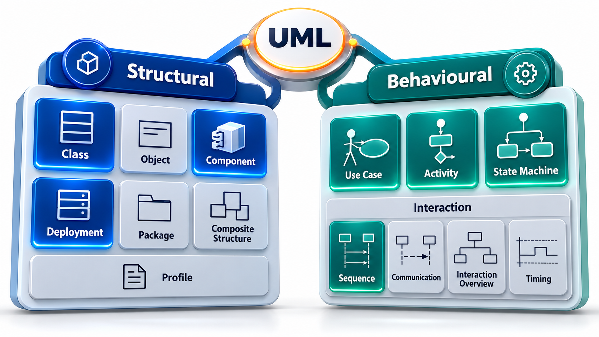
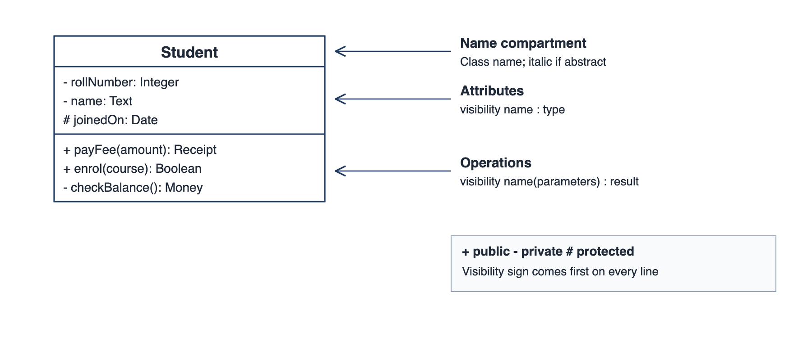
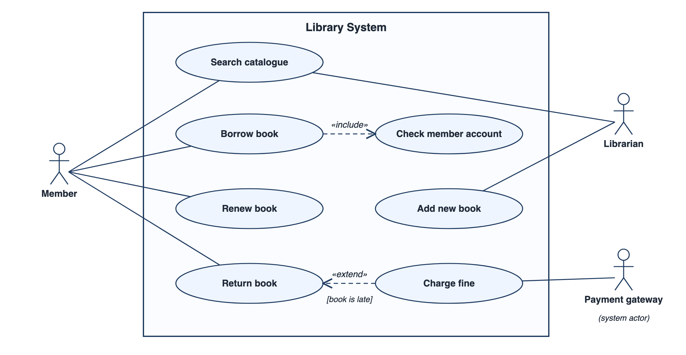
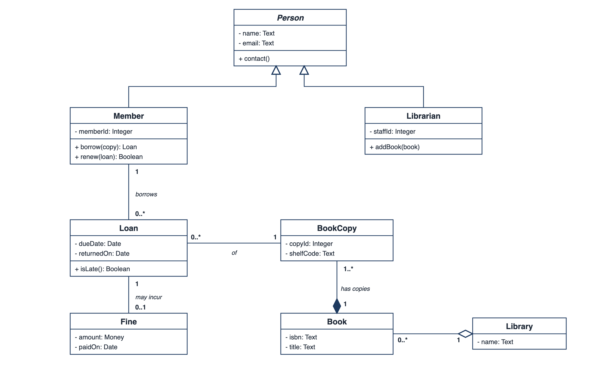
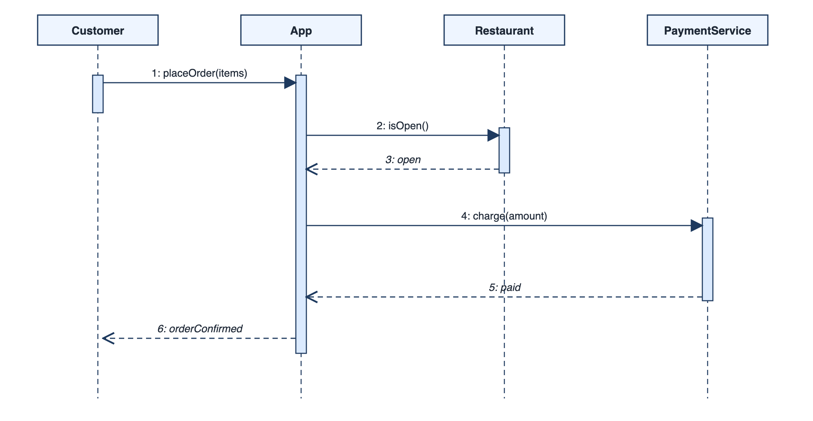

## When Everyone Draws a Class Differently

Imagine a team where one member draws a circle to mean a class, another uses the same circle for a process, and a third uses it for a goal. Each diagram makes sense to its author and none can be read by the others. For years, in the early days of object-oriented design, this was the normal state of affairs, with a dozen competing notations and tools that could not exchange files.

The **Unified Modeling Language**, or UML, ended that by agreeing one vocabulary of boxes, lines and symbols, so that a diagram drawn in one place can be read in another. It is not a method: it does not say how to run a project or in what order to draw. It is a *notation*. This topic gives the map of that vocabulary, so that each diagram can be placed in the family it belongs to.

A notation is the same kind of thing as the symbols of circuit diagrams or sheet music. A trained reader can look at a page and know what is meant without asking the author. The shared meaning is what gives the notation its worth, and it is also what makes careless use costly: a diagram that uses a familiar symbol in an unfamiliar way will be misread by every trained reader. This topic therefore combines two aims, to teach the map and to encourage care in using it.

## Two Families: Structure and Behaviour

UML 2 defines fourteen kinds of diagram. They divide into two families, according to the kind of question they answer.

**Structural diagrams** show what a system is made of: the parts and how they are arranged and connected, at one moment, regardless of time. They answer questions like "what are the classes?", "what components make up the system?" and "which servers does it run on?".

**Behavioural diagrams** show what a system does: how it responds, in what order, how states change over time. They answer "what happens when a customer pays?", "what states can an order be in?" and "what can a user do?".

| Family | Diagram | The question it answers |
| --- | --- | --- |
| **Structural** | Class | What kinds of thing exist, and how are they related? |
| | Object | What does a particular snapshot of those things look like? |
| | Component | What are the replaceable parts, and what do they offer and need? |
| | Deployment | What runs on which machine? |
| | Package | How are the parts grouped? |
| | Composite structure, profile | Internal structure of a part, and extensions of the notation |
| **Behavioural** | Use case | What can each kind of user do with the system? |
| | Activity | What is the flow of work, including decisions and parallel steps? |
| | State machine | What states can something be in, and what moves it between them? |
| | Sequence | In what order do the parts exchange messages in one scenario? |
| | Communication, timing, interaction overview | The same messages with other emphasis |

Nobody uses all fourteen. In practice, five or six account for nearly all the diagrams drawn: use case, class, sequence, activity, state machine, and component or deployment.

<!-- Visual: the fourteen UML diagram types arranged as a tree with two branches, structural and behavioural, with the most-used ones highlighted. Save as images/44_uml_diagram_family.png. -->

## Choosing a Diagram by the Question

The most practical skill is picking the diagram from the question, not the other way round. A team that starts with "we should draw a class diagram" often produces a diagram nobody needed. A team that starts with "what do we not yet understand?" picks the right one.

| If the question is... | ...draw a |
| --- | --- |
| Who uses the system, and for what? | Use case diagram |
| What are the main things in the problem, and how are they linked? | Class diagram |
| What happens, step by step, when one thing occurs? | Sequence diagram |
| What is the flow of work, with choices and parallel parts? | Activity diagram |
| What states can this thing be in, and what changes them? | State machine diagram |
| How do the parts connect, and what runs where? | Component and deployment diagrams |

Two or three diagrams, each answering a question the team really had, are worth more than a full set drawn to be complete.

## Where Each Diagram Fits in a Project

Diagrams are used at different stages, and the stage affects the level of detail.

| Stage | Useful diagrams | What they do there |
| --- | --- | --- |
| **Requirements** | Use case, activity, a rough class diagram of business concepts | Agree what the system is for and what it must handle, with the client |
| **Analysis** | Class (domain), sequence, state machine | Understand the problem's concepts and behaviours |
| **Design** | Class (design), sequence, component, deployment | Decide how it will be built and how it will be arranged |
| **Implementation** | Class, sequence (for tricky parts) | Guide developers; explain difficult code |
| **Maintenance** | Any, drawn from the code | Understand an existing system before changing it |

A class diagram drawn at requirements time contains business ideas such as `Student` and `Fee`. The same kind of diagram at design time contains software ideas such as repositories and services. The notation is the same; the content and the audience differ.

## Reading the Notation Basics

Although each diagram has its own symbols, a few conventions run through all of them.

- **Boxes** are things: a class, a component, a node. Text in the box names it, and compartments hold detail.
- **Lines** are relationships. The shape of the line and of its end says what kind: a plain line for a simple link, a hollow triangle for "is a kind of", an open arrow for "depends on", a filled diamond for "is made of".
- **Stereotypes**, written in double angle brackets such as `«interface»`, label a box as a special kind of thing.
- **Notes** are folded-corner boxes attached to a diagram element. They hold comments, and a good diagram uses them to explain, since they cost nothing.
- **Multiplicity** numbers near a line end say how many: `1`, `0..1`, `*` (many) or `1..*` (one or more).

The notation is a language, so it gives a way for two people to talk about a design without misunderstanding. It also has a grammar, and a diagram with a missing arrow or the wrong end symbol says something different from what its author meant.

<!-- Visual: a Student class drawn as a UML box, with the three compartments and the plus, minus and hash visibility signs labelled. -->

## One System, Three Different Diagrams

To see how the two families fit together, take a library system. A **use case** diagram, which is behavioural, shows the member, the librarian and the goals each pursues: search, borrow, renew, collect fines. A **class** diagram, which is structural, shows the classes `Member`, `Book` and `Loan` and how they connect. A **sequence** diagram shows what messages flow when a member borrows a book. Each diagram looks at the same system from another side, and together they say more than any alone.

The **use case** diagram comes first. It shows the people and systems outside the library, the goals they pursue, and the boundary of what will be built.

<!-- Visual: a UML use case diagram of a library system with Member, Librarian and Payment gateway actors, a system boundary, and include and extend relationships. -->

The **class** diagram looks at the same library from the structural side. It shows the kinds of thing the system must remember and how many of each can be linked to how many of another.

<!-- Visual: a UML class diagram of the library with Person, Member, Librarian, Loan, Fine, BookCopy, Book and Library, with multiplicities and the five relationship kinds. -->

Each diagram answers a different question and neither can replace the other. The next topics teach how to draw and read each of them, one by one.

## Diagrams and Code

A design diagram is meant to be built from, so it helps to know how its parts correspond to a program. The match is close for structure and looser for behaviour.

| Diagram element | What it becomes in a program |
| --- | --- |
| A class box | A class definition |
| Attributes in the box | The data each object holds |
| Operations in the box | The actions each object can perform |
| An arrow for "is a kind of" | Inheritance between classes |
| A line with multiplicity | A link or collection held by one object |
| An interface | A set of operations other parts can rely on |
| A message in a sequence diagram | A call from one object to another |
| A state in a state machine | A value of an object's condition, with rules about moving between values |

Because of this correspondence, tools can draw diagrams from code and generate code skeletons from diagrams. The drawn-from-code direction works well for detailed structure. The generated-code direction is limited, since a diagram cannot hold all the logic.

## UML in Practice: Sketch, Blueprint, Programming Language

Martin Fowler, who has written widely on the subject, describes three ways UML is used. As a **sketch**, people draw rough diagrams to think and discuss, then throw them away. This is by far the most common use. As a **blueprint**, a detailed design is drawn for others to build from, and it is maintained. As a **programming language**, a tool generates code from the models. The last has been tried widely and has had mixed results outside specialist areas.

<!-- Visual: a sequence diagram with Customer, App, Restaurant and PaymentService lifelines and the numbered messages of one food order. -->

Modern teams mostly sketch. They use UML's shapes because they are widely known, not because they follow every rule, and they draw only what they need. Many keep diagrams as text in their repositories and generate the pictures, so that they stay in step with the code.

## Common Faults in UML Diagrams

Several mistakes recur, and a reviewer should look for them.

| Fault | What it looks like | Remedy |
| --- | --- | --- |
| **Everything on one page** | Dozens of boxes and crossing lines | Split into views, one question each |
| **Mixing levels** | A business idea beside a database table | Decide the level and stay at it |
| **Wrong arrow** | An "is a kind of" arrow used for "uses" | Check the meaning of each end symbol |
| **Missing multiplicities** | Lines with no numbers | Say how many, because that is where design decisions hide |
| **Diagram as decoration** | Drawn because it was required, never read | Draw only on a real question |
| **Out of date** | Shows a design that was changed | Date it, own it, or delete it |
| **No title or key** | The reader cannot tell what the diagram claims to show | Always say what it is and for whom |
