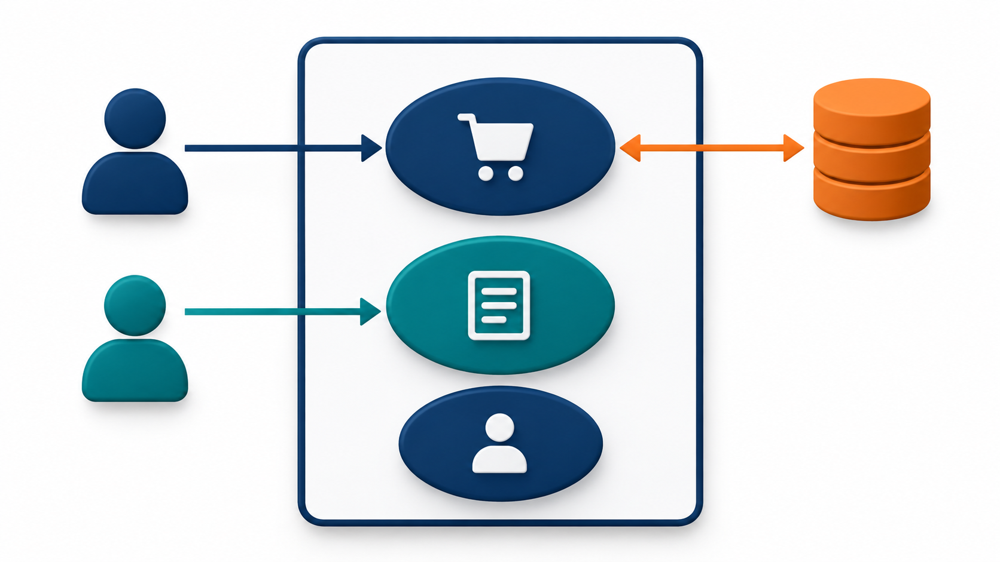
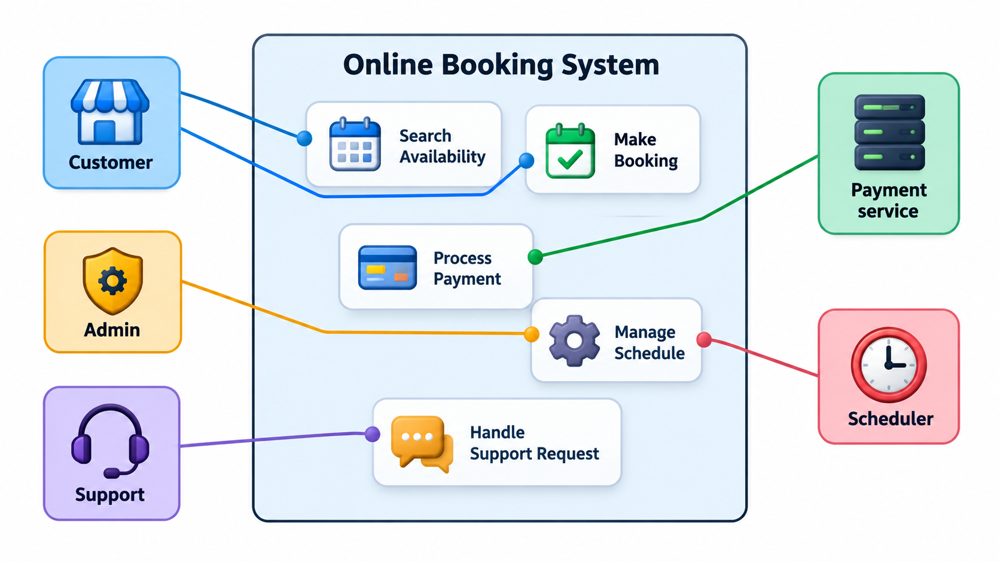
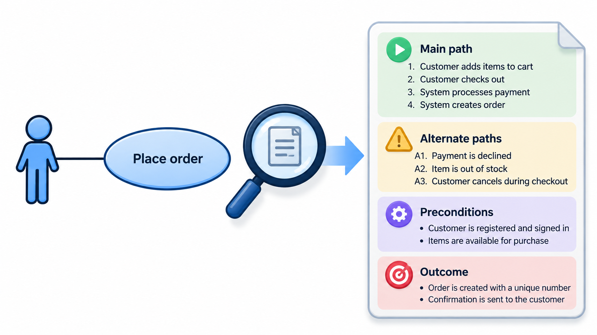

## Who Uses It, and Where Does It End?

Two questions come before any detailed design: who will use the system, and what for? A third is easily forgotten: where does the system stop? When a system exchanges information with people or other systems, many failures happen on the line between them, in the unwritten agreement about what is passed across.

A picture that draws that line, with the people and systems on each side and the exchanges that cross it, makes such assumptions visible. In use case modelling the line is called the **system boundary**. The **use case diagram** is one of the simplest in UML, and one of the most useful early in a project: it shows who uses the system, what they use it for, and where the system ends.

Its simplicity is deliberate. A use case diagram is meant to be read by the people who pay for the system and the people who use it, who will never learn class notation. If a customer can look at it and say "yes, that is what we need" or "you have missed something", it has done its work. Everything more detailed can wait.

## The Elements

A use case diagram has four ingredients.

- **Actors**, drawn as stick figures, are the roles that interact with the system from outside. They can be people ("Member"), other systems ("Payment gateway") or time itself ("Nightly scheduler"). An actor is a role and not an individual: one person can play several roles, and many people can play one.
- **Use cases**, drawn as ovals, are the goals actors pursue, named with a verb phrase from the actor's point of view: "Borrow book", "Collect fine".
- **The system boundary**, drawn as a rectangle, encloses the use cases. Actors stay outside. What is inside is the system to be built, and what is outside is not.
- **Associations**, drawn as lines, connect an actor to the use cases they take part in.

The diagram is a table in disguise. It lists who can do what. Its strength is that a customer can read it in a minute and say "you have forgotten that the registrar also needs to cancel", which is a requirement found at almost no cost.

<!-- Visual: a use case diagram of a library with Member and Librarian actors on either side of a system boundary containing search, borrow, renew, add book and collect fine. -->

## Primary and Supporting Actors

Not all actors play the same part. A **primary actor** starts a use case because they want something: the member who wants to borrow a book. A **supporting actor** is called on by the system to help complete a use case: the payment gateway that takes the fine. Telling them apart clarifies who the system is for and what it depends on.

| Actor | Kind | What they want or provide |
| --- | --- | --- |
| Member | Primary | Search, borrow and renew books |
| Librarian | Primary | Add books, collect fines, manage members |
| Payment gateway | Supporting | Takes the fine payment when asked |
| Email service | Supporting | Sends the reminder when asked |
| Nightly scheduler | Primary (time) | Triggers the overdue check every night |

Supporting actors matter because each is a dependency. The system cannot collect a fine if the gateway is down, so the design must say what happens then. A list of supporting actors is therefore a first list of things that can go wrong from outside.

## Finding the Actors and Use Cases

Beginners often stare at a blank page. A few questions find most actors and goals quickly.

1. Who uses the system directly? Who maintains it?
2. Which other systems does it call, or which call it?
3. Does anything happen at a certain time with no person starting it?
4. For each actor: what do they want to achieve with the system? What do they need to know from it? What information do they give it?
5. For each goal: is it one thing, or several? Would the actor be satisfied when it is done?

The last test is useful. A good use case ends with the actor having achieved something of value. "Log in" is rarely a goal by itself, since nobody visits a library system for the pleasure of logging in, but "Renew book" is. Small mechanical steps belong inside a use case; goals belong on the diagram.

## The Data Behind the Diagram

A use case diagram is a drawing of a relationship between two sets: actors and goals. The same relationship can be held as a table and checked. Take a library system.

| Use case | Actors who take part |
| --- | --- |
| Search catalogue | Member, Librarian |
| Borrow book | Member |
| Renew book | Member |
| Add new book | Librarian |
| Collect fine | Librarian, Payment gateway |

Three things can be read from it. Two use cases are shared: searching the catalogue serves both members and librarians, and collecting a fine involves the librarian and the payment gateway, which is a system actor. The shared ones are where the same behaviour must serve different people. Counting the goals per actor gives Member 3, Librarian 3 and Payment gateway 1, which shows that the gateway is a thin interface: all the system needs from it is to take a payment. And a check is possible: an actor with no use case should not be on the diagram, and a use case with no actor is a feature nobody asked for.

## Include and Extend

Two relationships connect use cases to each other, and they are often confused.

**Include** means that one use case always uses another as a step. "Borrow book" includes "Check member account", since every borrowing begins with it. The included use case is shared, and drawing it once avoids repeating it in each place that needs it. The arrow points from the base to the included case, labelled `«include»`.

**Extend** means that a use case may be added to another under a condition. "Return book" can be extended by "Charge fine", but only when the book is late. The base use case is complete without it. The arrow points from the extension to the base, labelled `«extend»`.

A quick test: if removing the second use case would leave the first one incomplete, it is an include. If the first is complete without it and the second happens only sometimes, it is an extend.

| Question | Include | Extend |
| --- | --- | --- |
| How often does it happen? | Every time | Only under a condition |
| Is the base complete without it? | No | Yes |
| Who knows about whom? | The base knows the included case | The extension knows the base; the base does not know it |
| Typical reason | Share a common step | Add an optional or exceptional behaviour |
| Example | Borrow book includes Check member account | Return book is extended by Charge fine |

A third relationship, **generalisation** between actors, lets one actor inherit another's goals. A "Senior librarian" can be drawn as a kind of "Librarian" who can do everything a librarian can and also approve write-offs. It avoids drawing the same lines twice.

<!-- Visual: include and extend use-case relationships. -->

## From Oval to Written Use Case

The oval is only a title. The substance sits in a short written description that every serious use case has, and the diagram serves as its index.

| Part | What it says | Example for "Renew book" |
| --- | --- | --- |
| **Actor** | Who starts it | Member |
| **Goal** | What they want | Keep a book for a further two weeks |
| **Precondition** | What must be true before | The member is signed in and has the book on loan |
| **Main flow** | The usual steps | Member selects the loan; system checks no one else has reserved it; system extends the due date; system confirms |
| **Alternative flows** | Variations and failures | The book is reserved, so the system refuses and offers a reservation; the member has unpaid fines, so the system asks them to pay first |
| **Postcondition** | What is true after | The due date has moved by two weeks |

Writing the alternatives is where the value lies. The main flow is what everyone already imagines. The alternatives are the cases a developer would otherwise meet for the first time in testing or, worse, in production.

## Getting the Boundary Right

Most mistakes in use case diagrams are about the boundary. If the boundary is drawn too wide, the diagram promises features the team does not intend to build. If it is too narrow, important actors and goals fall outside and are missed. A good test is to ask of every element: does the team build and own this? If so, it is inside. If another team, a vendor or a person controls it, it is an actor, and the line to it is an interface that needs a clear agreement about what is sent, in what form and what happens if it fails.

Naming also matters. A use case should describe a goal that has value to the actor ("Pay fee") and not a feature of the system ("Show payment screen"). Goal names stay valid when the interface changes.

<!-- Visual: a boundary rectangle with use cases inside and actors outside, and the lines that cross the boundary highlighted as the interfaces to agree on. Save as images/45_boundary_interfaces.png. -->

## Where Use Case Diagrams Help, and Where They Do Not

The diagram is good for a first agreement on scope, for explaining the system to non-technical people, and as an index to the detailed written use cases that sit behind each oval. It is also a handy base for planning: each use case can be estimated, assigned and tested as a unit, and a test plan can be checked for coverage by asking whether every use case has at least one test.

It is weak at showing order, detail or data. It says nothing about what happens inside a use case, which belongs to the text of the use case, a sequence diagram or an activity diagram. A diagram with forty ovals has lost its job as an overview, and is better split by actor or area.

## Common Faults

| Fault | What it looks like | Remedy |
| --- | --- | --- |
| **Feature names as use cases** | "Show login screen", "Click submit" | Rename as goals the actor values |
| **Too fine-grained** | Twenty ovals for one task | Merge into one goal; keep steps in the text |
| **Missing actors** | Nobody for the nightly job or the external service | Ask what starts things and what is called |
| **Diagram as flowchart** | Arrows between use cases showing order | Use an activity diagram for order |
| **Boundary left implied** | No rectangle, so scope is unclear | Always draw it |

## Five Misreadings of Use Case Diagrams

**"The diagram is the use case."** The oval is a title. The substance is the written flow, with its main steps and alternatives.

**"Actors are the people in the company."** Actors are roles, and external systems count. A payment gateway that the system calls is an actor.

**"Include and extend are interchangeable."** Include is always, shared and required. Extend is sometimes, conditional and optional.

**"More use cases means a better analysis."** Too many small ones bury the picture. Name goals at a level the actor would recognise.

**"The boundary is a formality."** It is the most important line on the diagram. It decides what the team owns and what it depends on.
