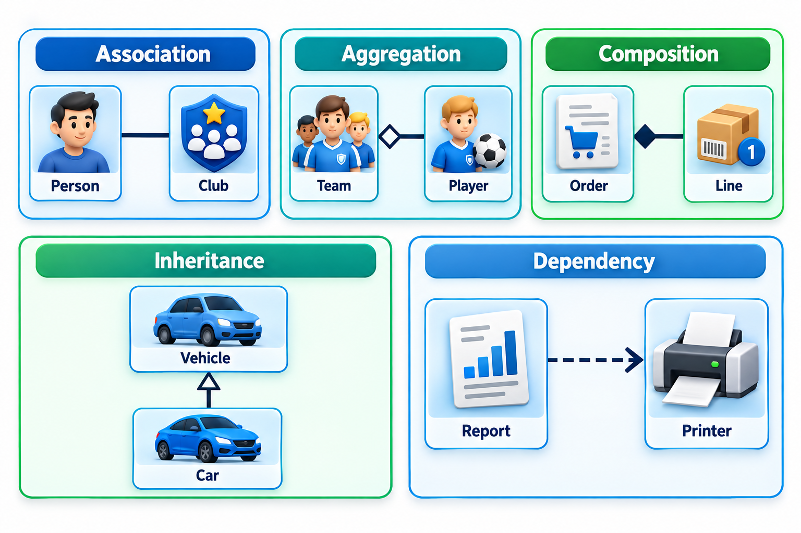
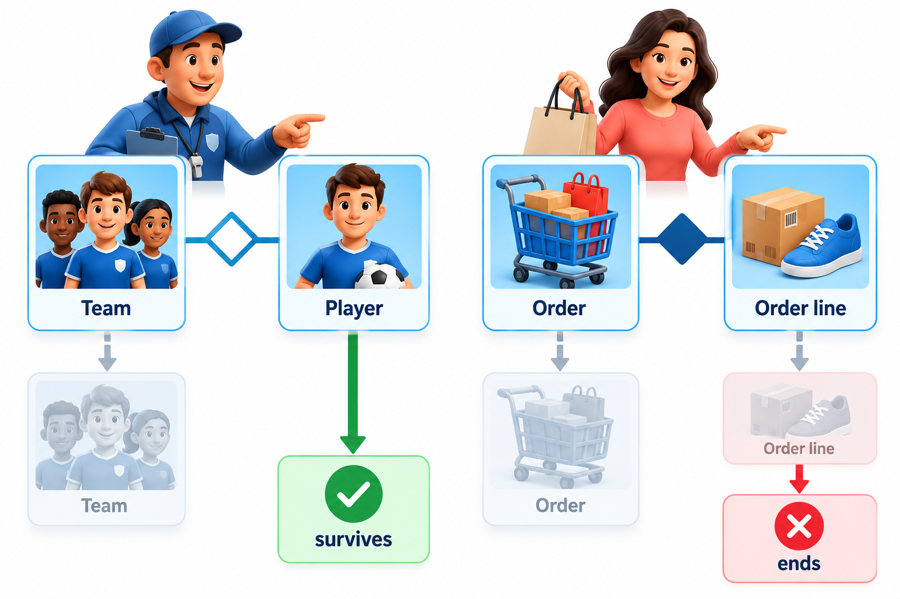
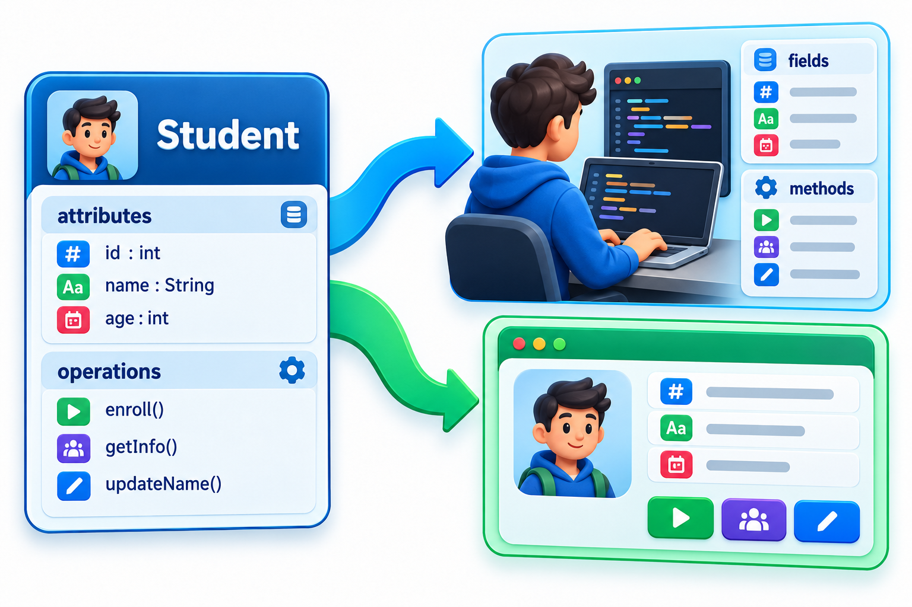
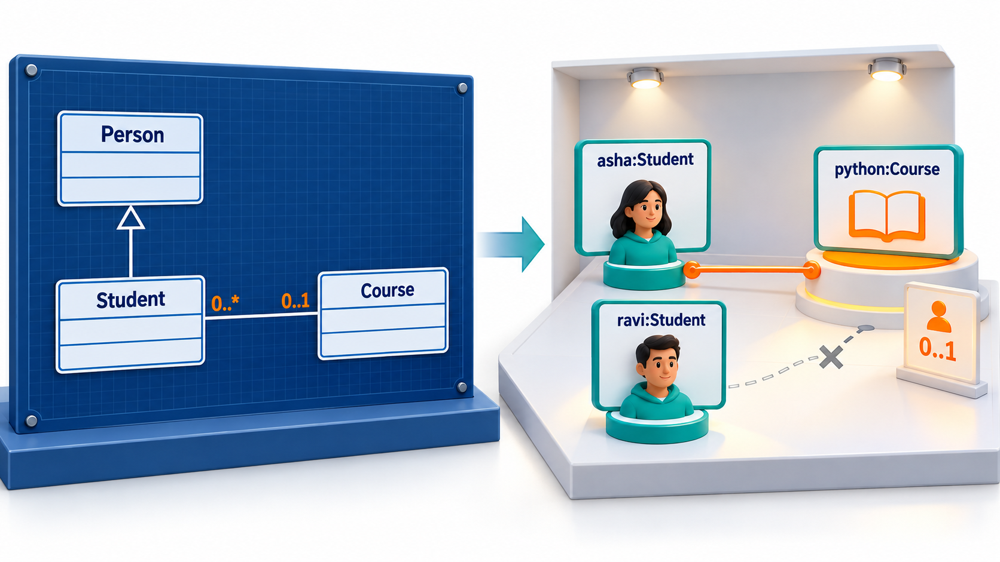

## The Things in a Problem, and How They Connect

Before a single feature is built, a team can ask what the main things in its problem are, and how they relate. A library has books, members and loans. A college has students, courses and teachers. Which thing is a kind of which, which thing has which, and how many of each can there be? Arguing about those questions on one page is far cheaper than discovering the disagreement in the software.

That page is a **class diagram**, the most widely used structural diagram in UML. It is a family tree of the things in a system. This topic covers the parts of the diagram, the relationships that matter most, and how the diagram corresponds to a working system.

A class is a description of a kind of thing: what every such thing knows and what every such thing can do. "Student" is a class; Asha is one particular student, an **object** of that class. The diagram is about the kinds, and the rules that hold between kinds, which is why it is so good for settling arguments early. Once the team agrees that a course has many students and a student takes many courses, a large number of later decisions follow from it.

## Anatomy of a Class

A class is drawn as a rectangle with three compartments.

| Compartment | What it holds | Example for a Student |
| --- | --- | --- |
| **Name** | The class name, in bold or capitalised | `Student` |
| **Attributes** | The data each object carries, with types | A roll number (private, a whole number) and a name (private, text) |
| **Operations** | What an object can do | Pay a fee of a given amount (public) |

The sign before a member shows its **visibility**. A plus means public, usable by anyone. A minus means private, usable only inside the class. A hash means protected, usable by the class and its subclasses. The usual rule of good design is to make attributes private and expose only the operations that other code needs, which is the idea of encapsulation: the data is protected by the behaviour around it.

A class diagram does not show every attribute and operation. A box with just the name is fine when the detail is not needed. The diagram shows what the audience needs to see.

<!-- Visual: student UML class with attributes, operations and visibility. -->

## Finding the Classes

Beginners ask where classes come from. A reliable method starts from a plain description of the problem and reads it for nouns and verbs.

Take the sentence: "A member borrows a book from the library. Each loan has a due date. A late loan produces a fine."

| Word in the description | Becomes | Reason |
| --- | --- | --- |
| member, book, loan, fine | Candidate classes | Things the system must remember |
| due date | Attribute of Loan | A fact about a loan, not a thing in its own right |
| borrows | Association or operation | Links Member and Book through Loan |
| produces | Association | A late Loan has a Fine |
| library | Possibly the system itself | The whole, not a thing inside it |

Not every noun is a class. A noun that has its own facts to remember and its own rules is a class; a noun that is merely a fact about something else is an attribute. Ask: does it have attributes of its own? Do different instances need to be told apart? If yes, it is likely a class.

## Relationships Between Classes

The lines between boxes are the real content of the diagram. Five kinds cover almost every case.

| Relationship | Line | Reads as | Example |
| --- | --- | --- | --- |
| **Association** | Plain line | "knows about" or "uses" | A Student is enrolled in a Course |
| **Aggregation** | Line with hollow diamond | "has a", parts can live apart | A Team has Players |
| **Composition** | Line with filled diamond | "is made of", parts die with the whole | A House is made of Rooms |
| **Generalisation** | Line with hollow triangle | "is a kind of" | A Student is a kind of Person |
| **Dependency** | Dashed arrow | "temporarily uses" | A Report uses a Printer |

An association can carry a **multiplicity**, numbers at each end that say how many objects take part. `1` is exactly one, `0..1` is optional, `*` is any number, and `1..*` is at least one. "A Course has `1..*` Students and a Student takes `0..*` Courses" is a precise sentence about the design. Multiplicities are where many design decisions and many bugs live: can a course exist with no students? Can a student be in no course?

**Generalisation** is the relationship of inheritance. The subclass inherits the attributes and operations of the superclass and adds its own. A good test is the phrase "is a": a Student is a Person, but a Course is not a Student. If the sentence sounds wrong, the relationship is probably not generalisation.

<!-- Visual: five UML relationship types with their line symbols. -->

**Aggregation and composition** both mean "has parts", and differ in ownership. In composition, the parts belong to the whole alone and cannot exist without it: rooms do not outlive their house. In aggregation, the parts exist independently: players still exist when a team folds. If the distinction is unclear, many teams use a plain association and put the detail in a note.

<!-- Visual: aggregation and composition compared through part lifecycles. -->

## Reading Multiplicity as Business Rules

Each multiplicity is a rule in disguise. Consider a library.

| Diagram says | Rule in plain words | Question to ask the client |
| --- | --- | --- |
| Member 1 to 0..* Loan | A member can have any number of loans, including none | Is there a limit, say five at once? |
| Loan * to 1 Book copy | Each loan is for exactly one copy | Can a loan cover two books? |
| Book 1 to 1..* Copy | Every book has at least one copy | Can a title exist in the catalogue with no copies? |
| Loan 1 to 0..1 Fine | A loan has at most one fine | What if it is late twice, after a renewal? |

Each row turns a symbol into a question, and each question is a requirement that was not yet written. This is the practical power of a class diagram: it makes a team ask the questions that would otherwise be answered by accident in code.

## Composition Over Inheritance

Beginners meet inheritance first and tend to overuse it. A common warning is that deep trees of "is a kind of" are hard to change: altering a class near the top changes everything below it. Often a "has a" relationship serves better.

| Situation | Inheritance version | Composition version | Which holds up better |
| --- | --- | --- | --- |
| Different payment methods | Card, Upi and NetBanking all kinds of Payment | An Order has a Payment method that can be replaced | Both work, but composition lets a customer change method without changing the order |
| Staff who are also students | Student and Employee both kinds of Person; a person who is both has a problem | A Person has roles: student role, staff role | Composition |
| Shapes drawn on a screen | Circle and Square kinds of Shape | Same | Inheritance suits a true "is a kind of" |

Use inheritance where the "is a" sentence is true for the whole life of the object. Use composition where the thing may change or play more than one part.

## From Diagram to Implementation

Class diagrams map directly onto the finished software. Each element of the diagram has a counterpart in the implementation.

| Diagram element | In the implementation |
| --- | --- |
| Class | A class, a blueprint for things of that kind |
| Attribute | A field, a piece of data each thing holds |
| Operation | A method, something each thing can do |
| Generalisation (a kind of) | Inheritance |
| Association (has) | A reference to, or a collection of, the other thing |
| Multiplicity (how many) | A limit enforced by a rule |

Consider a small diagram: a *Student* that is a kind of *Person*, enrolled in *Courses* that have a limited number of seats. Suppose the Python course has one seat, and two students ask to enrol.

| Event | Result |
| --- | --- |
| Asha enrols in Python | Accepted: the course has a free seat |
| Ravi enrols in Python | Refused quietly: the course is full, and his course list stays empty |
| Is Asha a Person? | Yes, because a Student is a kind of Person and can be used wherever a Person is expected |

Everything in the table could be read from the diagram. That is the benefit of drawing first: the rule "at most one student" was a decision made on the diagram, not discovered later in the software.

Notice the word "quietly" in the second row. The diagram did not say what should happen to Ravi, only that the seat limit exists. A diagram records structure and rules about numbers; it does not record what to tell the user. That belongs to behaviour diagrams and to written requirements.

<!-- Visual: mapping a class diagram to fields and methods in code. -->

## Object Diagrams: A Snapshot

A class diagram shows kinds of thing and how they relate in general. An **object diagram** shows one moment, with real instances: the student Asha, the course Python, and the link between them. It is useful for checking that a design allows what you expect. The enrolment example above is such a snapshot: the Python course holds Asha and no one else. Object diagrams are rarely drawn in full, but sketching one is a quick test of a class diagram's multiplicities.

<!-- Visual: a class diagram of Person, Student and Course with multiplicities, beside an object diagram of the objects asha:Student and python:Course with a single link between them. Save as images/46_class_and_object_diagram.png. -->

## Three Levels of Class Diagram

The same notation serves different purposes, and mixing them produces confusing pictures.

| Level | Classes represent | Audience | Example classes |
| --- | --- | --- | --- |
| **Conceptual (domain)** | Things in the business world | Client and team | Member, Book, Loan, Fine |
| **Specification** | The interfaces the software offers | Designers | LoanService, MemberRepository |
| **Implementation** | Actual classes in the program | Developers | LoanServiceImpl, SqlMemberRepository |

Start at the conceptual level, since it is the one the client can check. Move down only when a decision needs it, and say at the top of the diagram which level you are at.

## Keeping the Diagram Useful

A class diagram can easily become a wall of boxes. A few habits keep it useful. Draw only the classes that matter to the question. Show attributes and operations only when they carry meaning. Group related classes. Name classes with the words of the problem, such as `Loan` and `Fine`, not `DataManager`. And draw at the level of the problem first, the things in the real world, before drawing the classes needed for the program, like helpers and screens.

## Five Misreadings of Class Diagrams

**"A class diagram is a picture of the code."** It can be, but a better use is a picture of the design before the code, or of the problem domain. A diagram that mirrors every line of code adds nothing.

**"Inheritance is the most important relationship."** Associations are far more common, and deep inheritance trees are often a design smell. Composition is usually the safer way to reuse.

**"Aggregation and composition are the same."** The difference is the life of the parts. If the parts die with the whole, it is composition.

**"Every attribute must appear."** Show what the reader needs. Unfilled boxes are fine.

**"Multiplicity is a detail."** It states rules of the business: how many, and whether optional. A wrong multiplicity is a wrong requirement.
