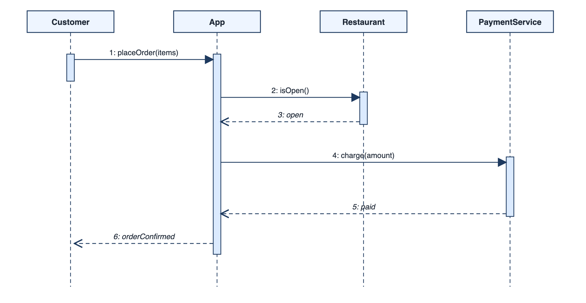
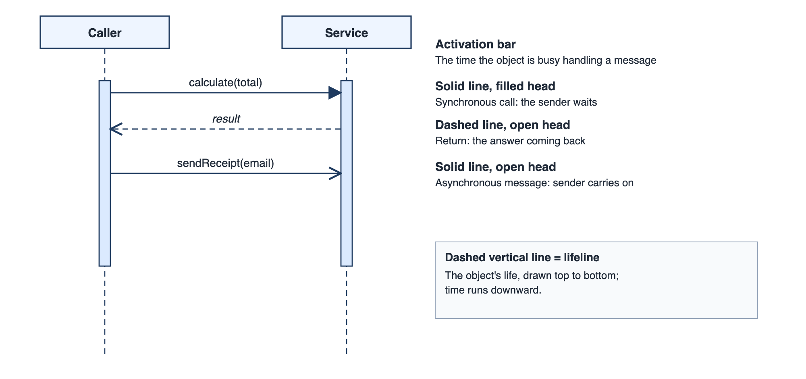
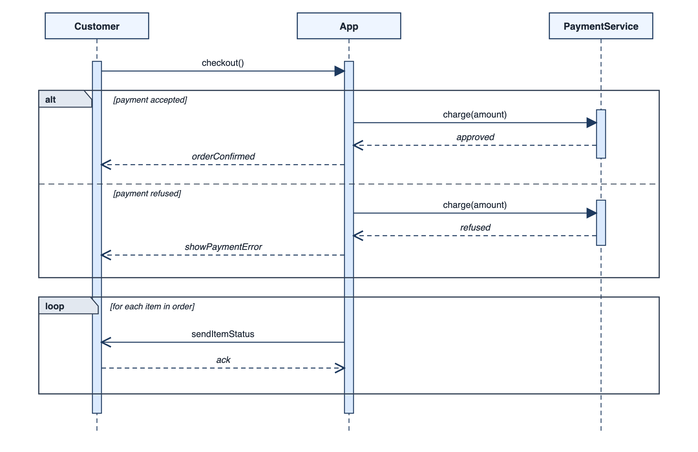
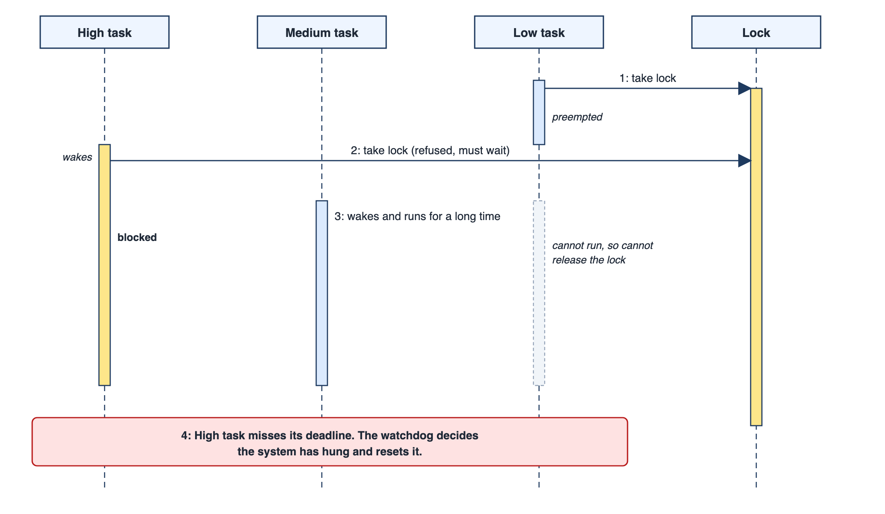

## Some Faults Live in the Order of Events, Not in Any One Piece

Sometimes every part of a system is correct and the system still misbehaves, because of the order in which the parts talk to each other. Two tasks wait for each other, a charge is made before a check, a reply arrives before the request it answers. No single piece of the system is at fault. The fault is in the sequence, and it can only be seen by laying the interactions out over time.

A **sequence diagram** does exactly that. It shows who sends which message to whom, in what order. When the question is "what happens, step by step, when this occurs?", it is the right tool.

Order is the hardest property of a system to see. Structure can be read from a list of classes, and rules about data can be read from a table. But when several things run at once, or several services call each other, the order of events is spread across many files and many machines, and no one place shows it. The sequence diagram collects it into one picture.

## Reading a Sequence Diagram

The diagram has two axes. Across the top are the participants, each drawn as a box with a dashed vertical line, called a **lifeline**, descending from it. Time runs down the page. Arrows between lifelines are **messages**, and their order from top to bottom is the order in which they happen.

| Element | How it looks | What it means |
| --- | --- | --- |
| **Participant** | A box at the top | An object, component or actor taking part |
| **Lifeline** | Dashed line down from the box | The participant's existence over time |
| **Synchronous message** | Solid arrow with a filled head | The sender waits for the reply |
| **Asynchronous message** | Solid arrow with an open head | The sender carries on without waiting |
| **Return message** | Dashed arrow back | The reply or result |
| **Activation bar** | Narrow rectangle on the lifeline | The participant is busy handling a call |
| **Self message** | Arrow looping back to the same lifeline | The participant calls one of its own operations |

Only vertical position matters for time. The horizontal distance between lifelines means nothing, and the length of an arrow says nothing about how long a message took. Readers new to the notation sometimes read a long arrow as a slow message; it is only a long arrow.

A food-order diagram shows the idea. A customer places an order with the app. The app asks the restaurant whether it is open, and the restaurant replies. The app asks the payment service to charge, and the payment service replies. The app confirms to the customer. The order of the arrows carries the logic: the charge happens only after the restaurant has confirmed.

<!-- Visual: a food-order sequence diagram with four lifelines, activation bars, solid arrows for requests, dashed arrows for replies and numbers 1 to 6 on the messages. -->

Read it like a script. Message 1 is the customer placing the order. The App then asks the Restaurant whether it is open (2) and receives a reply (3). Only then does it ask the PaymentService to charge (4), receive confirmation (5), and tell the customer the order is confirmed (6). The narrow bars on each lifeline are activations, the periods when that participant is busy. The solid arrows are requests and the dashed arrows are replies. Notice that the App's bar stays open from message 1 to message 6: it is waiting on other parties the whole time, which is why its lifeline is the busiest.

## Synchronous and Asynchronous Messages

<!-- Visual: a small two-participant sequence diagram with callouts for the activation bar, the synchronous call, the return and the asynchronous message. -->

The difference between waiting and not waiting is one of the most important things a sequence diagram can show, and it changes how a system behaves under stress.

| Kind | Sender behaviour | Everyday analogy | Consequence |
| --- | --- | --- | --- |
| **Synchronous** | Stops and waits for the answer | A phone call: you stay on the line | Simple to reason about; if the other side is slow, you are slow |
| **Asynchronous** | Sends and carries on | A letter or text message | Sender is free, but the answer, if any, arrives later and out of step |

Take an order that sends a confirmation email. If the app sends the email synchronously, the customer waits while the email service responds, and if the email service is down the order may fail. If the app sends it asynchronously, the customer sees "confirmed" at once and the email follows. The second is more robust, but it raises new questions: what if the email never arrives? Who retries? A sequence diagram that distinguishes the two arrow styles makes these questions visible at design time.

## Checking an Order Rule

Because a sequence diagram is a list of messages in order, a rule about order can be checked. Here are the messages of an online order, with the time each was sent.

| Time | From | To | Message |
| --- | --- | --- | --- |
| 0 ms | Customer | App | Place order |
| 40 ms | App | Stock | Check items |
| 90 ms | App | Payment | Charge card |
| 160 ms | App | Customer | Order confirmed |

The design rule is that stock must be checked before the card is charged. Reading down the list, "check items" appears at the second step and "charge card" at the third, so the rule holds. Had the two been swapped, the order would flag a bug in which customers are charged for goods that may not exist. Reading down the list is reading down the lifelines of the diagram, and the same table corresponds closely to a trace of what a real system did.

A related check concerns time. If every message has a timestamp, the gaps show where the waiting is. In the table above, 50 ms passes between the stock check and the charge, and 70 ms between the charge and the confirmation. If the payment step took two seconds in testing, the diagram tells you exactly which arrow to examine.

## Choices and Repeats: Combined Fragments

Real interactions have conditions and loops. UML handles them with **combined fragments**, labelled boxes drawn over part of the diagram. The most common are:

- **alt** for alternatives. The box is divided by a dashed line into sections, each with a guard in square brackets, such as `[payment accepted]` and `[payment refused]`. Exactly one section runs.
- **opt** for an optional section that runs only if its guard is true.
- **loop** for a section that repeats while its guard holds, for instance for each item in a basket.
- **par** for sections that run at the same time.

These give a diagram the power to show a full scenario with its branches, though a diagram with several nested fragments soon becomes hard to read. A better habit is to draw the main scenario on one diagram and the important alternatives on others.

<!-- Visual: a sequence diagram with Customer, App and PaymentService, an alt frame divided by a dashed line into the guards payment accepted and payment refused, and a loop frame for each item in the order. -->

The upper frame is an **alt**. The label in its corner says what kind of fragment it is, the dashed line splits it into two sections, and each section starts with a guard in square brackets. If the payment is accepted, the App asks for the charge, hears that it is approved, and confirms the order. If it is refused, the App asks for the charge, hears that it was refused, and shows an error. Exactly one section runs. The lower frame is a **loop**: the messages inside it repeat once for each item in the order, here reporting each item's status to the customer and receiving an acknowledgement.

## Walking Through a Scenario Step by Step

Here is how a team might build a sequence diagram for "a member renews a library book".

1. **Pick one scenario.** The main success path: the member renews and it works.
2. **List the participants.** Member, the library app, the loan records, the reservation records.
3. **Write the messages in order.** Member asks to renew; app asks loan records for the loan; app asks reservations whether anyone is waiting; app asks loan records to extend the date; app tells the member the new date.
4. **Check each message has a sender who could know to send it.** If the app asks reservations a question, it must know the book; where did it learn that? From the loan record, which was fetched earlier. Good.
5. **Add the alternatives.** If someone is waiting, the app refuses. If the loan does not exist, the app reports an error. Each becomes an alt section or a separate diagram.
6. **Look for the missing participant.** Often the exercise reveals one nobody mentioned, such as a fines check before renewal.

The sixth step is where the diagram pays for itself. Missing steps are the commonest design flaw, and they are far cheaper to find on paper.

## When to Draw One

A sequence diagram earns its place when an interaction involves three or more participants and the order matters: a login that passes through a browser, an application server and an identity provider, a payment that crosses several services, a handshake between a phone and a device. It is good for finding missing steps, for explaining a flow to a new teammate, and for debugging a puzzling interaction, such as three tasks fighting over a shared lock.

It is a poor tool for showing complex logic inside one component, for which an activity diagram or code is better, or for showing a whole system, for which a structural diagram is better. Keep each diagram to one scenario and a handful of participants.

## The Fault That Only a Sequence Shows

Return to the opening claim. A famous kind of timing fault is **priority inversion**. Three tasks run on one processor: a low-priority task that holds a lock, a high-priority task that needs that lock, and a medium-priority task that needs neither. The high task waits for the lock. The low task, which could release it, never gets the processor, because the medium task keeps running. The high task, in effect, is blocked by the medium one, which has lower priority. In a spacecraft or a vehicle controller, a watchdog may then decide the system has hung and reset it.

| Step | Low task | Medium task | High task |
| --- | --- | --- | --- |
| 1 | Takes the lock | Waiting | Waiting |
| 2 | Running | Waiting | Wakes, asks for the lock, blocks |
| 3 | Interrupted | Wakes and runs for a long time | Still blocked |
| 4 | Cannot run, so cannot release the lock | Running | Blocked past its deadline; watchdog resets the system |

Every task and every lock, examined alone, is correct. Only the sequence across the three lifelines shows the fault, and a table of attributes would never reveal it. That is the real reason to learn this diagram: to be able to see failures that are not located in any single place.

<!-- Visual: a sequence diagram with High task, Medium task, Low task and Lock lifelines: the low task takes the lock, is preempted, the high task asks for the lock and is blocked, the medium task runs for a long time, and a red box marks the deadline missed and the watchdog reset. -->

## Common Faults in Sequence Diagrams

| Fault | What it looks like | Remedy |
| --- | --- | --- |
| **Too many participants** | Ten lifelines and arrows crossing the page | Group into subsystems and draw detail separately |
| **Every internal call drawn** | A trace of code, not a design | Include only messages that carry meaning |
| **Missing returns** | Requests with no replies, so the reader cannot tell what comes back | Show returns where the answer matters |
| **Mixing levels** | A user click beside a database query | Choose one level per diagram |
| **No alternatives** | Only the happy path | Add at least the main failure |
