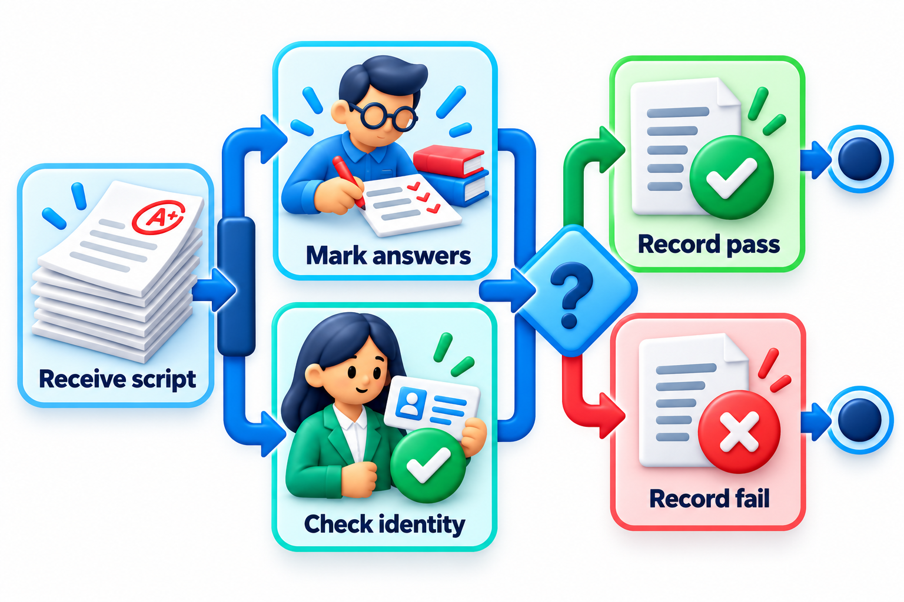
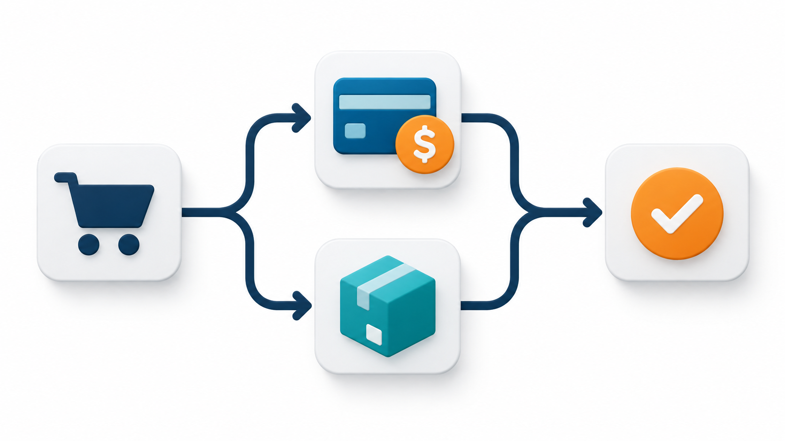
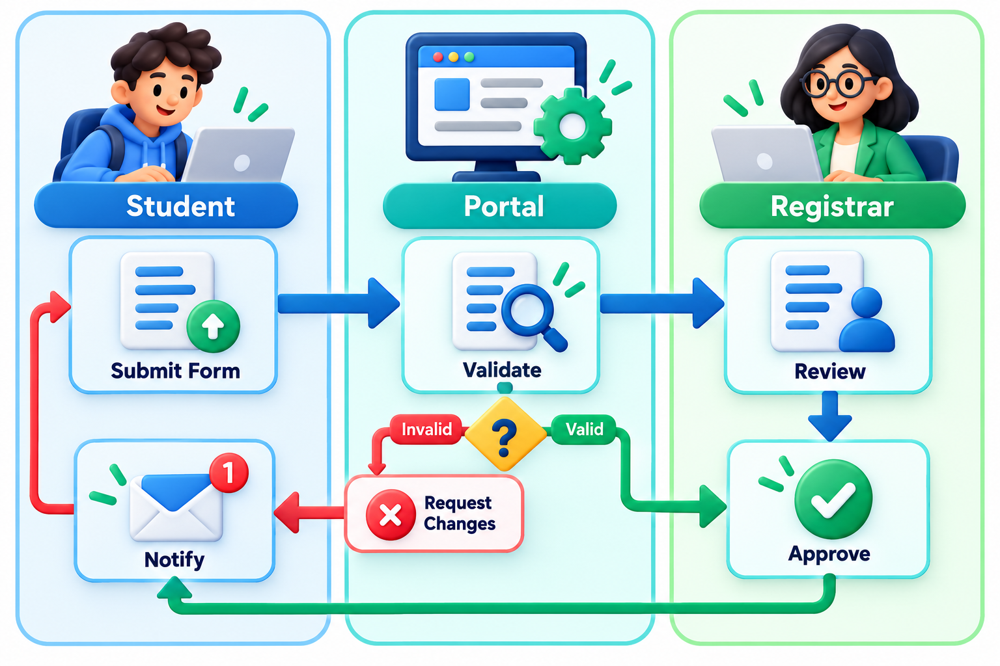
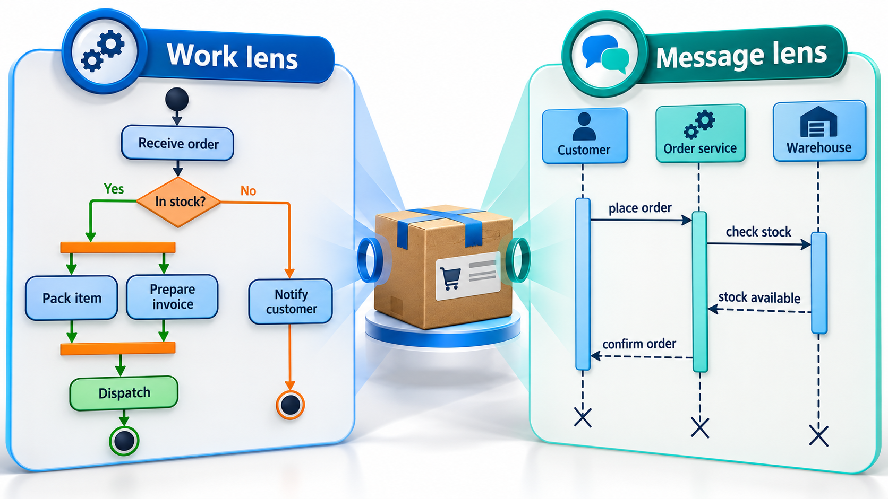

## A Flowchart That Can Do Two Things at Once

Many real processes are not a single line of steps. When a pizza is ordered, the kitchen makes it while a driver is found, and both must be ready before delivery begins. When a student applies to a college, the documents are checked while the fee is processed. A plain flowchart, which does one thing at a time, cannot show this.

An **activity diagram** draws a flow of work from a start to an end, with the steps in between, the choices made along the way, and the parts that happen at the same time. It is essentially a flowchart, extended with notation for parallel work and for who does what.

It suits any process that has a shape: a business procedure, an algorithm, the steps inside a use case. Where a sequence diagram asks who talks to whom, an activity diagram asks what happens next, and what could happen instead.

## The Elements

| Element | Symbol | Meaning |
| --- | --- | --- |
| **Initial node** | Filled circle | Where the flow begins |
| **Action** | Rounded rectangle | A step of work |
| **Control flow** | Arrow | The order from one step to the next |
| **Decision** | Diamond with guards | A choice, with conditions such as `[in stock]` on the outgoing arrows |
| **Merge** | Diamond | Where alternative paths come back together |
| **Fork** | Thick bar, one arrow in, several out | Start of parallel steps |
| **Join** | Thick bar, several arrows in, one out | Wait for all parallel steps to finish |
| **Final node** | Circle with a ring | The end of the flow |

A **decision** has one arrow in and several out, each labelled with a guard, and exactly one is taken. A **fork** has one arrow in and several out, and *all* are taken at once. That difference matters: decisions choose, forks split. A **join** waits for every incoming flow before continuing, which is how the diagram says "do not start delivering until both the pizza and the driver are ready".

Guards on a decision should cover every case and not overlap. If a diamond offers `[in stock]` and `[out of stock]`, every order goes one way or the other. If it offers only `[in stock]`, the diagram is silent about what happens otherwise, and that silence is a gap in the design.

<!-- Visual: an exam-script flow with a decision diamond for "script complete?" and a fork into two parallel checks that join before the final step. -->

## Reading a Diagram Step by Step

Take a simple process: a student submits an assignment.

| Step | Element | What happens |
| --- | --- | --- |
| 1 | Initial node | The student opens the submission page |
| 2 | Action | Upload file |
| 3 | Decision | Is the file the right type? |
| 4a | Guard `[yes]` | Continue to step 5 |
| 4b | Guard `[no]` | Show an error and return to step 2 |
| 5 | Fork | Two things happen at once |
| 6a | Action | Check for copied text |
| 6b | Action | Record the submission time |
| 7 | Join | Wait for both checks |
| 8 | Action | Send a receipt to the student |
| 9 | Final node | Done |

Several features appear: a loop back (step 4b to step 2), a fork and join, and a decision. A reader can trace any path and ask what is missing. For instance, what if the copy check takes ten minutes? The join makes the receipt wait for it, which may or may not be wanted. The diagram turns that question into something to discuss.

## Why Parallel Flows Matter

Fork and join are the feature that distinguishes an activity diagram from a plain flowchart, and they carry a practical message about time. Steps that need not wait for each other should not. The total time of a forked section is that of its *slowest* branch, not the sum of the branches. Take an online pizza order: 2 minutes to take the order and 15 to deliver. In between, two branches can run.

| Branch | Steps | Minutes |
| --- | --- | --- |
| Kitchen | Make pizza (12), bake (10) | 22 |
| Delivery | Find driver (6), wait at shop (4) | 10 |

| Arrangement | Calculation | Total |
| --- | --- | --- |
| One after another | 2 + 22 + 10 + 15 | 49 minutes |
| With fork and join | 2 + the slower branch (22) + 15 | 39 minutes |

A saving of ten minutes comes from the structure of the process alone. The shorter branch has 12 minutes to spare. That slack is a hint that the delivery side could take on another task, or that the kitchen is the bottleneck worth improving. The diagram shows where to look.

The longest path through the diagram, from start to end, is its **critical path**. Speeding up a step off that path changes nothing; speeding up a step on it shortens the whole process. In the pizza example, cutting the driver search from 6 minutes to 3 saves no time at all, while cutting baking from 10 minutes to 8 saves two.

<!-- Visual: fork and join nodes coordinate parallel activities. -->

## Swimlanes: Who Does What

An activity diagram can be divided into columns or rows called **swimlanes**, one for each person, team or system responsible. Each action is drawn in the lane of the one who performs it. When an arrow crosses from one lane to another, there is a handover. A diagram of how a student registers for an exam might have lanes for the student, the portal and the registrar's office. At a glance, it shows who is waiting for whom, and where handovers happen, which are the places where things get lost.

Swimlanes are especially helpful for business processes and for finding bottlenecks. If most of the arrows cross lanes, the process is full of handovers and probably slow. If a lane has long stretches with nothing in it, that party is idle while others work.

A small count makes this concrete. Suppose an exam registration has eight steps and the arrows between them cross lanes five times.

| Measure | Value | What it suggests |
| --- | --- | --- |
| Steps | 8 | A modest process |
| Handovers (lane crossings) | 5 | More than half the transitions pass between parties |
| Steps in the registrar lane | 1 | The registrar is involved once, but the student waits on that step |

Each handover is a place where work waits in someone's queue. Reducing five handovers to three might do more for the total time than speeding up any single step.

<!-- Visual: activity flow divided into student, portal and registrar swimlanes. -->

## Objects, Signals and Other Extras

Activity diagrams carry a few more symbols that are worth knowing when a process needs them.

| Symbol | Meaning | Example |
| --- | --- | --- |
| **Object node** | A piece of data passed between actions | An "Application form" handed from the student to the clerk |
| **Send and receive signal** | Sending a message or waiting for an event | Waiting for the payment confirmation |
| **Time event** | A step triggered by the clock | "After 24 hours, send a reminder" |
| **Activity final vs flow final** | End of the whole activity, or of just one branch | One branch of a fork ends while the other continues |

Most diagrams need none of these. They exist for processes in which the passing of data or the waiting for events is the point.

## Activity Diagrams Compared with Others

People often ask when to use an activity diagram rather than a sequence diagram. The simplest answer is that an activity diagram follows the *work*, and a sequence diagram follows the *messages between objects*. An activity diagram is good for a process with decisions and parallel steps, such as an order, a registration, an algorithm. A sequence diagram is better when the key question is which component talks to which, in what order.

| Feature | Activity diagram | Sequence diagram |
| --- | --- | --- |
| Focus | The flow of work | Messages between participants |
| Shows parallel work | Directly, with fork and join | With a par fragment, less naturally |
| Shows who does what | With swimlanes | By lifeline |
| Shows decisions | Diamonds, central to the notation | alt fragments |
| Good for | Business processes, algorithms, use case flows | Interactions among objects or services |

An activity diagram is also a good way to describe the flow inside one use case, fleshing out the main and alternate flows into a picture. And it can describe an algorithm in a form that a non-programmer can follow.

<!-- Visual: a table-like comparison with two small drawings: an activity diagram following steps, decisions and a fork, and a sequence diagram following messages between three objects. Save as images/48_activity_vs_sequence.png. -->

## Common Faults

| Fault | What it looks like | Remedy |
| --- | --- | --- |
| **Decision with missing guard** | A diamond with one labelled exit | Label every exit so all cases are covered |
| **Fork with no join** | Parallel branches that never rejoin | Add a join, or end the branches deliberately |
| **Dead end** | An action with no outgoing arrow and no final node | Every path must reach an end |
| **Too much detail** | Sixty actions on one page | Break into sub-diagrams |
| **Swimlanes with no meaning** | Lanes drawn but not used to show responsibility | Use them for roles or drop them |

## Five Misreadings of Activity Diagrams

**"An activity diagram is just a flowchart."** It looks like one, but fork, join and swimlanes let it describe parallel work and responsibility, which a flowchart cannot.

**"A decision and a fork are the same."** A decision takes one branch. A fork takes all of them at once.

**"Everything in parallel is faster."** Only if the branches do not compete for the same people or machines, and the join waits for the slowest branch anyway.

**"Draw every tiny step."** A diagram with sixty actions hides the shape of the process. Show the steps that matter and put detail in subdiagrams.

**"Swimlanes are decoration."** They show responsibility. They are often the quickest way to see where a process hands work over, and where it gets stuck.
