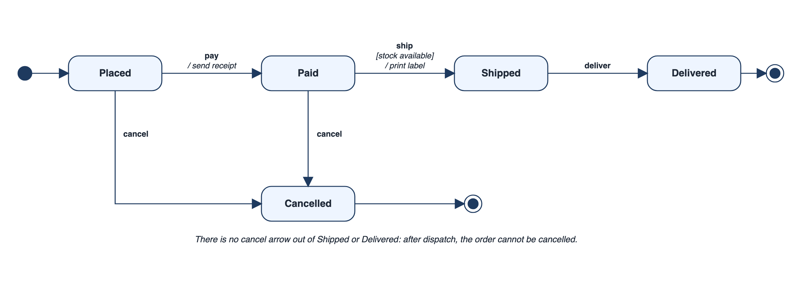

## The Same Event Means Different Things in Different States

A message arrives. What should happen? It depends on what state the receiver is in. A "cancel" request on an order that has just been placed should succeed; on an order already out for delivery it should be refused; on an order already delivered it makes no sense. When the rules about states and events are scattered through a program, some combination is always forgotten, and the forgotten combination is where the surprising failure lives.

A **state machine diagram** is the tool for drawing exactly those combinations. Each object has states, events cause transitions between them, and anything not drawn is not allowed.

The idea is older than software. A turnstile is either locked or unlocked. Push it when locked and nothing happens; insert a coin and it unlocks; push it when unlocked and it lets you through and locks again. Four combinations, two states, and the whole behaviour is clear. Most business objects are the same thing with more states: an order, an account, a ticket.

## States, Events and Transitions

Many things in software have a life with distinct stages: an order, a user account, a network connection, a document in review. At any moment such a thing is in one **state**, and it can only move to another state when something specific happens.

| Term | Meaning | Example for an online order |
| --- | --- | --- |
| **State** | A situation the object stays in for a while | Placed, Paid, Shipped, Delivered, Cancelled |
| **Event** | Something that happens | The customer pays, the courier delivers |
| **Transition** | A move from one state to another, caused by an event | Placed to Paid, when the payment arrives |
| **Guard** | A condition that must be true for the transition | `[stock available]` |
| **Action** | Something done when the transition happens | Send a confirmation email |
| **Initial and final state** | Where the life begins and ends | A filled circle, and a circle with a ring |

On the diagram, states are rounded rectangles and transitions are arrows labelled `event [guard] / action`. The most important property is what is *missing*. If there is no arrow from "Shipped" labelled "cancel", then an order cannot be cancelled once it has shipped. The diagram makes impossible things visibly impossible.

<!-- Visual: a state machine diagram: an initial node into Placed, then Paid, Shipped and Delivered, with Cancelled reachable from Placed and Paid, and transition labels such as pay / send receipt and ship [stock available] / print label. -->

Read the diagram by starting at the filled circle. A new order enters **Placed**. The arrow labelled `pay / send receipt` takes it to **Paid**, and the text after the slash says that a receipt is sent on the way. From Paid, the arrow `ship [stock available] / print label` leads to **Shipped**, but only if the guard in square brackets is true. From Shipped, `deliver` leads to **Delivered**, which has the ringed circle of a final state, so the life of the order ends there. Two arrows labelled `cancel` lead to **Cancelled**, one from Placed and one from Paid. There is no such arrow from Shipped or Delivered, and that absence is the rule: an order that has left the warehouse cannot be cancelled.

## What Counts as a State

Beginners often draw steps as states. A state is a *condition that lasts*, during which the object waits for something. A step is an action that happens and finishes.

| Candidate | State or not? | Reason |
| --- | --- | --- |
| Paid | State | The order stays in it until someone ships it |
| Sending receipt | Not a state | It is an action done on the way into Paid |
| Shipped | State | Remains until delivery |
| Validating card | Usually an action | It takes a moment and ends with a result |
| Awaiting payment | State | The order sits and waits for an outside event |

A useful test: can you describe how long the object stays there, and what it is waiting for? If the answer is "no time at all, then it moves on", it is probably an action.

## A State Machine as a Table

A state machine can be written as a table: for each pair of current state and event, the next state. The pairs not in the table are not allowed.

| Current state | Event | Next state |
| --- | --- | --- |
| Placed | pay | Paid |
| Placed | cancel | Cancelled |
| Paid | ship | Shipped |
| Paid | cancel | Cancelled |
| Shipped | deliver | Delivered |

Feed it a sequence of events, starting from Placed.

| Current state | Event | Result |
| --- | --- | --- |
| Placed | pay | Moves to Paid |
| Paid | ship | Moves to Shipped |
| Shipped | cancel | Not allowed: there is no such arrow, so the order cannot be cancelled once it is on the road |
| Shipped | deliver | Moves to Delivered |
| Delivered | cancel | Not allowed: the order is finished |

This is the practical benefit. Every rule about what can happen next is in one table that anyone can read. Compare it with the same rules spread across a dozen conditional checks in different places, which is the situation that lets a forgotten combination of state and event turn into a failure.

## Guards and Actions

Two refinements make state machines practical. A **guard** is a condition on a transition. The arrow from Paid to Shipped might be labelled `ship [stock available]`: it is taken only if the condition holds. If it does not, the order stays in Paid. A guard lets one event lead to different states depending on data.

An **action** is something the machine does as it moves, written after a slash: `pay / send receipt`. Actions can also be attached to entering or leaving a state. Together, guards and actions turn the diagram from a map of states into a full description of behaviour.

| Transition label | Reads as |
| --- | --- |
| `pay` | When payment arrives, move on |
| `pay / send receipt` | When payment arrives, move on and send a receipt |
| `ship [stock available]` | When asked to ship, move on only if stock exists |
| `ship [stock available] / print label` | The same, and print a label on the way |

## Entry, Exit and Internal Actions

Instead of repeating the same action on every arrow that enters a state, a diagram can attach it to the state itself. An **entry action** runs whenever the state is entered, no matter which arrow was used; an **exit action** runs whenever it is left; and a **do activity** runs for as long as the object is in the state.

| Kind | Example for the Shipped state | Why attach it here |
| --- | --- | --- |
| Entry | Notify the customer that the parcel is on its way | Applies however the order arrived in Shipped |
| Do | Track the courier's position | Continues while shipped |
| Exit | Close the packing record | Applies however the order leaves Shipped |

This keeps diagrams short and prevents a classic fault: adding a second route into a state and forgetting to repeat the action.

## Finding the Missing Cases

The best use of a state machine diagram is as a checklist. For every state, ask what happens for every event. An order in the Paid state can receive pay, ship, deliver and cancel. The first of those, a second payment, needs an answer: ignore it? Refund it? Report an error? A grid of states by events, with every cell filled in or deliberately marked "not possible", is the most thorough way to find the case nobody thought of.

| State \ Event | pay | ship | deliver | cancel |
| --- | --- | --- | --- | --- |
| Placed | Paid | Not possible | Not possible | Cancelled |
| Paid | **Undecided** | Shipped | Not possible | Cancelled |
| Shipped | **Undecided** | Not possible | Delivered | Not allowed |
| Delivered | **Undecided** | Not possible | Not possible | Not allowed |
| Cancelled | **Undecided** | Not possible | Not possible | Ignore |

Four cells are marked undecided, all in the pay column. A customer who pays twice because the page was slow, or who pays for an order that was cancelled, is an ordinary event, and today nobody has said what the system should do. Each undecided cell is a requirement waiting to be written. It is far cheaper to find them in a table than in a complaint.

## Where State Machines Appear

State machines suit anything that has a life cycle: an order, a bug report moving from open to fixed to closed, a user session, a connection, a vending machine, a traffic light, a game character. They are also hiding inside many programs without being drawn, in the form of status flags and nested conditions. Pulling these into one explicit table or diagram is one of the most effective ways to make code clearer.

Their weakness is size. A thing with many independent aspects, for instance a document that is both "draft or published" and "locked or unlocked" and "private or shared", has a number of states that multiplies: two choices of each give eight combinations. UML offers nested and parallel states to handle that, though it is often better to split the object so that each part has a small machine of its own.

| Approach | States to draw for the document | Comment |
| --- | --- | --- |
| One flat machine | 2 x 2 x 2 = 8 | Every combination named and connected |
| Three small machines | 2 + 2 + 2 = 6, and far fewer arrows | Each aspect understood alone |
| Nested states | A "Published" group containing its own sub-states | Shared transitions drawn once on the group |

## Common Faults

| Fault | What it looks like | Remedy |
| --- | --- | --- |
| **Steps drawn as states** | "Validating", "Sending" | Keep states for conditions that last |
| **Unreachable state** | A state with no arrow in | Remove it or add the missing route |
| **Dead state** | A non-final state with no arrow out | Add the exit, or mark it final |
| **Undecided cells** | Events with no stated outcome | Fill the grid and decide |
| **One giant machine** | Forty states in a tangle | Split by aspect or use nesting |
