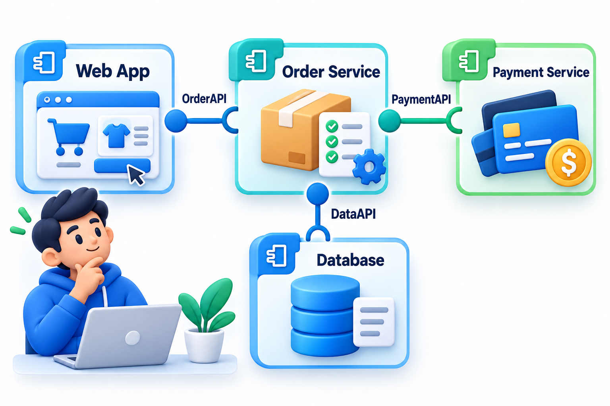
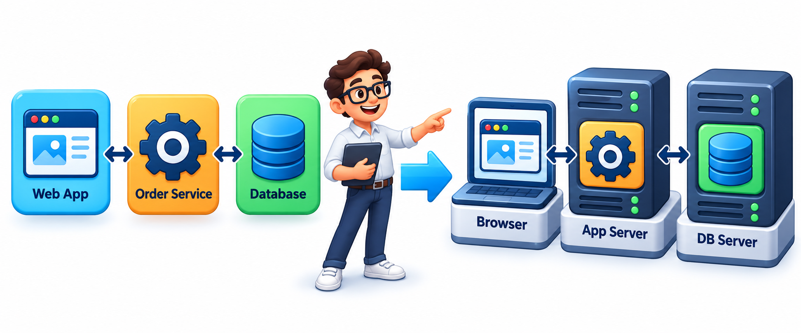
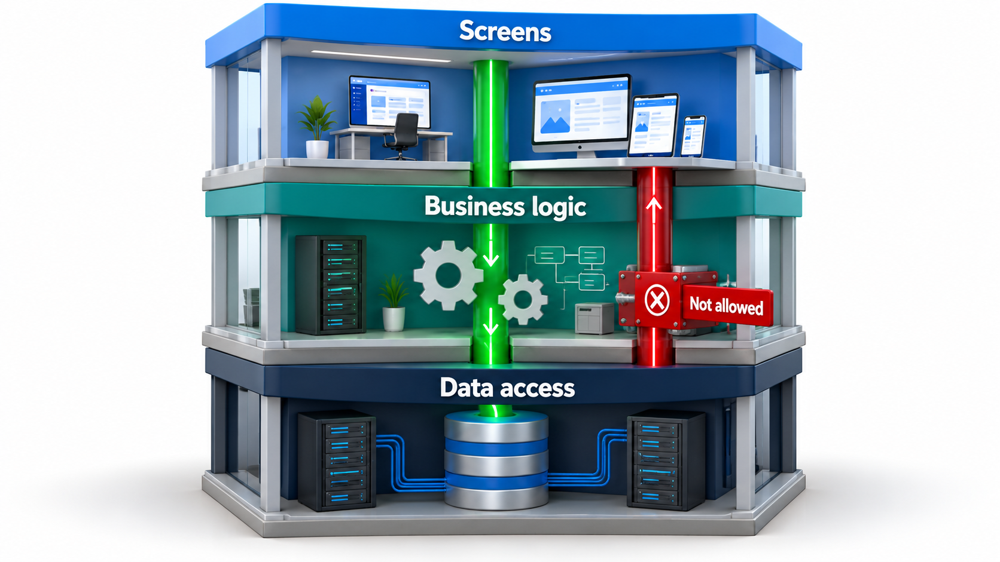

## Hidden Dependencies Are the Ones That Hurt

Systems are built from parts, and parts depend on one another. When one fails, the failure travels along the dependencies to everything that needs it. The most damaging outages are often those where the dependency was not drawn anywhere: two services that appeared unrelated both needed the same storage, and when it failed they failed together.

Two UML diagrams exist to make such dependencies visible. A **component diagram** shows the parts of a system and what each needs from the others. A **deployment diagram** shows where those parts run. Together they answer the question that matters when something breaks: if this one thing fails, what else goes with it?

The class diagram looks at the fine grain: the things inside the program. These two look at the coarse grain: the large pieces that are built, released and run separately. They are the diagrams a team uses when planning how to split work between groups, how to release safely, and how to survive failure.

## Components and Interfaces

A **component** is a replaceable part of a system, with a clear boundary, that hides its inside and offers a defined interface. A payment service, a login module and an order database are all components. A component diagram draws them as boxes labelled with `«component»` or a small icon, and shows how they connect.

Connections are drawn with two symbols. A **provided interface**, a small circle on a stick (like a lollipop), says "this component offers this service". A **required interface**, a half circle (a socket), says "this component needs this service". When the socket of one fits the lollipop of another, they are connected. Where the notation is awkward, a plain dashed arrow, labelled `uses`, from the dependent component to the one it depends on, is common and clear enough.

The idea is that components talk only through interfaces. Because the Orders service uses the Payment service only through its interface, the payment provider can be replaced with another, as long as the interface is kept, without anyone else noticing.

<!-- Visual: components of an online shop connected through lollipop and socket interfaces: Web app, Orders, Payments, Catalogue and Database. -->

## What Makes a Good Component

Dividing a system into components is a design decision, and some divisions are better than others.

| Quality | What it means | Warning sign when missing |
| --- | --- | --- |
| **Cohesive** | Everything inside belongs to one responsibility | A "Utilities" component that does unrelated things |
| **Loosely coupled** | Few and simple connections to others | A change in one component forces changes in five |
| **Clear interface** | Others need to know only what it offers | Callers reach into its internals |
| **Replaceable** | Another implementation could take its place | Everything depends on how it works inside |
| **Owned** | A named team looks after it | Nobody knows who to ask |

A component that scores badly on these is one whose boundary is in the wrong place. The diagram helps because the tangle shows up as a mass of crossing arrows.

## Following Dependencies

The arrows of a component diagram carry an important piece of information: the direction of dependency. A depends on B means A cannot work without B. A failure in B reaches A, and anything that depends on A, and so on. Take a small system.

| Component | Depends on |
| --- | --- |
| Web app | Auth service, Orders service |
| Orders service | Database, Payment gateway |
| Auth service | Database |
| Report job | Database |
| Database | Nothing |

Following the arrows shows what each failure affects.

| If this fails | Components affected | How |
| --- | --- | --- |
| Payment gateway | 2: Orders service, Web app | Orders needs the gateway, and the Web app needs Orders. Auth and the Report job are untouched. |
| Auth service | 1: Web app | Only the Web app needs it |
| Database | 4: Orders service, Auth service, Report job, Web app | Four of the five other components need it, directly or through another component |

The Database is a **single point of failure**: a part whose failure takes down much of the system. A dependency drawn on a diagram can be examined, and a team can decide to protect the database with a copy, or to let the Report job keep a cache so it survives briefly without it. A hidden dependency cannot be examined at all, which is the argument for drawing it.

Counting dependencies in both directions gives a quick measure of each component's role.

| Component | Depends on (outgoing) | Depended on by (incoming) | Role |
| --- | --- | --- | --- |
| Web app | 2 | 0 | A leaf: breaks if anything below fails, nothing breaks if it fails |
| Orders service | 2 | 1 | Middle |
| Auth service | 1 | 1 | Middle |
| Report job | 1 | 0 | A leaf |
| Database | 0 | 3 | Foundation: everything rests on it |

Components with many incoming arrows deserve the most care, since many others depend on them. Components with many outgoing arrows are the most fragile, since many things can break them.

## Where Things Run: Deployment Diagrams

A component diagram says what the pieces are. A **deployment diagram** says where they run. Its boxes are **nodes**, which are physical or virtual machines, containers or execution environments: a user's browser, an application server, a database server. Software items, called **artefacts**, such as a web application package or a database, are drawn inside the nodes they run on. Lines between nodes show the communication paths, such as an HTTPS connection or a link to a database.

This view answers different questions. How many copies of a component run, and on what? What crosses the network, and so can be slow or fail? What happens if this one machine, or this one data centre, goes away? A system whose components look independent on the component diagram may all be deployed on one server, and so share a fate.

<!-- Visual: software deployed across browser, application server and database server nodes. -->

## Reading a Deployment as a Failure Table

A deployment can be written as a table of what runs where, and the failure question asked of each node.

| Node | What runs on it | If the node is lost |
| --- | --- | --- |
| Server A | Web app, Auth service | Users cannot sign in or browse |
| Server B | Orders service, Report job | Orders and reports stop |
| Database server | Database | Everything that stores data stops |
| Browser | The user's page | Only that user is affected |

Now compare two deployments of the same components.

| Deployment | Servers | Loss of one server stops | Cost |
| --- | --- | --- | --- |
| All on one server | 1 | Everything | Lowest |
| Split as above | 3 | One or two components | Higher |
| Split and each duplicated | 6 | Nothing for a single loss | Highest |

The logical design is identical in all three. The cost, resilience and speed of the system are decided by the deployment, which is why it deserves a diagram of its own and a conversation before release, not after the first outage.

## Logical to Physical

The two diagrams are best used together, as the logical view and the physical view of the same system. The component diagram is the logical one: it is stable and describes responsibility. The deployment diagram is the physical one: it changes as the system moves from a laptop to a test server to the cloud. Mapping the first onto the second shows decisions that matter, such as which components share a machine, which are replicated, and where the data lives.

<!-- Visual: mapping logical software components to physical deployment nodes. -->

## Packages and Layers

A **package** groups related elements, and a package diagram shows how groups depend on each other. For a large system it gives the top-level map. A good structure has dependencies that point one way, from higher-level packages to lower-level ones, and avoids cycles in which A depends on B and B on A, since cycles make parts impossible to change or replace separately. Checking for cycles is one of the useful things a dependency drawing can do.

| Layer | Responsibility | May depend on |
| --- | --- | --- |
| Screens | What users see and click | Business logic |
| Business logic | Rules such as fine calculation | Data access |
| Data access | Reading and writing storage | Nothing above it |

If the data access layer needed to call back into the screens, the one-way structure would be broken, and a change to a screen could break storage. The rule "dependencies point down" is simple enough to check on a diagram and, with tooling, in the code.

<!-- Visual: packages arranged in layers (screens, business logic, data access), with dependency arrows pointing downward, and one crossed-out upward arrow labelled "not allowed". Save as images/50_package_layers.png. -->

## Common Faults

| Fault | What it looks like | Remedy |
| --- | --- | --- |
| **Hidden shared dependency** | Two "independent" parts that use the same database or service, not drawn | Draw shared resources explicitly |
| **Cycles** | A depends on B and B on A | Introduce an interface or move shared code to a third component |
| **Everything depends on one component** | A foundation with arrows from all sides | Protect it, and question whether it does too much |
| **Component diagram with no interfaces** | Only plain boxes | Name what each offers and needs |
| **Deployment diagram with no numbers** | No copies shown | State how many instances run |

## Five Misreadings of Component and Deployment Diagrams

**"A component is a class."** A component is larger: a replaceable part with an interface, often made of many classes.

**"Separate components means separate failures."** Only if they are deployed and connected separately. Two components on one machine, or sharing one database, fail together.

**"The deployment diagram is the operations team's problem."** Where things run shapes performance, cost and reliability, so developers need to understand it.

**"Draw every dependency."** A diagram with all of them is unreadable. Draw the ones that matter for the question, such as the paths whose failure would hurt.

**"Interfaces are a formality."** They are the promise that lets one part change without breaking the others. A diagram with clear interfaces is a diagram of a system that can be maintained.
