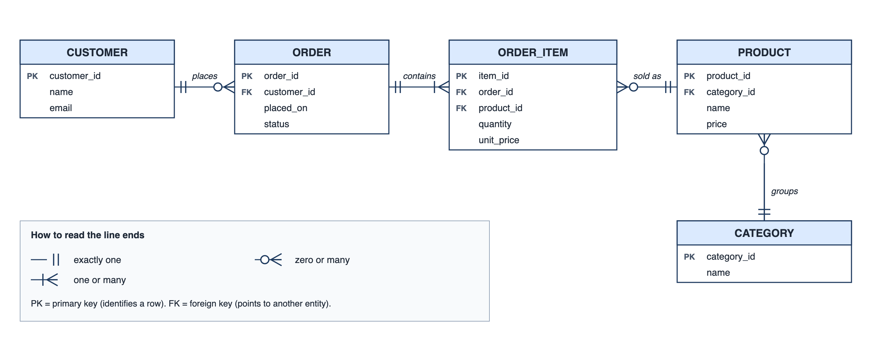
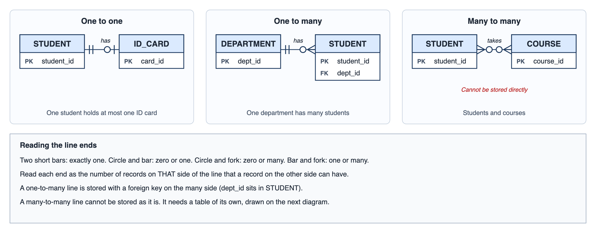
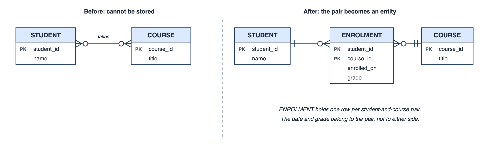
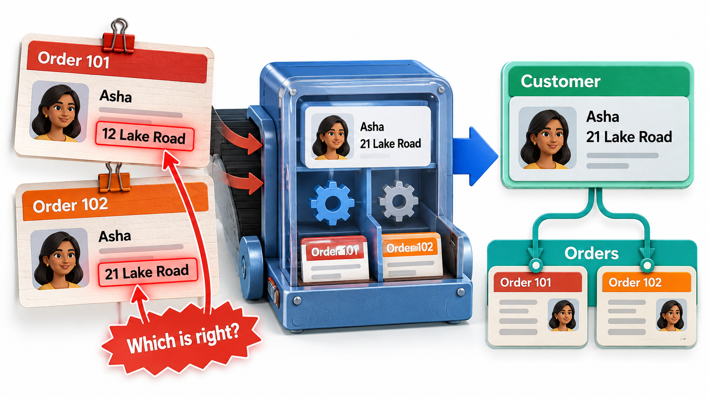

## Data Outlives Code

A program can be rewritten in a year, but the data it created stays, and every assumption in the shape of that data stays with it. A form that assumes everyone has a first name and a last name cannot hold a person with one name. A column that is 20 characters wide silently cuts off a longer name. These assumptions were not decided by anyone; they were absorbed from the first picture of the data that came to mind, and once built into a table they are hard to remove.

**Data modelling** is the practice of deciding, deliberately and early, what a system must remember and how the pieces relate. A mistake in the data model is the most expensive kind of mistake in software, precisely because data outlives code.

Consider why. Code can be replaced by deploying a new version, and the old one disappears. Data cannot be replaced: it holds years of customers, orders and history, and every program, report and export that reads it expects it to have a particular shape. To change the shape, the data must be migrated without loss, every reader must be updated, and the whole must happen while the system keeps running. Teams that skip the thinking at the start pay for it many times over.

## Three Levels of Data Model

Data models are drawn at different levels of detail for different people, and confusing the levels is a common source of muddle.

| Level | Describes | Audience | Example |
| --- | --- | --- | --- |
| **Conceptual** | The things the business cares about and how they relate, with no technical detail | Client and team | Student, Course, Enrolment |
| **Logical** | Entities, attributes, keys and relationships, independent of any particular database product | Designers | Student(id, name, email) |
| **Physical** | Actual tables, column types, indexes and storage choices for a chosen database | Developers and administrators | `student` table with `name` as 100 characters |

The usual route is from conceptual to logical to physical, adding detail at each step. A client can check the conceptual model, since it uses their words. Only the physical model depends on the database product, which is why the first two should be settled before the third.

## Entities, Attributes and Relationships

The standard notation is the **entity-relationship (ER) diagram**, proposed by Peter Chen in a 1976 paper. It has three ideas.

- An **entity** is a kind of thing the system must remember, such as Student, Course or Payment. It becomes a table.
- An **attribute** is a fact about an entity: a student's name, a course's title. It becomes a column. One attribute, or a combination, is chosen as the **key**, the value that identifies each record uniquely.
- A **relationship** says how entities are connected: a student *enrols in* a course. It is described by its **cardinality**: how many of one entity can be linked to how many of another.

| Cardinality | Meaning | Example |
| --- | --- | --- |
| **One to one** | Each record on one side matches at most one on the other | A student and their ID card |
| **One to many** | One record on one side matches many on the other | A department has many students |
| **Many to many** | Records on each side match many on the other | Students and courses |

The cardinality of a relationship is a statement about the business, and it is worth confirming with the people who know. "Can a student belong to two departments?" is a question that changes the table design completely.

<!-- Visual: an ER diagram: CUSTOMER, ORDER, ORDER_ITEM, PRODUCT and CATEGORY as tables with primary and foreign keys, joined by crow's-foot lines, with a key to the line ends. -->

Read each line as two sentences, one from each end. Between CUSTOMER and ORDER, the bars at the customer end say that every order has exactly one customer, and the circle and fork at the order end say that a customer can have zero or many orders. ORDER and ORDER_ITEM are joined with a bar and a fork, so an order has one or many items. ORDER_ITEM is the table that sits between ORDER and PRODUCT: many items can refer to one product, and each item refers to exactly one. CATEGORY groups products, and the foreign key `category_id` inside PRODUCT is how the one-to-many line is stored. The keys marked PK identify rows, and the keys marked FK are the columns that hold another table's key.

## Choosing Keys

Every entity needs something that tells one record from another. The choice is more delicate than it looks.

| Kind of key | Description | Example | Trade-off |
| --- | --- | --- | --- |
| **Natural key** | A real-world value that is already unique | Roll number, email address | Meaningful, but real values change: people change email addresses |
| **Surrogate key** | An invented number or code with no meaning | A student number such as 4821 | Never changes, but means nothing to a reader |
| **Composite key** | Two or more columns taken together | (student id, course id) | Natural for junction tables |

A good key is **unique** (no two records share it), **stable** (it does not change over the life of the record) and **never empty**. Email addresses fail the stability test, and phone numbers fail the uniqueness test when a family shares one. Most designs use a surrogate key and keep natural values as ordinary columns, with a rule that they must not repeat.

## From the Diagram to Tables

An ER diagram translates almost mechanically into a relational database.

<!-- Visual: three small ER diagrams side by side for one to one (Student and ID card), one to many (Department and Student) and many to many (Student and Course), with a key to the line ends. -->

1. Each entity becomes a table, each attribute a column, and the key becomes the primary key.
2. A **one-to-many** relationship is stored by putting the key of the "one" side as a **foreign key** column in the "many" side. Each student row carries the id of their department.
3. A **many-to-many** relationship cannot be stored in either table, because each row would need a list. It becomes a table of its own, a **junction table**, with one row per pair and the two foreign keys. Enrolment is such a table: one row for each student-and-course pairing.

The junction table is often a hidden entity with its own facts. An enrolment has a date, a grade and a status, and these belong to the pair, not to the student or the course alone. Spotting that is a sign of a good model.

<!-- Visual: a before and after diagram: Student and Course joined by a many-to-many line on the left, and on the right the same pair joined through an Enrolment table that carries the date and grade. -->

## Mapping to Tables in Practice

Take students, courses and enrolments. A many-to-many relationship (a student can take many courses, and a course has many students) is held in three tables.

| Student table: id | name |
| --- | --- |
| 1 | Asha |
| 2 | Ravi |

| Course table: id | title |
| --- | --- |
| 10 | Python |
| 20 | DBMS |

| Enrolment table: student id | course id |
| --- | --- |
| 1 | 10 |
| 1 | 20 |
| 2 | 10 |

The enrolment table is the junction table: it holds only pairs of ids, one row for each student-and-course link. Asha (1) is in Python (10) and DBMS (20), and Ravi (2) is in Python. A question that crosses the relationship, such as how many students are in each course, is answered by matching the course ids in the enrolment table to the course table and counting: Python has two students and DBMS has one.

Notice that the model never stores a student's name in the enrolment table or a list of courses in the student table. Every fact is held once, and the relationship is held in one place. Changing a course title means changing one row.

## What Goes Wrong Without Normalisation

The alternative to this design is a single wide table, which seems simpler at first.

| student | course | course title | lecturer | lecturer email |
| --- | --- | --- | --- | --- |
| Asha | 10 | Python | Meena | meena@college.edu |
| Ravi | 10 | Python | Meena | meena@college.edu |
| Asha | 20 | DBMS | Karthik | karthik@college.edu |

Three kinds of trouble follow, known as **anomalies**.

| Anomaly | What happens in the wide table |
| --- | --- |
| **Update** | Meena changes her email. It must be changed in every row she appears in; miss one and the data disagrees with itself |
| **Insert** | A new course with no students yet cannot be recorded, because every row needs a student |
| **Delete** | If Ravi is the only student in a course and his row is deleted, the course and its lecturer vanish from the data |

**Normalisation** is the discipline of splitting tables so that each fact is stored in one place, which removes these anomalies. In practice it means asking, for each column: does this depend on the key of this table, and nothing else? The lecturer's email depends on the lecturer, not on the enrolment, so it belongs in a lecturer table.

<!-- Visual: a customer's name and address repeated on every order row, with two rows showing different addresses and a warning "which is right?", beside a model where the address is stored once and orders point to it. Save as images/51_store_each_fact_once.png. -->

## Mapping Entities to Classes and Tables

Programmers meet the same ideas in two forms. In a program, an entity is a class and a relationship is a reference or a collection. In a database, it is a table and a foreign key. Object-relational mapping tools exist to move between the two. The mismatch between them, known as the impedance mismatch, is a regular source of trouble: a class holds a list of courses inside a student, where a table cannot. The data model should be designed with both views in mind, and decisions such as the junction table should be made once, in the model, and not rediscovered in the code.

## Questions That Improve a Data Model

A few questions reveal most of the problems before any tables exist.

| Question | Why it matters | Example of what it reveals |
| --- | --- | --- |
| What identifies each thing uniquely, and can that identifier change or repeat? | Keys are hard to change later | Email as key breaks when a student changes address |
| What happens to history when something changes? | Old records must stay true | An old invoice should keep the old address |
| What must never be empty, and what may be? | Decides column rules | A student must have a name; a middle name is optional |
| What are the longest, shortest and oddest values? | Prevents truncation and rejection | A single-word name; a 60-character surname |
| Who owns each fact? | Prevents two sources of truth | Fee amount owned by finance, not copied by every system |
| Which facts are calculated? | Stored copies drift from the source | The order total derived from its items |

Normalisation follows from asking these questions. A model that repeats a fact in several places will, sooner or later, contain two versions of it that disagree.
