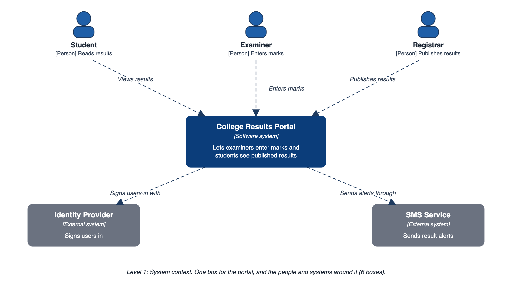
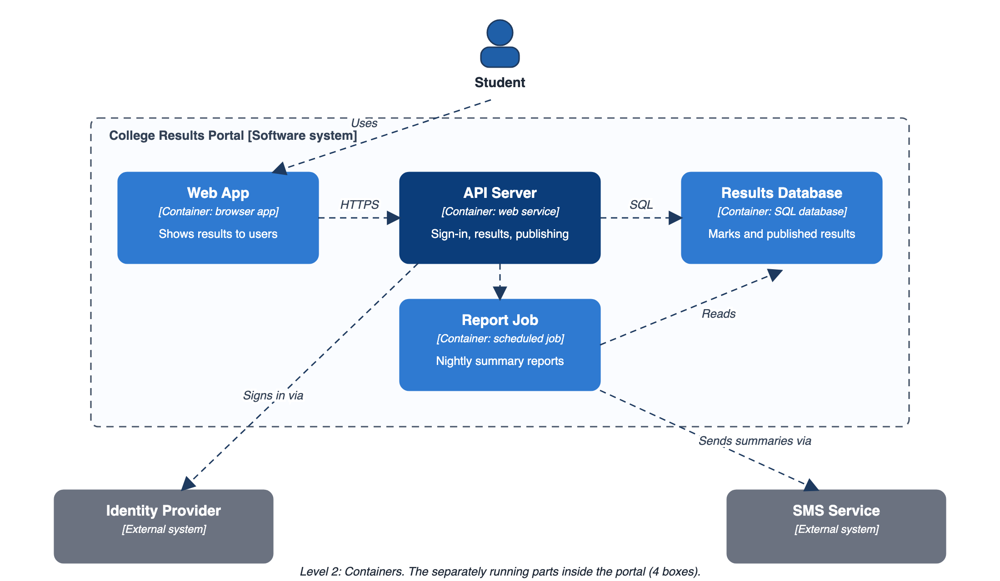
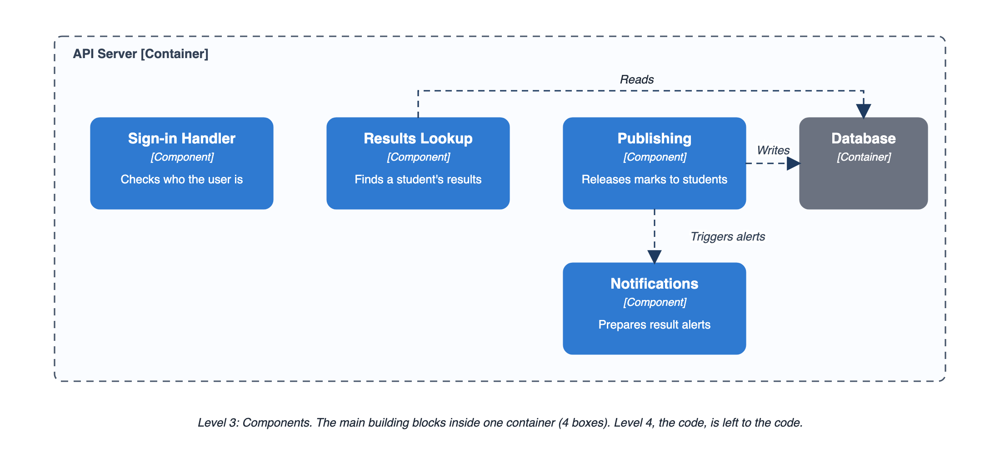
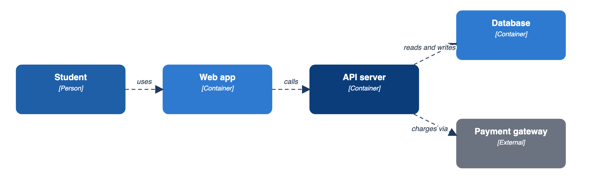
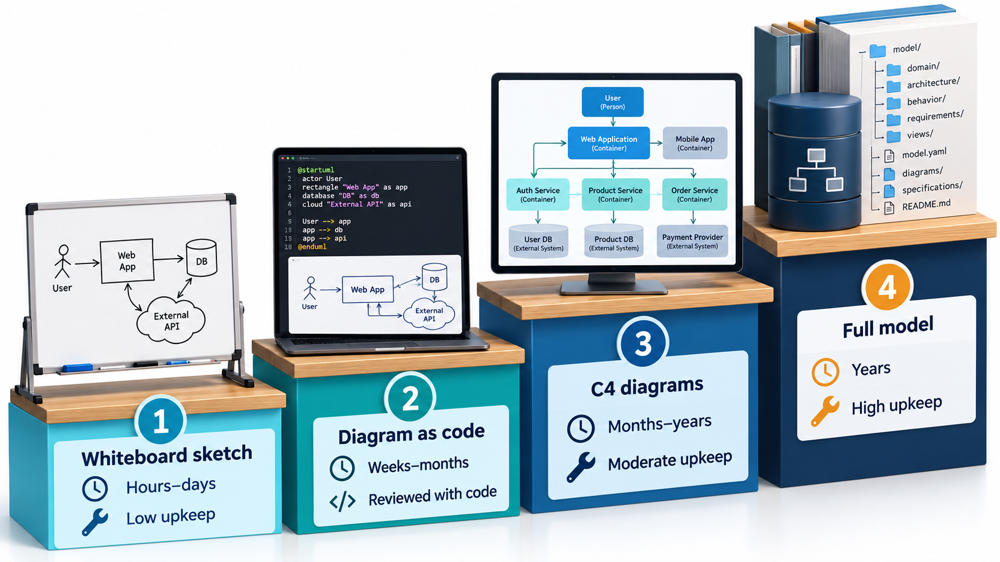
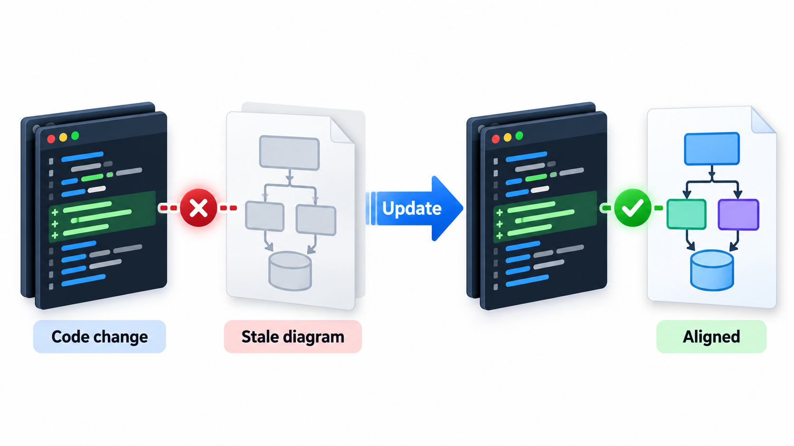

## Draw Only as Much as You Need

A diagram is a means, not a product. Its job is to help people think and talk, and once it has done that it has little value unless it stays true. The heavyweight habit of drawing everything in a tool, filing it in a document and never touching it again produces pictures that go quietly out of date. The lightweight alternative is to draw as little as needed, keep it close to the work, and treat diagrams as part of the code base and not as a separate document.

Several tools make this practical by describing diagrams in plain text, so that a diagram can live next to the work it describes, change in the same review as the work, show up in a comparison of versions, and be reviewed like anything else. This topic is about that shift towards lightweight modelling.

The shift answers a real problem. Teams that drew complete models before building discovered two things: the models were out of date by the time the code existed, and the effort of keeping them current competed with the effort of delivering. Lightweight modelling keeps the benefit, shared understanding, and drops most of the cost.

## The Agile Attitude to Models

The agile movement did not reject modelling. It rejected modelling that was heavy, slow and detached from the working software. An agile team still draws, but on its own terms.

- **Draw to think, then throw it away.** A whiteboard sketch of the design for the next two weeks does its job in an hour. It does not need to be kept, formalised or kept up to date.
- **Model just enough.** Enough to start, to share a common picture, and to see the risky parts. Not a complete design for the whole system before any code.
- **Keep it close to the code.** Diagrams that live in the repository are more likely to be seen and corrected.
- **Treat the working software as the model that counts.** Diagrams explain it. They are never more authoritative than it.

The phrase sometimes used is *just enough, just in time*: draw what the next decision needs, when it is needed.

| Heavy habit | Lightweight habit | What changes |
| --- | --- | --- |
| Model the whole system before coding | Model the next piece before building it | Less is drawn, and what is drawn is used at once |
| Keep diagrams in a separate document | Keep them in the repository | They are seen when code changes |
| Update diagrams as a separate task | Update them in the same change as the code | They stay true |
| Treat the diagram as the specification | Treat working software as the truth | Diagrams cannot drift into fiction unnoticed |
| Draw everything in the same detail | Draw risky parts in detail and the rest roughly | Effort follows risk |

## Whiteboard Sketching

The cheapest model is a group of people at a whiteboard. A few habits make it effective. Start from a concrete scenario, such as "a student pays a fee", and walk through it. Draw boxes for the things that matter and arrows for who talks to whom, and name them in words the whole group uses. Argue with the picture, not with each other. Take a photo before wiping it, and attach it to the ticket or the pull request. A photo of a whiteboard, taken with a date and a title, is a perfectly good record of a design discussion.

A sketching session often follows a short pattern.

1. **State the question** on the board before drawing anything: "How will results reach students on results day?"
2. **Draw the current understanding** in a few boxes and arrows.
3. **Walk one scenario** through it, tracing the path with a marker.
4. **Mark what is unknown or risky** with a question mark or a colour.
5. **Decide the next action**, which may be a prototype, a conversation or the first piece of code.
6. **Photograph and move on.**

The picture is a by-product. The valuable output is the shared understanding and the decision.

## The C4 Model: Zooming In and Out

Simon Brown developed the **C4 model** in the 2000s and 2010s as a lightweight way to describe software architecture at four levels of zoom, like a map. Each level answers a different question for a different audience.

| Level | Shows | The question it answers | Audience |
| --- | --- | --- | --- |
| **1. System context** | Your system as one box, with the people and systems around it | What is it, who uses it, what does it connect to? | Everyone, including non-technical people |
| **2. Containers** | The separately running parts: web app, API, database, mobile app | What are the major pieces and how do they talk? | Developers and operations |
| **3. Components** | The main building blocks inside one container | How is this container organised? | Developers working on it |
| **4. Code** | Classes and methods | How is this component built? | Rarely drawn, as the code itself says it |

The word *container* here means a separately running or deployable thing, such as a web application or a database. It does not mean a Docker container, though it may be one. The value of the model is that most teams need only the first two levels, and each level is simple. A context diagram has one box for the system and a handful of others around it. Nothing else is needed to tell a new colleague what the system is for.

The map analogy is exact. A map of a country shows motorways, a map of a city shows streets, and a map of a street shows houses. Nobody tries to show houses on the country map. In the same way, a context diagram does not show internal services, and a component diagram does not show other systems' internals.

## What Each C4 Level Looks Like for One System

Take a college results portal.

| Level | What the diagram contains | Count of boxes |
| --- | --- | --- |
| Context | The portal; Student, Examiner and Registrar as people; the identity provider and the SMS service as outside systems | 6 |
| Containers | Web app, API server, results database, report job | 4 inside the portal, plus the outside systems |
| Components (inside the API server) | Sign-in handler, results lookup, publishing, notifications | 4 |
| Code | Left to the code itself | None drawn |

Here are the first three levels drawn for the portal. The context diagram comes first: the portal is one box, with the three people who use it and the two outside systems it depends on.

<!-- Visual: a C4 system context diagram of a college results portal with Student, Examiner and Registrar people and Identity Provider and SMS Service external systems. -->

Zooming in one level opens the portal box and shows the separately running parts inside it. Each box names its technology, so a developer can see what is a browser app, what is a service and what is a database.

<!-- Visual: a C4 container diagram of the results portal with Web App, API Server, Results Database and Report Job inside a boundary, and the Identity Provider and SMS Service outside it. -->

Zooming in once more opens a single container, the API server, and shows its main building blocks.

<!-- Visual: a C4 component diagram of the API server with Sign-in Handler, Results Lookup, Publishing and Notifications, and the Database container. -->

A new joiner can understand the first diagram in a minute, the second in five, and the third when they start work on the API. They never need to wade through detail meant for someone else.

## Diagrams as Text

The idea of keeping a diagram as text has a simple form. The relationships are data: a list of what connects to what, with a label. A few lines of text turn the list into a picture, using a tool such as Mermaid or PlantUML. Take four connections.

| From | Label | To |
| --- | --- | --- |
| Student | uses | Web app |
| Web app | calls | API server |
| API server | reads and writes | Database |
| API server | charges via | Payment gateway |

Drawn by a tool from those four rows, the picture looks like this.

<!-- Visual: a diagram generated from four connections: Student uses Web app, Web app calls API server, API server reads and writes Database, and API server charges via Payment gateway. -->

Each row becomes one line of text in the tool's notation: a name, a labelled arrow and another name. Pasted into a page that supports the tool, the four lines display as a picture of the student using the web app, which calls the API server, which reads and writes the database and charges through the payment gateway. A change to the system is a change to a line of text. In a review, the reviewer sees a new line such as "API server sends email through Mail service" as a plain addition, and can comment on it. That is what makes the diagram easy to keep honest.

| Benefit | Why it follows from text |
| --- | --- |
| **Versioned** | Every change is recorded with who made it and why |
| **Reviewable** | A teammate can comment on one line of a change |
| **Searchable** | You can find every diagram that mentions the payment gateway |
| **Mergeable** | Two people can edit without overwriting each other |
| **Cheap to correct** | Fixing a diagram takes seconds, so it gets fixed |

The cost is control over layout. The tool places boxes automatically, and for a large diagram the result may need coaxing. For most working diagrams that is a fair price.

## Choosing the Weight

Whiteboards, C4 diagrams and diagrams-as-code are three points on a scale of effort, and each suits a different purpose.

| Style | Lifespan | Best for |
| --- | --- | --- |
| **Whiteboard sketch** | Hours to days | Thinking together, deciding the next piece of work |
| **C4 context and container diagrams** | Months | Explaining the system to newcomers and outsiders |
| **Diagrams as code** | As long as the code | Details that change, kept in review with the code |
| **Full UML model in a tool** | Years | Regulated or safety-critical systems that need traceability |

The principle that runs through all of them is the same: the effort of a diagram should match the value of what it records. A short-lived idea should have a short-lived drawing.

A few questions help choose.

| Ask | If yes | If no |
| --- | --- | --- |
| Will anyone need this after the week ends? | Keep it somewhere durable | Sketch and discard |
| Does it change whenever the code changes? | Keep it as text beside the code | A static picture is fine |
| Must an auditor or regulator see traceability? | A full model in a tool may be justified | Keep it light |
| Is the audience outside the team? | Use context-level diagrams in their language | Team-level detail is fine |

<!-- Visual: four rungs of a ladder from whiteboard sketch to diagram as code to C4 diagrams to full model in a tool, each labelled with how long it lasts and how much it costs to keep current. Save as images/52_modelling_weight_ladder.png. -->

## Keeping Diagrams Honest

Even light diagrams rot. A few habits prevent it.

- **Date and own every long-lived diagram.** A line saying who maintains it and when it was last checked makes staleness visible.
- **Update in the same change.** If a pull request alters the structure, the diagram changes with it, and the reviewer checks both.
- **Delete without guilt.** A diagram nobody has opened in a year is a candidate for removal. A missing diagram misleads nobody; a wrong one misleads everyone.
- **Prefer fewer diagrams.** Each one is a promise to keep it true.
