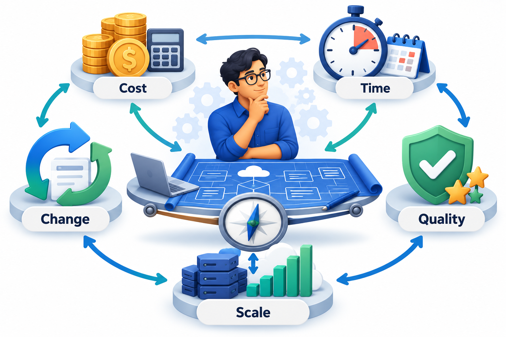
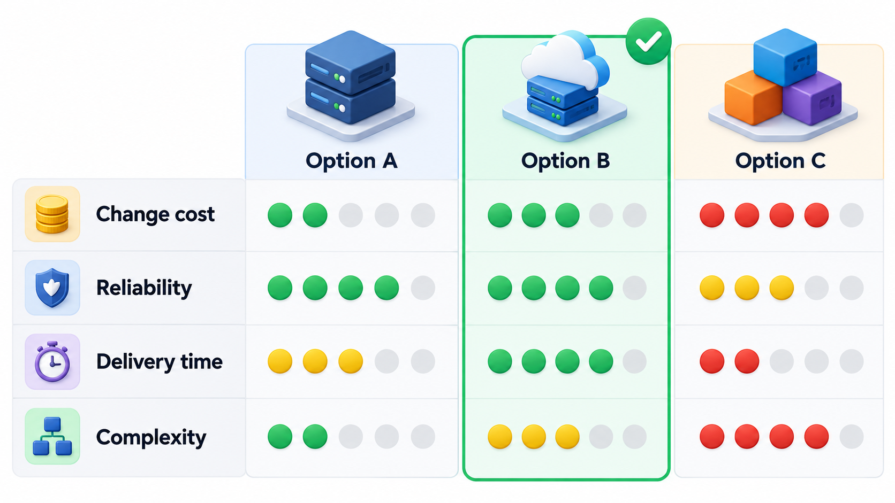
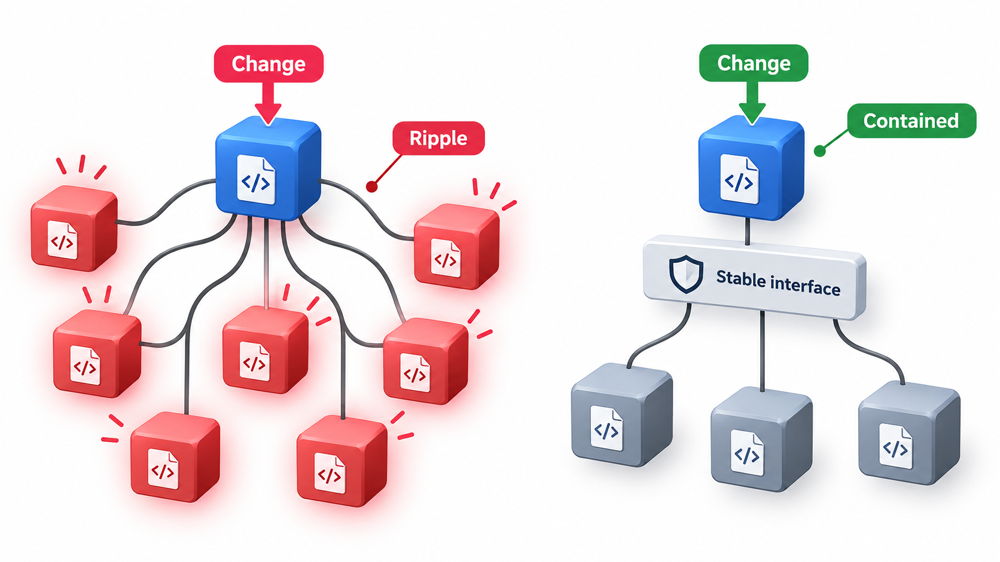
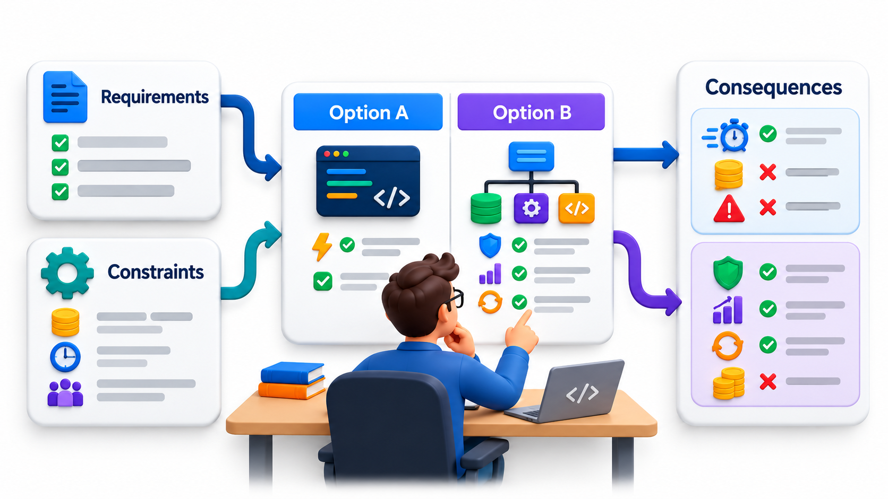
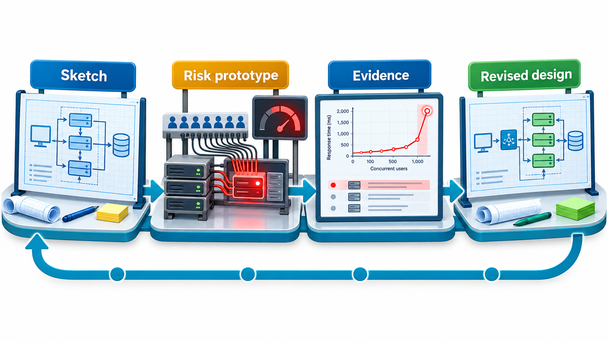

## Design Is the Cheapest Place to Make a Mistake

Between knowing what a system must do and writing it lies a stage where the structure is decided: which parts exist, what each is responsible for, how they talk to each other. A mistake here costs a conversation or a sketch. The same mistake discovered after the system is built costs a rewrite. Yet this is also the stage most easily skipped, because it produces no running software.

**Software design** is the activity of deciding that structure on purpose: generating options, comparing them against what matters, recording the choice and its reasons, and checking it before it is built. Skipping the analysis does not remove the decisions; it makes them by accident, later, and without anyone checking their effect. This topic is about doing design deliberately.

The economics are simple. Suppose a flawed decision is found at three different moments.

| When the flaw is found | What fixing it involves | Relative cost |
| --- | --- | --- |
| During a design review | Redrawing a sketch, a short conversation | 1 |
| During coding | Rewriting the affected modules | 5 to 10 |
| After release | Rewriting code, migrating data, apologising to users | 50 or more |

The ratios are illustrative and vary between projects, but the direction is consistent across the industry: the later a flaw is found, the more depends on it, and the more it costs to remove.

## Design Is Deciding

To design software is to decide how it will be built so that it meets its requirements within its constraints. It sits between the question of *what* the system must do, answered by requirements, and the act of writing the code. A design is not a drawing. It is a set of decisions: which parts the system has, what each is responsible for, how the parts talk, what technology is used, how data is stored, how failures are handled.

Every program has a design, whether or not anyone chose it. The only choice is whether the decisions are made deliberately, with the alternatives considered, or by accident, one line of code at a time. Accidental design tends to leave a system hard to change.

Because design is a series of decisions, it is shaped by forces that pull in different directions: the requirements, the quality attributes such as speed and security, the deadline, the budget, the skills of the team, the technology already in use. A design is a compromise between them, and a good designer can say which forces were weighed and why.

<!-- Visual: a designer in the middle with forces pulling in from the sides: requirements, quality goals, time, cost, team skills and existing technology. -->

## Levels of Design

Design happens at several levels, from broad to narrow, and mixing them up causes confusion.

| Level | What is decided | Example |
| --- | --- | --- |
| **Architecture** | The major parts of the system, their responsibilities and how they connect | A web app, an API server, a database and a payment gateway |
| **High-level design** | How each major part is divided into modules or components | The API server has modules for students, fees and receipts |
| **Detailed design** | The classes, functions and data structures inside a module | A `FeeCalculator` class with a method that takes a student and a date |
| **Interface design** | What each part promises to the others | The inputs, outputs and errors of the fee calculation |

The higher levels are more expensive to change and shape everything below them. Choosing a database early is a much bigger commitment than choosing the name of a function. A common error is to spend days on the detailed design of one class while the architecture is still undecided, and the opposite error is to draw boxes and arrows and never think about how any one of them would work.

## The Steps of a Design Process

Design looks different in every team, but a sensible process has a recognisable shape.

1. **Understand the problem and the forces.** Read the requirements, and list the quality goals (how fast, how secure, how available), the constraints (deadline, budget, existing systems) and the skills of the team.
2. **Identify the hard parts.** Which requirements are risky or unfamiliar? Design effort belongs there first, not on the routine parts.
3. **Generate more than one option.** The first idea is rarely the best. Even two or three rough alternatives sharpen thinking.
4. **Compare the options against the forces.** Use a table. Be explicit about which quality each option favours.
5. **Choose, and record why.** Write down the decision, the alternatives rejected and the reasons.
6. **Test the riskiest part cheaply.** A small prototype or a paper walkthrough of a hard scenario.
7. **Review with others.** Someone who did not make the decision will see what its author cannot.
8. **Revise as you learn.** Expect the design to change once code exists.

The most commonly skipped steps are three and five. Teams commit to the first option they think of and never record why. Months later nobody can explain the decision, and nobody dares to change it.

## Comparing Options with a Decision Table

When there are two or three candidate designs, a small table makes the trade-offs plain. Suppose a college portal must send fee reminders, and the team considers three ways.

| Criterion | Weight | A: Send inside the web request | B: A nightly batch job | C: A message queue with a sender service |
| --- | --- | --- | --- | --- |
| Simple to build | 3 | 5 | 4 | 2 |
| Does not slow users down | 3 | 1 | 5 | 5 |
| Survives a mail outage | 2 | 1 | 3 | 5 |
| Cheap to run | 2 | 5 | 5 | 3 |
| **Weighted total** | | 3x5+3x1+2x1+2x5 = **30** | 3x4+3x5+2x3+2x5 = **43** | 3x2+3x5+2x5+2x3 = **37** |

The scores are judgements, not measurements, and the weights are the team's own priorities. The value of the table is not the arithmetic but the conversation it forces. If someone disagrees with the winner, they must say which weight or score they dispute. For a small college, option B wins. For a company sending millions of messages a day with a strict reliability goal, the weights would change and option C might win. The same options give a different answer when the forces differ, which is why a design is always "right for these conditions".

## Compare Designs by What a Change Costs

A way to judge a design is to ask how much would have to change when a plausible requirement changes. Compare two designs for the same system when the tax rule changes. In design A, each of the billing, invoice, reports and refunds modules has its own copy of the rule. In design B, one tax service owns the rule and the other modules ask it.

| Design | Where the tax rule lives | Modules to edit when the rule changes |
| --- | --- | --- |
| A: copied everywhere | Billing, invoice, reports and refunds | 4 |
| B: one owner | The tax service only | 1 |

The two designs behave the same today. They differ in the cost of a change tomorrow: one edit against four, with a chance of missing one of the four. A design review that asks "what happens when this changes?" finds this kind of difference before anything is built. Real designs have many such questions: change the database, add a payment method, support a new language. The more of them a design absorbs in one place, the cheaper it is to keep.

## Design Documents

Decisions have to be recorded, or they are forgotten and re-argued. A **design document** is a written account of a design: the problem it addresses, the options considered, the choice made and the reasons, the main components and their interfaces, and the risks. It need not be long. Many teams use a short template of two to six pages.

| Section | What it answers |
| --- | --- |
| **Context and goals** | What problem, for whom, and what counts as success? |
| **Non-goals** | What are we deliberately not solving? |
| **Options considered** | What else could we have done? |
| **Decision and reasons** | What did we choose, and which forces decided it? |
| **Main components and interfaces** | What are the parts and what do they promise? |
| **Risks and open questions** | What might go wrong, and what do we not yet know? |

The most valuable part of a design document is not the final diagram. It is the section on alternatives, which says what else was considered and why it was rejected. Months later, when someone asks "why didn't they use a queue here?", the answer is in the document. Reviewing the document with colleagues before building is also the cheapest way to find problems. Another person asking "what happens if the payment times out?" costs a few minutes, and the same question in production costs far more.

<!-- Visual: requirements constraints and trade-offs shape design decisions. -->

## Design Is Iterative

It would be pleasant if design were a phase that finished before coding began. It rarely is. Writing code teaches things that analysis could not, and the design adjusts. A good approach is to design enough to start, to build the risky parts early to test the design, and to revise as understanding grows.

The risk in revising is not the change itself. It is changing the design without examining the effect, or without testing the result. A seventeenth-century warship whose design was changed to carry extra guns after the plans were approved, and which was never properly tested for stability, is the extreme example; a software team that bolts on a new requirement without asking what it does to the structure is the everyday one. Each revision should go through the same questions as the original: what forces changed, what does the change touch, and how will we know it works?

<!-- Visual: a loop of sketching a design, testing the riskiest part with a small build, learning, and revising the design, shown as a repeating cycle. Save as images/53_design_iterate.png. -->

## When to Stop Designing

Design can go on forever. Two guides help to stop. First, design until the riskiest decisions are made and tested, not until every detail is settled; the rest can be decided when it is built. Second, stop when the cost of being wrong is lower than the cost of further thinking. A decision that is easy to reverse, such as a function name, deserves minutes. A decision that is hard to reverse, such as the choice of database or the boundaries between services, deserves days.

| Decision | Cost of reversing | Design effort it deserves |
| --- | --- | --- |
| Name of a function | Minutes | Almost none |
| Layout of a module's internals | Hours | A short sketch |
| Interface between two teams' modules | Days of coordination | A written agreement and review |
| Database choice | Weeks, with data migration | A comparison and a prototype |
| Splitting into separately deployed services | Months | A full design document and review |

## Five Misreadings of Software Design

**"Design is drawing diagrams."** Diagrams record a design. The design is the set of decisions behind them.

**"If we do not design, we avoid design."** Not designing means the design is made by default, line by line.

**"A design is finished before the coding starts."** It is refined as the team learns. Design and coding feed each other.

**"Good design means the most flexible design."** It means one that fits the forces actually present. Flexibility that nobody needs is cost.

**"The architect decides and others follow."** Design works best as a conversation, with those who must build and run the system helping to find the problems.
