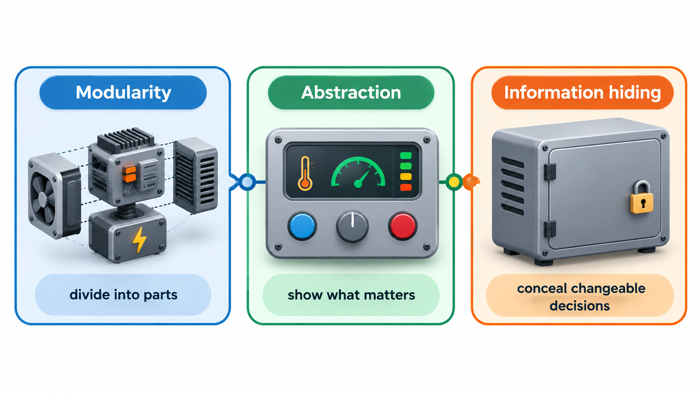
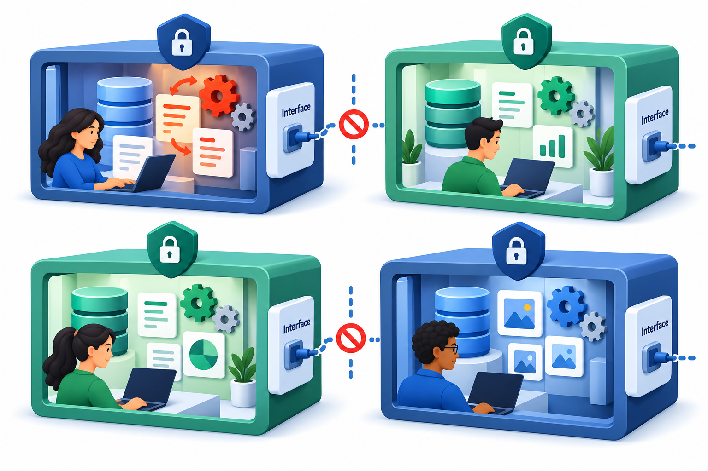
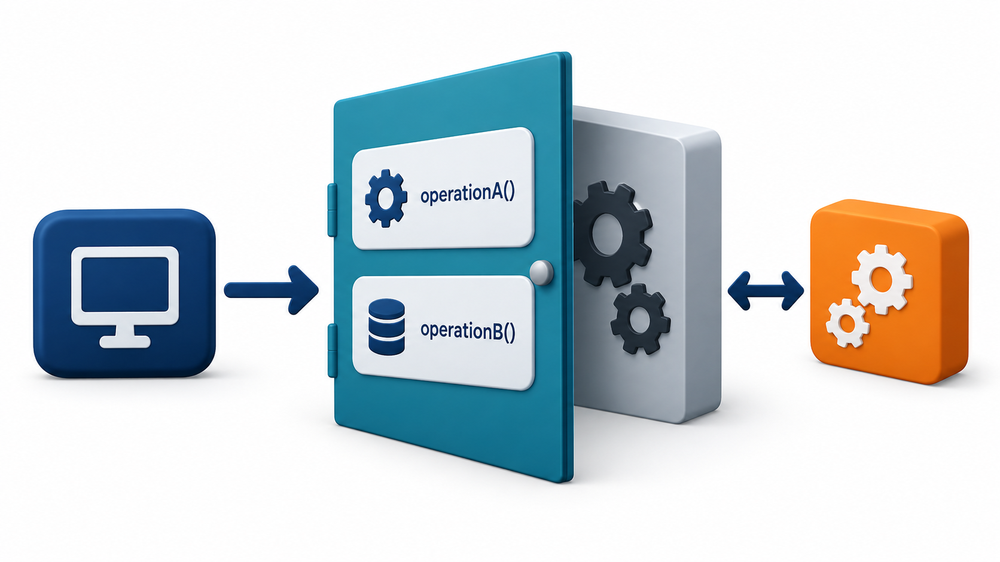
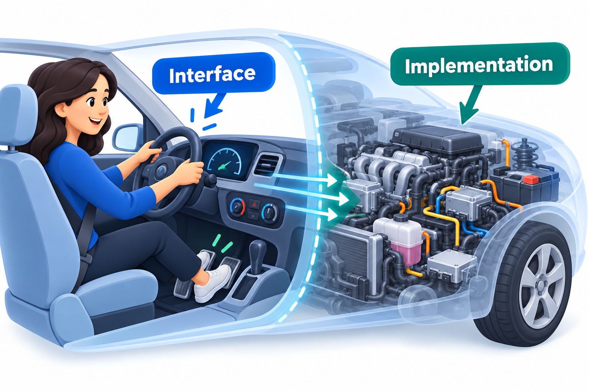
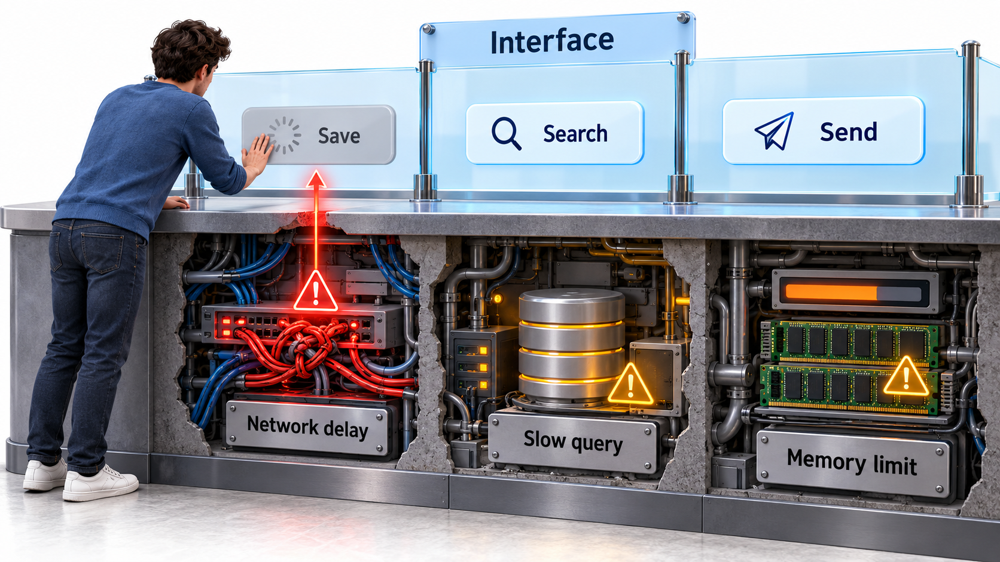

## Hide the Decision That Is Likely to Change

Any system can be cut into modules in more than one way. One way follows the steps of the process: a module to read the input, one to transform it, one to sort it, one to print it. Another follows the decisions that are likely to change: how the data is stored, how it is packed, how it is sorted. Both versions can be built in about the same time, and both work. The difference appears when something changes.

A change to the storage format touches every module in the first design, because they all share the data layout. In the second it touches one. This is the core of **modularity** and **information hiding**: modules should be chosen to hide design decisions that might change, behind a small interface, and not to mirror the steps of the process. Abstraction is the companion idea of presenting only what a user of a module needs to know.

The comparison comes from a 1972 paper by the computer scientist David Parnas, which compared two ways of dividing the same small program and showed that the second made change far cheaper. Half a century later, the lesson is still one of the most reliable in design.

## Three Related Ideas

Three ideas work together here, and they are often confused.

**Modularity** is dividing a system into parts, called modules, that can be understood, built and changed separately. Without it, one person must keep the whole system in their head, which fails once the system is larger than a few thousand lines.

**Abstraction** is the practice of focusing on what something does and ignoring how. A driver uses a steering wheel and a pedal. The mechanism of the car is out of sight. In software, a function named `calculate_fee` is an abstraction: the caller knows what it returns, and not what it does inside.

**Information hiding** is Parnas's principle. Each module keeps its design decisions secret and shows the rest of the system only a small, stable interface. Abstraction describes the view from the outside, and information hiding is the discipline that makes the abstraction safe to rely on.

| Idea | Question it answers | Benefit |
| --- | --- | --- |
| Modularity | How do I split the system? | Parts can be built and understood separately |
| Abstraction | What does the user of this part need to know? | Users think at a higher level |
| Information hiding | Which decisions should be secret, and where? | Changes stay inside one module |

<!-- Visual: a module drawn as a box with a thin, labelled interface on the outside and several design decisions (storage format, algorithm, data structure) hidden inside. -->

## Two Ways to Divide the Same Program

Take a program that reads a list of student records, sorts them by name and prints a report. Here are two decompositions.

| Division | Modules | What each knows |
| --- | --- | --- |
| **By process step** | Read, Sort, Print | All three know the layout of a record and how the list is stored |
| **By hidden decision** | Record store, Name ordering, Report layout | Only the record store knows the layout; only the ordering module knows how names are compared; only the report module knows how output looks |

Now introduce four changes and count the modules that must be edited.

| Change | Process-step design | Hidden-decision design |
| --- | --- | --- |
| Records gain a "section" field | Read, Sort, Print (3) | Record store (1) |
| Sort order becomes surname first | Sort (1) | Name ordering (1) |
| Store records in a database, not a file | Read, Sort, Print (3) | Record store (1) |
| Report must be printed as a table | Print (1) | Report layout (1) |
| **Total edits** | **8** | **4** |

Both designs handled the ordering and layout changes equally well. The difference showed up in the changes that touched the data: the process-step design had spread knowledge of the data across every module. Notice also that the second design's boxes do not correspond to anything you would draw on a flowchart. They are named after secrets, not steps.

## Interface and Implementation

The line between what a module shows and what it hides is the **interface**. It lists the operations other code may use, what each takes and returns, and what can go wrong. The **implementation** is everything behind it. The rule is that callers may depend on the interface and never on the implementation.

A good interface is small, stable and expressed in the terms of the problem. A stack offers `push`, `pop` and `size`. It does not offer "get the third slot of the internal array". If the interface leaks the implementation, callers will use it, and then the implementation can never change.

Consider two implementations of a stack, the "last in, first out" pile. Both offer the same three operations: push an item, pop the top item, and peek at the top. These three operations are the interface. Inside, the first keeps its items in a list. The second chains each item to the rest, like a linked chain. How items are stored is each version's secret.

A caller pushes "a", then "b", looks at the top, pops once, and looks again.

| Step | Version 1 (list) | Version 2 (chain) |
| --- | --- | --- |
| Push a, push b, then peek | Top is b | Top is b |
| Pop | Returns b | Returns b |
| Peek again | Top is a | Top is a |

Both give the same results, because the last item in is the first out. The caller does not know, and does not need to know, which version it has. This is information hiding in action. The team could swap in a faster or smaller representation next year, and nothing that uses the stack would change. Had callers reached into the hidden storage directly, the swap would have broken them.

<!-- Visual: a stable interface exposes useful operations while hiding implementation secrets. -->

## What Makes an Interface Good

| Quality | Meaning | Poor example | Better example |
| --- | --- | --- | --- |
| **Small** | Few operations, each needed | A class with forty public methods | Five operations that cover the use |
| **Stable** | Unlikely to change | Exposes the internal data layout | Exposes only the meaning of the data |
| **In problem terms** | Uses the vocabulary of the user | "Give me the third slot of the internal array" | "Show me the top item" |
| **Complete for its purpose** | Callers need not bypass it | No way to ask for the size, so callers count by popping | "How many items are there?" |
| **Documented, including failure** | States what can go wrong | Silent about errors | "Raises an error if the stack is empty" |

## What to Hide

Parnas's advice was to hide the decisions most likely to change. Typical candidates are:

- the format in which data is stored or sent
- the choice of algorithm
- the use of a particular library or external service
- the representation of dates, money and identifiers
- rules that come from policy, such as fee calculations

A useful exercise is to list the decisions in a design and mark each one as "stable" or "likely to change". Every likely-to-change decision should have exactly one module that owns it. This is why a payment gateway is accessed through a small `PaymentService` of your own: when the provider changes, only that module changes.

| Decision | Likely to change? | Hide in |
| --- | --- | --- |
| Which payment provider is used | Yes, contracts and prices change | A payment service module |
| How a fee is calculated | Yes, policy changes every year | A fee rules module |
| That a student has a name | No | Can be visible to all |
| How receipts are stored | Possibly, as volume grows | A receipt store module |
| Which email service sends reminders | Yes | A notification module |

## Abstraction Has Levels

Good systems are built in layers of abstraction. At the top, a function reads like the problem: `register_student`. Below it sit functions at a lower level, `validate_documents` and `charge_fee`. Below those are the details of databases and networks. A reader can stop at the level they need. The skill is to keep each function at one level, and not to mix a high-level step like "send the receipt" with a low-level one like "open a socket and write bytes".

A simple test: read a function's steps aloud. If they sound like items of the same list, at the same size, it is at one level. If one reads "check eligibility" and the next reads "append bytes to a buffer", levels are mixed, and the reader must keep changing gear.

<!-- Visual: a car interface hiding the complexity of its implementation. -->

## Leaky Abstractions

Real abstractions are imperfect. A network drive looks like a local folder until the connection drops. A database call looks like a function call until it takes five seconds. These are *leaks*: the hidden detail breaks through. Joel Spolsky called this the Law of Leaky Abstractions: all non-trivial abstractions leak to some extent. The consequence is not to avoid abstraction, which would be impossible, but to remember what is underneath, and to document the cases where it shows through, such as "this call may be slow" or "this operation may fail".

| Abstraction | What it promises | How it leaks |
| --- | --- | --- |
| Network drive as a folder | Files behave like local ones | Opening a file can stall or fail when the network is slow |
| Database call as a function | Returns a result | Can take seconds, time out, or return stale data |
| Memory as unlimited | Allocate as needed | Runs out under load |
| Remote service as a local object | Calls succeed or raise errors | Calls may succeed but the reply be lost |

<!-- Visual: a smooth surface labelled "the interface" with a few cracks through which hidden details leak: network delays, slow queries, and memory limits. Save as images/54_leaky_abstraction.png. -->

