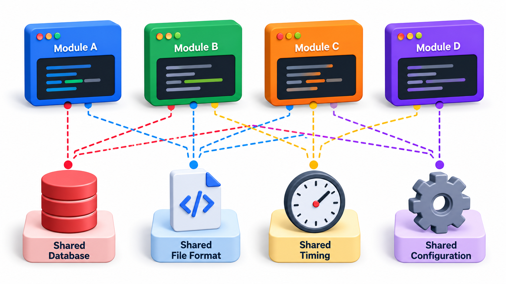
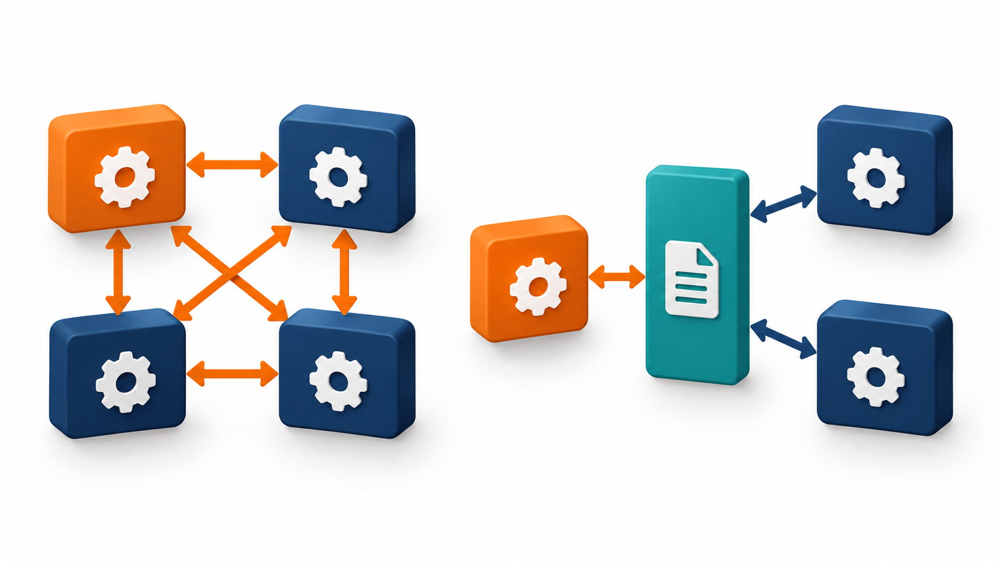
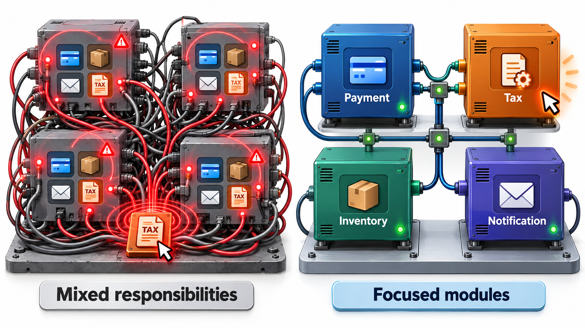

## Why Changing One Thing Should Not Break Ten

Imagine a program in which thousands of pieces of data can be changed from anywhere. Nobody can say what a change will affect, because every part of the program is connected to every other part, and the connections are invisible. Such a design is not wrong at any single point; it is wrong in its shape.

Two properties describe the shape of a design in exactly these terms. **Coupling** is how strongly modules depend on each other. **Cohesion** is how strongly the contents of a single module belong together. Good design aims for low coupling and high cohesion, and both can be seen, and even measured.

The two are linked by the same arithmetic that makes large systems hard: every dependency between modules is a pair that someone must keep in mind. High cohesion keeps related things together so that most questions are answered inside one module. Low coupling keeps the number of outside connections small. A design with both is one where a change stays where it started.

## Cohesion: Does This Module Have One Job?

A module is cohesive when everything in it serves a single purpose. A `fees` module with functions to calculate a fee, apply a late fine and issue a receipt is cohesive: they are all about what a student owes. A `utils` module holding a fee calculator, a date formatter, a file reader and an email sender is not. Its contents have only one thing in common: nobody knew where else to put them.

Writers on the subject describe a ladder, from worst to best:

- **Coincidental**: the parts are unrelated. The grab-bag `utils` file.
- **Logical**: the parts do similar kinds of thing, selected by a flag. One function that "handles output" and switches between printing, saving and emailing.
- **Temporal**: the parts happen at the same time, such as all start-up work, though they are unrelated.
- **Sequential and functional**: the parts work together for one well-defined goal, each feeding the next. This is the target.

A quick test is to try to describe the module in one sentence without using "and". If you cannot, it probably has more than one job.

| Module | One-sentence description | Verdict |
| --- | --- | --- |
| `fees` | Works out what a student owes | Cohesive |
| `utils` | Calculates fees, formats dates, reads files and sends email | Four jobs: coincidental |
| `startup` | Opens the database, loads settings, starts the scheduler and warms the cache | Temporal: related only by time |
| `output` | Prints, saves or emails a report depending on a flag | Logical: three jobs behind a switch |

<!-- Visual: a miscellaneous utility drawer compared with a focused fee calculator. -->

## Coupling: How Tightly Are Modules Tied?

Two modules are coupled when a change in one may force a change in the other. Some coupling is unavoidable, since a system whose parts do not connect is not a system. The aim is to make the connections few, narrow and visible. From worst to best:

| Kind | What it means | Example |
| --- | --- | --- |
| **Content** | One module reaches into another's internals | Changing another class's private data directly |
| **Common** | Modules share global data | Ten thousand global variables |
| **Control** | One tells another what to do through a flag | Asking a result routine to show a grade instead of marks by passing a yes-or-no flag |
| **Stamp** | Modules share a whole record when only part is needed | Passing a full student record to a function that needs one name |
| **Data** | Modules share only the values they need | Passing just the name |

Moving down the table, each form is easier to understand and change. A function that takes only the postcode it needs can be reused anywhere and tested alone. One that takes the whole customer record depends on how that record is laid out, and breaks when the layout changes.

<!-- Visual: passing an entire record compared with passing only the needed postcode. -->

## Coupling That Does Not Appear in Code

Coupling is not only about one module calling another. Several quieter forms cause the same pain.

| Form | What it looks like | Why it hurts |
| --- | --- | --- |
| **Temporal** | Module B only works if module A has been called first | The order is an unwritten rule |
| **Data format** | Two services agree, without saying so, on a date format | A change in one silently breaks the other |
| **Deployment** | Two services must always be released together | They are one system pretending to be two |
| **Team** | Two teams must agree before either can change anything | Work waits on meetings |
| **Shared database** | Two programs read and write the same table | Either can break the other by changing the table |

The last is the most common in practice. Two services may have clean code and separate repositories, and yet be tightly coupled because both depend on the exact layout of one table.

## Measuring It

Coupling can be counted. For each module, **fan-out** is the number of modules it depends on, and **fan-in** is the number of modules that depend on it. Robert Martin used these to define **instability**: fan-out divided by the sum of fan-in and fan-out. A value of 0 means a module that many others rely on and that depends on nothing: hard to change, because everything would feel it, so it should be stable. A value of 1 means a module that depends on many and that no one depends on: easy to change, because nothing else would notice.

Take a small system.

| Module | Depends on | Depended on by | Instability |
| --- | --- | --- | --- |
| Screens | 3 | 0 | 1.0 |
| Logic | 2 | 1 | 0.67 |
| Reports | 1 | 1 | 0.5 |
| Fees | 1 | 2 | 0.33 |
| Database | 0 | 3 | 0.0 |

The screens depend on three modules and nothing depends on them, so they can change freely, which is right for a user interface that changes often. The database depends on nothing and is used by three modules, so it is the foundation, and a careless change there would reach everything above. The healthy pattern is that dependencies point from unstable modules towards stable ones. If a stable module like the database depended on the screens, a change to the interface would ripple down to the foundation, and the numbers would show it.

<!-- Visual: loose coupling prevents one change from rippling across modules. -->

## A Worked Change: Counting the Ripple

To see why this matters, take a concrete change: the college adds a "section" field to every student record. Compare two designs.

| Design | How modules get the student's name | Modules that must change |
| --- | --- | --- |
| **Tightly coupled** | Each module receives the whole student record and reads the fields it likes | Many, because the record layout changed and each module's reading code must be checked: Fees, Reports, Receipts, Notifications (4) |
| **Loosely coupled** | Modules receive only the values they need, such as the name or the amount | Only the module that actually uses the section: Reports (1) |

In the first design, the change is not hard, but it must be inspected everywhere, and one missed spot becomes a defect. In the second, the other three modules never knew the record had a layout, so there is nothing to check. Low coupling does not make changes easier to write; it makes them easier to *contain*.

## Reducing Coupling and Raising Cohesion

The remedies are simple to state and take discipline to apply.

- **Pass less.** Give a function the values it needs and not the whole object.
- **Depend on interfaces.** Talk to a module through a small, stable interface and not through its internals.
- **Remove global state.** Pass data in as arguments, and return results.
- **Replace flags with separate functions.** Two functions with clear names are better than one function and a switch.
- **Split modules with two jobs, and merge fragments of one job.** Keep each module on one purpose.
- **Move behaviour to the data it uses.** If a function keeps reaching into another class's fields, it probably belongs there.

Low coupling and high cohesion also support each other. A module with a single purpose has fewer reasons to talk to others. A tangle of dependencies usually means that responsibilities have been misplaced.

<!-- Visual: before and after of the same module set: a tangle of arrows between mixed-purpose boxes becoming a few arrows between single-purpose boxes. Save as images/55_tangle_to_tidy.png. -->

## Warning Signs

| Sign | What it suggests |
| --- | --- |
| A change in one place keeps requiring edits in many files | High coupling, or one responsibility scattered widely |
| A module name that ends in "Manager", "Helper" or "Utils" | Low cohesion: nobody could name its one job |
| A function with many boolean parameters | Control coupling: the caller steers the callee |
| Tests need a lot of set-up to run one function | The function depends on much that it should not |
| Two modules that import each other | A cycle: neither can be understood or replaced alone |
| Developers say "touch it and something breaks elsewhere" | Hidden connections |

## Cohesion and Coupling in a Single Class

The two ideas can be seen inside one small design. A `Student` class that stores a name and roll number, knows how to compute its fee, formats its own printable report and sends its own emails is low in cohesion: it has four jobs, and a change to any one risks the others. It is also highly coupled to whatever formats and mail systems it uses.

| Version | Jobs in the class | Reasons to change | Connections to other modules |
| --- | --- | --- | --- |
| One class doing everything | 4 | 4 | Printing, mail, fee rules, storage |
| Split: `Student`, `FeeCalculator`, `ReportFormatter`, `Mailer` | 1 each | 1 each | Each connects only to what it needs |

After the split there are more classes, but each is easy to describe, test and change. The number of connections between parts rises slightly, yet each is narrow, and no change to the report layout can disturb the fee rule.

## Five Misreadings of Coupling and Cohesion

**"Zero coupling is the goal."** A system must connect its parts. The goal is few, narrow, explicit connections.

**"Cohesion means small."** A large module can be cohesive if everything in it serves one purpose.

**"Coupling is only about code."** Teams, data formats and deployment can also be coupled. Two services that must always be released together are tightly coupled, however separate their code looks.

**"A high fan-in is bad."** A stable foundation used by many modules is expected. It is a sign that it must be kept stable and carefully tested.

**"Metrics replace judgement."** Numbers point at suspicious places. Deciding whether the structure is right still needs a person who understands the problem.
