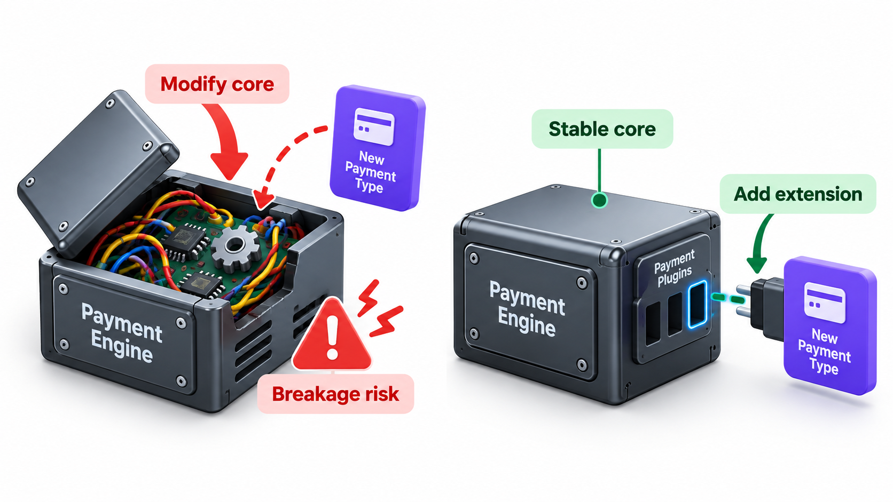
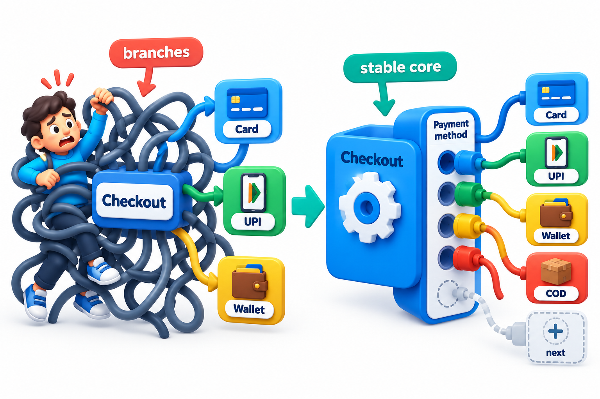
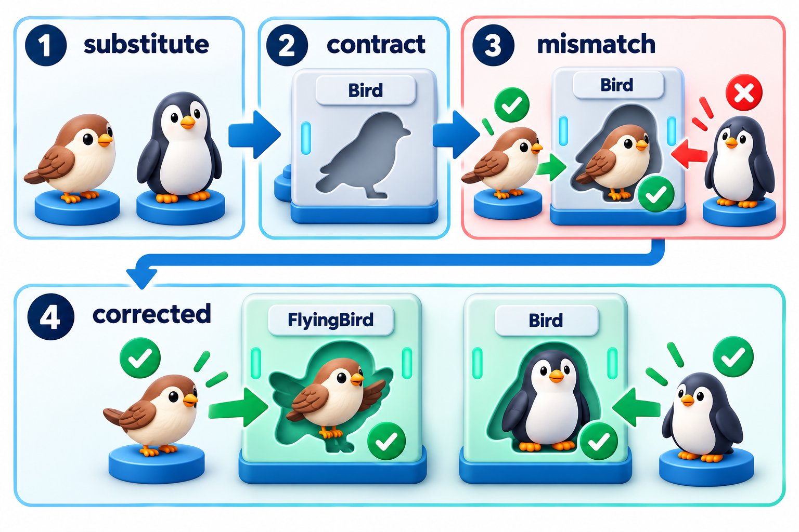
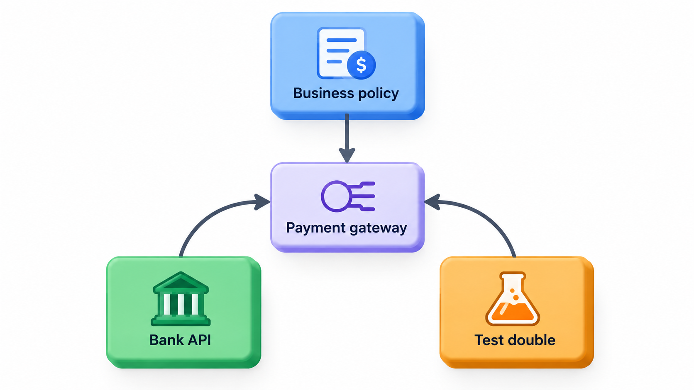
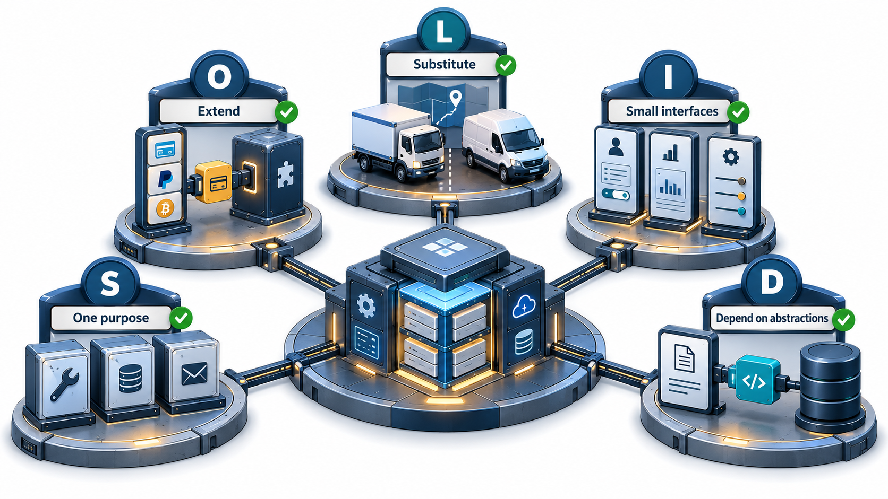

## Rules of Thumb for Designs That Bend Without Breaking

A good design is one that can be changed safely. Experience in object-oriented design has produced five rules of thumb for getting there, known by the acronym **SOLID**: single responsibility, open/closed, Liskov substitution, interface segregation and dependency inversion. They were collected by Robert Martin in the early 2000s from work by himself, Barbara Liskov, Bertrand Meyer and others.

They are not laws. They are heuristics that describe what tends to make designs easy to change. A classic warning about what happens without them: a widely used library once made its stack a subclass of a resizable-array class to save effort, so that every stack also allowed insertion in the middle and reading by position. A programmer who thought they had a stack of plates could take a plate from the bottom. The design looked economical and let the user break the thing's own rules.

The five principles address five different ways in which designs become rigid, and each can be understood as a response to a symptom.

| Principle | Symptom it prevents |
| --- | --- |
| Single responsibility | One change forces edits to a class that does many unrelated things |
| Open/closed | Every new feature means editing working code |
| Liskov substitution | A subclass surprises code written for its parent |
| Interface segregation | A class must implement operations it cannot support |
| Dependency inversion | Business rules are welded to databases, screens and libraries |

## S: Single Responsibility

*A class should have one reason to change.*

A class that calculates fees, formats receipts and sends emails has three reasons to change: a new fee rule, a new receipt layout, a new mail provider. A change for one risks breaking the others, and every change must be tested against all three. Split into three classes, each changes for its own reason only.

The principle is about *reasons to change*, which means people. Ask who would request a change to this class. If the answer is the accounts office, the design team and the IT department, the class serves three masters and should probably be split.

| Class | Who asks for changes | Verdict |
| --- | --- | --- |
| `FeeCalculator` | Accounts office | One reason |
| `ReceiptFormatter` | Design team | One reason |
| `MailSender` | IT department | One reason |
| `FeeReceiptMailer` (all three jobs) | All three | Three reasons: split |

Splitting has a cost: more classes, more connections. The aim is not the smallest class but a class whose reasons to change are not tangled together. Two things that always change together belong together.

## O: Open for Extension, Closed for Modification

*Add new behaviour by adding new code, not by editing old code.*

Every edit to working code risks a bug. A design that lets you add features without touching what already works is safer. The usual way is to put the part that varies behind a common interface and add new variants as new entries. Take discounts. The price calculation never changes: it looks up the named discount and applies it.

| Discount | Rule | Price for Rs 1,000 |
| --- | --- | --- |
| None | Amount unchanged | 1,000 |
| Student | 10% off | 900 |
| Festival | Flat Rs 50 off | 950 |
| Senior (added later) | 20% off | 800 |

The senior discount is added at the end as one new rule and one new entry in the table of discounts. The price calculation is unchanged, and the three earlier cases are not touched, so they cannot break. Compare the alternative of a chain of conditions inside the price calculation: every new discount would mean editing the part that every discount depends on.

| Approach | Adding a fifth discount means | Risk to existing discounts |
| --- | --- | --- |
| Chain of conditions in the calculation | Editing the calculation | Any slip can break all four |
| Rules held as separate entries | Adding one entry | None: the old entries are untouched |

Be careful with the word "closed". Nothing is closed against all change; the code is closed against the kinds of change you predicted when you chose where the variation goes. A wrong prediction leaves you editing the core anyway.

<!-- Visual: tangled payment branches compared with an extension-friendly payment socket. -->

## L: Liskov Substitution

*Code that works with a base type must keep working when given any subtype.*

The principle is named after Barbara Liskov. It says that a subclass is not just a class that shares code with its parent. It must honour the parent's promises, so that code written for the parent works with it unchanged. The classic example is the square and the rectangle. In mathematics a square is a rectangle, so it seems natural to make a square a kind of rectangle.

The rectangle promises that after its width is set, its height is unchanged, so the area is width times height. A square must keep its sides equal, so setting its width must also change its height. That quietly breaks the rectangle's promise. Now take a routine written for rectangles that widens a shape to width 5 and reports the area.

| Shape given to the routine | Result | What the caller expected |
| --- | --- | --- |
| Rectangle 5 by 3 | Area 15 | 15, correct |
| Square of side 3 | Area 25 | 15, a surprise |

The fault is not in the routine but in the claim that a square can stand in for a rectangle in this code. In a program where shapes can be modified, a square is not a rectangle in the sense that matters. The stack that is also a resizable array is the same mistake. The fix is usually to avoid inheritance here: make shapes separate classes that share an interface for area, and do not promise independent sides on a square.

A subclass keeps the promise when it follows these rules:

| Rule | Meaning | Violation example |
| --- | --- | --- |
| It accepts at least what the parent accepts | It must not demand more of callers | A subclass that rejects inputs the parent allowed |
| It delivers at least what the parent promises | It must not give less back | A subclass whose result can be empty when the parent's never was |
| It keeps the parent's invariants | Rules that always hold must still hold | A subclass that lets a balance go negative when the parent forbade it |
| It raises no new surprises | No unexpected errors | A subclass method that raises "not supported" |

The last row is a common warning sign: a subclass that overrides a method only to refuse it is saying it is not really that kind of thing.

<!-- Visual: a substitution test revealing and correcting a broken inheritance contract. -->

## I: Interface Segregation

*No client should be forced to depend on methods it does not use.*

A large interface forces every implementer to supply every method, even those it cannot support. A printer interface with `print`, `scan` and `fax` makes a simple printer implement scanning that it cannot do. Splitting it into smaller interfaces, one for each ability, lets each class promise only what it can deliver. Clients then depend on small interfaces and are not affected by changes to features they never use.

| Device | One fat interface (print, scan, fax) | Three small interfaces |
| --- | --- | --- |
| Basic printer | Must supply scan and fax; refuses them | Implements Print only |
| Office multifunction | Implements all three | Implements all three |
| Scanner | Must supply print and fax; refuses them | Implements Scan only |

With the fat interface, two of the three devices contain methods that exist only to say "not supported", which is a Liskov warning sign as well. With small interfaces, the type system tells the truth about what each device can do.

## D: Dependency Inversion

*High-level code should not depend on low-level details. Both should depend on abstractions.*

A fee service that creates a particular database connection inside itself is welded to that database. Testing it requires the database, and changing the database means changing the service. If the service instead receives something that offers `save`, from outside, it depends only on that abstraction. Production code hands it the real database, and a test hands it a simple in-memory stand-in. The dependency has been "inverted": the detail now depends on the interface that the high-level code defines.

| Aspect | Without inversion | With inversion |
| --- | --- | --- |
| Arrow of dependency | Fee service points at the database | Both point at a "save" interface owned by the fee service |
| Testing the fee service | Needs a live database | Uses an in-memory stand-in |
| Changing database product | Edit the fee service | Write a new implementation of the interface |
| Who owns the interface | The database layer | The business logic, which states what it needs |

The word "inversion" refers to the direction of the arrows. In the natural way of building, high-level code points down at the details it uses. Here, the detail points up at an interface defined by the high level.

<!-- Visual: five visual stations representing the SOLID design principles. -->

## Using Them With Judgement

The principles reinforce each other. Splitting responsibilities (S) leads to small classes with small interfaces (I). Depending on those interfaces (D) allows new variants without editing old code (O), provided the variants honour the promises (L). Together they describe a design that can absorb change.

They can also be taken too far. A program with an interface and a factory for every class, written to satisfy principles that would never be tested by a change, is harder to read than it should be. Use them where change is likely, and where a small structure now will save a large edit later. For code that will never change, simple and direct is fine.

| Situation | Reasonable response |
| --- | --- |
| A class changes for three different reasons every term | Split it (S) |
| A new payment method arrives every quarter | Put variation behind an interface (O, D) |
| A script run once for a migration | Keep it simple; none of this applies |
| A subclass overrides a method to refuse it | Rethink the inheritance (L) |
| Only one implementation exists and none is expected | Do not add an interface yet |
