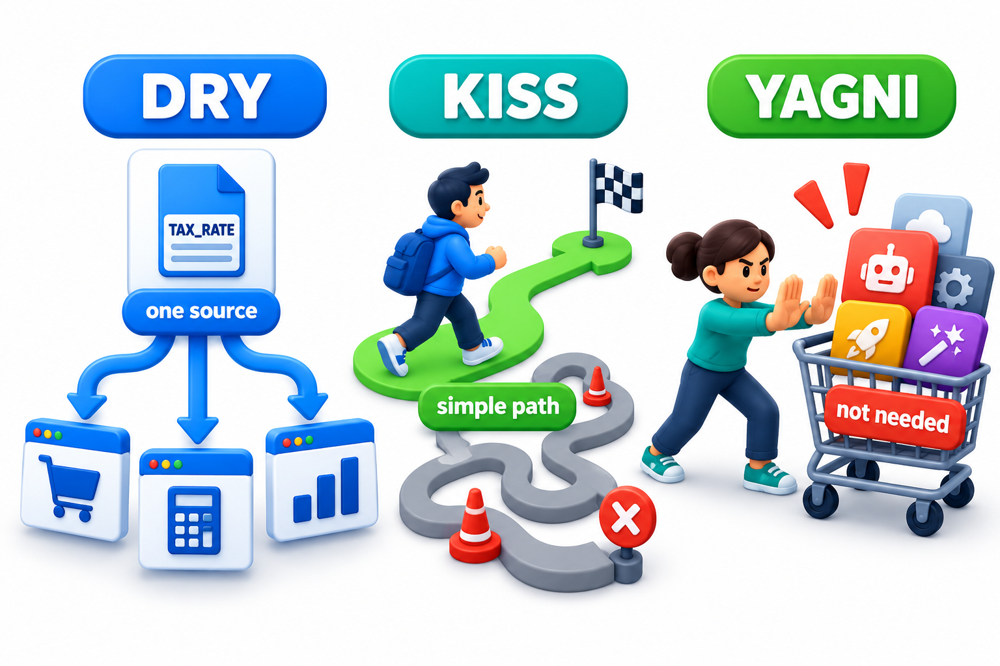
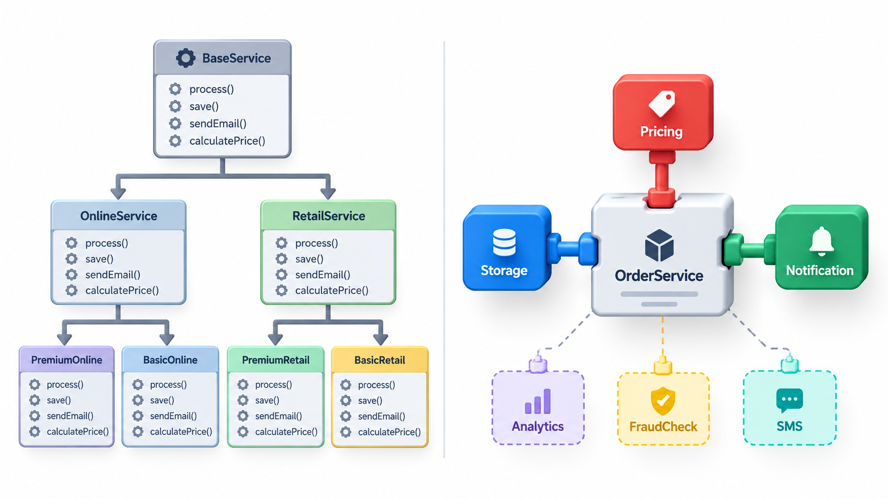
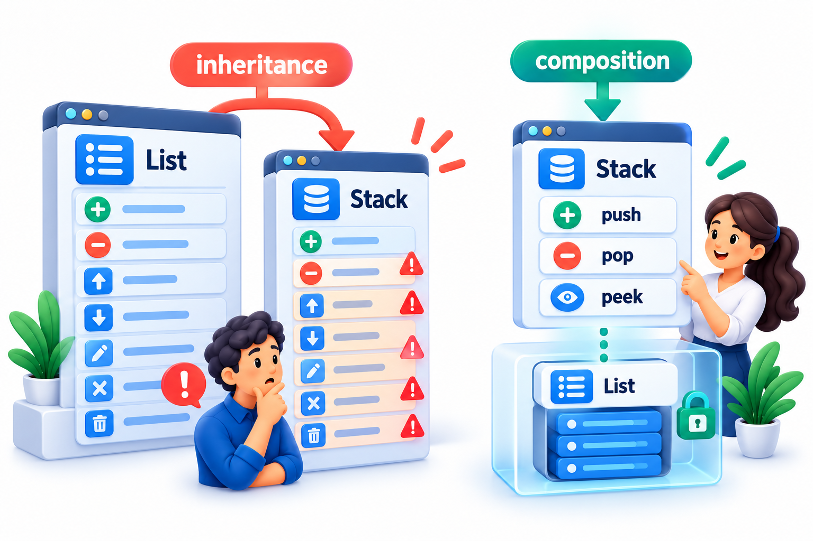
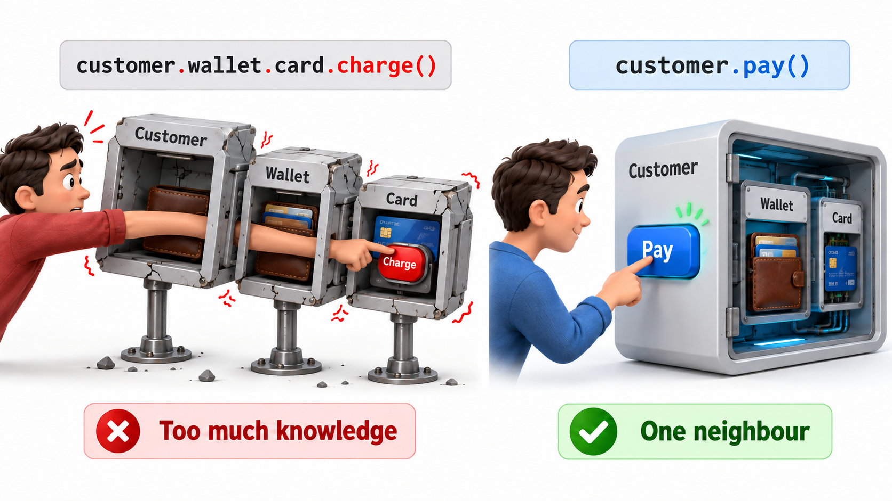
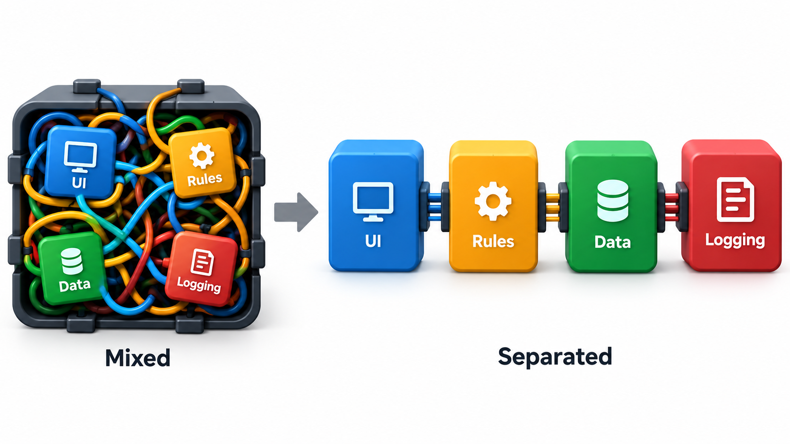

## Small Habits That Make Mistakes Harder to Write

A surprising amount of good design is plain habit. A repeated line, a missing pair of brackets, a copied block that was edited in only one place: these are the sort of mistakes that can occur anywhere, and a security flaw in a widely used system once came from exactly such a slip, a duplicated line that made a check unreachable. Habits cannot prevent every mistake, but they make mistakes harder to write and easier to see.

This topic gathers six such habits that are widely taught: **DRY** (do not repeat yourself), **KISS** (keep it simple), **YAGNI** (you aren't going to need it), composition over inheritance, the Law of Demeter, and separation of concerns.

Unlike the structural measures of coupling and cohesion, these habits are about everyday decisions: whether to copy a block, whether to add an option, whether to reach through an object. They are worth learning as a set because they pull against each other in useful ways. Used together with judgement, they keep a codebase small, clear and changeable.

## DRY: Don't Repeat Yourself

Andrew Hunt and David Thomas stated the principle in their 1999 book *The Pragmatic Programmer*: every piece of knowledge should have a single, unambiguous, authoritative representation in a system. It is about knowledge more than about text. If the late-fee rule is written in the billing code, the report code and the reminder email, there are three copies of the rule, and they will drift apart. When the rule changes, someone will update two of them.

The remedy is to give each fact one home and let everything else refer to it. But beware of false duplicates: two pieces of code that look alike today but represent different facts, and will change for different reasons, should not be merged. Merging them couples things that should be free.

| Situation | Real duplication? | Action |
| --- | --- | --- |
| The late-fee rule in billing, reports and reminders | Yes: one fact, three copies | Give it one home |
| The number 18 meaning minimum age for registration and also the number of weeks in a term | No: same digits, unrelated facts | Leave separate |
| Two validation routines that match today but belong to students and to staff, with different rules likely | Probably no | Leave until the rules prove to be the same |
| The same database table layout described in code, in a document and in a report | Yes | Generate the others from one source |

A helpful rule of thumb is to tolerate a repeat twice and act on the third. Two similar pieces may be a coincidence; three are a pattern, and by then you can see what they have in common.

## KISS: Keep It Simple

The principle, often credited to the engineer Kelly Johnson at Lockheed in the 1960s, says that systems work best when they are kept simple. A design that is simple is easier to understand, test, change and fix. Every extra layer, option or clever trick has to be understood by every future reader. The test is whether a competent colleague could understand the code in a few minutes. Cleverness that saves five lines and costs ten minutes per reader is a loss.

Simplicity is not the same as shortness or familiarity. A short expression packed with tricks may take longer to read than six plain lines. Simple also does not mean naive: a simple solution to a hard problem is often the product of hard thinking.

| Version | Lines | Time a new reader needs | Verdict |
| --- | --- | --- | --- |
| A clever one-liner combining four operations | 1 | 10 minutes to understand | Short, not simple |
| Four plain steps with clear names | 6 | 1 minute | Simple |
| A general framework for steps that may someday be added | 60 | 15 minutes | Complex for the need |

## YAGNI: You Aren't Going to Need It

Born in Extreme Programming, YAGNI warns against building for needs you imagine. A team that adds configuration options, plug-in points and generality in case they are wanted later pays for them now, in time and complexity, and often guesses wrongly. Build what the requirements need today, in a way that is easy to change, and add the rest when it is real.

The cost of speculation has four parts: the effort to build the unneeded feature, the effort to carry it (it must be understood, tested and maintained), the delay to the features that were needed, and the risk that the guess was wrong and the feature must be reworked anyway.

DRY, KISS and YAGNI push in the same direction, but they can conflict with enthusiasm for abstraction. Removing duplication can add an abstraction, which is a cost. The balance is to remove duplication that is real and to leave small, harmless repetition alone.

<!-- Visual: physical metaphors for DRY, KISS and YAGNI. -->

## Composition Over Inheritance

When one class needs the abilities of another, there are two ways to get them. **Inheritance** makes the new class a subclass: it *is a* kind of the other. **Composition** gives the new class an instance of the other to use: it *has a* part that does the job. Inheritance fixes the relationship at compile time and exposes the parent's whole interface. Composition is more flexible, since the part can be swapped, and it hides what is inside. The advice, from the book *Design Patterns* in 1994, is to prefer composition and use inheritance only when the subclass truly is a kind of its parent in every respect. A stack built as a subclass of a resizable array, which then also lets callers insert into the middle, shows what goes wrong otherwise.

| Question | Inheritance | Composition |
| --- | --- | --- |
| What does the new class expose? | Everything the parent exposes | Only what it chooses to |
| Can the relationship change at run time? | No | Yes: swap the part |
| How tightly is it tied to the parent's internals? | Tightly: parent changes ripple down | Loosely: only the part's interface matters |
| Typical test | "Is it a kind of?" in every respect | "Does it use?" |

<!-- Visual: inheritance compared with composition for combining behaviour. -->

## The Law of Demeter

The Law of Demeter, formulated at Northeastern University in 1987 and named after a project called Demeter, says a method should talk only to its immediate friends: itself, its parameters, the objects it creates and its own parts. It should not reach through one object to get to another. The informal version is "don't talk to strangers", or "use only one dot".

Writing a call that goes through the customer to its wallet to pay 200 reaches through the customer to its wallet, so the caller now knows that customers have wallets and that wallets pay. If the customer's design changes so that it pays through a bank account instead, every caller that reached through it must change. The Law of Demeter says to talk only to your immediate neighbour: tell the customer to pay, and let the customer decide how.

Take a customer with a balance of Rs 500, and three payments of Rs 200.

| Payment | Style | Result |
| --- | --- | --- |
| First | Reaching through the customer to the wallet | Accepted: the caller is tied to the fact that a customer has a wallet |
| Second | Asking the customer to pay | Accepted: the caller depends on one object, not two |
| Third | Asking the customer to pay | Refused: only Rs 100 is left, because both styles act on the same wallet |

If the customer later pays by card or bank account, only the customer's own payment behaviour changes. The callers that asked the customer keep working. The callers that reached through to the wallet are all broken.

A second benefit is that the customer can enforce its own rules. Because the customer is asked to pay, it can refuse the third payment and explain why. A caller who reaches into the wallet bypasses any rule the customer would have applied, such as a daily limit.

<!-- Visual: a train wreck of calls on the left, a call that goes through the customer to its wallet and its card, with the caller holding three objects, beside a single call on the right, a single call asking the customer to pay, with the caller holding one. Save as images/57_demeter_chain.png. -->

## Separation of Concerns

The last habit says that a program should be divided into parts, each addressing a separate concern. The code that decides what a fee should be is separate from the code that shows it on a screen and the code that stores it. The classic example is the arrangement of a web page: structure in HTML, appearance in CSS, behaviour in JavaScript. Dividing by concern makes each part simpler, lets different people work on different parts, and means that a change of concern, such as a new look, touches only one. Cohesion, information hiding and the Single Responsibility Principle are all expressions of this one idea.

| Concern | Who cares about it | Example change |
| --- | --- | --- |
| Business rules | Accounts office | New late fine |
| Presentation | Designers | New colour scheme |
| Storage | Database team | Move to a new database |
| Security | Security team | Stronger login |
| Communication | Operations | New email provider |

When each concern lives in its own part, each change has one place to go.

## Using the Habits Together

The six habits sometimes disagree, and judgement decides.

| Tension | Resolution |
| --- | --- |
| DRY vs KISS | Merging two similar blocks adds an abstraction. Merge only when the duplication is real and the shared version is easier to read |
| YAGNI vs "design for change" | Make the code easy to change, not full of options. Add the option when the need appears |
| Demeter vs short code | Writing a thin method that forwards the call adds a little code but protects callers. Accept it where the structure is likely to change |
| Composition vs convenience | Inheritance is quicker today. Choose it only when the "is a kind of" is true throughout |
