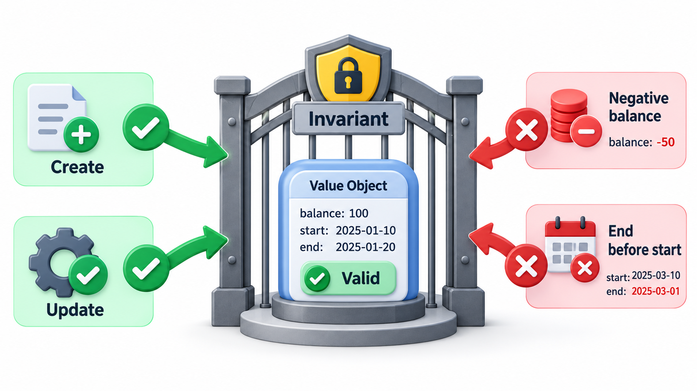
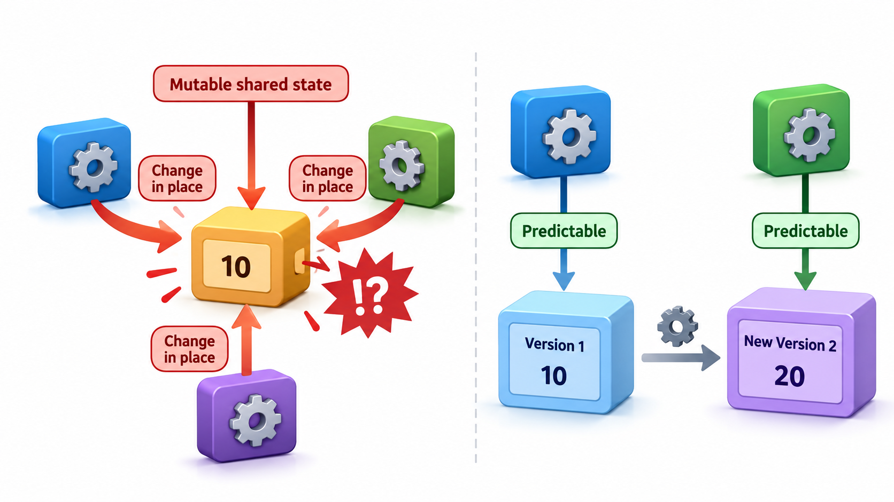
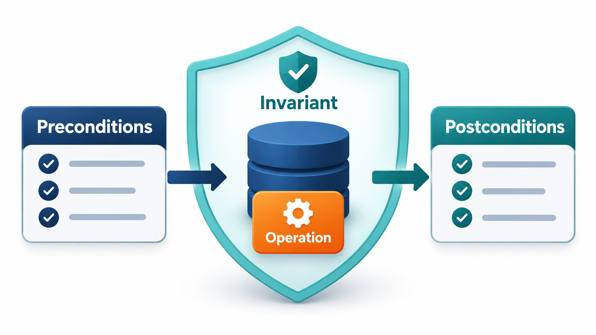

## A Value That Cannot Be Wrong

Some things in a program are values with rules: a date has a valid month, an interval ends after it starts, a price is not negative. If any code holding such a value can change it into something invalid, the guarantee is gone, and every part of the program must defend itself against every other.

An **abstract data type** presents a value through a small set of operations and keeps its representation private. An **invariant** is a rule about the value that is always true. And a value is **immutable** when, once created, it never changes: operations return a new value. Together these ideas let a type guarantee its own correctness. This topic shows how.

The alternative is defensive programming everywhere: every function that receives an interval checks that its start is not after its end, in case someone passed a broken one. With a well-built type, that check happens once, at the only place a broken interval could be made, and the rest of the program is spared.

## What an Abstract Data Type Is

An **abstract data type**, or ADT, is a kind of value defined by what you can do with it and not by how it is stored. Barbara Liskov and Stephen Zilles described the idea in 1974. A stack is an ADT: it has `push`, `pop` and `size`, and a rule that the last item pushed is the first popped. Whether it is stored in a list or a chain of links is hidden. A date, a fraction, a money amount and a set of students are all ADTs.

An ADT has four parts:

- **Creators** make new values (creating an interval from a start of 10 and an end of 14).
- **Producers** make new values from existing ones (`shifted`).
- **Observers** report something about a value (`length`).
- **Mutators** change a value in place (`push`).

The first three are the core of an immutable type. A mutator makes a type mutable, and with that comes the risk that anyone holding a reference can change it.

| Type | Creators | Producers | Observers | Mutators |
| --- | --- | --- | --- | --- |
| Money amount | Create from an amount and a currency | `plus`, `times` | `amount`, `currency` | None (immutable) |
| Stack | Create an empty stack | None | `peek`, `size` | `push`, `pop` |
| Date range | Create from a start and an end | `extended_by` | `contains`, `length` | None |

<!-- Visual: an ADT drawn as a sealed box with creators, producers, observers and mutators as the four kinds of door on its surface, and the representation hidden inside. Save as images/58_adt_four_operation_kinds.png. -->

## Designing an ADT: Specification First

Before choosing a representation, write down what the type is for. A short checklist works.

1. **State the abstract value.** "An interval is a set of whole numbers from a start up to an end."
2. **List the operations in the four kinds.** Which create, which derive, which observe, which change?
3. **Write each operation's contract.** What must the caller supply? What will the operation deliver?
4. **State the invariants.** What is always true of every value?
5. **Only then choose a representation.** Two numbers, or a list of all the members? The choice is hidden and can change.
6. **Decide what equality means.** Are two intervals equal if they have the same start and end? Almost always yes, and that should be explicit.

The order matters. Types designed from the representation outwards tend to leak it.

## Representation Invariants

Inside the type, the chosen representation has rules that must always be true for the type to work. They are the **representation invariant**. For an interval defined by a start and an end, the invariant is that the start is not after the end. A `Fraction` has a denominator that is not zero. A `Date` has a month between 1 and 12 and a day that fits that month. If the invariant fails, the object is broken, and every operation might misbehave.

The way to keep an invariant is to check it at the only places where the representation can change: the creators and any mutators. Everything else can then rely on it without checking again. That is why the constructor of an interval rejects a start that comes after the end: no broken interval can ever exist.

The **abstraction function** is the other half. It says how a stored representation maps to the abstract value it stands for. A set of students might be stored as a list; the abstraction function says that the list `[3, 1, 3]` stands for the set `{1, 3}`. Writing it down shows which different representations mean the same value, and helps you decide what equality should mean.

| Idea | Question | Interval example |
| --- | --- | --- |
| Abstract value | What does it mean? | The whole numbers from 10 to 14 |
| Representation | What is stored? | Two fields, start = 10 and end = 14 |
| Representation invariant | What must always hold of the stored data? | start is not greater than end |
| Abstraction function | How does storage map to meaning? | (start, end) stands for the numbers start up to end |

## An Interval That Protects Itself

Take an interval: the whole numbers from a start to an end. Its representation invariant is that the start is not after the end. The type checks the invariant when a value is created and offers no way to change the value afterwards. Operations return new intervals.

| Operation | What happens |
| --- | --- |
| Create the interval [10, 14] | Accepted: the start is not after the end |
| Ask its length | 4, always non-negative because the invariant guarantees it |
| Shift it by 7 | A new interval [17, 21] is returned; the original is still [10, 14] |
| Try to create [9, 3] | Rejected at the door, with a message that says the start must not be after the end |

The invariant is checked at creation, and nothing modifies the interval afterwards, so once true it stays true. Shifting is a producer: it builds a new value and leaves the original alone. The attempt to create [9, 3] never produces an invalid interval, so the invariant stays intact.

## Why Immutability Helps

An immutable value cannot be changed after it is created, and that gives several benefits. It can be shared freely, since nobody can alter it behind your back. It is safe to use from several threads at once, with no locks. It can be used as a key in a table without fear that it will change. And it makes reasoning easier: a value you read earlier is still the same value now.

The cost is that changes produce new objects, which can use more memory or time. In most programs that cost is small and the safety is worth it. Where it matters, a mutable object is kept inside a module and never handed out, or a copy is returned.

A habit that follows is **defensive copying**: if a method receives a mutable object that it stores, it keeps a copy, and if it returns one of its own, it returns a copy. Otherwise a stray reference outside the module is a way in for changes that break the invariant. An early version of a date class in a popular language handed out its internal dates in this way, and callers could change a "private" date without the class knowing.

| Without defensive copy | With defensive copy |
| --- | --- |
| A booking stores the date object it was given | A booking stores its own copy |
| The caller later changes that date | The caller's change has no effect on the booking |
| The booking's check-in date moves silently | The booking stays as created |
| The invariant "check-out after check-in" may be broken without any code in the booking running | The invariant holds |

<!-- Visual: a bank account protecting private state behind controlled operations. -->

## Contracts in the Type

An ADT's documentation states what each operation requires and promises, and what the type always guarantees. A precondition says what the caller must provide. A postcondition says what the operation will deliver. An invariant says what is always true between operations. Together they form a contract between the type and its users.

| Part | Meaning | Example: withdraw from an account |
| --- | --- | --- |
| **Precondition** | What must be true when called | Amount is positive and not more than the balance |
| **Postcondition** | What is true when it returns | Balance is reduced by exactly the amount |
| **Invariant** | True before and after every operation | Balance is never negative |

If the caller breaks the precondition, the fault is the caller's. If the precondition held and the postcondition fails, the fault is the operation's. This simple division gives debugging a head start.

<!-- Visual: preconditions postconditions and invariants define a software contract. -->

## Spotting a Broken Invariant

When a program misbehaves because a value is invalid, the question is where it became invalid. A type with a protected invariant makes that question easy to answer.

| Situation | Where to look |
| --- | --- |
| An interval with start after end appears | The constructor or a mutator: those are the only places it can be created or changed |
| A balance goes negative | The withdraw operation, or a method that returns a reference to the internal balance |
| A date shows month 13 | The creator, or a setter that does not check |
| Two "equal" values behave differently | The definition of equality, or a leaking mutable field |

Without encapsulation, the same bug could have come from any line of code in the program that touches the value, and finding it would mean searching them all.
