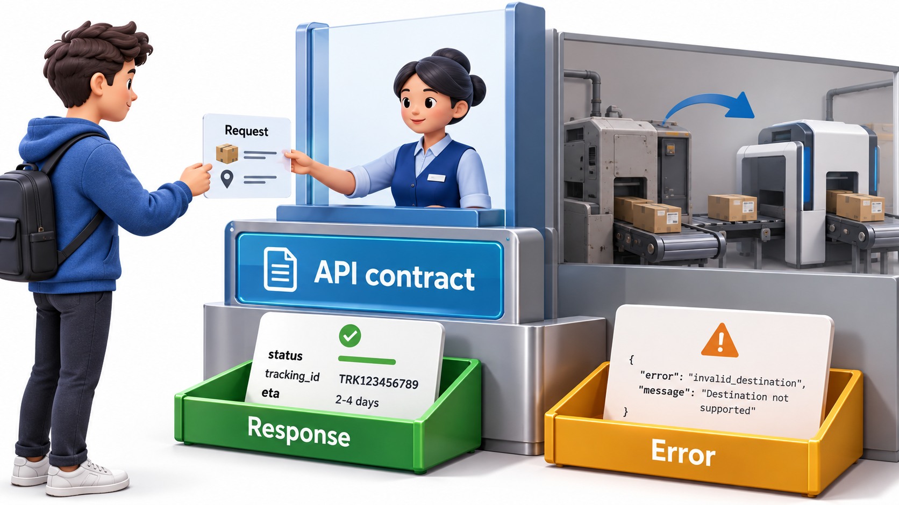
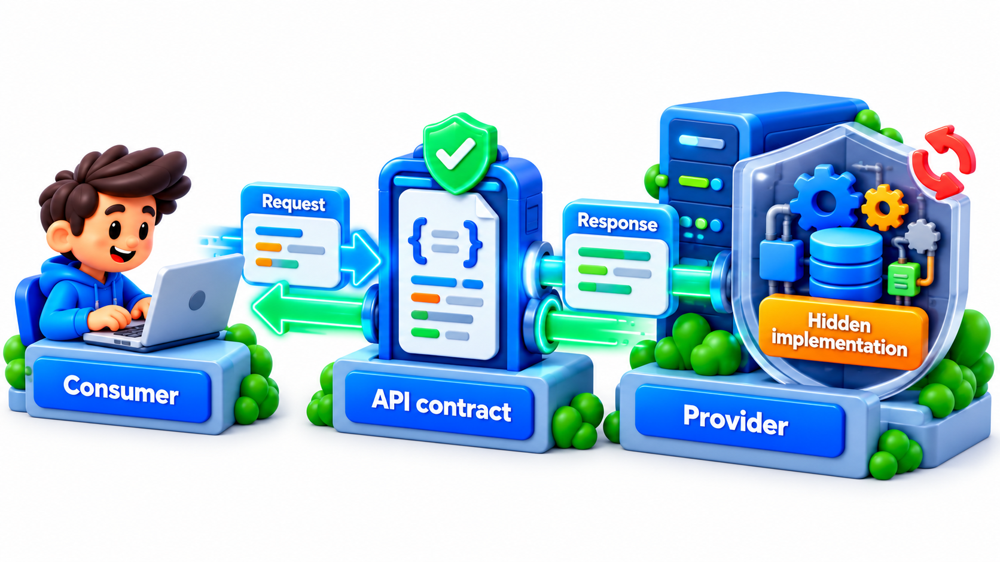
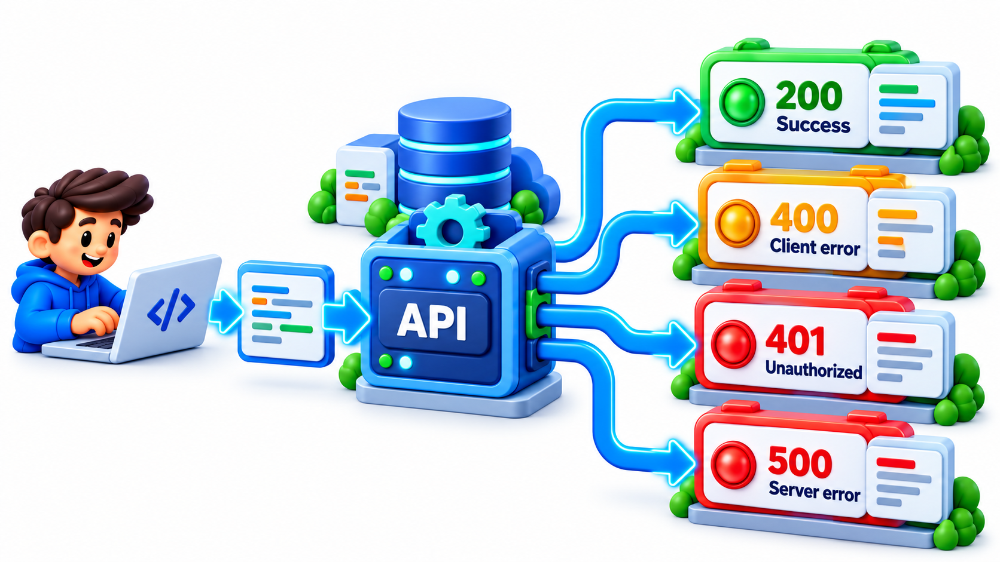
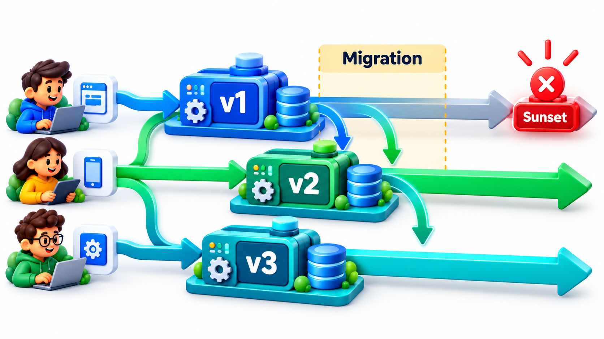
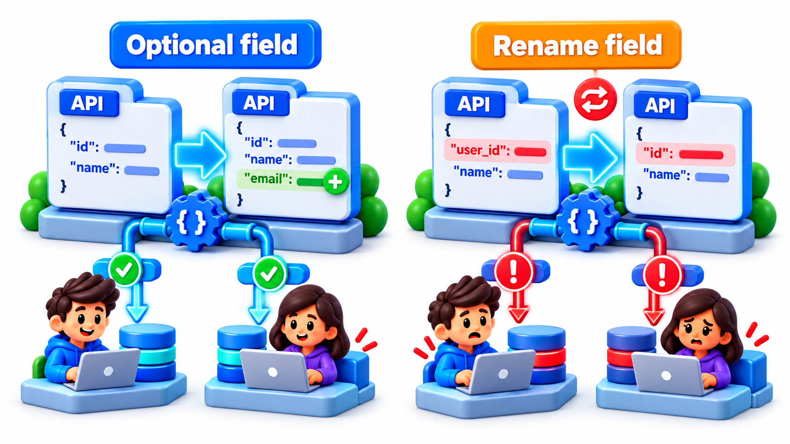

## An API Is a Promise to People You Have Never Met

Other people's programs depend on the interface you publish. If you change it carelessly, their programs break, and they did nothing wrong. An **API**, an application programming interface, is therefore a promise, and breaking it costs trust. Providers that take the promise seriously go to great lengths to keep it, even keeping old versions of an interface running for years so that code written long ago still works.

This topic covers what that promise should contain, how to make it clear, and how to change it without breaking it.

The difficulty is that an API's users are scattered and unknown. When you change a function inside your own program, you can find every caller and fix it. When you change an interface that a thousand other teams use, you cannot, and many of them will not read your announcement for months. Everything about API design follows from this asymmetry: you control one side of the contract, and you must be careful because you do not control the other.

## An API Is a Contract

An API is the set of operations one piece of software offers to others, with the rules for using them. It might be a function in a library, a web service that returns data in JSON, or the commands of a tool. The caller and the provider are often different teams, or different companies, who never meet. The only thing joining them is the API, so it has to carry everything the caller needs to know: what to send, what comes back, what can go wrong.

<!-- Visual: A stable API contract gives callers predictable responses and structured errors while the provider changes behind it. -->

A good API contract states:

- **The inputs**: names, types, which are required, and what values are valid.
- **The outputs**: the shape of a successful result.
- **The errors**: what can go wrong, how it is reported and what each error means.
- **The guarantees and limits**: whether a call is safe to repeat, how fast it should be, how many calls are allowed.

<!-- Visual: an API contract connects a consumer to a provider while hiding implementation. -->

## Kinds of API

The word covers several things, and the design concerns differ.

| Kind | Who calls it | Example | Particular concern |
| --- | --- | --- | --- |
| **Library API** | Programmers, inside their program | Functions of a date library | Names and types; compatibility across versions |
| **Web API** | Programs over a network | A service that returns student fees as JSON | Errors, versioning, rate limits, security |
| **Command-line API** | People and scripts | Options of a tool | Consistent flags, exit codes |
| **Internal API** | Other teams in the same company | One service calling another | Contract tests, ownership |
| **Public API** | Unknown outsiders | A payment or maps service | Longest compatibility promise, documentation |

The wider the audience, the longer the promise must last. A public API may need to work unchanged for years.

## Design for the Caller

The best API is the one that a newcomer can use correctly by reading the names. A few habits make that likely.

**Name things clearly.** A routine named "get the fees for a student" says what it does. One named "process the data" does not. Use the vocabulary of the problem, keep names consistent across the API (always `student_id`, never sometimes `sid`), and avoid abbreviations that need a glossary.

**Make the easy path the correct one.** Choose sensible defaults, require only what is really needed, and make dangerous operations explicit. A function called `delete_all` should be hard to call by accident.

**Keep it small.** Every operation and option is a promise you must keep. Expose only what callers need. You can add later; you can rarely remove.

**Be consistent.** If one call returns a list under the key `items`, all lists should be under `items`. Surprises cost the caller time and produce bugs.

A way to test an API design before building it is to write the code that will *use* it first. If the calling code looks clumsy, the API is clumsy.

| Version of the same operation | Calling code | Verdict |
| --- | --- | --- |
| A call with two bare values after the data, such as yes and 2 | Nobody can tell what True and 2 mean | Poor |
| A call that names each option: the student, the term and whether to include the fine | Reads like a sentence | Good |
| A single routine called "do everything" for a student | Hides what it does | Poor |

## Safe to Repeat: Idempotence

Networks fail. A caller sends a request and gets no reply. Did it arrive or not? The only safe response is to try again, and that is only safe if repeating the call does no harm. An operation is **idempotent** if doing it twice has the same effect as doing it once.

| Operation | Idempotent? | If a retry happens |
| --- | --- | --- |
| Read a student's fees | Yes | Same answer |
| Set a student's email to a given value | Yes | Same final state |
| Delete a given receipt | Yes | Second call finds nothing; end state unchanged |
| Add Rs 500 to a balance | No | Balance increases twice |
| Create a new payment | No, unless protected | Customer charged twice |

For operations that are not naturally idempotent, a well-designed API lets the caller send a unique **idempotency key** with the request. The provider remembers the key, and a repeat with the same key returns the original result instead of acting again. It is a small feature that prevents a serious class of failure: the customer charged twice because of a timeout.

## The Error Contract

How an API reports failure is part of the contract, and often the part that is least considered. A good error report has a stable, machine-readable code so that programs can react, a human-readable message for developers, and enough detail to act on, such as which field was wrong. Web APIs use the numeric status codes of the protocol: 200 for success, 400 for a bad request from the caller, 401 and 403 for authentication and permission problems, 404 for something not found, 429 for too many requests, and 500 for a failure on the server. The point is that a caller can tell its own mistake from the provider's.

| Status | Meaning | Whose problem | What the caller should do |
| --- | --- | --- | --- |
| 200 | Success | None | Use the result |
| 400 | Request was malformed or invalid | Caller | Fix the request; do not retry unchanged |
| 401 | Not authenticated | Caller | Provide valid credentials |
| 403 | Authenticated but not permitted | Caller | Ask for access; do not retry |
| 404 | Thing not found | Caller or data | Check the identifier |
| 429 | Too many requests | Caller | Slow down and retry after a wait |
| 500 | The provider failed | Provider | Retry later; report if it persists |

<!-- Visual: HTTP status code families. -->

## Backward Compatibility

Once an API is in use, changes fall into two kinds.

A **backward-compatible** change leaves existing callers working. Adding a new optional field to a response, adding a new operation, or accepting a new optional parameter are usually safe.

A **breaking** change can make existing callers fail. Removing or renaming a field, changing a type, making an optional input required, changing the meaning of a value, or tightening validation are all breaking. Compare two changes to a response that gives a student's name and fee due, as read by an old client that expects exactly those two fields.

| Change to the response | Effect on the old client |
| --- | --- |
| A field is added (a hostel field appears) | The old client ignores it and keeps working: backward compatible |
| A field is renamed (fee due becomes amount due) | The old client cannot find the field it needs and fails: breaking |

Only one word changed in the second case, yet the old client fails. It did nothing wrong; it followed the contract it was given. The failure is the provider's, which is why even a small rename must be handled with care. The advice implied for clients is to ignore fields they do not recognise: a client that rejects unknown fields turns every harmless addition into a break.

A fuller classification helps when reviewing a proposed change.

| Change | Safe? | Why |
| --- | --- | --- |
| Add an optional request parameter | Safe | Old callers do not send it |
| Add a required request parameter | Breaking | Old callers do not send it, so the call fails |
| Add a response field | Safe for well-written clients | Ignored by those that do not know it |
| Remove or rename a response field | Breaking | Clients looking for it find nothing |
| Change a field's type (number to text) | Breaking | Clients parse it the old way |
| Make validation stricter | Breaking | Previously accepted requests are now refused |
| Change the meaning of a value without changing its shape | Breaking and silent | Nothing fails visibly; results are quietly wrong |

The last is the most dangerous because no error alerts anyone.

## Versioning

When a breaking change cannot be avoided, the provider releases a new **version** and keeps the old one running for a while. Versions can be indicated in the address (`/v2/students`), in a header or, as Stripe does, by date. Good practice is to announce the change early, run old and new together for an overlap period long enough for callers to move, monitor who still uses the old one and contact them, and then retire it with plenty of notice. Retiring is part of the contract, and what a provider promises about it should be written down.

<!-- Visual: old and new API versions overlapping during a migration period. -->

Testing helps too. **Contract tests** check that the provider still returns what its documented contract promises, and that the consumer still uses only what the contract allows. When both run automatically, a breaking change is caught before it ships.

<!-- Visual: a breaking API change affecting consumers that relied on the old shape. -->

## Documentation and Limits

An API without documentation is a guess. Good documentation covers each operation's purpose, inputs and outputs, an example request with its response, the list of errors, and the limits. Limits matter more than beginners expect: how many calls per minute, how large a request can be, how long a result is kept. A **rate limit** protects the provider from overload and from one careless caller affecting everyone; a caller who has been told the limit can design for it, and one who has not will find it by failing.

## Five Misreadings of API Design

**"An API is just the functions we expose."** It is the full promise: inputs, outputs, errors, limits and the meaning of each field. The behaviour counts as much as the signature.

**"Adding a field can never break anyone."** It cannot break a well-written client, but a client that rejects unknown fields will break. Tell consumers to ignore what they do not know.

**"We can fix the API later."** Once it has users, every change has a cost. A name chosen carelessly may be kept for years.

**"Errors are an afterthought."** A caller spends as much time on failures as on successes. A clear error contract saves hours of guessing.

**"Version numbers solve compatibility."** They only label it. The work is in keeping old versions running and giving users time and notice to move.
