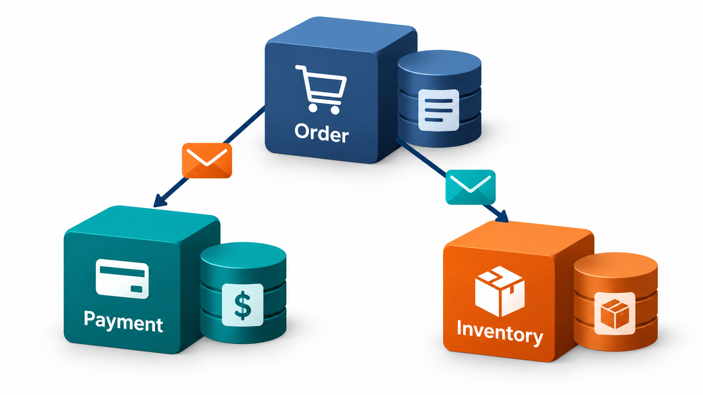
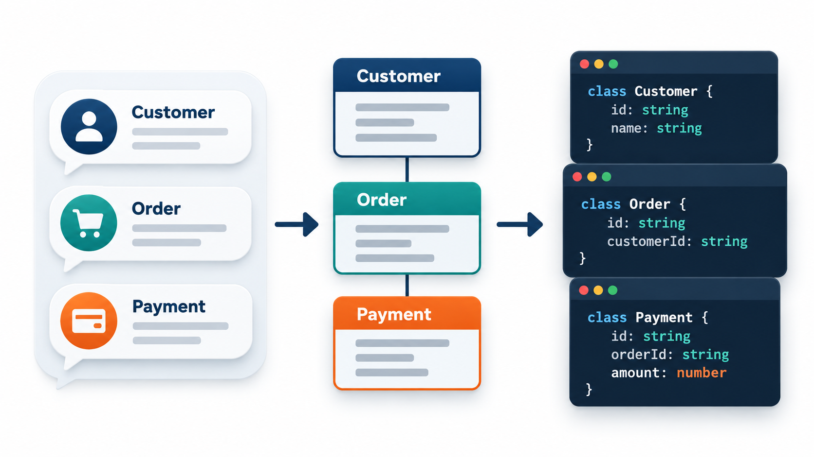

## Who Is Responsible for What?

Beginners often design a program as a sequence of procedures and a heap of data, then try to force objects into the shape of the procedures. Object-oriented design starts from a different question. Instead of "what data do I store?", it asks "who is responsible for what?". The things in the problem become objects, each with a clear responsibility, and the design is a conversation between them.

A low-tech way to practise this is the **CRC card**: an index card for each class, with its name, its responsibilities, and the other classes it collaborates with. Groups act out a scenario by moving the cards around a table. This topic describes the way of thinking: how to find the classes in a problem, how to decide where responsibilities belong, and how to keep the design in the language of the people who know the problem.

## Objects Have Responsibilities

An object-oriented program is a society of objects that cooperate by sending each other messages. Each object has data that it keeps to itself and behaviour that it offers. The difficult part of design is not the syntax, but deciding who does what. Rebecca Wirfs-Brock developed the approach called **responsibility-driven design**: an object is characterised by what it knows, what it does and whom it asks for help.

A CRC card makes this concrete. A card for `Order` might read:

| Class: Order | |
| --- | --- |
| **Responsibilities** | Know its lines. Work out its total. Know whether it has been paid. |
| **Collaborators** | OrderLine, Customer, Payment |

Walking through scenarios with the cards exposes problems. If one card has fifteen responsibilities, the class is doing too much. If two cards keep passing the same data back and forth, perhaps they should be one. If a task has no owner, there is a missing class.

<!-- Visual: three index cards labelled Order, OrderLine and Payment, each showing its responsibilities and collaborators, with arrows between collaborators. -->

## A CRC Session, Step by Step

Take the scenario "a customer places an order and pays".

1. **Write one card per candidate class.** Customer, Order, OrderLine, Product, Payment.
2. **Read the scenario aloud, one step at a time.** "The customer asks to add a product to the order."
3. **For each step, ask: who is responsible?** Adding a line belongs to the Order, which holds the lines.
4. **Move or hold the card for the responsible object.** The person holding Order says: "I add a line. I need the Product's price, so I ask Product."
5. **Record a new responsibility or collaborator on the cards** whenever one appears.
6. **Spot the problems.** If everything flows through one card, it is too powerful. If a card has nothing to do, it may not be needed.
7. **Repeat with the alternative scenarios**: payment refused, product out of stock, order cancelled.

| Observation during the session | What it suggests |
| --- | --- |
| One card collects most responsibilities | A "god class"; split it |
| A responsibility nobody wants | A missing class, perhaps a pure fabrication |
| Two cards always collaborate and nothing else | Perhaps they are one class |
| A card with a single trivial responsibility | May be an attribute of another class |

## GRASP: Patterns for Assigning Responsibility

Craig Larman collected a set of guidelines for deciding where responsibilities belong, which he called **GRASP**, for General Responsibility Assignment Software Patterns. The most useful for a beginner are the following.

- **Information Expert.** Give a responsibility to the class that has the information needed to fulfil it. The order knows its lines, so it computes the total.
- **Creator.** Let a class create objects that it contains or closely uses. The order creates its lines.
- **Low Coupling and High Cohesion.** Prefer assignments that keep dependencies few and classes focused.
- **Controller.** Put the handling of a system event, such as "pay fee", in a class that coordinates and does not do the work itself.
- **Polymorphism.** When behaviour varies by type, give each type its own version and avoid a chain of conditions.
- **Pure Fabrication.** When no class in the problem fits naturally, invent a class that does, such as a `PaymentGateway`, to keep the others cohesive.

<!-- Visual: The order calculates its total because it owns the line information instead of overloading a controller. -->

The first of these patterns is the Information Expert: give a job to the object that holds the information. Take an order with two lines. Each line knows its price and quantity, so it is the expert on its own subtotal. The order holds the lines, so it is the expert on the total.

| Order line | Price x quantity | Subtotal (asked of the line) |
| --- | --- | --- |
| Notebook | 60 x 3 | 180 |
| Pen | 10 x 5 | 50 |
| **Order total (asked of the order)** | | **230** |

The order does not look inside a line's fields; it asks each line for its subtotal and adds them. Had the total been computed by some outside routine that dug into every line, any change to how lines work would break it. Here each class guards its own knowledge, which is the Law of Demeter and information hiding at work.

## Polymorphism: Replacing Conditions with Types

When behaviour depends on a kind of thing, a long chain of "if it is this kind, do this; otherwise if it is that kind, do that" spreads knowledge of the kinds across the program. The object-oriented alternative is to give each kind its own version of the behaviour and let the caller simply ask.

| Design | Adding a new kind of shape | Risk |
| --- | --- | --- |
| Chain of conditions in a drawing routine | Edit the routine; also every other routine that checks the kind | Missing one place |
| Each shape knows how to draw itself | Add one new shape that knows how to draw itself | The existing shapes are untouched |

The same idea shows up in payment methods, discount rules and notification channels. It is the practical expression of the open/closed principle: new variants arrive as new objects.

## Domain Models: Objects from the Problem

Where do the classes come from? The best source is the problem itself. A **domain model** is a set of classes that represent the concepts of the problem domain, with the relationships between them. For a bank, the concepts are Account, Customer, Transfer and Statement. They are named in the language of the bank, not in the language of the software: a `DataRecord` tells the banker nothing.

A simple way to start is to read the requirements and underline the nouns. Many will become classes or attributes. The verbs will suggest responsibilities. Then sketch how they relate, and walk through scenarios. The model is a first approximation and it will change as understanding improves.

<!-- Visual: banking domain model using business concepts and relationships. -->

## Domain-Driven Design in Brief

Eric Evans's 2003 book *Domain-Driven Design* developed these ideas for large systems, and a few of its concepts have become common.

<!-- Visual: the word customer used in separate sales and support contexts. -->

- **Ubiquitous language.** Developers and domain experts agree a shared vocabulary, and the same words are used in conversation, documents and code. If the business calls it a "bonafide certificate", the class is `BonafideCertificate`, not `StudentLetter`. When the code reads like the business, experts can spot mistakes in it.
- **Bounded context.** The same word can mean different things in different parts of a business. A "customer" in sales is a prospect with a name and a phone number. In support, a customer has tickets and a service plan. Trying to make a single `Customer` class for both produces a bloated, confused object. Instead, each part of the system, a bounded context, has its own model with its own meaning of the word, and the contexts are connected through clear translations.
- **Entities and value objects.** An *entity* has an identity that persists as its data changes: a particular student. A *value object* is defined only by its values and is usually immutable: an amount of money, a date range.
- **Aggregates.** A cluster of objects treated as a unit, with one root through which all changes pass. An order and its lines form an aggregate, and outside code changes lines only through the order.

| Concept | Test | Example |
| --- | --- | --- |
| Entity | Two with the same data are still different if their identity differs | Two students both named Asha Rao |
| Value object | Two with the same data are interchangeable | Two Rs 500 amounts |
| Aggregate root | The only door into a cluster | Order, for its lines |

DDD matters most where the business rules are complex. For a simple form-over-database application, its full machinery is more than is needed, though the habit of a shared language is useful anywhere.

<!-- Visual: shared domain language keeps conversation models and code aligned. -->

## Common Design Smells

| Smell | What it looks like | Likely cause |
| --- | --- | --- |
| **God class** | One class that knows and does everything | Responsibilities never distributed |
| **Anemic model** | Classes holding data only, with all logic in separate "service" classes | Behaviour not placed with the data it uses |
| **Feature envy** | A method that mostly uses another class's data | The method is in the wrong class |
| **Shotgun surgery** | One change needs small edits in many classes | A single responsibility scattered |
| **Primitive obsession** | Money held as a bare number, dates as text | Missing small value classes |

## Five Misreadings of Object-Oriented Design

**"OO design means using lots of inheritance."** Responsibilities and collaboration are the core. Inheritance is one tool and often not the best.

**"Classes are nouns, so find all the nouns."** Nouns are a start. Many nouns are only attributes, and the real design work is in the responsibilities.

**"A domain model is a database diagram."** It models behaviour and concepts, not just stored data. The database is one way of persisting it.

**"One model of the customer is enough for the whole company."** Words mean different things in different contexts. Forcing one model produces a class that serves nobody well.

**"CRC cards are childish."** They are quick and cheap and they get everyone to talk. The best designers use them whenever a design is hard to see.
