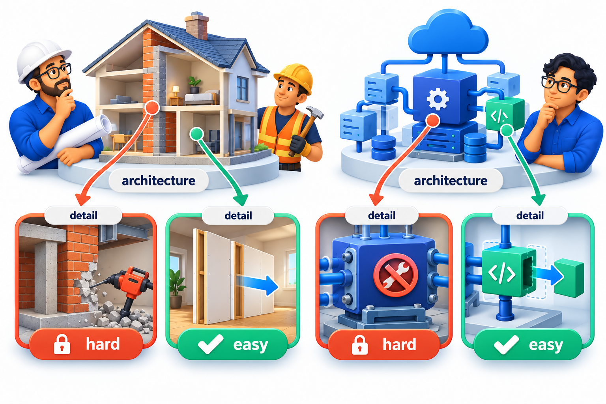
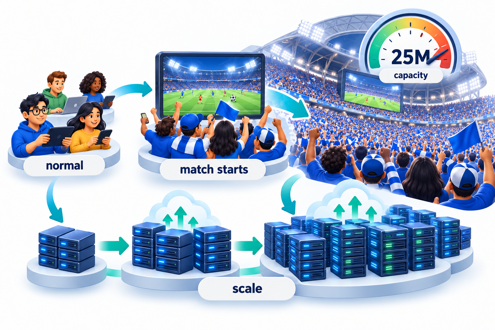
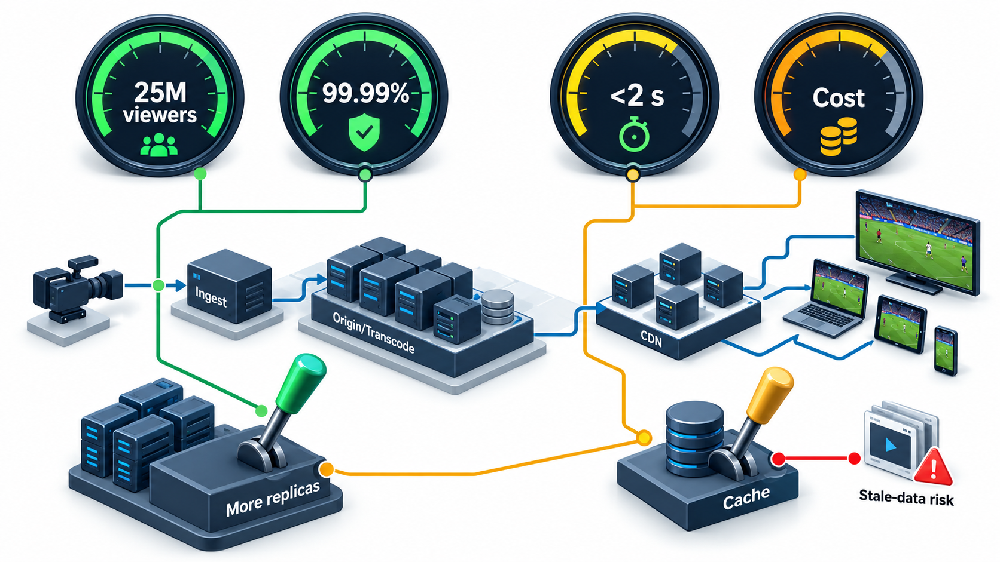
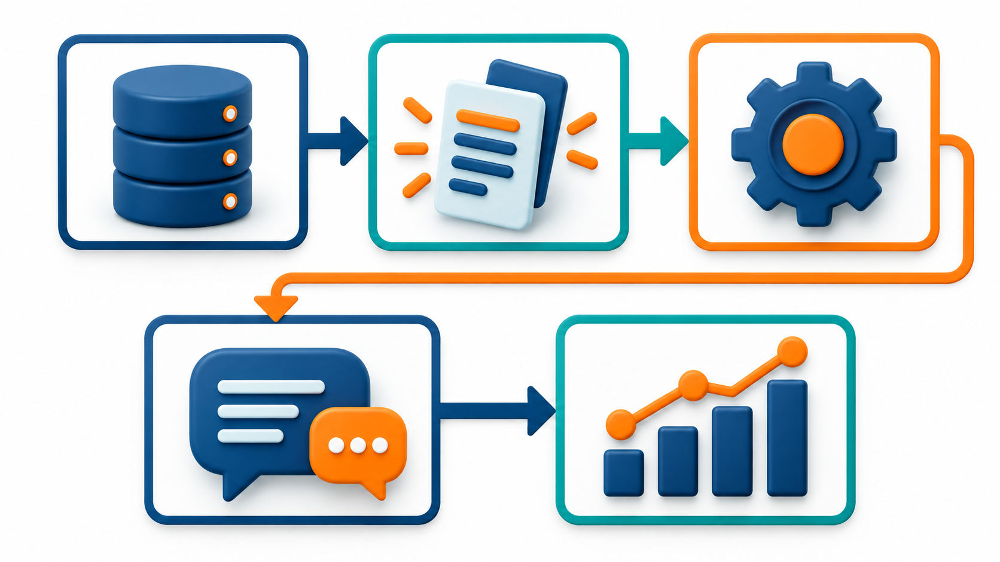

## The Decisions That Are Expensive to Change Later

Some decisions about a system are small: the name of a variable, the layout of a screen. Others shape everything that follows: how the data is split up, how the parts talk, how the system grows when demand surges, which features can be switched off to protect the rest. These are not details of any single function. They are the shape of the whole system, and changing them later means rebuilding.

Those decisions are what we call the **architecture** of a system. A system's architecture is mostly decided by its quality needs, such as how many users it must serve at once or how quickly it must recover, rather than by its features. This topic covers what architecture is, what drives it, and how to reason about it, using a live-streaming service for a cricket match as the running example.

## What Architecture Is

Software architecture is the set of significant design decisions about a system: the major parts, what each is responsible for, how they are arranged and connected, and the principles that guide how it evolves. The word *significant* is the key. Not every decision is architectural. The name of a variable is not. The choice between a single database and one per service is, because it is expensive to change and affects almost everything else.

Ralph Johnson, a well-known software designer, described it as "the decisions that you wish you could get right early". They are the choices that are costly to reverse. A useful test is to ask what it would cost to change a decision later. If the answer is "a few lines", it is detail. If the answer is "months, and every team would be affected", it is architecture.

Architecture also differs from design in scope. Architecture is concerned with the system as a whole and with the qualities it must have. Detailed design is concerned with how individual parts achieve their jobs.

| Decision | Cost to change later | Architectural? |
| --- | --- | --- |
| Name of a variable | Seconds | No |
| Layout of one screen | Hours | No |
| Which library formats dates | Days | Rarely |
| One database or one per service | Months, with data migration | Yes |
| Whether the system is one program or many | Months, every team affected | Yes |
| Whether users' data is stored in one country or many | Possibly years, with legal impact | Yes |

<!-- Visual: load-bearing building structure compared with consequential software structure. -->

## Quality Attributes Drive the Decisions

Why does a streaming service need its particular architecture? Because of what it must achieve. Functions alone, such as playing a video, hardly constrain the architecture, since many designs can play a video. What shapes it are the **quality attributes**: how many viewers at once, how quickly playback starts, how available the service must be, how safe the payments are, how fast new features can be released.

| Quality attribute | The question it asks | Example for the streaming service |
| --- | --- | --- |
| **Performance** | How fast does it respond? | Playback starts within five seconds |
| **Scalability** | Can it handle growth in load? | Millions of simultaneous viewers on match day |
| **Availability** | How much of the time is it working? | Almost no downtime during a live event |
| **Security** | Who can do what, and is data protected? | Payments and accounts are safe |
| **Modifiability** | How cheaply can it change? | New features can be released weekly |
| **Testability** | Can we check that it works? | Changes can be verified automatically |
| **Cost** | What does it cost to run? | Bandwidth and servers within budget |

Each quality has to be stated so that it can be checked, and the best format is the **quality attribute scenario**: a source produces a stimulus, in an environment, to which the system gives a response, measured in a particular way. "At the peak of a semi-final (environment), 25 million viewers (stimulus) start or continue watching, and the service keeps playing with start-up under five seconds for 95 per cent of them (response measure)." This leaves nothing to interpretation, and an architect can ask what structures would meet it.

| Part of the scenario | Meaning | In the example |
| --- | --- | --- |
| Source | Who or what produces the stimulus | Viewers |
| Stimulus | The event | Start or continue watching |
| Environment | The conditions | Peak of a semi-final |
| Response | What the system does | Keeps playing |
| Response measure | How we check | Start-up under five seconds for 95% of viewers |

## Putting Numbers on It

The numbers behind a scenario often decide the architecture by themselves. Take a live cricket match watched by 25.3 million people at once, and work out how much data leaves the system each second at three video qualities.

| Video quality | Megabits per viewer per second | Data leaving the system |
| --- | --- | --- |
| Low (360p) | 0.7 | about 17.7 terabits per second |
| Medium (720p) | 2.0 | about 50.6 terabits per second |
| High (1080p) | 4.0 | about 101.2 terabits per second |

An ordinary server link of 10 gigabits per second carries 5,000 medium-quality viewers, so serving everyone would need about 5,060 such links. One calculation has already ruled out a design with one big server room. It forces the architecture towards a distributed one, with content delivery networks and many servers close to the audience. The figures are rounded for illustration. The exercise is the point: do the arithmetic early, since it can narrow the choices faster than argument.

<!-- Visual: A live-streaming platform scaling for a 25-million-viewer match-day surge. -->

## Trade-offs Are the Job

No architecture is best at everything. Making a system more secure can make it less convenient. Making it faster can make it more expensive. Making it flexible can make it more complex. An architect's job is to understand which qualities matter most for this system and to make the trade-offs explicitly, so that the choices are conscious.

| To improve... | A common tactic | What it may cost |
| --- | --- | --- |
| Performance | Keep copies of popular data close to users (caching) | Users may briefly see stale data; extra moving parts |
| Availability | Run several copies in different places | More cost; harder to keep copies in step |
| Scalability | Split the system into independently scaled parts | More network calls; harder debugging |
| Security | Check every request and encrypt traffic | Added delay; harder development |
| Modifiability | Add layers and interfaces | More code and indirection |

<!-- Visual: A live streaming architecture balances viewer scale availability latency cost and stale-data risk. -->

A pragmatic practice is to rank the top three or four qualities, and to write down the decisions that favour them and the costs accepted. For the streaming service, availability and scale at peak outrank, say, absolute consistency of every viewer count. That choice permits some designs and excludes others.

<!-- Visual: A quality scenario connects stimulus response and measurable result. -->

## Views of an Architecture

No single picture shows everything about an architecture, for the same reason that no single plan shows a building. Architects use several **views**, each for a different audience and question.

| View | Shows | Answers | Typical audience |
| --- | --- | --- | --- |
| **Logical (structure)** | Parts and their responsibilities | What is the system made of? | Developers |
| **Runtime (behaviour)** | How parts interact while running | What happens when a viewer presses play? | Developers, testers |
| **Deployment** | Where parts run | What runs on which machines? | Operations |
| **Data** | Stores and flows of data | Where does information live and move? | Data and security teams |

A team that draws only the logical view often finds, too late, that the deployment cannot meet the performance goal.

## Recording Decisions

Because architectural decisions are expensive and cross-cutting, they should be recorded with their reasons. A short note for each, giving the context, the decision, the alternatives rejected and the consequences, saves months of confusion later. The note is called an architecture decision record, and the habit is worth beginning at once: whenever a choice would be costly to reverse, write down why you made it.

<!-- Visual: consequential architecture decisions surrounding a system blueprint. -->

## A Worked Case: Choosing Between Two Designs

Suppose the streaming team weighs two ways to serve the match. Design 1 serves everything from one large data centre. Design 2 pushes video to many edge servers close to viewers, with a central service handling sign-in and payments.

| Quality scenario | Design 1: one data centre | Design 2: edge servers plus central core |
| --- | --- | --- |
| 25 million viewers at peak | Cannot supply the data volume; the calculation above rules it out | Each edge handles its local audience |
| Start-up under five seconds | Long distances add delay for far viewers | Content is nearby, so the delay is short |
| Survive loss of a site | A data-centre outage ends the stream | Other edges carry on; sign-in has a standby |
| Cost | Lower to build, impossible to scale | Higher, justified by the load |
| Simplicity | Simple | More parts to operate |

The table does not say Design 2 is simply better. It says that, for these scenarios, Design 1 fails the most important one. For a small college lecture stream with fifty viewers, the same table would favour Design 1. The architecture follows the scenarios, not fashion.
