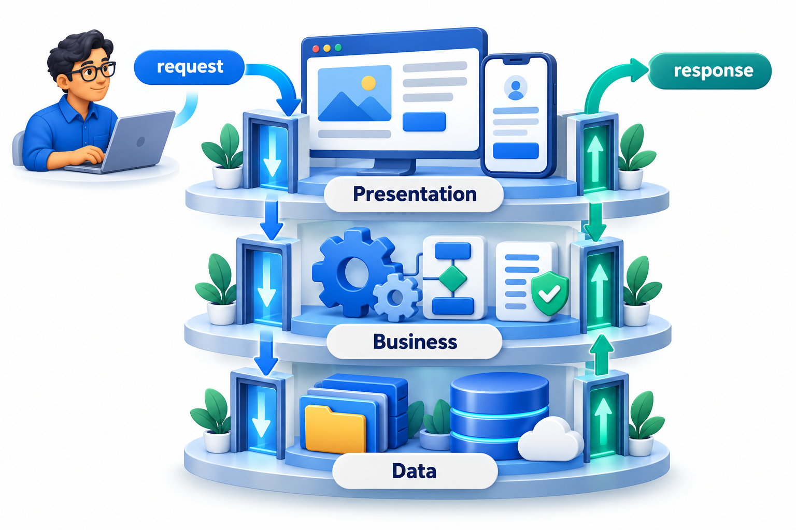
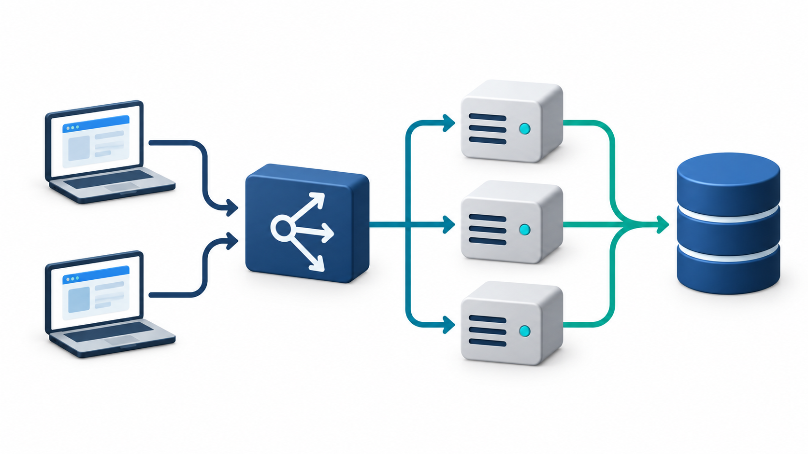
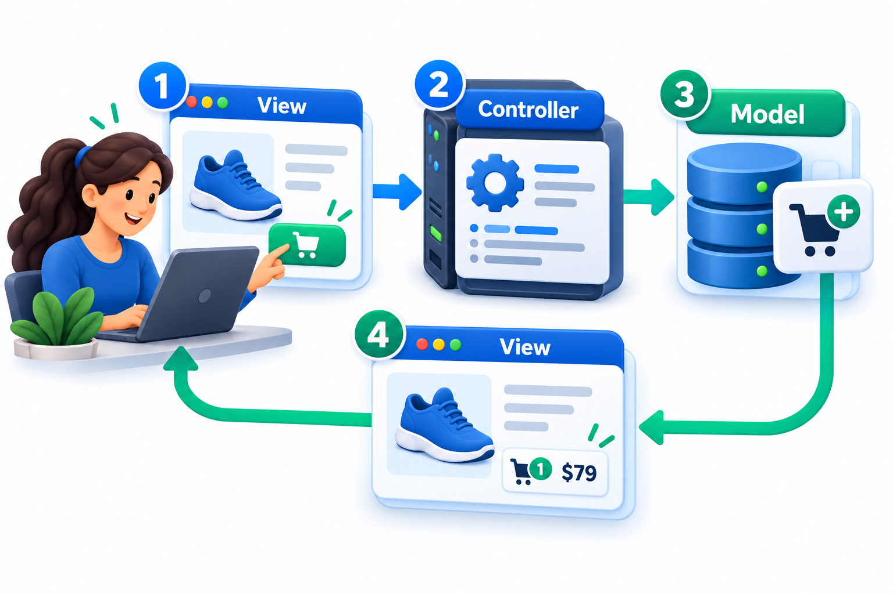
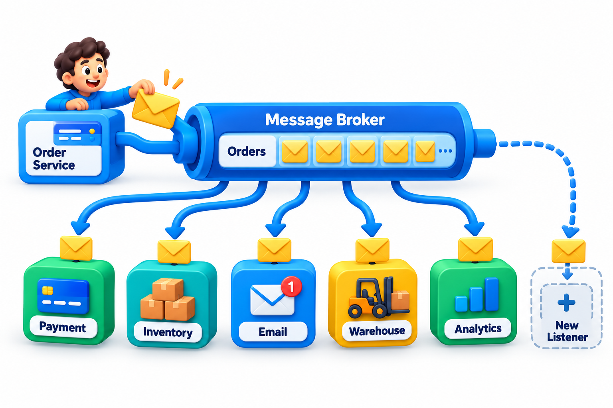
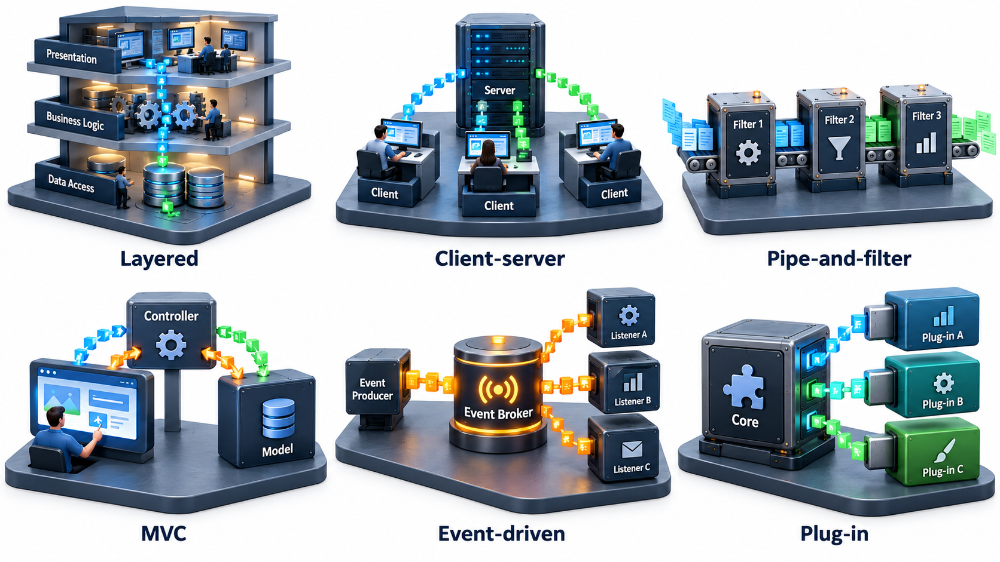

## Systems Come in a Handful of Familiar Shapes

Builders do not invent a new kind of building for every client. They choose among familiar forms, such as the terraced house, the tower or the warehouse, each with known strengths and costs. Software has the same repertoire. Programs can be chained like garden hoses, stacked in layers, arranged around a shared message channel, or split into parts that talk across a network.

An **architectural style** is a named, recurring way of arranging the parts of a system, with a known set of strengths and costs. A style is not a design of any particular system. It is a pattern for a family of them. Choosing a style is among the earliest architectural decisions, and it fixes a great deal that comes after. This topic surveys six of the common ones.

Each style can be understood through four questions: what are the parts, how do they connect, what moves between them, and what rules constrain the arrangement? The constraints are the point. A style gives its benefits only if the rules are kept, and a layered system whose layers call each other freely is layered in name only.

## Layered

Parts are arranged in horizontal layers, each of which uses only the layer directly below. A typical web application has a presentation layer (screens), a business layer (rules) and a data layer (storage). A request goes down through the layers and the answer comes back up. The strength is clarity and replaceability: the screens can change without touching the data. The cost is that every request pays a toll to cross each layer, and strict layering can force pointless pass-through code. The key rule is that dependencies point one way, down, and never skip or reverse.

| Layer | Responsibility | May call |
| --- | --- | --- |
| Presentation | Show screens, take input | Business layer |
| Business | Apply rules such as fee calculation | Data layer |
| Data | Read and write storage | Nothing above it |

<!-- Visual: presentation, business and data layers in a software system. -->

## Client-Server

Parts are divided into **clients**, which ask, and **servers**, which answer. A browser is a client of a web server. Servers hold shared resources and rules, while clients focus on presentation. Because many clients share one server, the server can be maintained in one place, but it is also a shared point of load and of failure. A server that keeps no memory of past requests (a *stateless* server) can be copied freely, with a load balancer sending each request to any copy, which is the main way such systems scale.

| Server design | Remembers the user between requests? | Can any copy serve any request? | Scaling |
| --- | --- | --- | --- |
| **Stateful** | Yes, in its own memory | No: the user must return to the same copy | Hard: copies need to share or stick to users |
| **Stateless** | No: each request carries what is needed, or a shared store holds it | Yes | Easy: add copies behind a load balancer |

<!-- Visual: stateless servers let a load balancer route any request to any instance. -->

## Pipe-and-Filter

In the pipe-and-filter style, data flows through a sequence of **filters**, each of which transforms it and passes it on through **pipes**. Each filter knows nothing about the others, only the format of what comes in and goes out. The strength is that filters can be reordered, replaced and reused, and tested alone. The cost is that data must be in a common format, and it is awkward for interactive programs. A familiar example is the Unix shell line that lists files, keeps the lines that match and counts them.

Take a pipeline of three filters over a five-line log: keep the error lines, extract the message, count each message.

| Stage | What it does | Output |
| --- | --- | --- |
| Input | Five log lines, two informational and three errors | 5 lines |
| Filter 1: keep error lines | Drops the informational lines | 3 lines |
| Filter 2: take the message | Keeps only the text after "ERROR:" | disk full, timeout, disk full |
| Filter 3: count each | Tallies identical messages | disk full: 2, timeout: 1 |

Because the filters are independent, a new one, such as one that removes duplicates, can be inserted without touching the others. It is also easy to test each with a few lines of input. Beyond the shell, the same style appears in compilers (read, tokenise, parse, generate), in data-processing jobs and in image-processing chains.

## Model-View-Controller and Its Relatives

Interactive applications separate three concerns. The **model** holds the data and the rules. The **view** displays it. The **controller** takes the user's input and tells the model what to do. When the model changes, the view updates. The separation lets the same model serve several views, such as a web page and a mobile app, and lets each part be changed or tested alone. Variants such as **MVVM** (Model-View-ViewModel) put an intermediary between model and view that prepares data for display and lets the view bind to it automatically, a common arrangement in mobile and desktop frameworks.

| Part | Knows about | Does not know about | Example: a fee screen |
| --- | --- | --- | --- |
| Model | Fees, rules | How things look | Calculates the amount due |
| View | How to display data | Business rules | Shows the amount in a table |
| Controller | Which action the user took | Details of display or rules | Receives "Pay now" and asks the model to record it |

<!-- Visual: one user action flowing through view, controller and model. -->

## Event-Driven

Parts communicate by producing and reacting to **events**. A component announces that something happened, such as "order placed", and any number of other components that have registered interest respond: one sends an email, one updates stock, one starts a shipment. The publisher does not know who listens. A **broker** in the middle can hold events until the listeners are ready. This decouples parts in time and in knowledge, and makes it easy to add listeners. The cost is that the flow of control is harder to follow, since no single place shows the whole sequence, and that failures and ordering need care.

| Question | Request-and-response | Event-driven |
| --- | --- | --- |
| Does the sender know who acts? | Yes, it calls them by name | No, it announces the event |
| Adding a new reaction | Change the sender | Add a new listener |
| If a listener is down | The call fails | The event waits at the broker |
| Following the flow | Read the calls in order | Search for who listens to which event |

<!-- Visual: an order event published through a broker to multiple independent listeners. -->

## Plug-in (Microkernel)

A small, stable **core** provides the basic functions, and features are added as **plug-ins** that conform to an interface the core defines. Web browsers with extensions, code editors with add-ons and build tools with plug-ins all work this way. The core stays small and reliable, and others can extend it without touching it. The cost is the design of a good plug-in interface, since once published it must be kept stable.

## Choosing a Style

Styles are not exclusive. A real system often combines them: layered inside each service, event-driven between services, with a plug-in mechanism for extensions. The choice follows the qualities that matter.

| Style | Favours | Costs |
| --- | --- | --- |
| **Layered** | Clarity, replaceable parts | Overhead per request, pass-through code |
| **Client-server** | Central control, shared resources | The server as a bottleneck and a single point of failure |
| **Pipe-and-filter** | Reuse, reordering, simple testing | A common data format, poor fit for interaction |
| **MVC and MVVM** | Several views of one model, testable logic | Extra structure for small applications |
| **Event-driven** | Loose coupling, easy to add reactions | Hard-to-follow flow, ordering and failure handling |
| **Plug-in** | Extensibility, a stable core | A hard-to-change plug-in interface |

A worked mapping shows how styles combine. A college results portal might be client-server at the top (browsers and a server), layered inside the server (screens, rules, data), event-driven for notifications (publishing results triggers emails and SMS), and pipe-and-filter for the nightly job that cleans and loads marks. Four styles, each applied where its strengths matter.

<!-- Visual: six small diagrams in a grid showing layers, client and server, a pipeline of filters, MVC triangle, a broker with publishers and subscribers, and a core with plug-ins. Save as images/62_six_styles.png. -->

## When a Style Is Applied Badly

Each style fails in a recognisable way when its rules are broken, and spotting the failure is a useful skill.

| Style | How it goes wrong | Symptom |
| --- | --- | --- |
| Layered | Upper layers reach straight into the data layer, or the data layer calls upwards | Changing the database breaks screens |
| Client-server | The server keeps memory of each user, so users stick to one copy | Adding servers does not help; sessions are lost on restart |
| Pipe-and-filter | A filter secretly depends on another's output format | Reordering filters breaks the result |
| MVC | Business rules creep into the view or the controller | The same rule is written in three places |
| Event-driven | Events carry too little or too much, or listeners depend on each other's order | Nobody can say what happens when an order is placed |
| Plug-in | Plug-ins reach into the core's internals | The core cannot change without breaking every plug-in |

In every case the underlying fault is the same: the rule that gave the style its benefit has been quietly broken, so the costs remain and the benefits do not.

## Five Misreadings of Architectural Styles

**"A style is a design."** It is a pattern for designs. The same style yields very different systems.

**"Each system has one style."** Most mix several, at different levels. The skill is to know which applies where.

**"A fashionable style is the right choice."** Choose by the qualities the system needs. A style that suits a streaming service may not suit a school's attendance form.

**"Event-driven is always more flexible."** It decouples in some ways and adds difficulty in others. Debugging an event flow is harder than following a call.

**"Layers mean the code is well structured."** Layers can still be tangled if dependencies skip or reverse. The rule is about the direction of dependencies, not just the number of layers.
