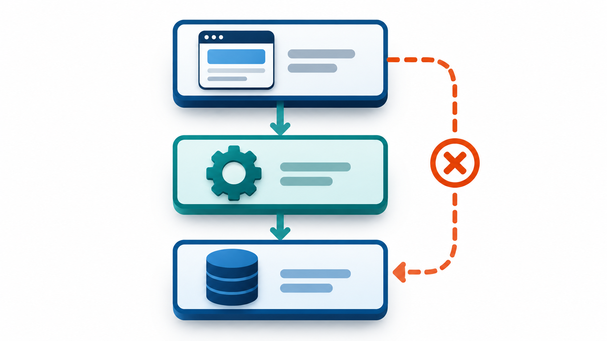
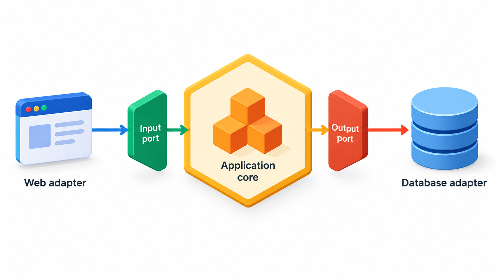
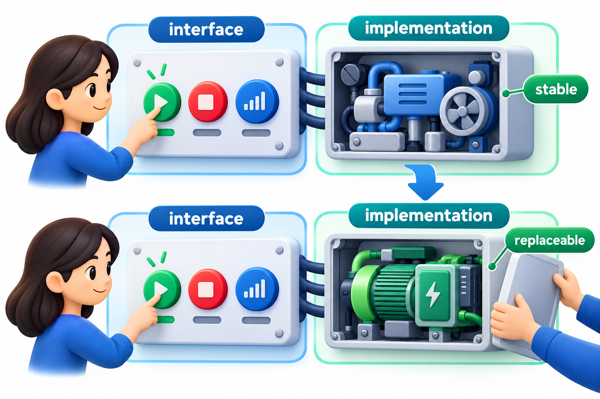
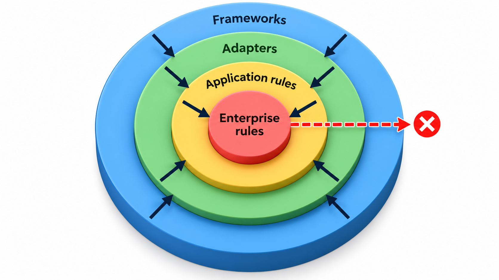
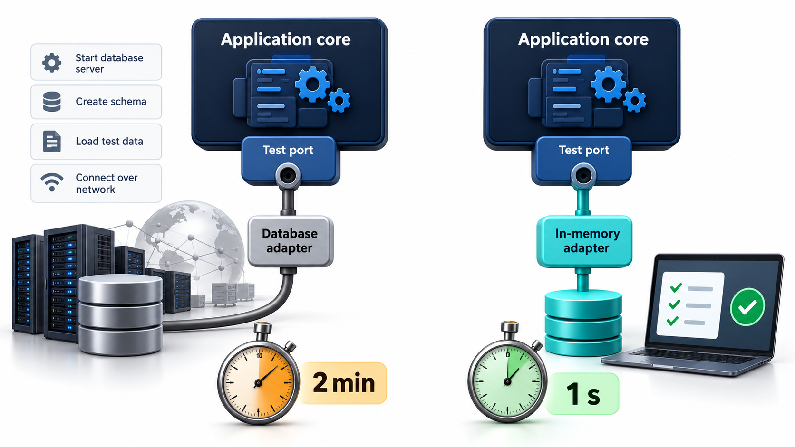

## Keep the Business Rules Free of the Plumbing

In many systems the business rules are tangled with the technology around them. Rules live in the screens and cannot be reused. Rules are so bound to the database that testing the simplest one needs a running database. Tests are then slow and fragile, so they are run rarely and defects creep in.

The **hexagonal architecture**, also called *ports and adapters*, and the closely related **clean architecture**, put the application's core logic in the centre, with everything else (the interface, the database, other systems) around the outside. The shape, a hexagon or concentric circles, is not important. The principle is, and it is easy to state: **the core must not depend on the outside. The outside depends on the core.**

Alistair Cockburn described the hexagonal form in the early 2000s, and Robert Martin popularised the clean architecture later. They arrived at the same rule from different directions, which is a reasonable sign that the rule is sound.

## Core, Ports and Adapters

The application is divided into an inside and an outside.

- The **core** holds the business rules and the use cases. It contains no code that knows about web frameworks, databases, files or the network.
- A **port** is an interface that the core defines for something it needs from or offers to the outside, such as "save a payment" or "send a notification". It is written in the core's own terms.
- An **adapter** is code outside the core that connects a port to a real technology. One adapter turns "save a payment" into an SQL command. Another turns the same call into a write to a file, or into a call that keeps data in memory for a test. On the way in, an adapter turns a web request, a command-line instruction or a scheduled job into a call on the core.

The direction of dependency is the key. The core defines the port. The adapter implements it. So the adapter depends on the core, and the core depends on nothing outside itself. This is the **dependency rule**, the same idea as dependency inversion, applied to the whole system.

| Side | Examples | Port direction |
| --- | --- | --- |
| **Driving (inbound)** | Web page, mobile app, command line, scheduled job, test | They call the core through ports the core offers |
| **Driven (outbound)** | Database, email service, payment gateway, file store | The core calls them through ports the core defines |

<!-- Visual: a hexagon with the application core in the middle, ports on its edges, and adapters outside connected to a web screen, a command line, a database, a file store and a payment service, with all dependency arrows pointing inward. -->

## The Idea in Practice

Take a fee service as a small core. It needs a place to store payments, so it defines that need as a **port**: anything that offers a way to save a payment. It can run with two **adapters**. One keeps payments in memory, the kind used in tests. The other does the same and also records an audit line.

| Case | With the in-memory adapter | With the audit adapter |
| --- | --- | --- |
| Asha pays Rs 5,000 | Recorded | Recorded, and an audit line is shown |
| Ravi pays Rs -1 | Rejected by the core's rule | Rejected by the core's rule |
| Total stored | Rs 5,000 | Rs 5,000 |

The business result is identical in both runs; the audit line appears only with the second adapter. The core service was not edited between the runs. It checks the business rule that an amount must be positive, then hands the payment to whatever store it was given, without knowing what that store is. That is the benefit: swap the technology by swapping the adapter, and test the rules without any of the technology.

## A Request Through the Hexagon

Follow one real request to see how the pieces cooperate.

1. A student presses "Pay fee" in a web page. The **web adapter** (driving side) receives the HTTP request and converts it into a plain call on the core: pay this amount for this student.
2. The **core** applies its rules: the student exists, the amount is positive, it does not exceed what is owed.
3. The core needs to charge the card. It calls its **payment port**, written in its own terms: "charge this amount".
4. The **payment adapter** (driven side) turns that into the actual request to the payment provider and translates the reply back.
5. The core asks its **storage port** to save the payment. The **database adapter** writes the row.
6. The core returns a result to the web adapter, which turns it into a page.

At no point does the core mention HTTP, SQL or the provider's wire format. A test replaces steps 1, 4 and 5 with simple stand-ins, and the same core runs unchanged.

## What the Style Buys

**Testability.** The business rules can be tested with plain objects and no infrastructure. Thousands of tests can run in seconds, which changes how often a team runs them.

**Replaceable technology.** The database, the web framework or an external service can be changed by writing a new adapter. The core, which is the valuable part, is left alone. A team that begins with a file store can move to a database later without rewriting the rules.

**Protection of the rules.** The business logic is the longest-lived part of a system. Frameworks come and go. By keeping the logic free of them, it survives their changes.

**Several front ends.** The same core can be driven by a web interface, a mobile app, a command-line tool and a test, each through its own adapter.

<!-- Visual: A stable public interface connected to a replaceable implementation. -->

## The Clean Architecture Circles

Robert Martin's version draws four concentric circles, with the dependencies pointing inward only. At the centre are **entities**, the most general business rules, which would exist even without any software. Around them are **use cases**, the application-specific rules for particular tasks. Next come **interface adapters**, which convert data between the form the use cases like and the form the outside likes. The outermost circle holds **frameworks and drivers**: the web framework, the database, the devices. Nothing in an inner circle may mention anything in an outer one. When an inner circle needs to call outward, it does so through an interface that it defines, and the outer circle supplies the implementation.

| Circle | Contains | Changes when | Rate of change |
| --- | --- | --- | --- |
| Entities | Enterprise-wide rules, e.g. "a fee cannot be negative" | The business itself changes | Rarely |
| Use cases | Application tasks, e.g. "pay a fee" | The application's behaviour changes | Sometimes |
| Interface adapters | Conversion of data to and from outside forms | Formats and screens change | Often |
| Frameworks and drivers | Web framework, database product | Technology fashions change | Often |

The arrangement puts the slowest-changing things in the middle and the fastest-changing at the edge, and makes the fast-changing depend on the slow, so that frequent change does not disturb the stable core.

## Costs and Judgement

The style is not free. It adds interfaces, mapping code between layers, and more files. For a small application whose lifetime is a few months, that overhead may not pay. The style earns its place where rules are complex and long-lived, where the technology is likely to change, or where fast, reliable tests matter. A reasonable path is to start simply and introduce ports at the places where the pain first shows, such as the database access that makes testing slow.

| Situation | Suggested approach |
| --- | --- |
| A one-week prototype | Skip it: keep everything simple |
| A fee system with many rules, to be used for years | Use ports at storage and payment |
| A small tool with one screen and one table | A simple layered structure is enough |
| A product with web, mobile and API front ends sharing rules | Strong fit: one core, several adapters |

<!-- Visual: two side-by-side test runs, one needing a database and taking minutes, the other using an in-memory adapter and taking a second. Save as images/63_fast_tests_with_adapters.png. -->

## Spotting the Boundary: What Belongs in the Core

A common difficulty is deciding what is business logic and what is plumbing. A few questions help.

| Item | Core or edge? | Reason |
| --- | --- | --- |
| "A fee cannot be negative" | Core | A rule of the business, true whatever the technology |
| "Late fine is Rs 10 a day after the due date" | Core | Policy owned by the college |
| The SQL that saves a payment | Edge (database adapter) | A detail of one storage technology |
| Turning a payment into JSON for a mobile app | Edge (interface adapter) | A detail of one front end |
| The URL path `/pay` | Edge (web adapter) | A detail of one delivery mechanism |
| The decision to send a receipt after payment | Core | A business step, though the sending is an edge |

A reliable test: could the rule be explained to the registrar without mentioning any technology? If yes, it belongs in the core. If explaining it needs words like table, endpoint or JSON, it belongs at the edge.

## Five Misreadings of Hexagonal and Clean Architecture

**"It is a particular folder structure."** It is a rule about the direction of dependencies. The folder names are incidental.

**"The database is the foundation of the system."** In this view it is a detail at the edge. The business rules are the foundation.

**"Every class needs an interface."** Ports are for the places where the core meets the outside world. Inside the core, plain classes are fine.

**"It means more code, so it is worse."** There is more structure, which costs a little and saves a lot where change is frequent. For a throw-away script, skip it.

**"It is only for big systems."** Even small programs benefit from keeping rules separate from input and output. The rigour can scale to the size of the risk.
