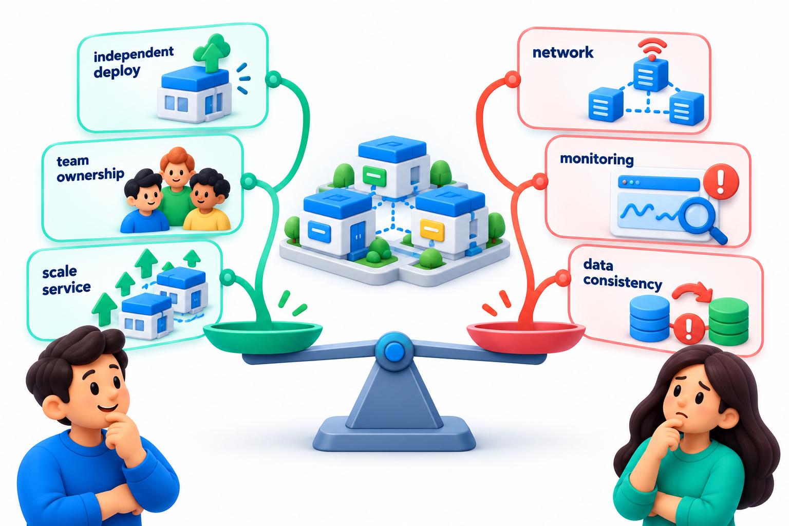
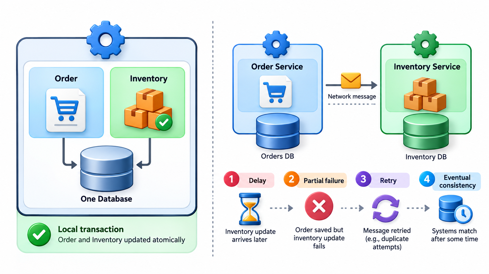
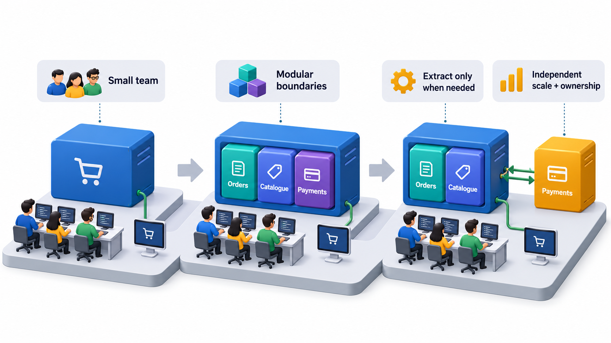

## Together or Apart: A Split That Costs Something

Every growing system faces a choice: keep it in one piece, or split it into many small independent services. In one piece, a single fault can stop everything, and a change anywhere means releasing the whole. Split apart, each service can fail and recover alone and be changed by its own team, but the parts now talk across a network, and the network is not free.

A **monolith** is a system built and deployed as a single unit. A **microservice** architecture splits it into small independent services. Both are respectable, and both have been regretted: some companies moved to many services and found the costs of passing data between them high, and later merged parts back together. This topic presents the choice fairly.

## The Monolith

A **monolith** is an application built and deployed as a single unit. All the features, the screens, the business rules and the data access, live in one codebase and run in one process, usually with one database. This is the natural way to start, and it has real strengths.

- **Simplicity.** One thing to build, test, deploy and monitor.
- **Speed of calls.** Parts talk by ordinary function calls, which take microseconds.
- **Easy consistency.** A single database transaction can update several things at once, and either all succeed or none do.
- **Easy refactoring.** Moving code between parts is an edit in one place, and a compiler can check it.

Its weaknesses show as the system and team grow. A small change means redeploying everything. One part's fault or load can affect all. A single technology choice binds every part. And many developers working in one codebase begin to collide, and boundaries erode into a tangle, the so-called *big ball of mud*.

A well-structured monolith, with strong internal boundaries between modules, is called a **modular monolith**. It keeps the simplicity of one deployment and the discipline of separate parts. For many organisations it is the right place to stay for a long time.

<!-- Visual: A modular monolith keeps strong internal boundaries within one deployment. -->

## Microservices

In a microservice architecture, the system is divided into many small services, each responsible for one business capability, with its own code, its own data store and its own deployment. They communicate over the network, through requests or messages. The strengths address the monolith's weaknesses.

- **Independent deployment.** A team can release its service on its own schedule.
- **Independent scaling.** The busy service can be given more resources without scaling the rest.
- **Isolation of failure.** A fault in one service need not stop the others, if the system is designed for it.
- **Team autonomy.** A small team can own a service end to end and choose suitable technology. This follows an observation made by Melvin Conway in 1967, now called Conway's law: a system's structure tends to mirror the communication structure of the organisation that builds it. Services owned by small independent teams are the architecture that matches such an organisation.

The cost is that a single program has become a distributed system, with all that implies. Calls that took microseconds now take milliseconds and may fail. Data is spread over several stores, so a change that touched one table now touches many with no shared transaction. Testing, tracing and debugging across services are harder. Deployment needs automation. And the whole thing needs people who understand it.

<!-- Visual: independent microservices behind an API gateway with separate data stores. -->

## Side by Side

| Aspect | Monolith | Microservices |
| --- | --- | --- |
| **Deployment** | One unit; everything released together | Each service separately |
| **Scaling** | Copy the whole application | Scale only the busy services |
| **Failure** | A serious fault can stop everything | Faults can be contained, if designed for |
| **Data** | One database, shared transactions | Each service owns its data; no shared transaction |
| **Speed of internal calls** | Microseconds | Milliseconds, and they can fail |
| **Team structure** | Works well for one small team | Suits many teams, each owning a service |
| **Technology choice** | One stack | Each service may choose |
| **Operational effort** | Low | High: monitoring, tracing, automation |
| **Testing** | Simple end-to-end | Needs contract tests and environments |
| **Best when** | Early product, small team, unclear boundaries | Large organisation, clear boundaries, differing scale needs |

## The Network Is Not Free

The cost of the network can be seen with a little arithmetic. Compare one user action passing through six components, in one process and across services. The figures are typical orders of magnitude: a call within a process takes about a thousandth of a millisecond, a call to another service about five milliseconds, and each component is up 99.9 per cent of the time.

| | Monolith (one process) | Microservices (six services) |
| --- | --- | --- |
| Latency added | 0.006 ms | 30 ms |
| Availability | 99.9% | about 99.4%, since all six must be up |
| Downtime a year | about 9 hours | about 52 hours |

The services add five thousand times as much overhead. Thirty milliseconds is not much for one action, but it multiplies over many calls, and a slow dependency makes it worse. With each component at 99.9 per cent, six in a chain give about 99.4 per cent. The figures assume failures are independent, which is generous. This is why microservices need patterns for resilience, such as timeouts, retries and circuit breakers that stop calling a failing service. These are the price of splitting. The arithmetic does not say that services are bad. It says that the split has to buy something worth more than it costs.

<!-- Visual: benefits and operational costs balanced around a microservices landscape. -->

## The Data Problem

The hardest consequence of splitting is what happens to data. In a monolith, one transaction can charge a payment, reduce stock and create an order, and if anything fails everything is undone. When each service owns its data, no single transaction spans them.

| Step in placing an order | Service | If the next step fails |
| --- | --- | --- |
| 1. Reserve stock | Inventory | Must release the reservation |
| 2. Charge card | Payments | Must refund |
| 3. Create order | Orders | Order missing, so the first two must be reversed |

Teams cope with a pattern in which each step has a compensating action that undoes it, and a coordinator ensures the compensations run if a later step fails. It works, but it is far more complex than one transaction, and for a period the system is in an in-between state. This is the best single reason to hesitate before splitting a part of a system that must change several things at once.

## Where to Draw the Boundaries

The hardest question is where to cut. Poorly chosen service boundaries give a *distributed monolith*: services that cannot be changed or deployed independently, because they share a database or must change together. They have all the costs of distribution and none of the benefits. Good boundaries follow business capabilities and bounded contexts, so that a change to one feature seldom needs changes to several services. A test is whether one team can deploy its service without asking anyone.

Many experienced engineers advise starting with a modular monolith and extracting a service only when there is a clear reason: a part needing different scaling, a team needing independence, or a component needing a different technology. Splitting prematurely, before the boundaries are understood, locks in the wrong divisions at the point where they are hardest to fix.

| Reason to extract a service | Good reason? |
| --- | --- |
| The video processing part needs many machines while the rest needs few | Yes: different scaling |
| Two teams keep blocking each other in the same codebase | Yes: team independence |
| The part needs a different language for a specialised library | Sometimes |
| "Microservices are modern" | No |
| The code is messy | No: fix the structure first; splitting a mess gives a distributed mess |

<!-- Visual: a timeline from a small team with a monolith, through a modular monolith, to a few extracted services as scale and team size grow, with the trigger for each step written beneath it. Save as images/64_monolith_to_services_path.png. -->

## Moving from One to the Other

Many teams begin with a monolith and extract services over time. A cautious route has recognisable steps.

| Step | What changes | Risk it reduces |
| --- | --- | --- |
| 1. Make the monolith modular | Clear modules, each with a narrow interface and its own data access | Boundaries are tested cheaply |
| 2. Separate the data | Each module reads only its own tables | Hidden coupling through the database is removed |
| 3. Pick one candidate | A part with a clear reason, such as different scaling | Learning on a small piece |
| 4. Extract it | Run it as its own service behind the same interface | The rest of the system sees no change |
| 5. Build the support | Monitoring, tracing, automated deployment | Operational surprises |
| 6. Review | Did it deliver the benefit that justified it? | Continuing on faith |

The reverse path also exists. Teams that over-split sometimes merge services back together after finding that two services always change as one. Treating the architecture as something that can move in both directions is healthier than treating microservices as a destination.
