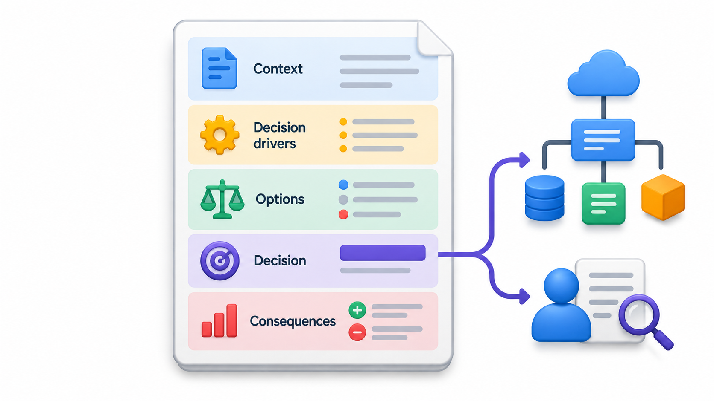
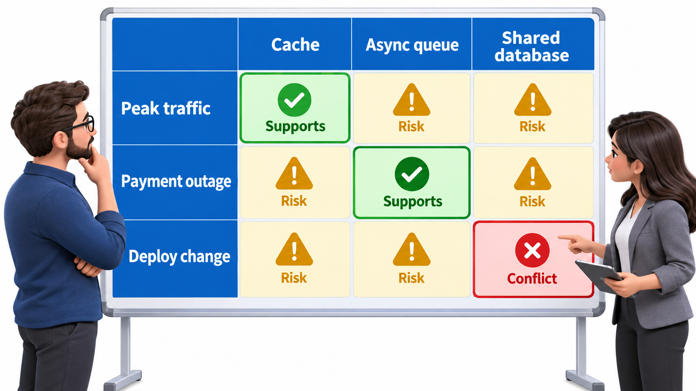

## Write Down Why, Not Just What

A system's architecture must be described so that others can understand it, and evaluated so that the team knows whether it will meet its goals. Most documentation records what the system is. The harder and more valuable thing to record is why it is that way: the situation that forced a decision, the choice made, and what became easier or harder as a result. When the people who made the choice have left, a newcomer facing a puzzling design has two bad options: accept it without understanding, or change it without knowing what depended on it.

A short text file per important decision, kept with the code and numbered in order, is called an **architecture decision record**, or ADR. It asks for so little, a page written while the decision is fresh, that teams actually do it. This topic covers documenting and evaluating architecture, and ends with a way of making sure it stays what it was meant to be.

Documentation and evaluation belong together because they answer the same two questions from different directions. Documentation answers "what did we build, and why?" Evaluation answers "will it do what we need?" A system with good documentation but no evaluation may be well described and wrong. A system evaluated once but never documented loses the reasons within a year.

## Views: No Single Picture Shows It All

A building has a floor plan, an electrical plan and a plumbing plan, because no one drawing serves every reader. An architecture is the same. The standard practice is to describe it through several **views**, each aimed at certain readers and certain questions.

| View | What it shows | Who needs it |
| --- | --- | --- |
| **Structural (module or component)** | The parts and the dependencies between them | Developers deciding where code goes |
| **Behavioural (runtime)** | How the parts interact in key scenarios | Developers and testers following a flow |
| **Deployment** | Where the parts run on machines and networks | Operations and security staff |
| **Decisions** | The significant choices and the reasons for them | Everyone who will change the system |

A view should be drawn for a reason and a reader, with a short key. The C4 model gives a handy set of levels for the structural view: context, containers, components. The behaviour is shown by a few sequence diagrams of the most important flows, such as a payment. The decisions are kept as ADRs.

<!-- Visual: four architecture views covering structure, behaviour, deployment and decisions. -->

## What a Newcomer Needs on Day One

A good test of documentation is to imagine a developer joining on Monday. What do they need, in order?

| Question | Answered by |
| --- | --- |
| What is this system for, and who uses it? | A one-page overview with a context diagram |
| What are the main parts and how do they connect? | A container-level diagram and a short paragraph for each part |
| How do I run it on my laptop? | A setup guide that has been tried by a newcomer recently |
| What happens in the most important flows? | Sequence diagrams of three or four key scenarios |
| Why is it built this way? | The decision records |
| What rules must I not break? | A short list of architectural rules, ideally checked automatically |
| Who do I ask? | Named owners for each part |

Six or seven short pages that answer these are worth far more than a hundred-page document nobody opens.

## Architecture Decision Records

A good ADR is short, perhaps half a page, and has a fixed shape.

| Section | What it contains | Example |
| --- | --- | --- |
| **Title and number** | A short name for the decision | `ADR-007: Use a message queue for receipts` |
| **Status** | Proposed, accepted, superseded | Accepted, 12 March |
| **Context** | The situation and the forces at play | Receipt generation takes up to 8 seconds and slows payments |
| **Decision** | What was chosen, in a sentence | Payments will publish an event, and a separate worker will make receipts |
| **Alternatives** | Other options and why they were rejected | Faster code (not enough), more servers (costly) |
| **Consequences** | What becomes easier, what becomes harder | Payments are faster. Receipts may arrive a few seconds late. We must monitor the queue |

Two habits make ADRs work. They are never edited to change history; if a decision is reversed, a new ADR says so and marks the old one superseded. And they live in the repository next to the code, so they are found, versioned and reviewed like anything else. Over time they form a log that explains how the system became what it is.

Which decisions deserve a record? A rough guide is any decision that is expensive to reverse, affects more than one team, or that a reasonable person might later question.

| Decision | Write an ADR? |
| --- | --- |
| Choose PostgreSQL over a document database | Yes |
| Split payments into a separate service | Yes |
| Adopt a naming convention for API fields | Yes, briefly |
| Rename a helper function | No |
| Use a particular library for date formatting | Usually no |

<!-- Visual: an architecture decision record preserving context, options, choice and consequences. -->

## Evaluating an Architecture

Before building a system, or when inheriting one, a team needs to ask whether the architecture will meet the goals. Evaluation asks of each important quality attribute: what scenario matters, and does the design meet it? A structured method, such as the Architecture Tradeoff Analysis Method from the Software Engineering Institute, brings stakeholders together to list the quality scenarios, rank them, and walk through how the architecture handles each, noting risks and trade-offs.

A lighter version works for most teams. List the five most important quality scenarios. For each, trace the architecture through it on a whiteboard. Note where it relies on a guess, where it has a single point of failure, and where two goals conflict. The output is a short list of risks, with an owner for each. A **design review** with colleagues who were not part of the design is part of the same practice. Questions from fresh eyes reveal assumptions that the authors no longer notice.

| Step | What happens | Output |
| --- | --- | --- |
| 1. Gather scenarios | Stakeholders say what matters most, in measurable terms | Five to ten quality scenarios |
| 2. Rank them | Vote on importance and difficulty | A short priority list |
| 3. Walk the design through each | Trace the path through the architecture | Where it copes, where it relies on a guess |
| 4. Record risks, sensitivity points and trade-offs | Note where a small change would have a large effect | A risk list with owners |
| 5. Decide actions | Change the design, test the risk, or accept it | Updated ADRs and tasks |

<!-- Visual: a table of quality scenarios against architectural decisions, with each cell marked as supports, risk or conflict, and the risk cells circled. Save as images/65_scenario_walkthrough_grid.png. -->

## Fitness Functions: Rules That Check Themselves

Documents and reviews work at one moment. Over months, an architecture drifts as people make changes that each seem reasonable. The remedy is to turn important architectural rules into automatic checks that run with every build. Such a check is called a **fitness function**: an objective test of whether the system still has a property that matters.

A **fitness function** is an automatic check that an architecture rule still holds. The rule might be structural ("the data layer must never import from the screens"), a performance limit ("the search must respond within 300 milliseconds for 95 per cent of requests"), or a rule about size or cycles ("no circular dependencies between packages"). Take the first kind. The rule is that the screens layer may use logic, and logic may use data, but never the other way round. A check reads which layer uses which.

| A layer uses another | Verdict |
| --- | --- |
| Screens use logic | OK |
| Logic uses data | OK |
| Screens use data | OK |
| Data uses logic | Violation: a lower layer reaches up |

The build fails with one violation. Run on every change, this turns a sentence from a design document into a guard. The next developer who takes the shortcut learns about the rule from a failed build, not from an archaeology of old documents.

| Kind of rule | Example check | Runs when |
| --- | --- | --- |
| Structure | No package depends on a package above it | Every build |
| Performance | Search answers within 300 ms for 95% of test requests | Nightly test |
| Size | No module larger than a set limit | Every build |
| Security | No password appears in the configuration | Every build |
| Availability | System recovers within a minute after a service is stopped | Regular drill |

<!-- Visual: architecture evaluation progressing from drivers and scenarios to options and trade-offs. -->

## Architectural Drift and Technical Debt

Even a well-designed architecture decays if nobody guards it. Each shortcut, a layer skipped to meet a deadline, a service reached into another's database for convenience, is small. Together they erode the structure until the documented design and the real one no longer match. The gap is a form of technical debt, and it can be measured by comparing what the diagrams say with what the code does.

| Sign of drift | How to detect it |
| --- | --- |
| Dependencies that break the layer rules | Automatic dependency checks |
| Documentation that disagrees with the code | Periodic review, or diagrams generated from code |
| Components with growing numbers of connections | Dependency metrics (fan-in and fan-out) |
| Decisions nobody can explain | Missing ADRs |

## Keeping Documentation Alive

Architectural documentation fails when it is written once and forgotten. A few habits help. Keep it small, so it can be kept up to date. Put it in the repository, so that a change to the structure shows up in the same change as the documentation. Prefer diagrams made from text, so they can be reviewed. Date every decision. And treat out-of-date documentation as a defect, not as an accepted state.

## Five Misreadings of Architecture Documentation

**"One big diagram is the architecture document."** One picture cannot show structure, behaviour, deployment and reasons. Use several views, each for a reader.

**"ADRs are bureaucracy."** A half-page written on the day of a decision saves hours of puzzling later. The cost is small and the benefit is long.

**"We can reconstruct the reasons from the code."** The code shows what was done. It does not show the alternatives that were rejected or the forces that decided it.

**"Evaluation is done once, before building."** The goals and the system change. Evaluate at major changes and keep automatic checks running.

**"A fitness function must be sophisticated."** A ten-line script that fails the build on a forbidden import is a fitness function, and it is often the most effective one.
