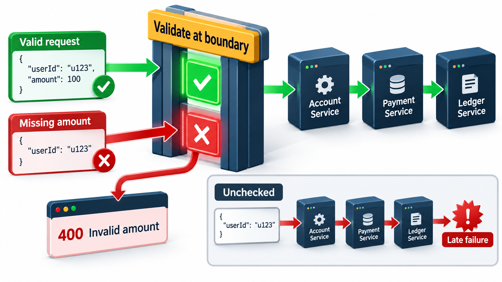
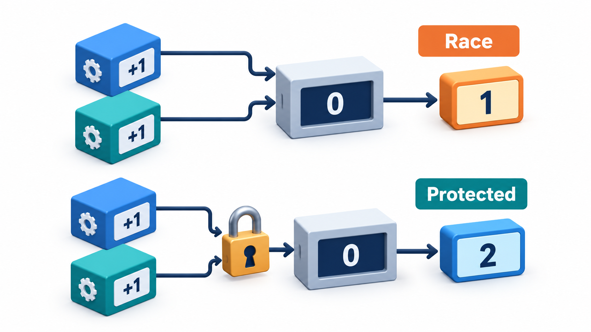
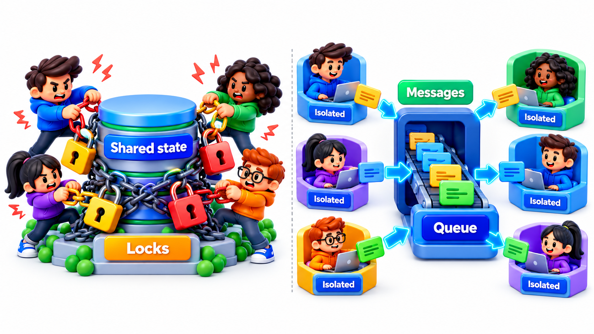
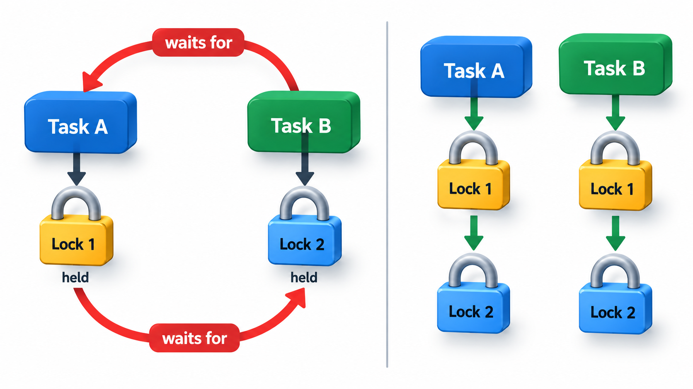
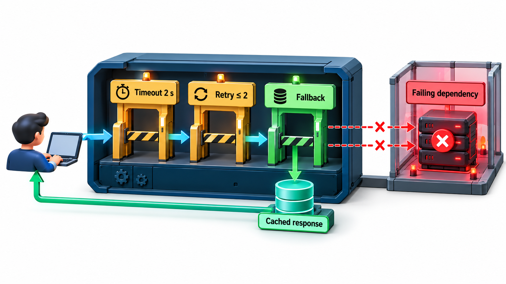

## Things Will Fail, and Timing Will Surprise You

Two facts shape the design of dependable systems. First, parts will fail, sometimes at the worst moment, so a design must expect failure and carry on. Second, programs that do several things at once can go wrong in ways that depend on timing, which makes them very hard to test. A bug can sit unseen for years because the timing it needs is extremely unlikely, and then appear on the one afternoon when it matters.

The most important of these timing bugs is the **race condition**: two parts of a program access the same data at the same time, and under a rare combination of timing they corrupt it. This topic covers the principles of handling both failure and concurrency.

The two themes belong together because they share a cause: in a system with many parts working at once, you cannot assume the world stands still while you act. Parts disappear mid-operation, replies arrive late or twice, and other tasks change data between your read and your write. Dependable design is largely the habit of not assuming otherwise.

## Failure Is Normal

In a system of many parts, something is always failing: a disk, a network link, a service that has run out of memory, a user who sends nonsense. A design that assumes everything works is a design that fails often. **Fault tolerance** is the ability to keep working, perhaps at reduced capability, when parts fail.

It helps to separate three words that are often used loosely. A **fault** is the underlying defect or event, such as a failed disk. An **error** is the wrong state that the fault produces, such as a corrupted record. A **failure** is what users see when the error reaches the outside: a page that does not load. Fault tolerance breaks the chain: a fault should not become a failure.

The basic strategies are few:

- **Detect.** Know quickly that something has failed. Timeouts, health checks and alarms (that themselves work) are the eyes of the system.
- **Contain.** Stop a failure from spreading. Boundaries such as separate processes, queues between components and limits on resources keep one fault local.
- **Recover.** Restart a failed part, retry an operation that failed for a passing reason, or switch to a spare.
- **Degrade gracefully.** Offer less when you cannot offer everything. A shop can keep browsing and taking orders when its recommendation service is down.

Within a program, error handling follows the same ideas. Check inputs at the boundary. Fail fast and loudly when something that should be impossible happens, so the problem is found close to its cause. Return errors with enough detail to act on. And never swallow an exception silently, since a hidden failure is the worst kind.

<!-- Visual: fail-fast error handling at a system boundary. -->

## Patterns for Containing Failure

Several well-known patterns put the strategies into practice.

| Pattern | What it does | Example |
| --- | --- | --- |
| **Timeout** | Stops waiting after a set time | Give up on the payment gateway after 3 seconds |
| **Retry with back-off** | Tries again after growing pauses (1s, 2s, 4s) | A momentary network blip passes |
| **Circuit breaker** | After repeated failures, stops calling for a while and fails fast | The recommendation service is down; skip it for 30 seconds |
| **Bulkhead** | Gives each dependency its own pool of resources | A slow report service cannot use up all the threads that login needs |
| **Fallback** | Supplies a reduced answer | Show yesterday's cached prices |
| **Redundancy** | Keeps spare copies | Two database servers, one on standby |
| **Health check** | Regularly tests that a part is alive | A load balancer stops sending traffic to a sick server |

Retries deserve a warning. If a service is overloaded and every client retries at once, the retries add to the overload. Back-off with some random variation spreads the retries, and a limit on the number of attempts stops them from continuing for ever.

| Attempt | Wait before it | Cumulative wait |
| --- | --- | --- |
| 1 | None | 0 s |
| 2 | 1 s | 1 s |
| 3 | 2 s | 3 s |
| 4 | 4 s | 7 s |
| Give up | | Return the fallback |

## What Concurrency Brings

A program is **concurrent** when it does several things in overlapping time: a web server handling thousands of requests, a phone app updating the screen while downloading, a bank processing many transfers. Concurrency is usually essential for speed and responsiveness. It also introduces a whole new class of bug, because the order in which the steps of different tasks interleave is not under the programmer's control.

The classic problem is a **race condition**: the outcome depends on the unlucky timing of two or more tasks that touch shared data. Take two bank clerks who each add 100 rupees to the same balance. Each does three steps: read the balance, add 100, write the result back. If one finishes before the other begins, the balance rises by 200 as it should. If both read before either writes, they both start from the same number, and the second write overwrites the first.

Two bank clerks each add Rs 100 to the same balance of Rs 1,000. Each does three steps: read the balance, add 100, write the result. Everything depends on the order in which the steps interleave.

| Order of steps | What happens | Final balance |
| --- | --- | --- |
| Without a lock: A reads, B reads, A writes, B writes | Both read 1,000; A writes 1,100; B also writes 1,100, based on what it read. The second deposit is lost. | Rs 1,100 (should be 1,200) |
| With a lock: A reads, A writes, B reads, B writes | B must wait until A has finished, so it reads 1,100 and writes 1,200 | Rs 1,200 |

Locking turns the unlucky order into the lucky one, by making B wait. The danger is that the unlucky order is rare. A program can run for years with the bug unseen, and then fail when the timing finally lines up. Testing is a poor defence, since you cannot easily force the timing.

The number of possible interleavings is large. Two tasks of three steps each can interleave in 20 different orders; only a few of them lose the deposit, which is why the fault hides.

| Interleaving (examples) | Result |
| --- | --- |
| A1 A2 A3 B1 B2 B3 (A finishes first) | Correct: 1,200 |
| B1 B2 B3 A1 A2 A3 (B finishes first) | Correct: 1,200 |
| A1 B1 A2 B2 A3 B3 (fully interleaved) | Lost update: 1,100 |
| A1 A2 B1 A3 B2 B3 (B reads before A writes) | Lost update: 1,100 |

<!-- Visual: two tasks racing for a shared resource, with a lock enforcing order. -->

## Safer Ways to Share

There are three main defences, in rough order of preference.

**Share nothing.** If tasks do not touch the same data, they cannot race. Give each task its own copy and combine the results at the end, or pass messages between tasks and not shared memory. This is the safest approach and fits many designs.

**Share only immutable data.** Data that cannot change can be read by any number of tasks at once without any risk. This is the concurrency benefit of immutability.

**Protect shared mutable data with locks.** A lock allows one task at a time into a critical section. It works, but it brings its own problems: forgetting a lock, holding one too long, and **deadlock**, where two tasks each hold a lock the other needs and both wait for ever. A famous case of lock trouble is the Mars Pathfinder lander in 1997, which kept resetting because a low-priority task held a lock that a high-priority task needed.

A function or class is **thread-safe** if it behaves correctly when used by several tasks at once. Documentation should say whether it is. Many standard library classes are not, and using them from several threads without protection is a common source of rare, hard-to-reproduce failures.

<!-- Visual: reducing contention by sharing less data between tasks. -->

## Deadlock: Two Tasks Waiting for Each Other

Deadlock needs four conditions at once: a resource can be held by only one task, tasks hold one resource while waiting for another, nobody can take a resource by force, and the waiting forms a circle. Remove any one and deadlock cannot occur.

| Step | Task A | Task B |
| --- | --- | --- |
| 1 | Takes lock on Accounts | Takes lock on Receipts |
| 2 | Wants lock on Receipts: waits | Wants lock on Accounts: waits |
| Result | Both wait for ever | |

The usual cure is to make every task take locks in the same fixed order, always Accounts then Receipts. Then the circle cannot form. Timeouts on lock requests are a second line of defence.

## Design Habits That Help

- Keep shared mutable state to a minimum, and put it behind one module that owns the locking.
- Make operations **idempotent** where you can, so that doing them twice has the same effect as once. Then retrying after a failure is safe.
- Set timeouts on every call to another service, so a hung dependency does not hold up the caller for ever.
- Test failure deliberately. Switch off a dependency, slow a network link, and see what the system does. Teams that do this regularly, a practice sometimes called chaos engineering, find weaknesses on their own schedule, not at the worst moment.

<!-- Visual: a request passing through a service with a timeout, a retry limit and a fallback response, each drawn as a guard, showing how a failing dependency is contained. Save as images/66_timeout_retry_fallback.png. -->

## Redundancy Needs Independence

Spare copies protect a system only if they fail independently. Two servers in one rack share a power supply; two copies of the same software share its bugs. If the cause of failure is common, both copies fail together.

| Redundancy | Protects against | Does not protect against |
| --- | --- | --- |
| Two servers in one room | One server's hardware failing | Power cut or fire in the room |
| Servers in two data centres | A whole site failing | A software bug present in both |
| Two different implementations of the same function | A bug in one | Mistaken requirements shared by both |
| Backups kept on the same disk as the data | Accidental deletion | Disk failure |

## Five Misreadings of Fault Tolerance and Concurrency

**"Our tests pass, so there are no races."** Races depend on timing that tests rarely reproduce. A passing test is no evidence of their absence.

**"Catching every exception makes the system robust."** Swallowing errors hides them. Handle what you can sensibly handle, and let the rest fail loudly where someone will see.

**"Locks fix concurrency."** They fix some problems and cause others. Sharing less is safer than locking more.

**"Redundancy guarantees availability."** Two copies of the same software with the same bug fail together. Redundancy needs independence.

**"Failure is a rare event to plan for last."** In a large system failure is constant. It belongs in the design from the beginning.
