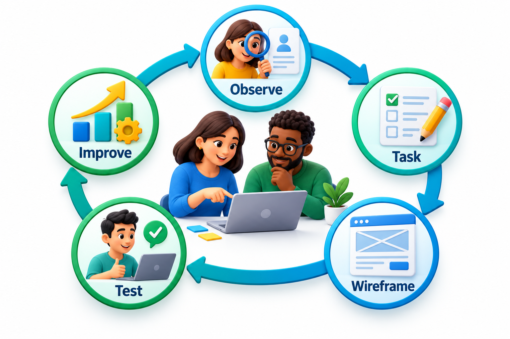
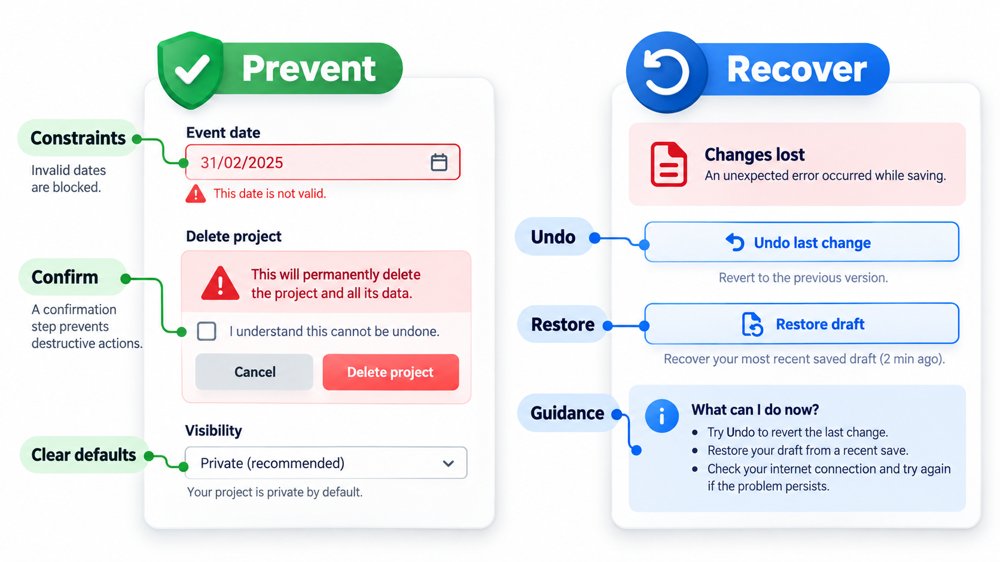
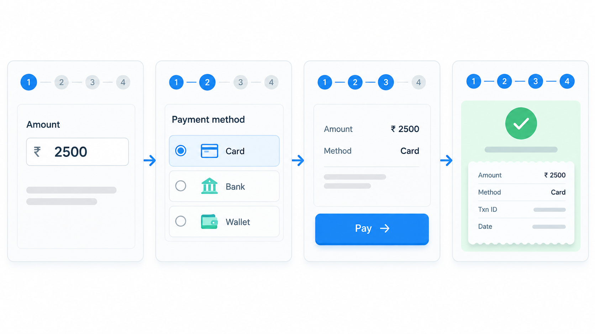
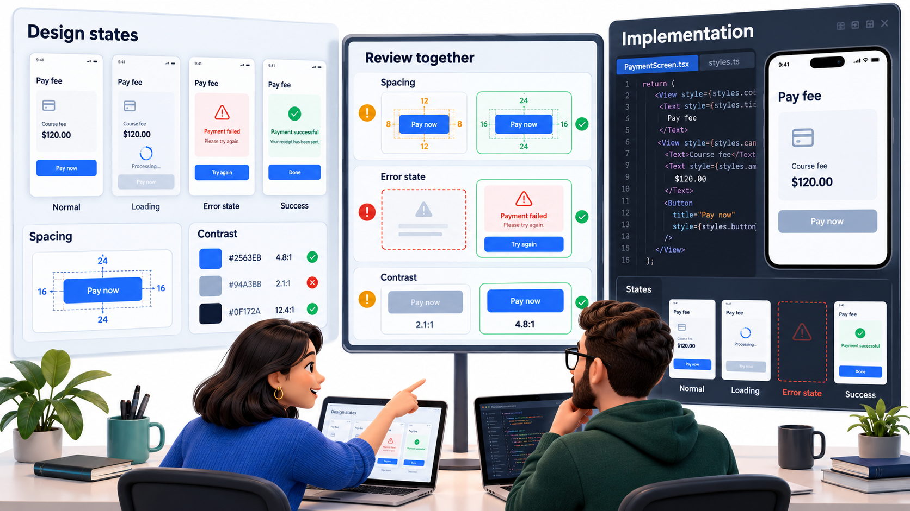
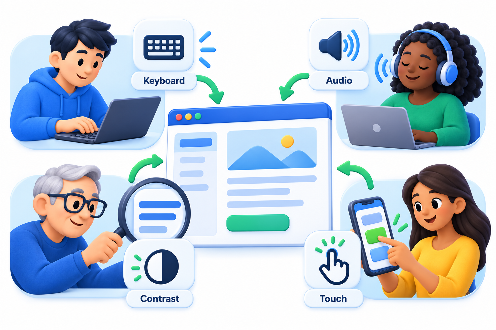

## When the User Makes a Mistake, Suspect the Design

A confusing button in a payment app, a form that loses your data, an error message that blames you: these are design failures, not user failures. When a ballot layout leads thousands of voters to punch the wrong hole, nobody intended to deceive them, but the design put the choice, the name and the hole in a configuration that people read wrongly under pressure.

**Human-centred design** is design that starts from how people actually see, think and act, and not from how the designer imagines they do. This topic covers the ideas and methods for avoiding such failures: understanding users, designing for the mistakes they will make, testing with real people and measuring the result.

The reason this belongs in a course on software engineering is that a system is only as good as its use. A perfectly correct program that students cannot work out how to use, or that clerks use wrongly under time pressure, has failed at its purpose. Usability is a quality attribute like speed or security, and it can be designed for, tested and measured.

## Start with People and Their Tasks

The central idea is to understand the people who will use the system, what they are trying to do and the conditions under which they do it, *before* deciding what to build, and then to check the design with them repeatedly. The cycle is simple.

1. **Observe and understand.** Watch real users. Learn their goals, their habits, their frustrations and their situation: a student on a crowded bus with a small screen, a clerk entering a hundred records in an hour.
2. **Define the tasks.** Write down what people need to accomplish, in their terms.
3. **Design.** Sketch ways to support those tasks.
4. **Test with users.** Put the sketch or prototype in front of real people and watch what happens.
5. **Repeat.** Fix what was found and test again.

Each cycle is cheap if done early with sketches, and expensive if done late with finished code.

<!-- Visual: A user-centered cycle from observation and tasks through wireframes and testing. -->

## Understanding Users: Methods

Observation can take several forms, and each shows something the others miss.

| Method | What you do | What it reveals | Effort |
| --- | --- | --- | --- |
| **Interviews** | Ask people about their work and problems | Goals, vocabulary, frustrations | Low |
| **Observation** | Watch people doing the task in their setting | What they actually do, as opposed to what they say | Medium |
| **Surveys** | Ask many people the same questions | How common a problem is | Low to medium |
| **Usage data** | Look at what people click, where they leave | Where the problems are, but not why | Low once collected |
| **Support tickets** | Read what users complain about | Real failures in the wild | Low |

People are poor reporters of their own habits, so observation matters. A clerk may say "I just type in the number", while watching reveals they write it on paper first because the form does not let them go back.

## Designing for Error

People make mistakes, and design should expect them. Mistakes come in two main kinds.

| Kind | What it is | Example | Design response |
| --- | --- | --- | --- |
| **Slip** | The person intends the right action but does something else | Pressing the wrong button; typing 5000 instead of 500 | Make buttons distinct; confirm large amounts; offer undo |
| **Mistake** | The person's plan is wrong | Believing a button submits when it only saves a draft | Clear labels; show what will happen; show status |

Good designs reduce errors in several ways. They make the wrong action impossible (a date picker that does not allow a date in the past), make it hard (a confirmation for deleting), make it reversible (undo) or make it visible (a summary before submission). Messages should say what happened and what to do, in plain words: "Your card was declined. Check the number or try another card" beats "Error 5021".

## Ten Heuristics for Judging an Interface

In the early 1990s Jakob Nielsen, working with Rolf Molich, distilled a list of general rules that most usability problems break. The list is called Nielsen's **ten usability heuristics**, and it is still the most widely used checklist for reviewing an interface.

| Heuristic | In plain words |
| --- | --- |
| **Visibility of system status** | Tell the user what is happening |
| **Match between system and real world** | Use the user's words and ideas, not the system's |
| **User control and freedom** | Offer an easy exit and undo |
| **Consistency and standards** | Same thing, same way, everywhere |
| **Error prevention** | Design so that mistakes are hard to make |
| **Recognition rather than recall** | Show options; do not make people remember |
| **Flexibility and efficiency** | Shortcuts for experts, simple paths for beginners |
| **Aesthetic and minimalist design** | Remove what is not needed |
| **Help users recognise and recover from errors** | Plain-language errors that say what to do |
| **Help and documentation** | Short, searchable and task-focused |

A review walks through the interface with the list and notes each violation. A ballot that alternates names on both sides of a central column of holes breaks at least three: it does not match how people read (real world), it makes errors easy (prevention) and it does not tell the voter what was selected (status).

## Wireframes and Prototypes

Before building an interface, designers sketch it. A **wireframe** is a simple black-and-white layout that shows where things go and what they do, without colour or final text. It is cheap enough to throw away and discuss. A **prototype** goes further: a clickable mock-up that lets a user walk through a task. Tools such as Figma make this easy, and paper prototypes can be as effective. The key is to put something in front of users before any code is written, when a change takes minutes.

| Fidelity | Looks like | Good for | Time to make |
| --- | --- | --- | --- |
| **Paper sketch** | Boxes drawn by hand | Exploring layouts quickly | Minutes |
| **Wireframe** | Plain digital layout | Agreeing structure and content | Hours |
| **Clickable prototype** | Screens linked together | Testing a task with users | A day or two |
| **Coded prototype** | Working but rough software | Testing behaviour and performance | Days to weeks |

<!-- Visual: a black-and-white wireframe of a fee payment screen, with boxes for the amount, the pay button and the receipt, and numbered notes saying which user task each part serves. Save as images/67_fee_payment_wireframe.png. -->

## Testing with Users

A usability test is simple to run. Give a participant a realistic task, such as "find out how much fee you owe and pay half of it", ask them to think aloud, and watch without helping. Note where they hesitate, go wrong or express confusion.

| Step | What to do |
| --- | --- |
| 1. Choose tasks | Two to five that matter most |
| 2. Recruit participants | Five people who resemble real users |
| 3. Brief them | "We are testing the design, not you" |
| 4. Observe | Silent, noting hesitation and errors |
| 5. Collect | Completion, time, errors and comments |
| 6. Fix and repeat | Address the biggest problems first |

Five participants are enough to find most of the larger problems in a given design. Different people tend to stumble in the same places, so each additional person adds less. More participants are worth recruiting for measurements, not for finding problems.

## Measuring Usability

Opinions about interfaces are easy to argue and hard to settle, so it helps to measure. Common measures from user tests are whether the participant completed the task, how long it took, how many errors they made, and how they rated the experience afterwards. A well-known questionnaire is the **System Usability Scale (SUS)**: ten statements ("I found the system unnecessarily complex", "I felt very confident using the system"), each rated from 1 (strongly disagree) to 5 (strongly agree). Odd statements are positive and even ones negative. For a positive statement the score is the answer minus 1; for a negative one it is 5 minus the answer, so a higher number always means a better experience. The total, from 0 to 40, is multiplied by 2.5 to give a score from 0 to 100.

Four participants tested an app.

| Participant | Pattern of answers | SUS score |
| --- | --- | --- |
| P1 | Warm to positive statements, low to negative ones | 90 |
| P2 | Neutral throughout | 50 |
| P3 | Mostly positive | 82.5 |
| P4 | The reverse of P1 | 25 |
| **Average** | | **61.9** |

Across many products the average SUS score is often cited as about 68, so this design is below it. It would be a signal to look at P4's session and see what went wrong. A score is a signal and not a diagnosis: it says whether people were satisfied, and the session notes say why. With only four people the average is rough, but the same method with five to ten users reveals most major problems.

## The Hand-off Between Designers and Developers

A design is not finished when the picture is approved. It has to be built faithfully, and the gap between a design file and working software is where much is lost. Good hand-off means developers see the design early and are consulted on what is feasible, the design is specified in terms they can use, such as spacing, colour values and states (hover, disabled, error, loading), and a shared library of components, a *design system*, keeps buttons and forms consistent. Designers review the built result, and developers raise questions as they find them. Treating the hand-off as a conversation, not a one-way delivery, avoids most of the arguments.

<!-- Visual: a design file and a coded screen side by side with differences circled (spacing, missing error state, wrong colour) and a two-way arrow between designer and developer. Save as images/67_design_developer_handoff.png. -->

## Accessibility Is Part of the Design

An interface that works for people with different abilities works better for everyone. Text with enough contrast helps people with poor eyesight and people using a phone in sunlight. Captions help deaf users and people in noisy places. A layout that works by keyboard alone helps people who cannot use a mouse and people who prefer speed. Building these in from the start costs little, and adding them at the end costs a lot.

| Need | Design feature | Who else benefits |
| --- | --- | --- |
| Low vision | Sufficient contrast, resizable text | Anyone in bright light |
| Blindness | Labels read by screen readers; meaningful order | Anyone using voice assistants |
| Hearing loss | Captions and transcripts | Anyone in a noisy place or without sound |
| Motor difficulty | Large targets; full keyboard use | Anyone on a moving bus |
| Cognitive load | Plain language, clear steps | Everyone under stress |

<!-- Visual: an interface supporting keyboard, audio, contrast and touch access. -->

## Five Misreadings of Human-Centred Design

**"Users are always right about what they want."** They are right about their problems. Designing the solution is the designer's work, and it must be tested with them.

**"Good design is how it looks."** Appearance is a part. Design is whether people can do what they came to do, without error.

**"A user who makes an error is careless."** Repeated errors point to a design that invites them. Fix the design.

**"Usability testing needs a lab and many participants."** Five users and a simple prototype find most of the big problems, and can be done in an afternoon.

**"We will make it usable after it works."** The structure of an interface follows from the tasks, so late changes are expensive. Test early with sketches.
