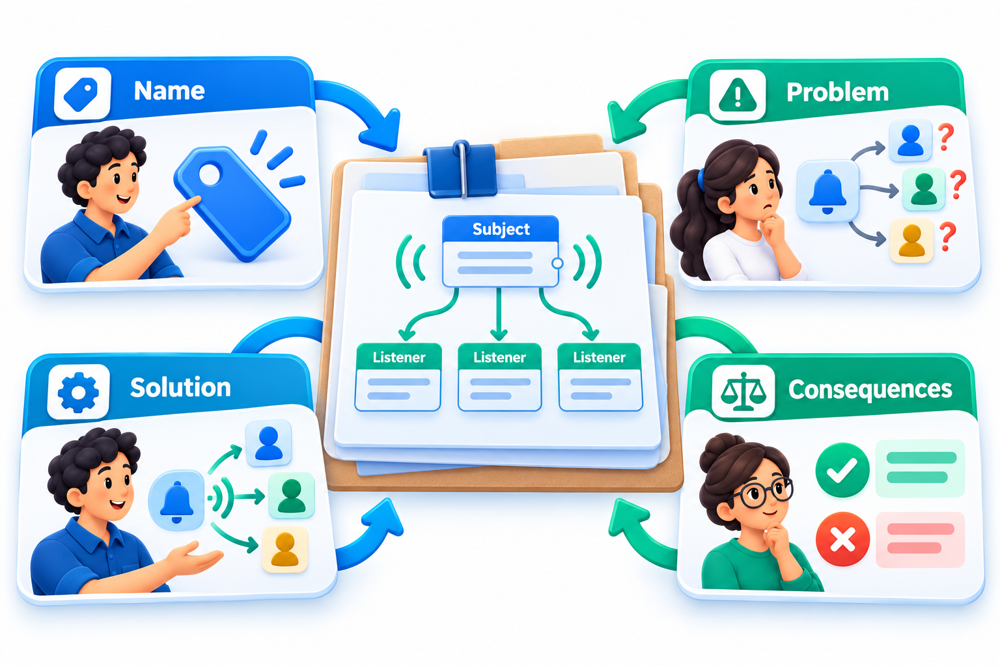
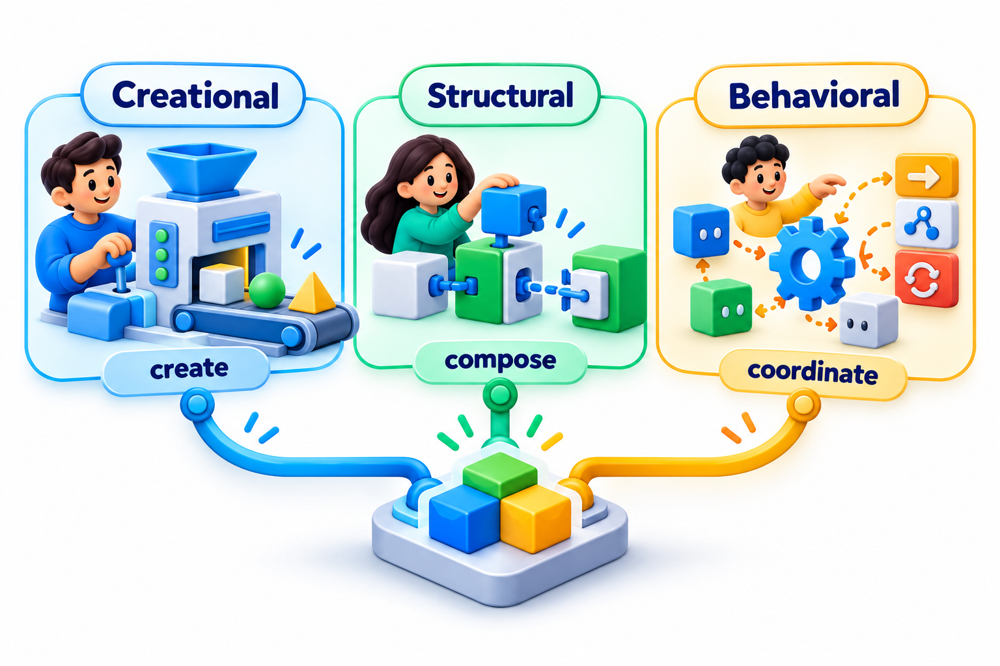
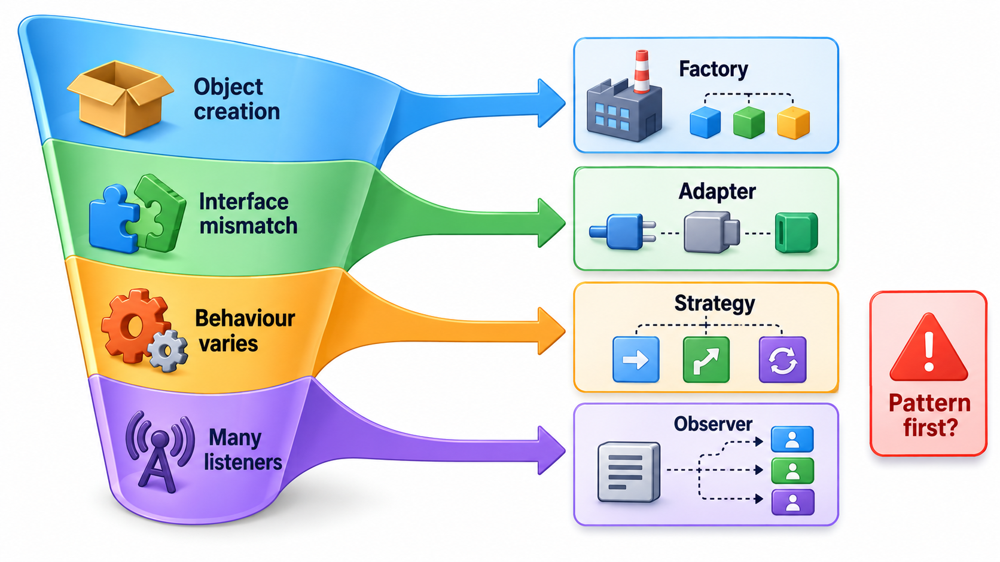
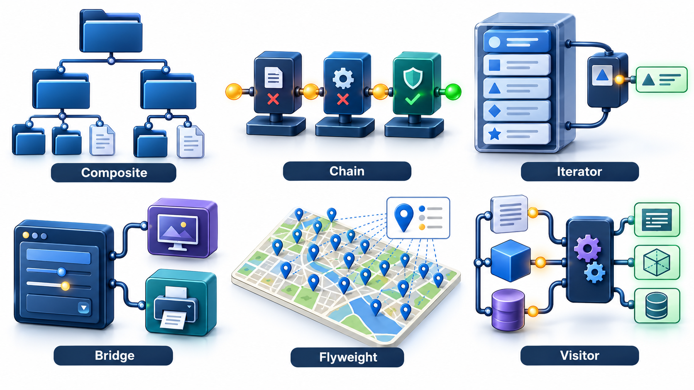
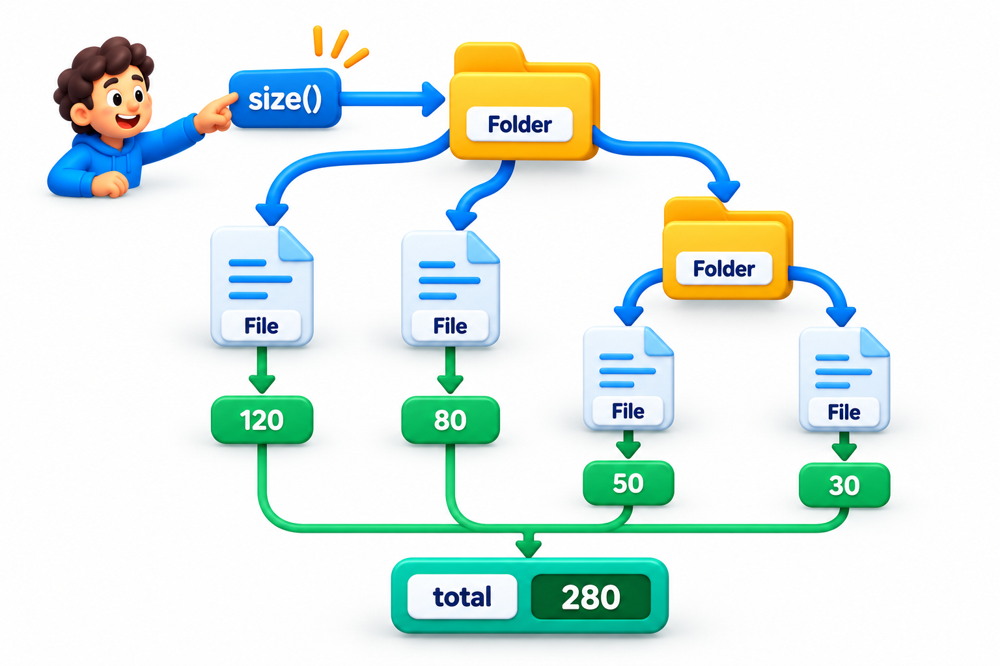

## Names for Solutions That Keep Coming Back

Experienced designers keep meeting the same problems: how to let one part of a system be told when another changes, how to create an object without tying the code to one particular kind, how to add a behaviour without rewriting a class. And they keep arriving at the same shapes of solution. A **design pattern** is a named, reusable solution to such a recurring problem, described well enough to be adapted but not so exactly that it is a piece of code to copy.

The idea was borrowed from architecture, where patterns such as "light on two sides of every room" give builders a shared vocabulary. In software, a 1994 book by four authors known as the Gang of Four catalogued 23 object-oriented patterns. Instead of describing a page of structure about an object that tells others when it changes, two engineers could say "Observer". This topic explains what a design pattern is and is not, how to read one, and why the right amount of patterns is fewer than a keen beginner expects.

The value of a name is easy to underrate. A team that shares a vocabulary of patterns can discuss a design in a sentence: "let us make the payment method a Strategy, and have the order notify listeners through an Observer". Without the names, the same conversation takes a whiteboard and ten minutes, and the risk of misunderstanding is higher.

## Pattern, Idiom, Anti-pattern

Three words are often mixed up.

| Term | What it is | Example |
| --- | --- | --- |
| **Design pattern** | A named, general solution to a recurring design problem, at the level of classes and objects | Observer, Factory Method |
| **Idiom** | A language-specific way to do a small thing well | A language's built-in way of opening a file that closes it automatically afterwards |
| **Anti-pattern** | A common solution that looks sensible but causes trouble | The "god class" that does everything |

A pattern sits between an architecture, which concerns the whole system, and an idiom, which concerns a line or two of code. It is not a piece of code to copy. It is a description of a *shape* that you adapt to your own situation.

## The Anatomy of a Pattern

Every pattern is described in the same way, which is why they are easy to compare.

- **Name.** A handle for discussion.
- **Problem.** What difficulty arises, and in what context.
- **Forces.** The pressures that pull in different directions, such as flexibility against simplicity.
- **Solution.** The arrangement of classes and their responsibilities that resolves the forces.
- **Consequences.** What you gain and what it costs.

The last two matter most. A pattern with no stated costs is a sales pitch. The costs, often extra classes or extra indirection, are what you must weigh against the benefit.

<!-- Visual: a pattern card with its parts labelled: name, problem and context, forces, solution as a small class diagram, and consequences with gains and costs. -->

## Reading a Pattern: An Example

To see how the parts fit, take the Observer pattern described in the five-part form.

| Part | Content |
| --- | --- |
| **Name** | Observer |
| **Problem** | Several parts of a system need to react when one object changes, and the object should not have to know who they are |
| **Forces** | The subject must stay independent of its listeners; new listeners should be easy to add; listeners should learn of changes promptly; too many notifications slow things down |
| **Solution** | The subject keeps a list of listeners and notifies each when it changes. Listeners register and unregister themselves |
| **Consequences** | Gain: loose coupling, easy to add reactions. Cost: the flow of control is harder to follow; a careless listener can slow every change; order of notification may matter |

Reading a pattern in this form lets you decide whether it fits. If your problem and forces match, the pattern is a candidate. If the consequences include something you cannot afford, look for another.

## Where Patterns Come From

Patterns are discovered, not invented. Designers notice that several successful systems solved a problem in a similar way, and write the common solution down. This is why a good pattern description includes known uses: places where the solution has been seen to work. It also explains why patterns age. A pattern that existed to work around a limitation of a language disappears when the language gains a feature that solves it directly.

| Pattern | Problem it worked around | What replaced it in many languages |
| --- | --- | --- |
| Iterator | No uniform way to walk a collection | The built-in `for` loop |
| Strategy | No way to pass behaviour as a value | Passing a function |
| Command | Same reason | Passing a function or a closure |
| Singleton | No clean way to share one instance | Modules, or a dependency container |

## Three Families

The GoF patterns are grouped by the kind of problem they address.

- **Creational patterns** deal with how objects are created, so that code does not depend on the exact classes it builds. Factory Method, Abstract Factory, Builder, Prototype and Singleton are in this family.
- **Structural patterns** deal with how classes and objects are composed into larger structures. Adapter, Facade, Decorator, Proxy, Composite, Bridge and Flyweight belong here.
- **Behavioural patterns** deal with how objects communicate and share responsibility. Strategy, State, Template Method, Observer, Command, Mediator, Iterator, Visitor and Chain of Responsibility are examples.

The patterns most worth learning first are Factory, Builder, Adapter, Decorator, Strategy and Observer. The rest of this topic gives a quick look at six others, so that you recognise them when you meet them.

<!-- Visual: creational, structural and behavioural pattern families. -->

## Choosing a Pattern from the Problem

Beginners often ask which pattern to use. The better question is what problem is present. A short guide:

| If the problem is... | Consider |
| --- | --- |
| The same chain of conditions on the kind appears in several places | Factory, or Strategy |
| An object takes ten constructor arguments, most optional | Builder |
| An incompatible interface blocks reuse of useful code | Adapter |
| A subsystem is too complicated for callers | Facade |
| Behaviour must be added without changing a class | Decorator |
| An algorithm must be swappable at run time | Strategy |
| An object behaves differently in different conditions | State |
| Many parts must react when one changes | Observer |
| Requests must be queued, logged or undone | Command |

## A Short Survey of Six More

**Composite.** Treat a single object and a group of objects in the same way. A folder contains files and other folders, and both can answer "how big are you?". The caller does not need to know which it holds.

| Item | Kind | How it answers "how big are you?" | Size |
| --- | --- | --- | --- |
| unit1 | File | Its own size | 40 KB |
| unit2 | File | Its own size | 55 KB |
| notes | Folder | Asks each item it holds and adds the answers | 95 KB |
| report | File | Its own size | 300 KB |
| empty | Folder | Holds nothing | 0 KB |
| project | Folder | Adds up the report, the notes folder and the empty folder | 395 KB |

A file and a folder offer the same question, and that shared question is what makes them interchangeable to a caller. Since an item inside a folder may be another folder, the same question works at any depth. Nothing anywhere asks "is this a file or a folder?". The structure does the work.

**Chain of Responsibility.** Pass a request along a line of handlers until one deals with it. A purchase request goes to a clerk; if it is too large, to a manager; if still too large, to a director.

| Expense | Clerk (up to Rs 5,000) | Manager (up to Rs 50,000) | Director (any amount) | Approved by |
| --- | --- | --- | --- | --- |
| Rs 3,000 | Approves | not asked | not asked | Clerk |
| Rs 20,000 | Passes it on | Approves | not asked | Manager |
| Rs 4,00,000 | Passes it on | Passes it on | Approves | Director |

Each handler answers if the request is within its authority, and otherwise passes it on. The requester offers the request to the first handler and does not need to know how many levels exist. To add a new approver, you insert one more handler into the line.

**Iterator.** Go through the items of a collection one by one without knowing how they are stored. The `for` loop in most modern languages is this pattern built into the language.

**Bridge.** Separate an abstraction from its implementation so the two can vary independently, for instance a remote control (the abstraction) that works with any kind of television (the implementation).

**Flyweight.** Share the common part of many similar objects to save memory. A text editor does not keep a separate object for the letter "e" each time it appears on a page.

**Visitor.** Add a new operation to a family of classes without changing them, by sending a "visitor" object around that knows what to do for each kind. It is useful when the set of classes is stable and the operations keep growing, and it is one of the harder patterns to read.

<!-- Visual: six small panels, one per pattern in the survey, each showing its structure in a few boxes: composite tree, chain of handlers, iterator walking a list, bridge between abstraction and implementation, flyweight shared objects, visitor travelling over a structure. Save as images/68_six_patterns_survey.png. -->

## Over-Engineering: The Pattern Hammer

New learners often fall in love with patterns and start to use them everywhere. A function that formats a name ends up as a factory that builds a strategy for a formatter, and a program of fifty lines becomes twelve files. This is **over-engineering**: adding structure for a flexibility that nobody needs.

<!-- Visual: A composite treats a single object and a group of objects alike. -->

A pattern pays for itself when the problem it solves is *actually present*. The signs are repeated edits to the same code for the same reason, a growing chain of conditions that switch on a type, or a need to swap parts for testing. When the signs are absent, the simple code is better. A useful discipline is to write the straightforward version first, and to introduce the pattern when the third similar case appears and the pain is real. Many languages also have features that make some patterns unnecessary: functions that can be passed around replace much of Strategy and Command.

| Situation | Plain code | With a pattern | Better choice |
| --- | --- | --- | --- |
| One payment method, none planned | One class | Factory plus interface | Plain code |
| Three payment methods, a fourth likely | Chain of conditions in several places | Strategy plus factory | Pattern |
| A report with one fixed layout | One function | Template Method with hooks | Plain code |
| Five report layouts sharing steps | Copied functions | Template Method | Pattern |

## Five Misreadings of Design Patterns

**"Patterns are code you can copy."** They are descriptions of a solution's shape. The code in each case is yours.

**"More patterns means better design."** Patterns solve specific problems. Using them where the problem is absent adds weight with no gain.

**"Patterns are only for Java and C++."** The problems are general. Other languages solve them in their own ways, often with less ceremony.

**"Knowing the names is the skill."** The skill is recognising the problem, and knowing what the solution costs. The names make discussion quicker.

**"Patterns are old and no longer relevant."** The specific list is from 1994, but the habit of naming solutions and weighing their consequences is how designers still talk.
