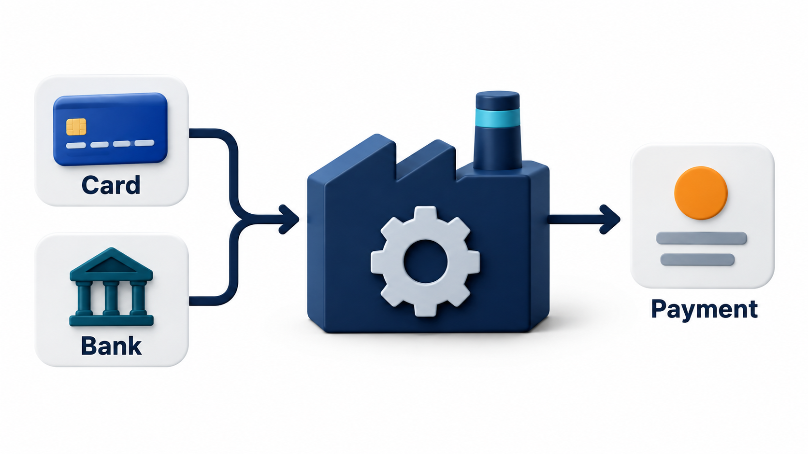
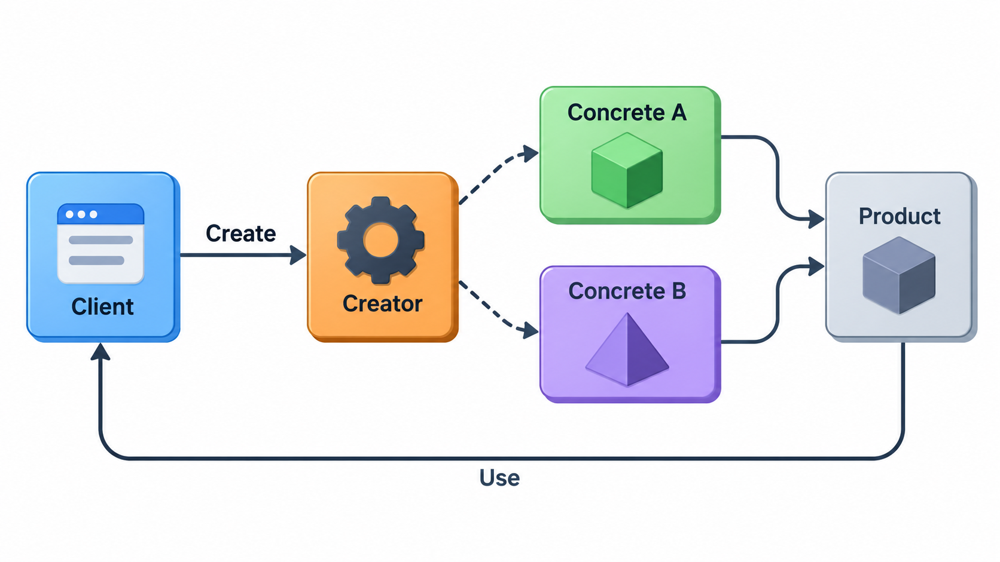
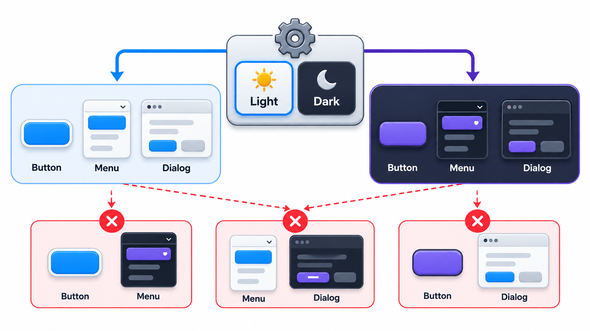
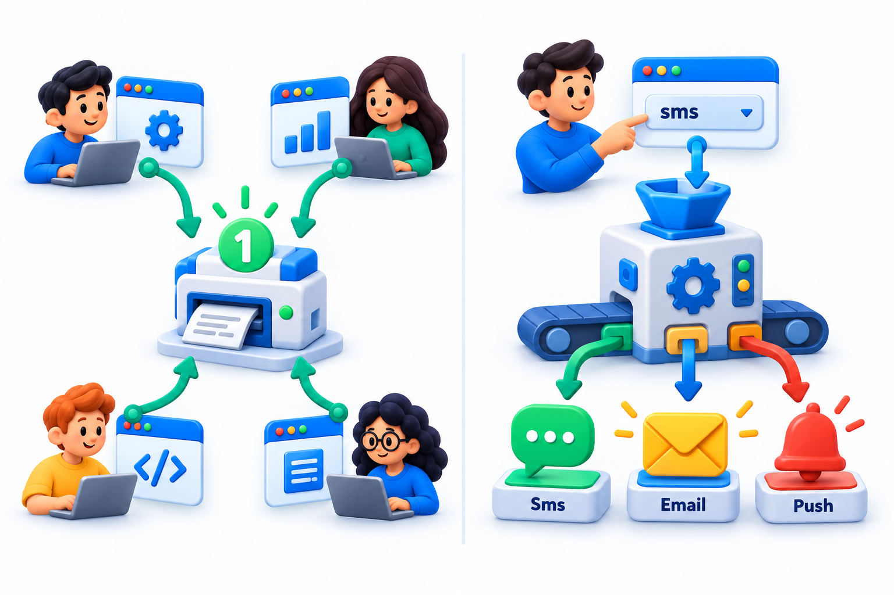
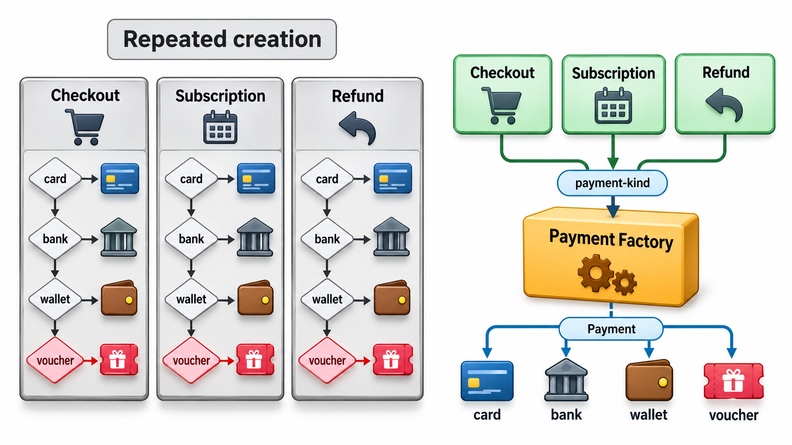

## Decide Which Class in One Place Only

When code creates an object by naming its class directly, it becomes tied to that class. If the choice later depends on a setting, a country or a customer, every place that did the creating must change. A library might offer a single call that returns "a calendar" and decide, from where the program is running, whether to build a Gregorian, a Buddhist or an imperial-era one. The calling code is the same everywhere, and the decision lives in one place.

That is the idea behind the **factory patterns**. A factory moves the decision of *which class to create* out of the code that uses the object, into one place that can be changed. This topic covers the two most common forms, the Factory Method and the Abstract Factory.

The need shows up whenever new kinds appear over time. A college adds UPI to card payments, then wallets, then bank transfers. Each addition is small, but if every screen and report that creates a payment names the classes directly, each addition is edited into a dozen places. A factory reduces that to one.

## The Problem Without a Factory

Imagine a college system where three places create payments: the online checkout, the front-desk screen and the nightly refund job. Each contains its own chain: if the kind is card, build a card payment; if UPI, build a UPI payment.

| Place | Contains the chain? | Edit when wallet payments are added |
| --- | --- | --- |
| Online checkout | Yes | Add a branch |
| Front-desk screen | Yes | Add a branch |
| Nightly refund job | Yes | Add a branch |
| Result | Three copies of one decision | Three edits, and a chance of missing one |

Missing one gives a bug that shows up only when a wallet payment reaches that path: possibly months later. The chain is knowledge that has been copied, and the factory is the cure for the copying.

## Factory Method

The simplest form of the idea is the **Factory Method**: a function whose job is to create an object and return it, deciding which class to create based on its input. The code that calls it works with the result through a shared interface and never mentions the concrete classes. Take a payment factory that knows two kinds of payment.

| The caller asks for | The factory builds | What the caller gets after paying Rs 500 |
| --- | --- | --- |
| Card | A card payment | "Charged 500 to card" |
| UPI | A UPI payment | "Collected 500 by UPI" |
| Cheque | Nothing | A clear refusal: unknown payment kind |

The factory is the only place in the program that knows the names of the two payment classes. The calling code asks for a payment by kind and uses its common "pay" operation. An unknown kind is refused with a clear error, in the one place where kinds are decided. To add wallet payments, you write a class and add one branch to the factory. The calling code is unchanged. Without the factory, every place that created a payment would need a new branch.

<!-- Visual: A factory chooses which concrete class to create behind a common interface. -->

In object-oriented textbooks, the pattern is often described with subclasses: a base class defines a method for creating a product, and each subclass overrides it to create a different one. The idea is the same. In languages with simple functions, a plain factory function is often enough.

| Form | How the choice is made | When it fits |
| --- | --- | --- |
| **Simple factory function** | One function with a branch per kind | Small, stable set of kinds |
| **Factory Method (subclass form)** | A base class defers creation to subclasses | A framework where users extend a class and supply the product |
| **Lookup table** | A table maps a name to the class | Many kinds, or kinds registered by plug-ins |

## A Walk Through a Factory Call

Follow three requests through the payment factory, step by step.

| Step | Request | What the factory does | Result |
| --- | --- | --- | --- |
| 1 | "card", Rs 500 | Looks up "card", finds the card class, builds a card payment | Card payment object returned |
| 2 | The caller calls pay | The card payment runs its own rules | "Charged 500 to card" |
| 3 | "upi", Rs 300 | Looks up "upi", builds a UPI payment | UPI payment object returned |
| 4 | "cheque", Rs 200 | Finds no entry | Refuses with an error naming the unknown kind |

The caller in steps 2 and 4 never saw the class names. If a cheque class is written later, step 4 changes in the factory alone.

## Abstract Factory: Families That Match

Sometimes the thing to create is not one object but a *set* of objects that must go together. A user interface toolkit might offer buttons, windows and menus in a light theme and a dark theme. A light button in a dark window would look wrong. The **Abstract Factory** pattern provides one place that creates a whole family of related products, so that they always match.

| Theme chosen | Window created | Button created |
| --- | --- | --- |
| Light | Light window | Light button |
| Dark | Dark window | Dark button |

Choosing the theme chooses both products at once, so a mismatch cannot happen. The code that builds a screen takes a theme name and never names a class. To add a high-contrast theme, you add two product classes and one entry to the table of themes. The code that builds screens does not change. This is the pattern's value: whole families can be added without touching the code that uses them.

A second example: a college that runs on two payment gateways, each requiring its own matching set of objects.

| Gateway family | Payment request object | Refund request object | Receipt parser |
| --- | --- | --- | --- |
| Gateway A | A's payment request | A's refund request | A's receipt parser |
| Gateway B | B's payment request | B's refund request | B's receipt parser |

Mixing A's payment request with B's receipt parser would fail in confusing ways. One abstract factory per gateway guarantees consistency.

## Factory Method or Abstract Factory?

| Question | Factory Method | Abstract Factory |
| --- | --- | --- |
| What does it create? | One product, chosen by kind | A family of related products |
| What varies? | Which class | Which whole family |
| Typical trigger | A repeated chain of conditions on the kind | Products that must match |
| Cost to add a new kind | One class, one branch | One class per product in the family |
| Cost to add a new product type to every family | Not applicable | High: every family must change |

The last row is a known drawback. Adding a new kind of product, say a "dialog", means adding it to every factory in every family.

## What Factories Buy

**Decoupling creation from use.** The code that uses an object depends on an interface, not a class. That makes it easier to test, since a test can supply a stand-in, and easier to change.

**One place for the decision.** When the choice of class depends on configuration, environment or input, it is made in the factory and is not scattered around.

**Control over creation.** A factory can do work that a plain constructor cannot, such as reusing an existing object, choosing a subclass, or doing setup that must happen every time.

**Consistent families.** An abstract factory enforces that related objects go together.

The costs are an extra layer of indirection and more names to learn. For a program that will only ever create one kind of object, a direct constructor is simpler and just as good.

<!-- Visual: A singleton and a factory compared as ways to control object creation. -->

## When Not to Use One

A factory earns its place when there is, or soon will be, more than one thing to create, or when creation is complicated. If your program has one payment type, a factory is clutter. A good time to introduce one is when you notice the same chain of conditions on the kind appearing in more than one place. That repeated chain is the sign that the decision belongs in one function.

<!-- Visual: two code paths, one with the same if-chain of payment kinds repeated in three places and one with a single factory deciding and three callers using the result, with the repeated chain crossed out. Save as images/69_repeated_chain_vs_factory.png. -->

## Common Pitfalls

| Pitfall | What happens | Remedy |
| --- | --- | --- |
| **The factory grows into a giant** | Hundreds of branches in one function | Register classes in a table; split by family |
| **The caller checks the kind anyway** | Code asks whether the payment is a card after the factory returned | Move the behaviour into the product so callers need not ask |
| **Misspelt keys** | A typo in a string gives a run-time failure | Use constants or an enumeration; fail loudly with the list of valid kinds |
| **Hidden dependencies** | The factory reaches for global settings | Pass what it needs as arguments |
| **A factory for one class** | Ceremony with no benefit | Use the constructor |

## Five Misreadings of Factory Patterns

**"A factory is just a wrapper around `new`."** It is a place where a decision is made. The wrapper is the means; the decoupling is the purpose.

**"Every class needs a factory."** Only where creation involves a choice or complexity. A plain constructor is fine otherwise.

**"Abstract Factory and Factory Method are the same."** One creates a single product by kind. The other creates a family of matching products.

**"Factories make code flexible for free."** They move complexity to the factory. A factory that grows to hundreds of lines of branches needs its own care.

**"A string key is a good way to pick a class."** It is simple, and a typo becomes a run-time error. An enumeration or a lookup table is safer for larger sets.
