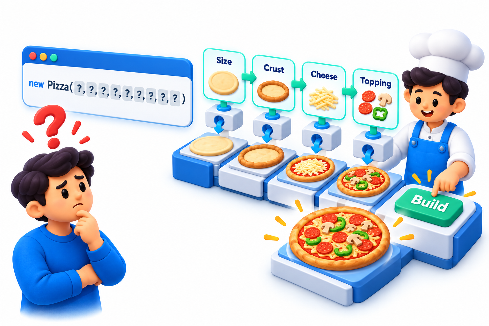
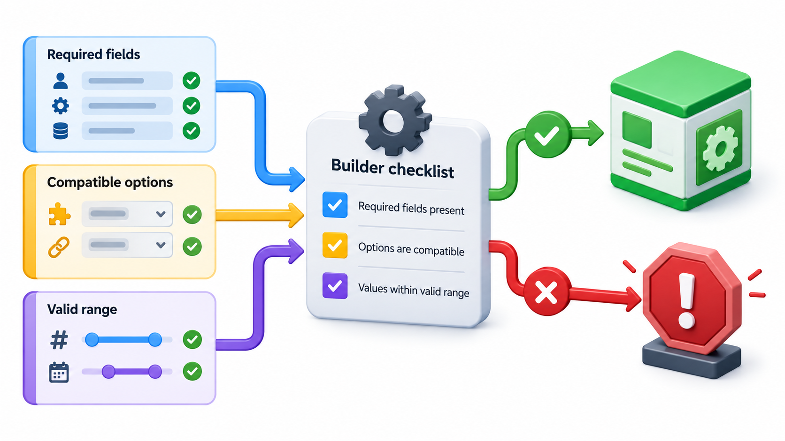
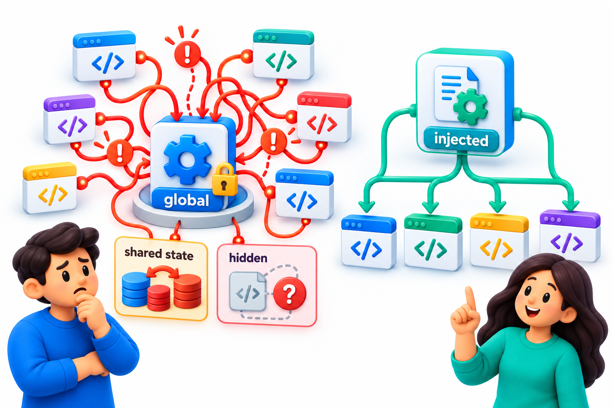
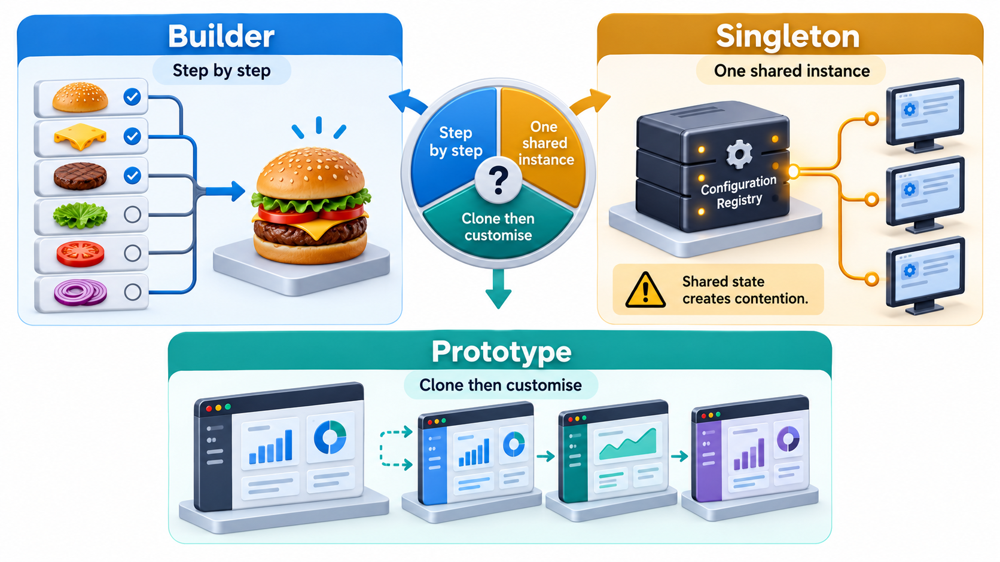

## Awkward to Build, Only One Allowed, Costly to Make Twice

Three different problems arise about how objects come into being. Some objects are awkward to construct, with many optional parts and a long list of values in an easy-to-confuse order. Some objects should exist only once in a program. And some are expensive to make from scratch, so it is cheaper to copy an existing one.

Three **creational patterns** answer these in turn: **Builder**, **Singleton** and **Prototype**. The middle one is also one of the best known and most abused: a function whose answer quietly depends on a hidden shared object has a signature that lies about what it depends on. This topic looks at all three, and at when each is worth using.

## Builder: Constructing in Steps

Some objects have many parts, most of them optional. A report might have a title, rows, a footer, a date format, a logo and a page size. A single constructor with ten parameters, most of which the caller does not care about, is a nuisance: the call is unreadable, and mixing up the order of arguments is easy. This is sometimes called the *telescoping constructor* problem.

The **Builder** pattern constructs the object step by step through named methods. Each step sets one part and returns the builder, so the calls can be chained, and a final step produces the finished object. Take a report builder, which starts with sensible defaults (a title of "Untitled", no rows, no footer).

| Step | What it sets |
| --- | --- |
| With title "Fees" | The title |
| Add row "Asha 5000" | The first row |
| Add row "Ravi 0" | The second row |
| With footer "2 students" | The footer |
| Build | Assembles the finished report |

The finished report reads: a heading "Fees", the rows "Asha 5000" and "Ravi 0", and a closing line "2 students". The footer is added only if one was set, which is the kind of optional-part logic a builder keeps in one place. The chain of steps reads like a sentence, so a reader can tell what each value means, which a call with five positional arguments would not show. The same builder could create a different layout by changing only the final step.

<!-- Visual: A builder assembling an object step by step. -->

Builders are especially valuable when an object should be **immutable** once created and also has many options. The builder collects the options while it is mutable and produces an unchangeable result at the end.

## What a Builder Can Check

Because all the parts pass through the builder before the object exists, the final step is a natural place to verify that the combination makes sense. An object that is built only when valid can never exist in an invalid state, which supports the idea that a well-built type guarantees its own correctness.

| Attempt | Builder's check at the final step | Result |
| --- | --- | --- |
| Title set, two rows, no footer | All required parts present | Report built without a footer |
| No title set | A default of "Untitled" is applied | Report built with the default |
| Page size set to 0 | A page size must be positive | Refused with a message naming the problem |
| Two footers set | The last one replaces the first | Report built with the second footer |

Compare this with a loose object whose parts are set one at a time after creation: between the first and the last setting it is half-built, and any code that sees it in that state may misbehave.

## Singleton: Exactly One

A **Singleton** is a class that allows only one instance and provides a single point of access to it. The classic uses are things that really are unique in a program: a configuration store, a logger, a connection pool. A typical implementation hides the constructor and offers an access method that creates the instance the first time and returns the same one afterwards.

The idea sounds harmless. The trouble is what the single global instance does to the rest of the code.

- **Hidden dependencies.** Any code can call the access method, so a function can depend on the singleton without saying so.
- **Shared mutable state.** Whatever one part changes, every other part sees. Behaviour depends on what happened earlier.
- **Hard to test.** Tests share the instance and affect each other, and substituting a stand-in is awkward.
- **Hard to change.** If one instance later becomes two, every call site is affected.

The second and third problems with a Singleton, hidden dependencies and shared state, show up clearly in tests. Two tests of a price calculation share a settings singleton. The calculation subtracts a discount that it reads from the shared settings; nothing in its signature says that it depends on settings at all.

| Test | What it does | Result |
| --- | --- | --- |
| Student discount test (runs first) | Sets the shared discount to 100, checks that Rs 1,000 becomes Rs 900 | Passes |
| Normal price test (runs second) | Assumes no discount, expects Rs 1,000 | Fails: the first test left the shared object changed |

The normal price test fails though nothing is wrong with the calculation. Each test is correct alone. Run in a different order, or in parallel, the results would change. Failures that depend on order are among the most confusing bugs to find. This is the complaint against the Singleton made concrete.

<!-- Visual: the costs of a singleton: hidden dependencies, shared state and testing trouble. -->

The alternative is usually to create one object at the start of the program and **pass it in** to the code that needs it. That keeps "only one" as a decision made in one place, without making the instance globally reachable. The language may still hold a single object. The code simply does not depend on that fact.

| Aspect | Classic Singleton | One object passed in |
| --- | --- | --- |
| How code gets it | Calls the global access method from anywhere | Receives it as an argument or at construction |
| Dependencies visible? | No: hidden inside functions | Yes: appear in the signature |
| Testing | Shared between tests; hard to replace | Each test supplies its own |
| Can it become two later? | Every call site must change | Only the place that creates it |
| Guarantees exactly one? | By the class itself | By the program's start-up code |

There are a few places where a genuine singleton is still sensible: a logger that is truly global, or a hardware resource such as a single printer connection that cannot be opened twice. Even then, many teams wrap access so that it can be replaced in tests.

## Prototype: Copy an Existing Object

Sometimes creating an object from scratch is expensive or complicated, and it is easier to take an existing, ready-made one and copy it. The **Prototype** pattern does that. You keep a configured example and make new objects by cloning it, then adjust what differs. A game might clone a prepared enemy character with all its settings and change only the position. A course catalogue might copy a template course.

The point to watch is the depth of the copy. A **shallow copy** duplicates the outer object but shares anything inside it with the original. A **deep copy** duplicates everything. Take a course template with a name, a number of hours and a list of topics (basics, loops).

| Copy made | What it shares with the template | After adding "functions" to the shallow copy and "classes" to the deep copy |
| --- | --- | --- |
| Shallow copy | The same topics list | Template shows basics, loops, functions |
| Deep copy | Nothing | Deep copy shows basics, loops, classes; template untouched by it |

Adding "functions" to the shallow copy also changed the template, because they share the same list. Adding "classes" to the deep copy left the template alone. This is the main trap of Prototype. If a copy shares parts with its original, changing one changes the other. When in doubt, deep-copy, or use immutable values so that sharing is harmless.

| Kind of part in the object | Shallow copy | Deep copy needed? |
| --- | --- | --- |
| Number, text, date (immutable) | Safe to share | No |
| List, dictionary, set (mutable) | Shared: dangerous | Yes |
| Another object with its own state | Shared: dangerous | Yes |
| Connection to a database or file | Shared handle | Usually not copyable at all; reopen instead |

<!-- Visual: Builder Singleton and Prototype solve different object creation problems. -->

## Choosing Among Them

| Pattern | The problem | Reach for it when | Take care that |
| --- | --- | --- | --- |
| **Builder** | An object with many parts, most optional | A constructor has become hard to read | The builder does not grow into a second copy of the class |
| **Singleton** | Only one instance should exist | Rarely. Prefer creating one and passing it in | It does not become a global variable by another name |
| **Prototype** | Making an object from scratch is costly | Many similar objects differ in a few details | Copies are deep enough to be independent |

<!-- Visual: builder and prototype compared as ways to avoid repeated construction work. -->

