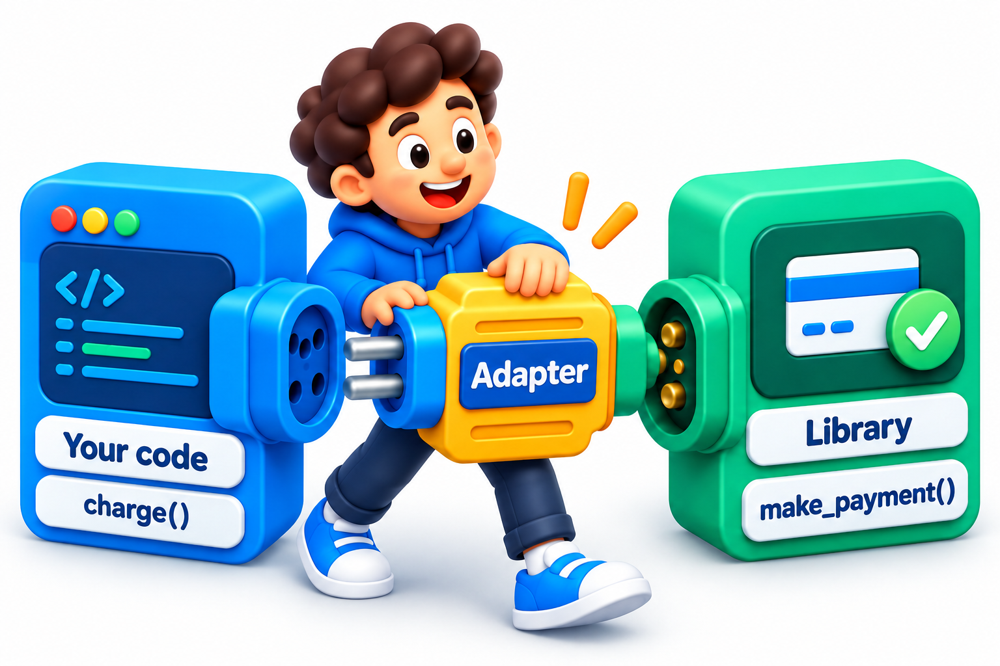
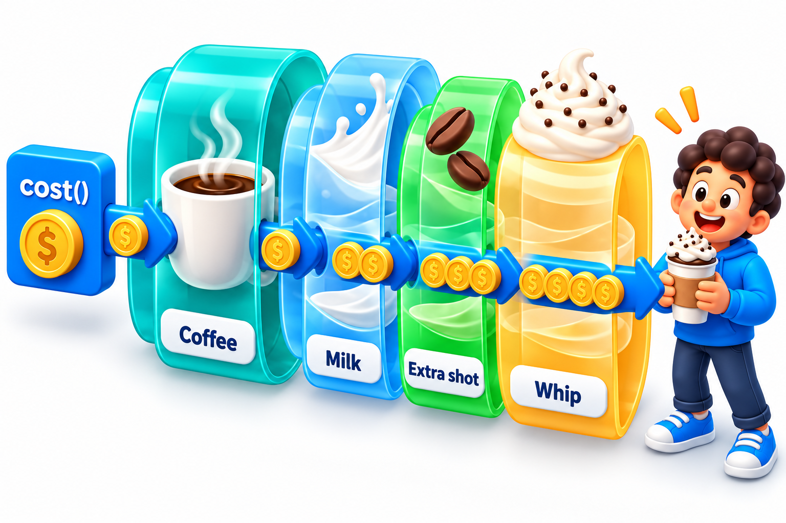
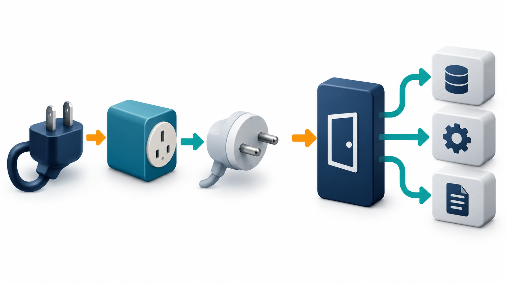
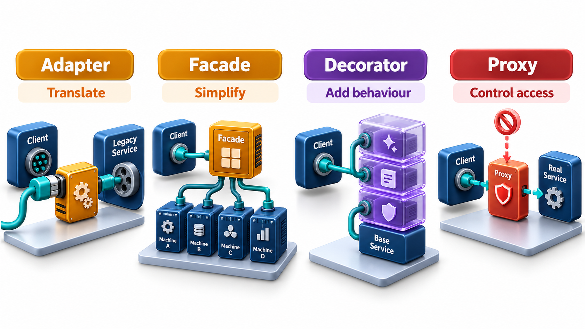

## Putting One Object in Front of Another

A recurring need in design is to stand something in front of an existing object so that the code using it does not have to change when what lies behind it does. A plug adapter changes one shape of plug into another without changing either. A set of wrappers, each doing one job, can be stacked to give combinations without writing a class for every mixture: reading a file, then buffering it, then numbering its lines.

**Structural patterns** deal with how classes and objects are assembled into larger structures. The four covered here, including **Adapter** and **Decorator**, share a theme: they place one object in front of another, so that the code using the front object does not need to change when what lies behind it does.

The shared mechanism is **delegation**: the front object receives a call and forwards some or all of the work to the object behind it. What differs between the patterns is what the front object does on the way: translate, simplify, add or guard.

## Adapter: Making One Interface Fit Another

You have code that expects objects with a certain interface, and you have an existing class that does the right job but with a different interface. You cannot, or do not want to, change the existing class. It may belong to a library, or an old system. An **Adapter** is a small class that sits between: it presents the interface your code wants and translates each call into the form the existing class understands.

An everyday analogy is a travel plug adapter. The charger's plug is one shape, the wall socket is another, and the adapter changes one into the other without changing either. In software, take an old payment gateway that takes the amount in paise (a hundredth of a rupee) and returns a numeric code, 200 for success. The rest of the code wants to say "pay this many rupees" and get back "paid" or "failed".

| Request from our code | What the adapter passes to the old gateway | Code returned | What the adapter tells our code |
| --- | --- | --- | --- |
| Pay Rs 500 | 50,000 paise | 200 | "paid" |
| Pay Rs 0 | 0 paise | 400 | "failed" |

The checkout code was written for the "pay in rupees" interface. It is passed the adapter, and it neither knows nor cares that an old system with different conventions sits behind it. The conversions and the code translation both happen inside the adapter. If the company changes gateway next year, a new adapter is written for the new one, and checkout and everything that calls it stay as they are.

<!-- Visual: an adapter translating between two incompatible interfaces. -->

An adapter typically performs several kinds of translation at once.

| Kind of mismatch | Example | What the adapter does |
| --- | --- | --- |
| Names | Our code says `pay`, the gateway says `submitTxn` | Maps one name to the other |
| Units | Rupees against paise | Multiplies or divides |
| Data shape | Our code passes a student object, the gateway wants an id and a name | Extracts and repackages |
| Result format | A number code against a word | Translates |
| Error style | The gateway returns error codes, ours raises exceptions | Converts one into the other |

Adapters are also where protective boundaries are drawn. If an outside system is unreliable, its quirks can be absorbed in the adapter and never reach the rest of the program.

## Facade: One Simple Door to a Complicated Room

A system may be made of many parts, and using it properly means calling several of them in the right order. A **Facade** is a class that offers a small, simple interface for the common tasks and hides the coordination behind it. To send a receipt, a caller does not have to find the fee record, calculate the total, render the template, get the mail connection and send. It asks a facade, in a single call, to send the receipt for a student, and the facade does all that.

A facade does not forbid direct access to the parts. It provides an easy route for the usual cases. Its value is that most users never have to learn the internals, and the internals can be rearranged without disturbing them.

| Without a facade | With a facade |
| --- | --- |
| Caller finds the fee record | Caller calls one operation |
| Caller computes the total | The facade does steps 1 to 5 in the right order |
| Caller renders the receipt | |
| Caller opens a mail connection | |
| Caller sends and closes | |
| Five steps repeated in every caller, in the same order | One step in every caller; the sequence lives in one place |

If the receipt process gains a sixth step, say logging, only the facade changes. Every caller benefits at once.

<!-- Visual: A facade offering one simple entry point to a complicated subsystem. -->

## Decorator: Adding Behaviour Without Subclassing

Suppose a message needs sometimes to be in capital letters, sometimes to carry a signature, sometimes both. Making a subclass for each combination leads to a growing family of classes. A **Decorator** instead wraps an object in another that offers the same interface, adds its own behaviour before or after delegating to the wrapped object, and can itself be wrapped.

| Wrapping | Message produced |
| --- | --- |
| Plain message | Fee due on 10 June |
| Wrapped in a signature | Fee due on 10 June - Accounts Office |
| Wrapped in capitals, then in a signature | FEE DUE ON 10 JUNE - Accounts Office |

The signature is not capitalised in the third line, because the order of the wrappers matters: capitals were applied first, then the signature was added. Reversing the order would capitalise the signature too. The wrappers can be stacked in any order and any number, and none of them needs to know about the others. No class was written for "uppercase and signed"; combinations come from stacking. This is how stacked file-reading classes in many libraries work.

The saving in classes is easy to count. With three independent options (capitals, signature, date stamp), subclassing needs a class for every combination.

| Approach | Classes needed for 3 options | For 6 options |
| --- | --- | --- |
| Subclass for each combination | 2 to the power 3 = 8 | 64 |
| Decorators | 3 wrappers plus the base | 6 wrappers plus the base |

The count grows by one with each new option in the decorator approach, and doubles in the subclass approach.

<!-- Visual: A decorator adding behaviour to an object by wrapping it. -->

## Proxy: A Stand-in with the Same Face

A **Proxy** also sits in front of an object with the same interface, but its purpose is to *control access* to it. It stands in for the real object and decides whether, when and how to pass calls along. Common kinds are:

- A **virtual proxy** delays creating an expensive object until it is needed, such as a large image that is loaded only when scrolled into view.
- A **protection proxy** checks permissions before passing the call on.
- A **remote proxy** represents an object that lives on another machine, hiding the network call behind an ordinary-looking method.
- A **caching proxy** keeps results of earlier calls so that repeated requests are answered quickly.

Decorator and Proxy have the same shape, a wrapper with the same interface, and differ in intent. A decorator adds *features*. A proxy controls *access*.

A caching proxy shows how the control works. Suppose a grade lookup is slow, taking two seconds each time.

| Request | Cache holds it? | What the proxy does | Time |
| --- | --- | --- | --- |
| Grades for Asha (first time) | No | Forwards to the real lookup, stores the answer | 2 s |
| Grades for Asha (again) | Yes | Answers from memory | Almost 0 s |
| Grades for Ravi (first time) | No | Forwards, stores | 2 s |
| Grades for Asha after the semester ends and grades change | Stale | Must be refreshed or expired | Depends on the expiry rule |

The last row is the price of the pattern: a proxy that remembers must also know when to forget.

<!-- Visual: A facade and an adapter compared by whether the interface is simplified or converted. -->

## Telling Them Apart

| Pattern | What it does | The wrapper's interface is | Typical question |
| --- | --- | --- | --- |
| **Adapter** | Converts one interface to another | Different from the wrapped object's | "How do I use this old class here?" |
| **Facade** | Simplifies a complicated subsystem | New and simpler | "How do I make this easy to use?" |
| **Decorator** | Adds behaviour | The same as the wrapped object's | "How do I add features without subclasses?" |
| **Proxy** | Controls access | The same as the wrapped object's | "How do I control or delay use of this object?" |

All four rely on **delegation**: one object forwards work to another. They differ in whether the interface changes and in what the wrapper adds. A useful habit when meeting a wrapper is to ask: does it change the interface, simplify it, add features or guard it?

<!-- Visual: four side-by-side diagrams of a client and a wrapped object: an adapter with a different interface, a facade in front of several parts, a decorator with the same interface adding a feature, and a proxy with the same interface guarding access. Save as images/71_four_wrappers.png. -->

## The Costs of Wrapping

Every wrapper is a new thing to understand and a new place for a call to pass through.

| Cost | How it shows up |
| --- | --- |
| **Indirection** | A debugger steps through several layers before reaching the real work |
| **Performance** | Each layer adds a small delay, which matters only in hot paths |
| **Ordering surprises** | Stacked decorators give different results in different orders |
| **Leaky wrappers** | A proxy that hides a network call still fails when the network does |
| **Too many layers** | Four wrappers deep, no one knows which does what |

Use a wrapper when it earns its place: when the underlying object cannot be changed, when many callers would otherwise repeat the same coordination, or when behaviour must be added at run time.
