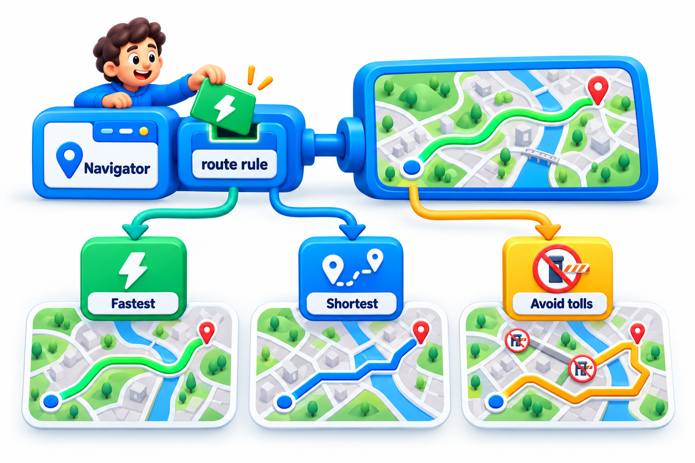
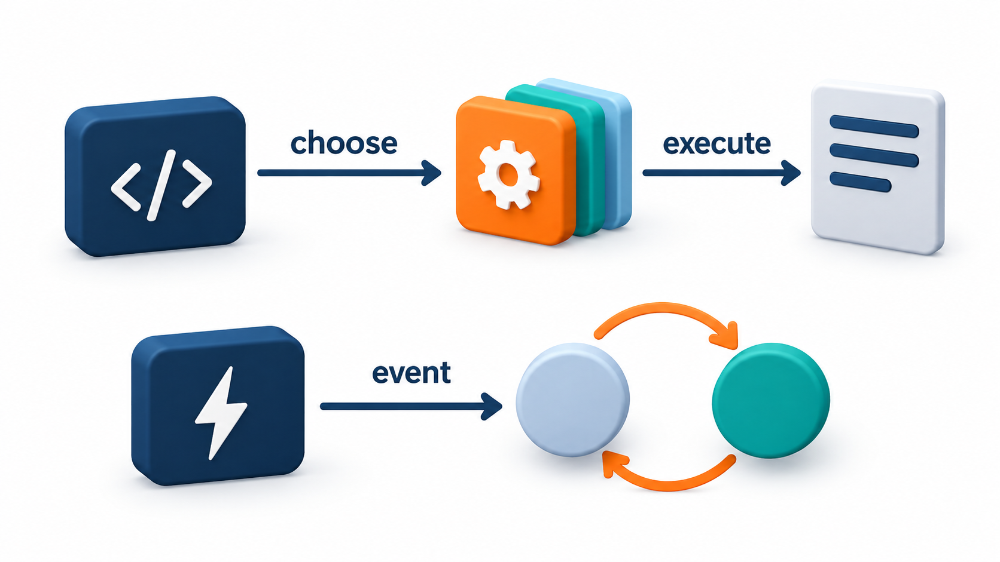
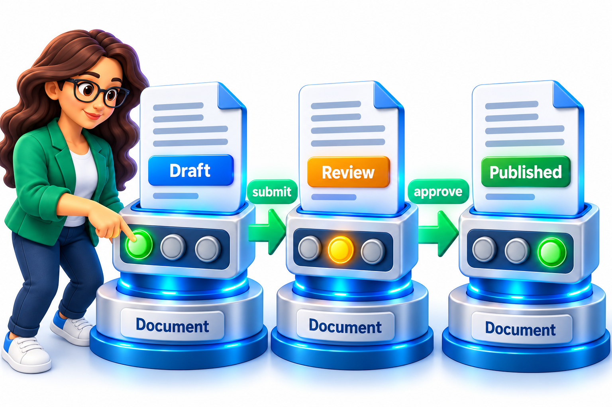
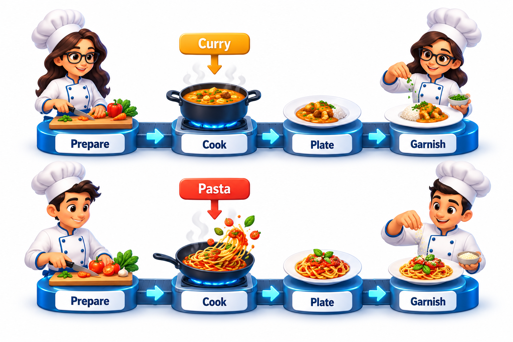
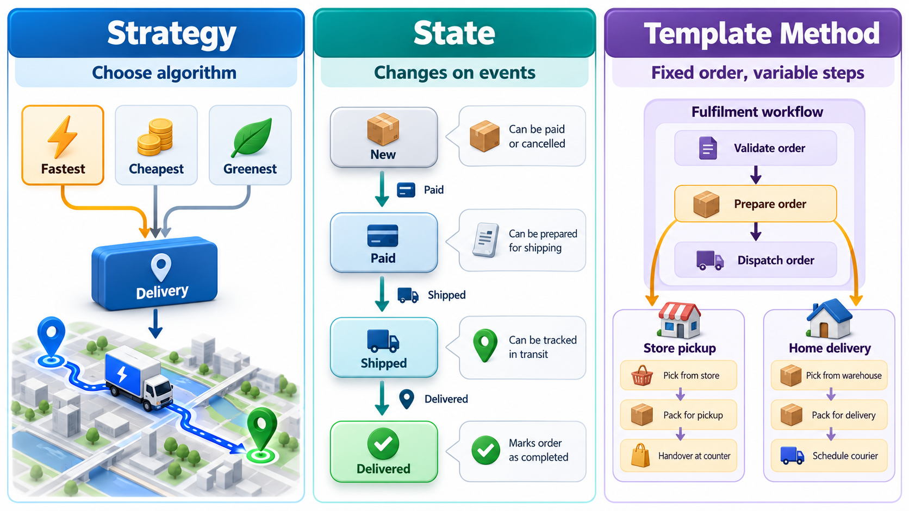

## Pull Out the Part That Varies

Sorting a list of students looks like a single task, until someone asks: by name, by roll number, by marks, by marks and then by name for ties? A function that hard-codes one order needs flags and branches for each new request, and every new request means editing it. A better design keeps the sorting the same and hands in the way of comparing as a separate piece.

That move, pulling the part that varies out into separate objects so that the rest does not need conditions or edits when the variation changes, is the shared theme of three **behavioural patterns**. They differ in what varies: an algorithm (**Strategy**), the behaviour that depends on an object's condition (**State**), or the steps of a fixed procedure (**Template Method**).

The reason this matters is the cost of conditions. A chain of "if this kind, do this; otherwise if that kind, do that" is easy to write once. But it is repeated wherever the kind matters, and each new kind means finding and editing every chain. The three patterns replace the chain with objects, so a new kind is added in one place and the old code is left alone.

## Strategy: Swap the Algorithm

A **Strategy** is a family of interchangeable algorithms, each in its own piece, behind a common interface. The code that needs the work done is given a strategy and uses it, with no idea which one it has. Take three ways to charge for shipping a 3 kg parcel.

| Strategy | Rule | Cost for 3 kg |
| --- | --- | --- |
| Standard shipping | 40 plus 10 a kilogram | Rs 70 |
| Express shipping | 100 plus 25 a kilogram | Rs 175 |
| Free shipping | No charge | Rs 0 |

The checkout takes a weight and a strategy and asks the strategy for the cost. It contains no condition for the kinds of shipping. To add pickup from the store, you write one more strategy; the checkout and the others are untouched. Without Strategy, the shipping function would be a growing chain of conditions that every new option has to edit. A strategy can also be chosen while the program runs, for example from the customer's selection, which a hard-coded condition handles awkwardly.

The same strategies give different totals for different weights, and the checkout code does not change.

| Weight | Standard | Express | Free |
| --- | --- | --- | --- |
| 1 kg | 50 | 125 | 0 |
| 3 kg | 70 | 175 | 0 |
| 10 kg | 140 | 350 | 0 |

<!-- Visual: A strategy object chosen at run time to perform one algorithm. -->

Everyday uses are common: sorting orders, compression methods, validation rules, route planning (fastest, shortest, avoid tolls) and pricing rules. In each, the surrounding code is the same and the rule differs.

## State: Behaviour That Depends on Condition

Many objects behave differently depending on the situation they are in. A document may be a draft, under review or published, and what a click on "edit" does depends on which. A common first implementation puts a variable that holds the state in the class, and every method begins with a chain of conditions on it. As states and methods multiply, the code becomes a tangle in which each new state touches every method.

The **State** pattern gives each state its own class. The object holds a reference to its current state object and passes calls to it. To change state, the object simply swaps the reference. The code for each state is in one place, and adding a state means adding a class.

Take a document with three states and three actions.

| Action | Draft | Under review | Published |
| --- | --- | --- | --- |
| Edit | Allowed | Refused: locked while reviewers read | Refused: create a new version |
| Submit | Moves to Under review | Refused: already submitted | Refused |
| Approve | Refused: not submitted | Moves to Published | Refused |

Without the pattern, each of the three methods contains a chain asking which state the document is in: nine decisions spread across three methods. With the pattern, each column becomes one class that knows its own three answers. Adding an "Archived" state adds one class, and no existing class is edited, apart from the ones that move to it.

State looks very like Strategy: in both, an object delegates to another object that can be replaced. The difference is in who does the replacing and why. A strategy is *chosen from outside* and usually stays the same during use. A state *changes itself* as events happen, often according to the rules of a state machine.

<!-- Visual: A strategy chosen from outside compared with a state that changes as events occur. -->

## Template Method: A Fixed Skeleton

Often several procedures share the same overall steps and differ only in some of them. All reports have a header, a body and a footer, but the header and body differ. The **Template Method** pattern puts the skeleton in a base class, in a method that calls the steps in order, and lets subclasses fill in the steps that vary. The base class controls the *sequence*, and the subclasses control the *details*.

<!-- Visual: an object delegating to a current state object that changes on events. -->

| Step | Base skeleton | Fee report | Attendance report |
| --- | --- | --- | --- |
| Header | Default: "Report" | "Fee report" | Keeps the default "Report" |
| Body | Must be supplied | "Asha 5000, Ravi 0" | "Asha 92%, Ravi 71%" |
| Closing line | "-- end of report --" | Same | Same |

The order, header then body then closing line, is fixed by the base and never changed by the subclasses. A change to the skeleton, such as adding a date line to every report, is one edit in the base class. This idea is sometimes described as "the Hollywood principle": do not call us, we will call you. The base class calls the subclass's steps at the moments it chooses.

Steps come in three kinds, and naming them helps design a template.

| Kind of step | Meaning | Example |
| --- | --- | --- |
| **Fixed** | Done by the base, never changed | The closing line |
| **Required** | Must be supplied by every subclass | The body |
| **Optional hook** | Has a default; a subclass may override | The header |

<!-- Visual: A template method fixing the order of steps while subclasses supply the details. -->

## A Worked Comparison

Suppose a college wants to send reminders. The same problem can be shaped by each pattern, and seeing them side by side shows what each is for.

| Need | Best fit | Why |
| --- | --- | --- |
| Choose between email, SMS and WhatsApp for each student | Strategy | The caller picks the channel; each is an interchangeable way to deliver |
| A reminder that is "scheduled", then "sent", then "acknowledged" or "failed" | State | The behaviour of the reminder changes with its condition |
| Every reminder goes: build message, check opt-out, send, log. Only "build message" differs | Template Method | The sequence is fixed and one step varies |

Notice that real systems use them together: a reminder with a State inside, a Strategy for the channel, and a Template Method for the common sequence.

## Choosing Between Them

| Pattern | What varies | Who decides | How it varies |
| --- | --- | --- | --- |
| **Strategy** | A whole algorithm | The caller, from outside | By passing a different object or function |
| **State** | Behaviour, depending on condition | The object itself, as events happen | By swapping the current state object |
| **Template Method** | A few steps in a fixed procedure | The subclass | By overriding steps in a subclass |

Template Method uses inheritance and so fixes its variation at the time the class is written. Strategy and State use composition and can change while the program runs. In languages where functions can be passed around, a strategy can be a plain function, and many small template methods become a function that accepts functions for the steps.

<!-- Visual: three small diagrams side by side: strategy with a context holding a replaceable algorithm, state with an object moving between state objects on events, and template method with a base class skeleton calling subclass steps. Save as images/72_three_variation_patterns.png. -->

## Common Pitfalls

| Pitfall | Pattern | What happens | Remedy |
| --- | --- | --- | --- |
| Strategy explosion | Strategy | Dozens of near-identical strategies | Parameterise one strategy instead |
| Callers that must know which strategy to pick | Strategy | The condition has moved to the caller | Choose in one place, such as a factory |
| State classes that know too much about each other | State | Every state names every other | Keep transitions in a table or in one place |
| Deep inheritance trees | Template Method | A subclass of a subclass overrides one step | Prefer passing the steps in as functions |
| Forgetting the fixed order | Template Method | A subclass calls steps itself and breaks the sequence | Make the template method not overridable |

## Five Misreadings of These Patterns

**"Strategy and State are the same pattern."** The structure is the same. Strategy is selected from outside and rarely changes. State changes itself as the object's situation changes.

**"Every `if` chain needs a strategy."** A short, stable condition is fine. Introduce the pattern when the chain keeps growing, or when the same chain appears in several places.

**"Template Method is old-fashioned because of inheritance."** It is very much used, as in test frameworks that call `setUp`, the test and `tearDown` in a fixed order. When inheritance is a problem, pass in functions for the steps.

**"Each state needs a class."** For two or three simple states a table or a few conditions are clearer. The pattern pays off as the states and their rules multiply.

**"A strategy must be a class."** In many languages a function is enough. The pattern is the idea of passing in the variation, not the class syntax.
