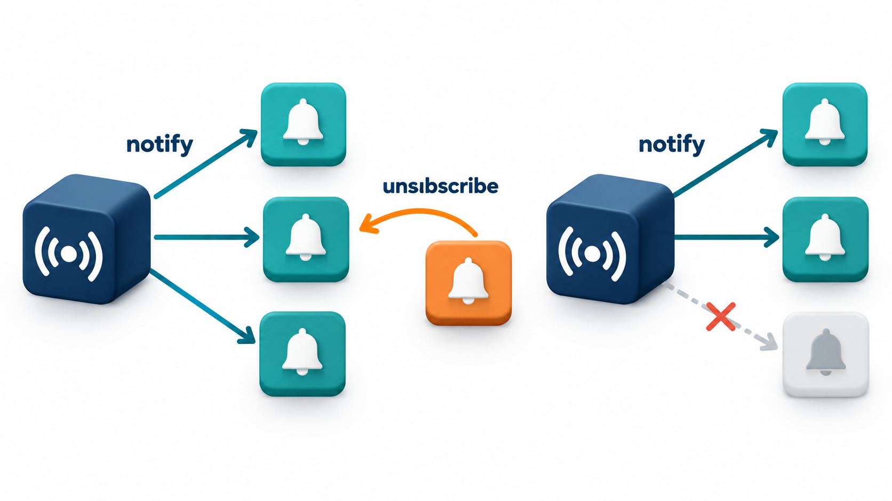
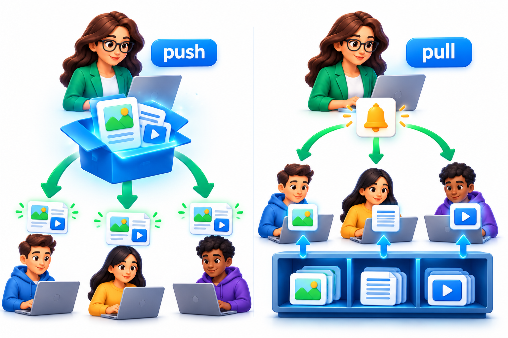
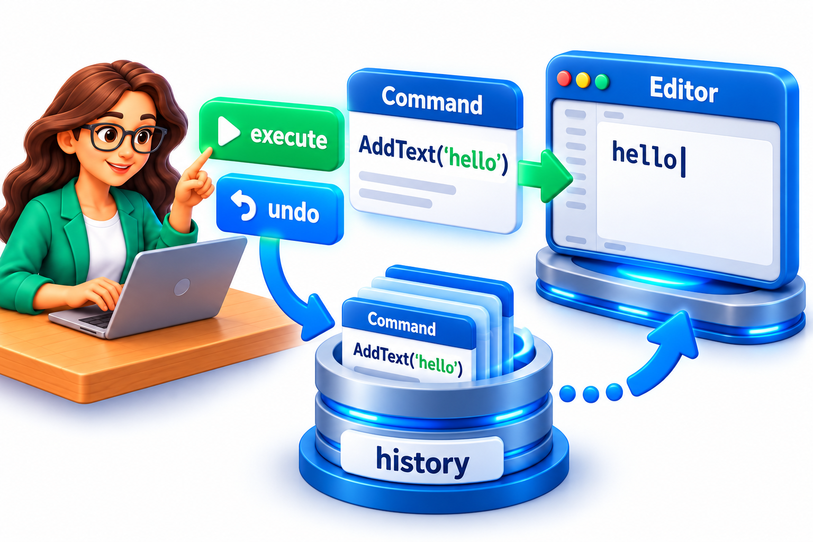
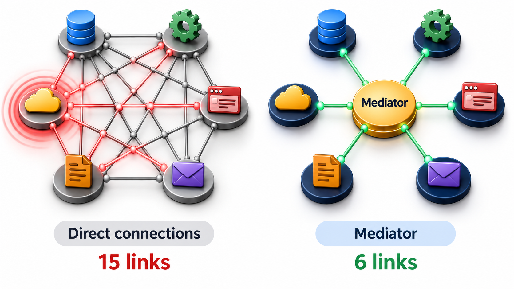
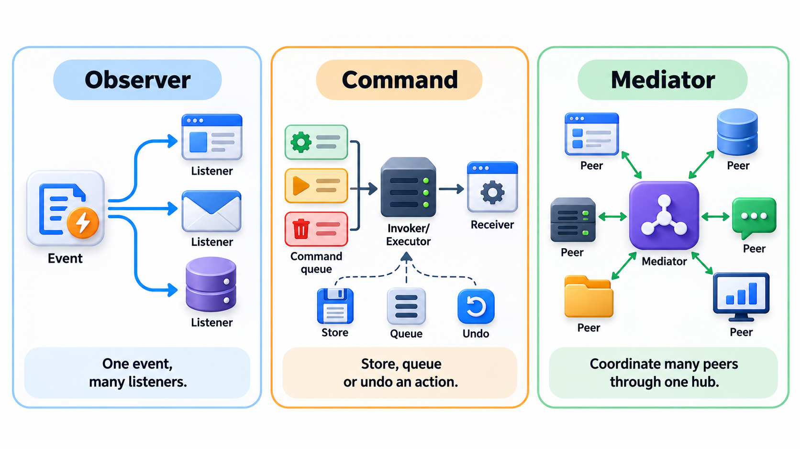

## How Do the Parts of a Program Talk Without Knowing Each Other?

Every interactive program has to answer this. A spreadsheet cell changes, and every chart and formula that depends on it must update. A button is clicked and any number of scripts must react. An editor must remember each action so that the user can undo it. If each part must know all the others, the program becomes a web that cannot be changed.

Three patterns solve different forms of the problem. **Observer** tells interested parties that something happened. **Command** turns an action into an object that holds everything needed to do it and to undo it. **Mediator** puts a go-between at the centre of a group so the members need not know each other. Undo is the easiest to feel: for a program to undo a deletion it must remember what was deleted and where, which is only practical if each action is an object.

The three share a goal of good design: low coupling. Each removes a different kind of knowledge. Observer removes the subject's knowledge of its listeners. Command removes the sender's knowledge of how the action is done. Mediator removes each member's knowledge of the other members.

## Observer: Tell Whoever Is Interested

An **Observer** relationship has a **subject**, which holds some state, and any number of **observers**, who want to know when it changes. Observers sign up with the subject. When the state changes, the subject notifies all of them. It does not know what they do with the news.

You see this everywhere. A spreadsheet cell changes, and every chart and formula that depends on it redraws. A user clicks a button in a web page, and any number of scripts that registered for that click are called. A stock price changes, and the screens of everyone watching it update. The thing that changes is the subject; those who want to be told are observers, and they sign up with the subject.

Take a fee account with a balance. An SMS sender signs up, then a ledger updater.

| Event | Who is watching | What happens |
| --- | --- | --- |
| Payment of Rs 2,000 | SMS sender | SMS: balance is now 2,000 |
| Payment of Rs 1,500 (after the ledger updater has signed up) | SMS sender and ledger updater | SMS: balance is now 3,500; ledger updated to 3,500 |

The account never mentions SMS or ledgers. Adding an audit log, an email or a dashboard is a matter of signing up another observer; the account is not edited. The loose coupling is the benefit: the subject knows only that it has watchers, not who or how many. The danger is the opposite side of the same coin: it is not obvious from reading the payment step what will happen when it is called.

Two details matter in practice. An observer should be able to **unsubscribe**, or the subject keeps it alive and keeps calling it long after it is wanted, a common cause of memory leaks. And the notification can *push* all the new data to observers or only tell them that something changed and let them *pull* what they need.

| Style | What the subject sends | Good when | Drawback |
| --- | --- | --- | --- |
| **Push** | The new data itself | All observers need the same facts | Observers get data they do not need |
| **Pull** | Only "something changed" | Observers need different parts | Each must ask back, and the subject's state may change meanwhile |

<!-- Visual: the lifecycle of an observer from subscribing to unsubscribing. -->

## Where Observer Goes Wrong

| Problem | What happens | Remedy |
| --- | --- | --- |
| **Forgotten unsubscribe** | A closed screen is still notified; memory is not released | Unsubscribe when the observer is done |
| **Slow observer** | One listener takes two seconds; the payment waits | Notify asynchronously, or keep listeners fast |
| **Failing observer** | One listener raises an error; the rest are never told | Catch errors per observer |
| **Notification storms** | One change triggers a change that triggers another | Batch changes; avoid observers that modify the subject |
| **Ordering assumptions** | A listener assumes it runs after another | Do not rely on order, or define it explicitly |

## Command: An Action as an Object

A **Command** turns a request into an object. It contains what to do, on what, and with which values. Because it is an object, it can be stored in a list, sent over a network, put in a queue, scheduled for later, logged, repeated, and, if it knows how to reverse itself, undone. Take a total of 100, and three "add" commands: add 50, add 30, add -20. Each is kept in a history.

<!-- Visual: A subject pushing data to observers compared with observers pulling what they need. -->

| Action | Command | Total afterwards |
| --- | --- | --- |
| Start | n/a | 100 |
| Do | Add 50 | 150 |
| Do | Add 30 | 180 |
| Do | Add -20 | 160 |
| Undo the latest | Take back -20 | 180 |
| Undo the next | Take back 30 | 150 |

The program never needed to remember the old totals. The commands carry enough information to reverse themselves, which is how real undo stacks work. The same idea gives macro recording (store the commands and replay them), job queues (put commands in a queue for workers) and audit trails (log every command).

A command object has a simple anatomy.

| Part | Role | Example for "add 50" |
| --- | --- | --- |
| **Receiver** | The thing acted upon | The running total |
| **Parameters** | The values needed | 50 |
| **Execute** | Does the action | Adds 50 |
| **Undo** | Reverses it | Subtracts 50 |
| **Description** | For logs and menus | "Add 50" |

Redo works with a second stack. When an action is undone, its command moves to a redo stack; if the user redoes it, it moves back. Any new action clears the redo stack, because the future it described no longer exists.

| Step | Undo stack (top on right) | Redo stack | Total |
| --- | --- | --- | --- |
| After the three adds | Add 50, Add 30, Add -20 | empty | 160 |
| Undo | Add 50, Add 30 | Add -20 | 180 |
| Redo | Add 50, Add 30, Add -20 | empty | 160 |
| Undo twice, then a new action "Add 5" | Add 50, Add 5 | cleared | 155 |

<!-- Visual: an action wrapped as a command object that can be stored and undone. -->

## Mediator: A Go-Between at the Centre

When many objects must talk to one another, direct connections multiply quickly. Ten objects that each know all the others have 45 relationships to keep consistent, and a change to one ripples through them. A **Mediator** is a central object that all the others talk to. Instead of each object calling the others directly, it tells the mediator what happened, and the mediator decides who needs to know and what to do.

The standard analogy is an air-traffic control tower. Planes do not coordinate by talking to every other plane in the sky. Each talks to the tower, which sees the whole picture and sends instructions. A chat room works the same way: users send messages to the room, and the room delivers them to everyone else. In a user interface, a dialog box often acts as a mediator for its fields: when the "country" field changes, the dialog updates the list of states, without the two fields knowing about one another.

The arithmetic of connections shows the gain.

| Number of objects | Direct links between every pair | Links through a mediator |
| --- | --- | --- |
| 3 | 3 | 3 |
| 6 | 15 | 6 |
| 10 | 45 | 10 |
| 20 | 190 | 20 |

The cost is that the mediator can grow into a large, complicated object that knows everything about everyone, a "god class". It trades many tangled connections for one place that must be kept understandable.

<!-- Visual: six objects joined by fifteen direct lines on the left, and the same six objects each connected only to a central mediator on the right, six lines in all. Save as images/73_mediator_fewer_connections.png. -->

## Observer or Mediator?

They can look alike, since both involve a central point. The difference is in the direction of knowledge.

| Question | Observer | Mediator |
| --- | --- | --- |
| Who knows whom? | Observers know the subject; the subject knows only that it has observers | Members know the mediator; the mediator knows every member |
| Where is the logic? | In each observer | In the mediator |
| Communication | One way: subject to observers | Many ways: members through the mediator |
| Typical use | Broadcasting a change | Coordinating a group with rules |

## Comparing the Three

| Pattern | What it solves | The coupling it removes | Typical sign you need it |
| --- | --- | --- | --- |
| **Observer** | Telling many parties about a change | The subject need not know who is listening | Code that calls several unrelated things after one event |
| **Command** | Treating actions as data | The sender need not know how the action is done | A need for undo, queues, logging or macros |
| **Mediator** | Many objects coordinating with each other | Objects need not know each other | A web of objects that all reference one another |

They also combine. A button (the sender) creates a command and hands it to a queue. A subject notifies observers, and one of them is a mediator that coordinates the reaction.
