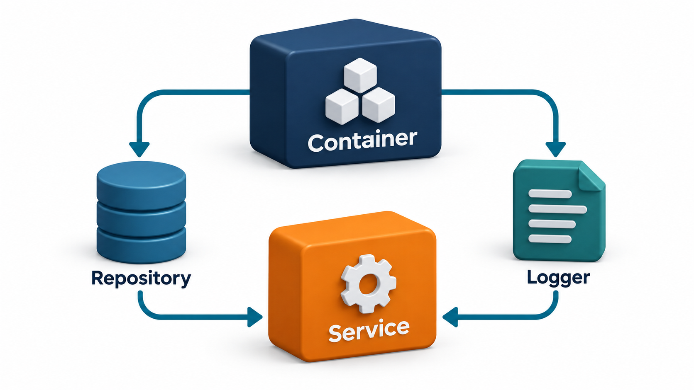
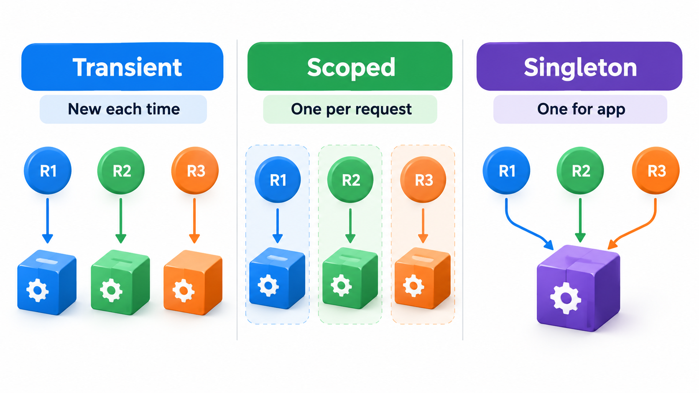
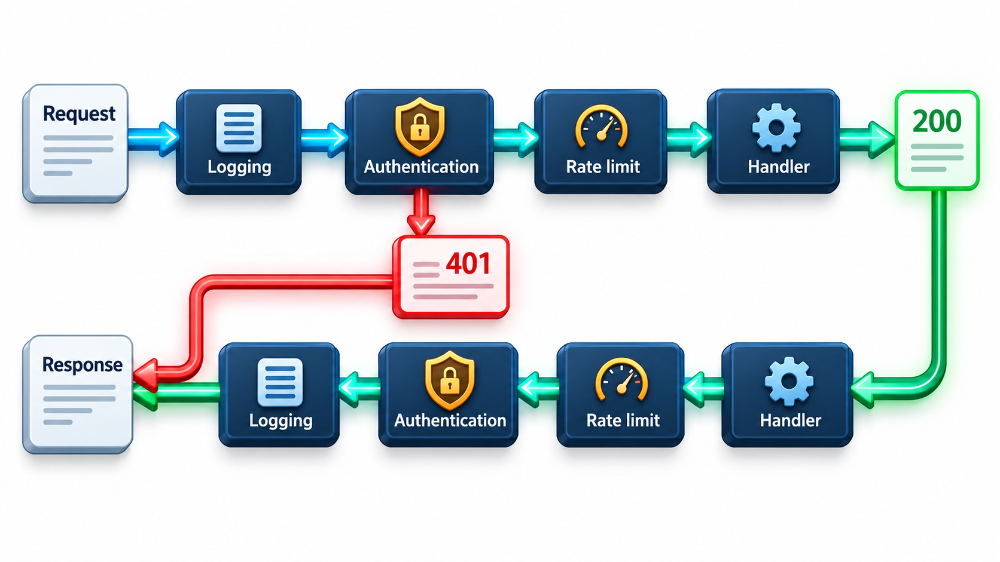
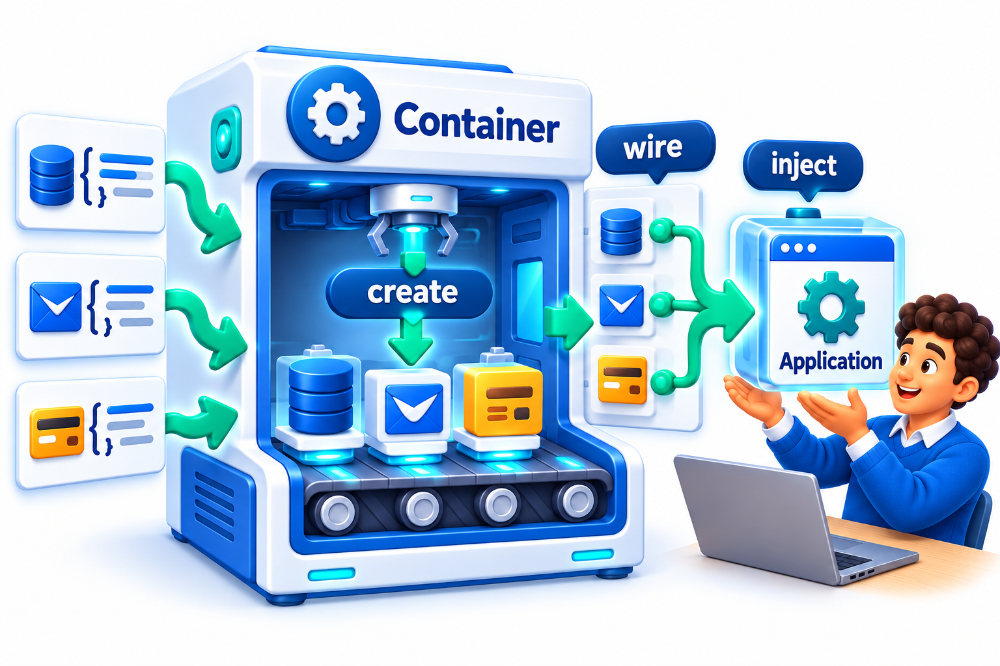

## Yesterday's Patterns Became Today's Plumbing

Many of the design patterns of the 1990s did not disappear. They became *infrastructure*. A developer using a modern framework uses patterns every day without writing them. Objects no longer find or create what they need by themselves; they declare what they need, and the framework supplies it. Requests no longer pass straight to the code that handles them; they travel through a chain of wrappers that check who you are, record what happened and limit how fast you can ask.

This topic looks at four: dependency injection, repositories, middleware and event handlers. It also shows how languages in which functions can be passed around express old patterns more simply, so that a whole pattern may reduce to one parameter.

The practical value of knowing this is that frameworks stop looking like magic. A newcomer who sees a database appear in a function's arguments without anyone creating it wonders where it came from. Someone who knows dependency injection recognises the mechanism, knows where to look, and can reason about what the framework will do.

## Dependency Injection

**Dependency injection** is the practice of giving an object the things it depends on, instead of letting it create or look them up itself. The object states what it needs, usually as parameters of its constructor or function, and whoever builds the object, a test, the main program or a framework, supplies them.

The benefit is that the object no longer decides which database or mailer it uses. In production it is given real ones. In a test it is given simple stand-ins. The object works the same either way, and the dependencies are visible in its signature, so nothing hides.

| Aspect | Object creates its own dependencies | Dependencies are injected |
| --- | --- | --- |
| Where the mailer comes from | The object builds a real mailer | It receives one |
| Testing registration | Sends real emails, or needs special tricks | Receives a fake mailer and checks it was asked to send |
| Changing the mail provider | Edit every class that builds a mailer | Change the one place that supplies it |
| Visible dependencies | Hidden inside the code | Listed in the signature |

An **inversion of control container** (IoC container) automates the wiring. The programmer declares the pieces and what each needs, and the container builds them in the right order and hands them over. Spring and FastAPI's dependency system work like this. Without a container, the same idea works by hand: build the objects in one place at the start of the program and pass them down.

<!-- Visual: registration tied to real email compared with injected real or fake email services. -->

## A Function as the Injected Part

In languages where functions can be passed around, the thing injected can be as simple as a function. Consider a fee calculation that is given the late-fine rule from outside, instead of knowing it. It replaces the whole Strategy pattern, with its interface and classes, by passing a function. For a base fee of Rs 1,000 paid 3 days late:

| Rule passed in | What it does | Total fee |
| --- | --- | --- |
| Normal rule | Adds Rs 5 for each day late | Rs 1,015 |
| Scholarship rule | Ignores the days and waives the fine | Rs 1,000 |
| Test stand-in | Always returns zero | Rs 0 |

The fee calculation does not know how fines are computed. It receives a rule and uses it. The test stand-in lets a test check what the calculation does with the rule's answer, without needing a real rule. No interface, no classes and no framework: the idea of Strategy and the idea of injection are both present in one parameter. For small variations this is often all that is needed.

<!-- Visual: an object receiving its dependencies from outside rather than creating them. -->

## Lifetimes: How Long Does an Injected Thing Live?

When a container supplies objects, it also decides how long each lives. This is a frequent source of confusion.

| Lifetime | Meaning | Suits | Danger |
| --- | --- | --- | --- |
| **Per request** | A fresh object for each incoming request, discarded afterwards | A database session for one request | None for most uses |
| **Singleton (one for the program)** | One object created once and shared | A configuration reader, a connection pool | Shared state across requests; thread safety |
| **Transient** | A new object every time it is asked for | Small helpers with no state | Cost if expensive to create |

A common bug is to inject a per-request thing into something that lives for the whole program. The long-lived object holds on to the first request's object for ever, and later requests see another user's data. The lifetimes must nest correctly: a long-lived object should not depend on a shorter-lived one.

## Repository: A Collection That Hides the Database

A **repository** gives the rest of the program a simple, collection-like interface to stored objects: adding a student, getting one by roll number and finding students by department. Behind it, the repository talks to a database, a file, an API or memory. The business code speaks in terms of students, and not tables and queries.

The pattern, described by Martin Fowler in his 2002 book on enterprise application architecture, serves two purposes. It keeps the business code free of storage detail, which makes the storage replaceable. And it makes testing easy, since a repository that keeps students in a list is a perfect stand-in for one that uses a database. A repository is the usual form of the "port" that a hexagonal architecture defines for storage.

| Business code asks | Database repository does | In-memory repository does |
| --- | --- | --- |
| Add student Asha | Writes a row | Appends to a list |
| Get student 12 | Runs a query by key | Looks up in a dictionary |
| Find students in "Physics" | Runs a filtered query | Filters the list |
| Result seen by the business code | A student object | A student object |

The business code gets the same answers either way. A test that uses the in-memory version runs in milliseconds and needs no database.

## Middleware: A Chain Around the Handler

Web frameworks handle a request by passing it through a series of steps before it reaches the code that produces the answer, and the answer passes back through the same steps. Each step is a **middleware**. One checks that the user is logged in. Another logs the request. Others compress responses, handle cross-site rules, or limit the rate of requests. The main handler does not know about any of them.

This is the Decorator and Chain of Responsibility patterns combined. Each middleware wraps the next step, does something before or after it, and may stop the request early. Take a chain with logging first, then a login check, then the real handler that returns a page.

| Request | Logging | Login check | Handler | Response |
| --- | --- | --- | --- | --- |
| From user Asha | Records "asha" | Passes it on | Returns a page for Asha | The page |
| From nobody (no user) | Records "(nobody)" | Stops the chain | Never sees it | "401 please log in" |

The login check stops the chain when the user is empty, and returns an answer without ever calling the handler. Otherwise it passes the request on. Asha is logged, checked and served. The anonymous request is logged and then refused at the login step. Adding rate limiting means writing one more wrapper and placing it in the chain. The handler is unchanged.

Order matters because each layer sees only what the layers before it have done.

| Order | Effect |
| --- | --- |
| Logging, then login check | Every request is logged, including refused ones |
| Login check, then logging | Refused requests vanish from the log; attackers leave no trace |
| Rate limiting before login check | Cheap rejection of floods before spending effort on authentication |
| Compression last | The response is compressed after all other layers have finished with it |

<!-- Visual: a request travelling left to right through logging, authentication, rate limiting and the handler, and the response travelling back through the same steps, with an early exit at authentication. Save as images/74_middleware_chain.png. -->

## Event Handlers: Observer in Disguise

When a framework says "run this function when a user clicks" or "when a message arrives on this queue", it is using the Observer pattern. The framework is the subject, and the function you register is the observer. The same pattern appears as web-page events, message-queue consumers, webhooks (an outside service calls your address when something happens) and lifecycle hooks (code that runs when the application starts or stops).

| Where it appears | Subject | Observer |
| --- | --- | --- |
| A web page | The button | Your click handler |
| A message queue | The queue | Your consumer function |
| A payment provider | The provider's servers | Your webhook address |
| An application framework | The start-up process | Your start-up hook |

The cautions from Observer carry over: handlers should be quick, should not assume an order, and must cope with the same event arriving twice. That last point is particularly important for webhooks and queues, which often deliver an event more than once.

## Functional Alternatives to Classic Patterns

Several GoF patterns were designed to work around a limitation of the languages of the time, where code could not easily be passed around. Where it can, the pattern shrinks.

| Classic pattern | Functional form |
| --- | --- |
| **Strategy** | Pass a function as an argument |
| **Command** | Store a function (with its data) in a list |
| **Observer** | Keep a list of callback functions |
| **Template Method** | Pass the varying steps as functions |
| **Decorator** | A function that takes a function and returns a wrapped one |
| **Factory** | A function that returns an object |

This does not make the patterns obsolete. The ideas remain: separate what varies, depend on a small interface, wrap behaviour. A programmer who knows the idea can recognise it in a class hierarchy or in a one-line function.

<!-- Visual: an inversion of control container wiring objects together. -->

