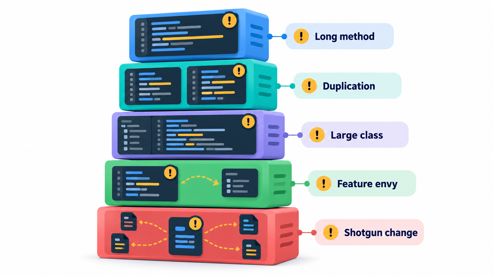
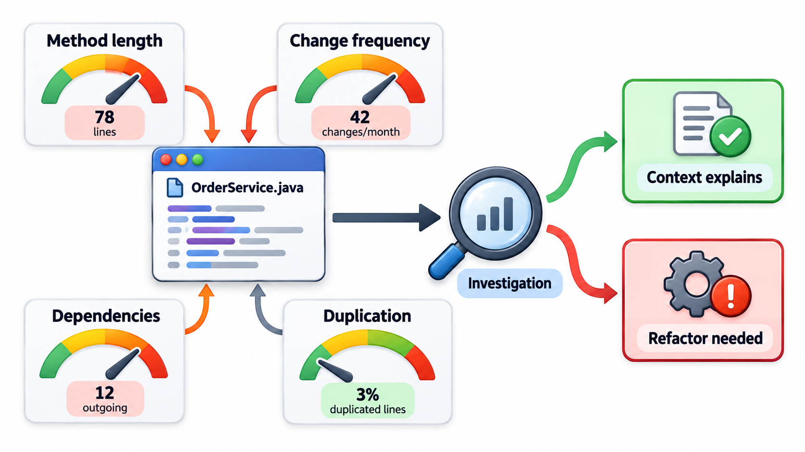
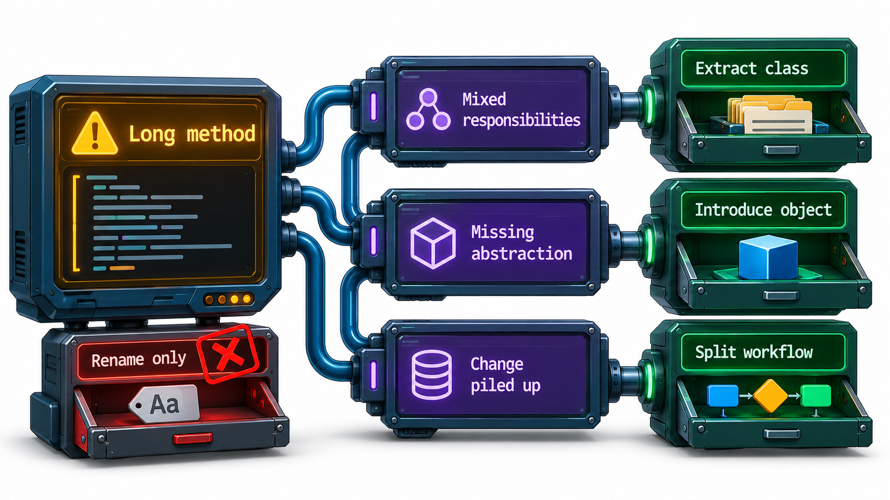
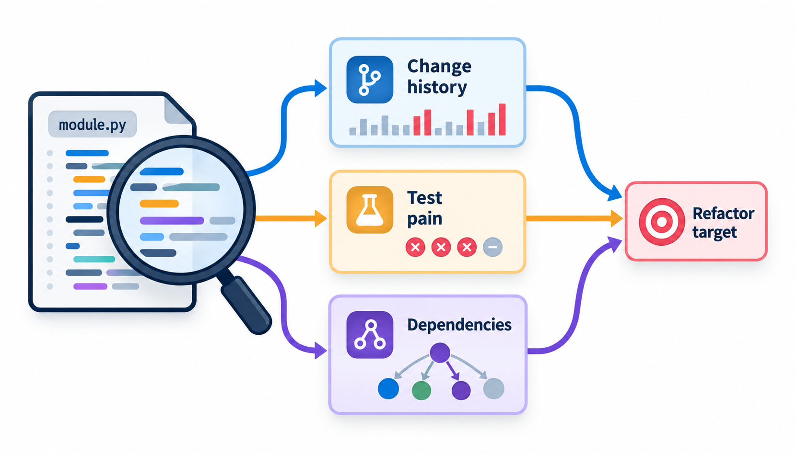

## Code Can Smell

An experienced programmer opening a piece of code often gets a feeling that is hard to put into words: not a definite bug, but a sense that something is wrong and that trouble is coming. The traditional advice for a baby, "if it stinks, change it", gave the feeling a name. A **code smell** is a surface sign that suggests a deeper problem in the design.

A smell is not an error. The program still works, passes its tests and may have shipped. It is a prompt to look closer. Some smells have names, and a name makes a vague unease into something that can be discussed in a review. This topic describes the most common smells, the larger class of bad habits called **anti-patterns**, and the ways to look for both.

The term comes from Kent Beck and Martin Fowler, who used it in the refactoring literature of the late 1990s. Their point was that experienced programmers share intuitions about bad code, and that writing the intuitions down as a catalogue lets beginners borrow years of experience quickly.

## A Catalogue of Common Smells

| Smell | What you see | What it suggests |
| --- | --- | --- |
| **Long method** | A function that runs for pages | Several jobs in one place; hard to understand, test or reuse |
| **Large class / God class** | One class with dozens of fields and methods that seems to know everything | Too many responsibilities; everything depends on it |
| **Long parameter list** | A function taking six or seven arguments | A missing object; the callers must remember an order |
| **Duplicated code** | The same logic in several places | One fix must be made in all places, and one will be missed |
| **Feature envy** | A method that uses another class's data more than its own | The behaviour is in the wrong class |
| **Shotgun surgery** | One small change forces edits in many classes | A single responsibility is scattered |
| **Divergent change** | One class is edited for many unrelated reasons | The class has several responsibilities |
| **Data clumps** | The same three or four values travel together everywhere | They want to be an object |
| **Primitive obsession** | Money or phone numbers as bare strings and numbers | A missing small type that could hold the rules |
| **Comments that explain bad code** | A paragraph describing what a confusing block does | The code should be clearer, not described |

Notice that several are opposites. *Shotgun surgery* is one change touching many places. *Divergent change* is one place changed for many reasons. They are two faces of the same problem: responsibilities do not line up with the modules.

<!-- Visual: a tower of smells arranged by what they hurt: a row for functions (long method, long parameter list), a row for classes (god class, feature envy, data clumps) and a row for change (shotgun surgery, divergent change), with the cause underneath. -->

## More Smells to Recognise

| Smell | What you see | What it suggests |
| --- | --- | --- |
| **Switch statements on type** | The same chain on "kind" in several places | A missing polymorphic design |
| **Speculative generality** | Hooks, options and abstractions nobody uses | Over-engineering for an imagined future |
| **Dead code** | Functions or branches that can never run | Fear of deleting; clutter that misleads |
| **Middle man** | A class that only forwards calls to another | A layer with no job |
| **Inappropriate intimacy** | Two classes that dig into each other's internals | They should be one, or have a proper interface |
| **Message chains** | A call that reaches through one object after another to get to a distant one | The caller knows too much about the structure |
| **Magic numbers** | Bare values such as 0.18 with no name | The rule behind the number is hidden |
| **Inconsistent naming** | `get_fee`, `fetchStudent`, `retrieve_marks` | No shared vocabulary |

## Finding Smells by Counting

Some smells can be detected by counting. Long methods and long parameter lists are the easiest. Real tools such as linters do this and more. Take two functions, with limits chosen by the team: more than 5 lines is a long method, and more than 4 parameters is a long parameter list.

| Function | Lines | Parameters | Verdict |
| --- | --- | --- | --- |
| Small helper | 2 | 1 | Looks fine |
| Register | 7 | 7 | Long method and long parameter list |

Registering a student is flagged twice: seven lines is above the limit of five, and seven parameters is above the limit of four. The thresholds are arbitrary and teams set their own. The tool does not say the function is wrong. It says "look here", and a person decides. Real code-quality tools read the code properly, but nearly all work this way: measure, compare with a limit, and point.

Other measures help find trouble: the length of a file, the number of methods in a class, how deeply conditions are nested, and how often a file changes. A file that is both large and edited every week is a better target for clean-up than a large file that nobody touches.

| File | Lines | Changes in last 6 months | Priority |
| --- | --- | --- | --- |
| `fees.py` | 1,200 | 48 | High: big and constantly edited |
| `legacy_import.py` | 1,500 | 1 | Low: big but stable |
| `receipt.py` | 150 | 40 | Medium: small but busy |

## Anti-patterns: Bad Habits with Names

An **anti-pattern** is a commonly seen solution to a problem that looks reasonable and causes more harm than good. The name was popularised by a 1998 book on the subject. Smells are small and local. Anti-patterns are bigger habits of design or process.

- **God object.** One class does nearly everything, and the rest are just data. Every change goes through it.
- **Spaghetti code.** Control jumps unpredictably, with tangled conditions and no structure. Nobody can say what a change will affect.
- **Copy-paste programming.** Code is duplicated and tweaked instead of shared.
- **Golden hammer.** A familiar tool is used for every problem, because it is the one the team knows: the database for everything, or one framework for all.
- **Lava flow.** Old code that nobody understands is left in place because it might be needed, and it hardens like cooled lava as new code is built around it.
- **Cargo-cult programming.** Code or design practices are copied without understanding why they work. The name comes from island communities that built imitation runways in the hope of bringing back the aircraft they had seen; the form was copied and the cause was missing. A programmer who adds a pattern because "that's how it is done", with no problem it solves, is doing the same.

Over-using design patterns is itself an anti-pattern. The warnings about over-engineering apply: a pattern added where no problem exists is a smell of its own.

<!-- Visual: common anti-patterns in software design and process. -->

## Process Anti-patterns

Some anti-patterns concern how a team works and not the code.

| Anti-pattern | What it looks like | Consequence |
| --- | --- | --- |
| **Death march** | A project with an impossible deadline, kept going by overtime | Exhaustion, shortcuts, defects |
| **Analysis paralysis** | Endless study before any decision | Nothing is built |
| **Reinventing the wheel** | Writing what a good library already does | Time lost; new bugs |
| **Hero programming** | One person saves every crisis | Knowledge sits with one person; burnout |
| **Not invented here** | Refusing outside solutions | Reduced speed and quality |
| **Management by checkbox** | Measuring activity (tickets closed) not outcome | Gaming of metrics |

## What to Do About a Smell

A smell is a hint, and the response should be proportionate.

<!-- Visual: A long method is a symptom whose underlying cause determines the appropriate refactoring. -->

1. **Notice it and name it.** "This is feature envy" gives the team something to discuss.
2. **Ask whether it matters here.** A long method in code that never changes costs little. The same smell in code that changes weekly costs a lot.
3. **Look for the cause.** Smells often point to a missing concept. Five parameters that travel together suggest a missing object.
4. **Fix it safely.** The tool for this is refactoring, small behaviour-preserving changes made with tests running.
5. **Record what you do not fix.** A known smell in a debt register is better than one nobody has noticed.

Not every smell needs treatment. A few are deliberate trade-offs. The cost is in leaving smells unnoticed and unexamined.

| Smell | Typical first refactoring |
| --- | --- |
| Long method | Extract method |
| Long parameter list | Introduce parameter object |
| Feature envy | Move method |
| God class | Extract class |
| Switch on type | Replace conditional with polymorphism |
| Magic number | Replace with named constant |
| Duplicated code | Extract and share |

<!-- Visual: where code smells come from and how they are investigated. -->

