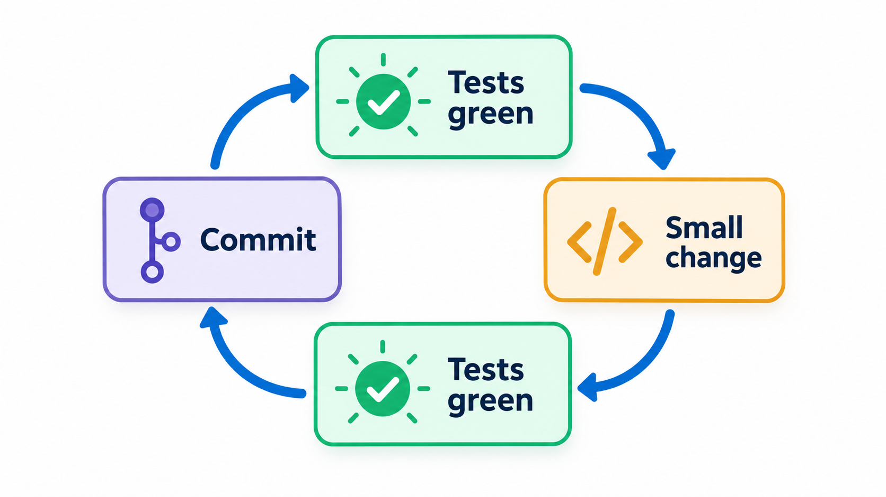
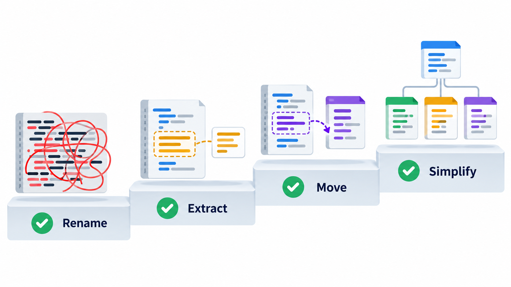
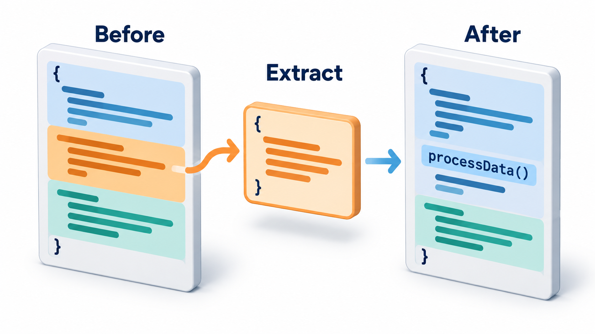
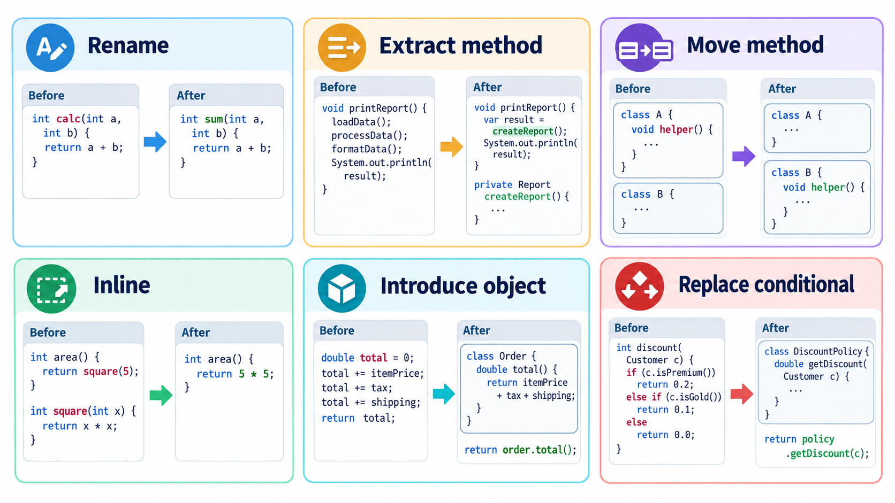
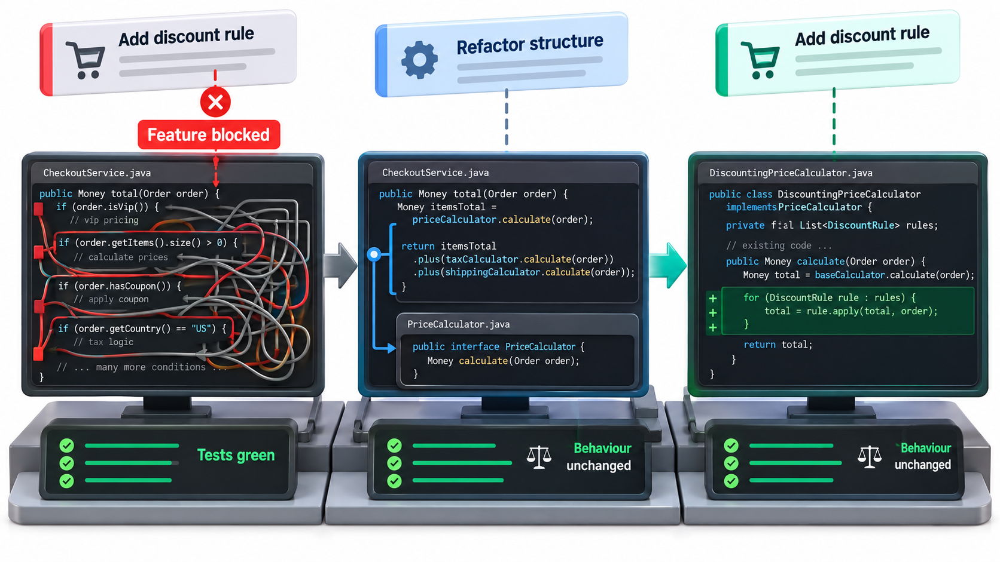

## Make the Change Easy, Then Make the Easy Change

When you have to make a change to a program, a good piece of advice, attributed to the programmer Kent Beck, is: first make the change easy, even if that part is hard, and then make the easy change. The first step is a reorganisation of the code that adds no features. The second is the feature, which now takes five minutes because the code is ready for it.

The reorganisation is called **refactoring**: changing the internal structure of code without changing what it does. The central discipline is in the definition. Refactoring *does not change behaviour*. If the behaviour changes, it is no longer a refactoring, whatever else it is. A program with a clean structure is cheaper to change, and refactoring is how to get from a messy structure to a clean one without breaking what works. Martin Fowler's catalogue of named refactorings gives the practice a vocabulary and a discipline.

## The Safety Net

If refactoring must not change behaviour, how do you know it did not? The answer is **tests**. Before you refactor, you need automated checks that describe what the code does now. After each small change, you run them. If they all pass, behaviour is preserved. If one fails, you know the last small change did it, and you can undo it.

For code that has no tests, the first step is to write **characterisation tests**: checks that record what the code *currently does*, whether or not that is right. They are a net to catch accidental change, not a statement of correctness. Take a pricing routine that was one function with a chain of conditions on the type of customer. It is refactored so that each customer type owns its rule. This technique is called **replace conditional with polymorphism**. The same checks are run against the old and the new version.

| Customer type | Price of Rs 1,000 before | Price after | Same behaviour? |
| --- | --- | --- | --- |
| Student | 900 | 900 | Yes |
| Senior | 800 | 800 | Yes |
| Guest | 1,000 | 1,000 | Yes |

The structure changed and the behaviour did not. Had the refactor slipped, for instance a senior discount of 0.85 instead of 0.8, the comparison would have shown a difference and pointed straight at the case. With the new structure, adding a staff discount is a new customer type. The old code would have needed another branch in a function that every customer type goes through.

<!-- Visual: A refactoring cycle in which tests stay green while the structure improves. -->

## Writing Characterisation Tests

When code has no tests, the aim is not to decide what it should do but to capture what it does. The method has a clear rhythm.

1. **Pick a behaviour to protect**, such as the price for a customer type.
2. **Run the existing code** with a chosen input and note the result, even if it looks odd.
3. **Record the input and the result** as an expected pair.
4. **Repeat for the interesting cases**: ordinary values, boundaries, and the odd ones.
5. **Refactor**, running the pairs after every small change.

| Input | Observed result | Recorded as expected? |
| --- | --- | --- |
| Student, Rs 1,000 | 900 | Yes |
| Senior, Rs 1,000 | 800 | Yes |
| Guest, Rs 0 | 0 | Yes |
| Student, Rs -100 | -90 | Yes, and note it: negative prices look like a latent bug to raise separately |

The last row shows an important discipline. The characterisation test records the odd result so that refactoring does not change it silently. Whether to fix it is a separate decision, made later and committed on its own.

## Small Steps

The second rule is to take **small steps**. Refactoring is done as a series of tiny changes, such as renaming one variable or moving one method, with the tests run after each. A large reorganisation done in one go is risky: if something breaks, there are too many changes to search. Small steps keep the program working at all times, and make it safe to stop at any point. The mood is of continuous tidying and not of occasional big clean-ups.

| Approach | Changes between test runs | If a test fails | Safe to stop midway? |
| --- | --- | --- | --- |
| Big-bang reorganisation | Hundreds | Hunt through hundreds of edits | No |
| Small steps | One or two | The last edit is the culprit; undo it | Yes |

<!-- Visual: small safe refactoring steps with tests after each. -->

## The Everyday Techniques

Fowler's catalogue is long, but a handful of techniques cover most of the work.

**Rename.** Give a variable, function or class a name that says what it is. This is the cheapest and most valuable refactoring, and every editor automates it.

**Extract method.** Take a block of code from a long function, give it a name, and make it a function of its own. The original now reads as a summary: `validate`, `calculate`, `save`. It removes the *long method* smell and creates a reusable piece.

**Inline.** The opposite. If a function is so trivial that its name says no more than its body, replace calls with the body.

**Move method or field.** If a method uses another class's data more than its own, move it there. This cures *feature envy*.

**Extract class.** When a class does two jobs, split it. The data and methods of one job go into a new class.

**Introduce parameter object.** When the same several values travel together through many calls (a *data clump*), make them a single object. A function that took seven separate values (name, roll number, email, phone, hostel, year and whether paid) takes a single student object.

**Replace conditional with polymorphism.** Replace a chain of `if` or `switch` tests on a type with one class per type, each carrying its own behaviour. The example above is this one.

**Replace magic number with a named constant.** `0.9` becomes `STUDENT_DISCOUNT`, with the reason in its name.

**Remove duplicate code.** Pull repeated logic into one function.

<!-- Visual: extracting a block of code into a named method. -->

## A Refactoring Walked Through

To see how small steps add up, take a fee-calculation function that is forty lines long and does three things: checks the student is eligible, computes the amount, and formats a message.

| Step | Refactoring | Tests run? | State of the function |
| --- | --- | --- | --- |
| 1 | Rename vague variables (`x`, `t`) to `base_fee`, `late_days` | Yes, pass | Same length, clearer |
| 2 | Replace the magic number 5 with `FINE_PER_DAY` | Yes, pass | Rule is named |
| 3 | Extract the eligibility check into `is_eligible` | Yes, pass | Twelve lines shorter |
| 4 | Extract the amount calculation into `compute_amount` | Yes, pass | Another fifteen lines shorter |
| 5 | Extract the message into `format_message` | Yes, pass | The original is now six lines that read like a summary |
| 6 | Add the new "scholarship" rule to `compute_amount` | Yes, new test added | The feature took one small edit |

Six small steps, each verified, and the feature at the end was the smallest change of all. If step 4 had broken a test, the cause would have been obvious.

## Which Refactoring for Which Smell

| Smell noticed | Refactoring to try | Why it helps |
| --- | --- | --- |
| Function too long | Extract method | Names the parts; shortens the whole |
| Same values travelling together | Introduce parameter object | Gives the clump a name and a home |
| Method envious of another class | Move method | Behaviour joins its data |
| Class with two jobs | Extract class | One reason to change each |
| Repeated a chain of conditions on the kind chains | Replace conditional with polymorphism | New kinds added without editing the chains |
| Unexplained numbers | Named constant | The rule is visible |
| A wrapper that does nothing | Inline | Removes a pointless layer |

## When to Refactor

A team does not need a special "refactoring project". The habit that works is to refactor as part of ordinary work. Fowler describes several moments:

<!-- Visual: A toolkit of common refactoring moves. -->

- **Before adding a feature.** Make the change easy first, as Beck advised.
- **While fixing a bug.** If the code is hard to understand, tidy it so the bug is visible, then fix it.
- **During code review.** A reviewer who sees a smell suggests a small clean-up.
- **The rule of three.** The first time you do something, just do it. The second time, wince at the duplication but do it anyway. The third time, refactor.

Refactoring is not suitable when the code is so broken that it should be rewritten, when there is no way to test it and no time to create one, or just before a deadline with no safety net. In those cases the right step is often to write the missing tests first.

<!-- Visual: a feature request meeting messy code, then a short refactoring step that makes the change easy, then the feature added in a few lines, with tests green at each stage. Save as images/76_make_the_change_easy.png. -->

## Risks and How to Manage Them

| Risk | How it shows up | Safeguard |
| --- | --- | --- |
| Behaviour changes by accident | A bug appears after a "tidy-up" | Tests after every step; small commits |
| Scope creep | The tidy-up becomes a rewrite | Decide the goal first; stop when reached |
| Mixing with feature work | A failure cannot be traced | Separate commits for structure and behaviour |
| Merge conflicts | Others are editing the same files | Refactor in short bursts and merge often |
| Refactoring code nobody changes | Effort with no return | Focus on code that changes often |

## Five Misreadings of Refactoring

**"Refactoring means rewriting."** A rewrite replaces the code. Refactoring improves it in small steps while it keeps working.

**"We can refactor without tests."** Without tests you can restructure, but you cannot know that behaviour was preserved. Write characterisation tests first.

**"Refactoring is cleaning up after the real work."** It is part of the real work. Putting it off until "later" means it is never done and every change gets harder.

**"A refactoring should also fix bugs and add features."** Mixing them makes it impossible to tell which change caused a failure. Do one at a time, and commit separately.

**"It is wasted effort because users see no difference."** Users see the difference in how quickly features arrive and how few bugs return. The saving is in the future work.
