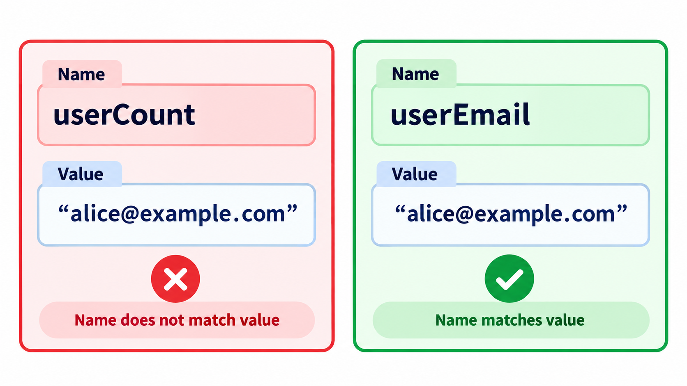
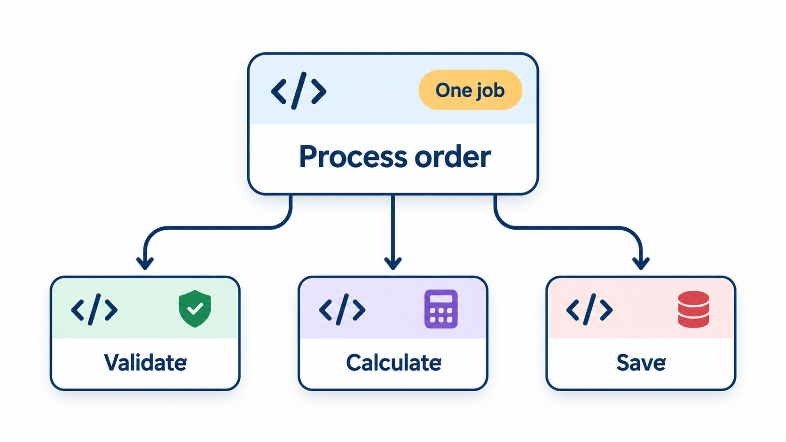
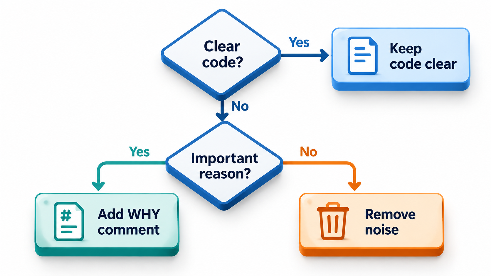
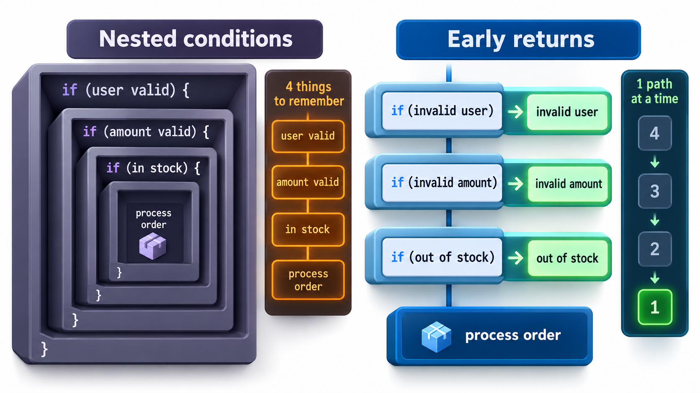
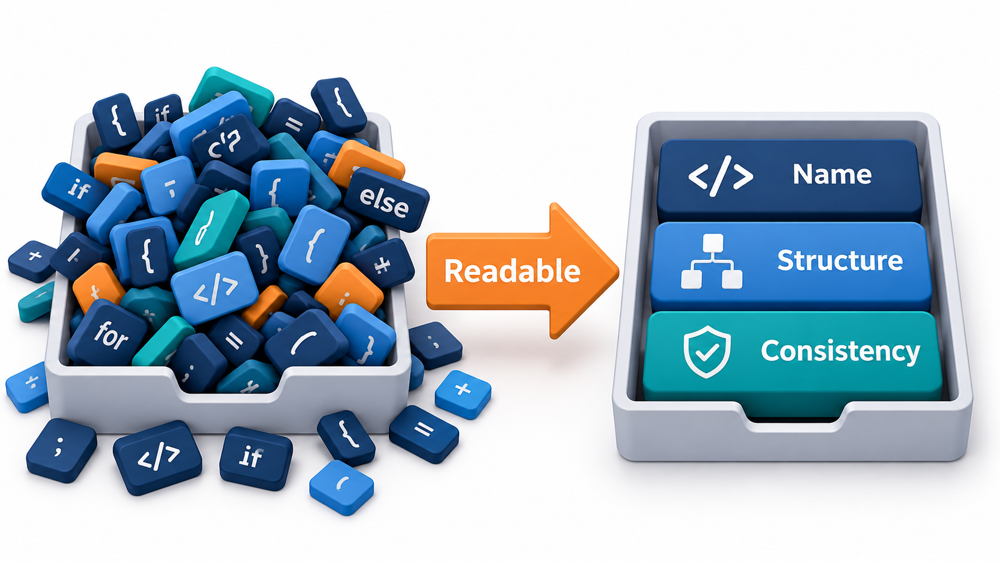
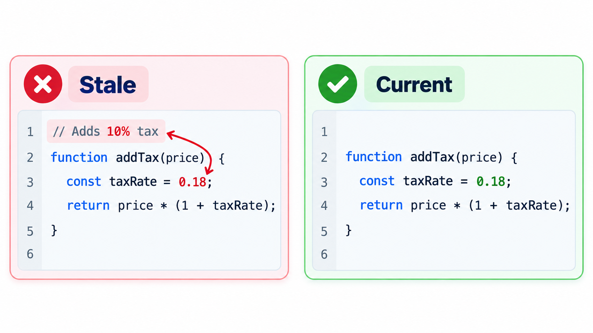

## Written Once, Read Many Times

Code is read far more often than it is written. You spend a morning writing a function. For the next five years, other people, and you yourself, will open it again and again: to fix a defect, to add a feature, to find out what it does. Every minute of confusion is multiplied by every reader and every return visit. The best code is not the cleverest. It is the code that a competent colleague can understand quickly, on a Monday morning, without asking the author.

This topic is about the three habits that give the largest readability gains for the smallest effort: names that say what things are, functions that do one thing, and comments that say what the code cannot.

Studies of working programmers consistently find that they spend much more of their time reading code than writing it, often cited as around ten times as much. If that is even roughly true, then a saving of a minute for the reader is worth ten minutes of extra care for the writer. Readability is therefore not a polish applied at the end. It is the main economy of maintenance.

## Names Carry Most of the Meaning

A reader meets a name before anything else. A good name answers three questions: what is it, what does it hold or do, and what units or limits apply. A poor one makes the reader read the surrounding code to find out.

| Poor name | Better name | Why |
| --- | --- | --- |
| `d` | `days_late` | Says what the number counts |
| `list1` | `students_with_dues` | Says what is in the list |
| "process data" | "send fee reminders to students" | Says the action and the subject |
| `flag` | `is_scholarship_holder` | A yes or no question reads naturally in an `if` |
| `temp` | `fee_after_discount` | Names the purpose, not the lifetime |
| "calculate" | "late fine for the days late" | Says what is calculated |

A few principles cover most cases. Use words from the problem, such as `fee`, `roll_number` and `hostel`, not words from the machine. Make the length of a name match the size of its scope: `i` is fine as the counter of a three-line loop and bad as a module-level variable. Be consistent: if one function uses `student_id` and another uses `sid`, readers must wonder whether they are different. And avoid names that mislead. A function named `get_total` that also sends an email is lying.

<!-- Visual: A misleading name that suggests something different from what the code does. -->

## Naming Different Kinds of Things

Each kind of thing has conventions that help the reader guess its role.

| Kind | Convention | Examples |
| --- | --- | --- |
| **Variables holding data** | Noun or noun phrase | `fee_due`, `students` |
| **Yes or no values** | Starts with is, has, can, should | `is_overdue`, `has_scholarship` |
| **Functions that do something** | Verb phrase | `send_receipt`, `calculate_fine` |
| **Functions that answer a question** | Reads as a question | "Is the student eligible?" |
| **Classes** | Singular noun | `Student`, `FeeReceipt` |
| **Collections** | Plural noun | `students`, `unpaid_invoices` |
| **Constants** | Capitals, with the meaning in the name | `LATE_FINE_PER_DAY` |
| **Units** | Put the unit in the name when ambiguity is possible | `timeout_seconds`, `amount_paise` |

The last is more important than it looks. A value called `timeout` could be seconds or milliseconds, and the wrong guess has caused real failures. Writing the unit in the name removes the guess.

## One Function, One Job

Long functions are hard to read because the reader must hold everything in mind at once. A function that validates, calculates, saves and sends an email has four jobs, and a change to any one of them requires reading the others. A good function is short, does one thing, and has a name that says what. If you struggle to name it without using "and", it is probably doing two jobs.

Short functions have an extra benefit: they let the code read like an outline. The top-level function becomes a list of steps with names, `validate`, `calculate_fee`, `save`, `send_receipt`, and the reader can stop at that level or drop down into a step if they need to.

Keep the number of parameters small. Three is comfortable, and more than four usually means a missing concept that wants to be an object. Avoid hidden effects: a function that quietly changes a global variable surprises everyone who calls it.

| Property | Comfortable | Warning |
| --- | --- | --- |
| Length | Fits on a screen (about 20 lines) | Needs scrolling |
| Parameters | 0 to 3 | 5 or more |
| Levels of nesting | 1 or 2 | 4 or more |
| Names for the job | One short verb phrase | Needs "and" |
| Side effects | None, or stated in the name | Hidden changes to other data |

<!-- Visual: functions that each do a single job. -->

## The Same Code, Two Ways

Take one task written twice: add up a bonus for students who passed. Both versions have exactly the same structure and give the same answer. They differ only in names.

| | Cryptic version | Clear version |
| --- | --- | --- |
| The function | f | total_bonus |
| The inputs | a, b, c | students, pass_mark, bonus_per_mark |
| Each record | i, read by position (i[1], i[2]) | name, marks, extra |
| The test inside | "if i[1] is at least b" | "if marks are at least the pass mark" |

Run on the same data (Asha with 82 marks and an extra of 5, Ravi with 41 and 7, Meena with 67 and 3, a pass mark of 50 and a bonus of 2 per mark), both give 16: Asha and Meena passed, so (5 + 3) x 2. In the cryptic version a reader must guess what is in the list, what positions one and two mean, and what the other two inputs are for. In the clear version the names say so. The whole difference is a few seconds of writing, and it saves minutes for every later reader. If a change request arrived saying "the pass mark is now 45", only the clear version tells you immediately where the number goes.

## Comments That Earn Their Place

Comments are often misused in two opposite ways. Some code has none and needs them. Other code has a comment on every line, restating what the code already says, such as a note "add one to i" beside a line that adds one to i. Such comments add noise, and worse, they go out of date. A comment that disagrees with the code is worse than no comment, because the reader does not know which to believe.

<!-- Visual: A decision aid for whether a comment adds anything the code does not already say. -->

A useful comment says something the code cannot. The most valuable is **why**: the reason for a choice that would otherwise look wrong. "We round fees down because the university rules say so (circular 12/2021)." "This delay is needed because the bank's server rejects two requests in the same second." Other good uses are warnings about traps, links to a specification or a bug report, and short summaries at the top of a module.

| Comment | Worth keeping? | Why |
| --- | --- | --- |
| `# add one to i` | No | Repeats the code |
| `# fees round down per circular 12/2021` | Yes | Gives a reason the code cannot show |
| A note marking work to be removed after a migration | Yes, if dated and owned | Marks known incomplete work |
| `# this is a hack` | No | Says nothing about what or why |
| `# the bank rejects two calls in one second` | Yes | Explains a delay that looks pointless |
| A large block of commented-out code | No | Version control keeps history |

<!-- Visual: two versions of the same function, one with four levels of nested if statements and one using early returns, with the number of things the reader must remember counted beside each. Save as images/77_nesting_vs_early_return.png. -->

A good rule is to try first to make the code clear, by better names and smaller functions, and to add a comment only for what remains. A comment is an apology for code that could not say it itself, except when it explains a reason. Names and structure are checked by the compiler and by tests. Comments are not, which is why they need to be few and true.

<!-- Visual: A reader holding fewer things in mind when code is organised in a readable flow. -->

## Reducing the Reader's Load

Readability is partly about how much a reader has to hold in memory. Deeply nested `if` statements, long chains of conditions and variables that live for a hundred lines all raise that load. Techniques that help include early returns that handle the special cases first and leave the main path unindented, naming a complicated condition ("eligible when marks are at least 40 and attendance is at least 75"), declaring a variable close to where it is used, and avoiding clever tricks that take a moment to decode.

Count what a reader must remember at the deepest point of a nested function that checks four things in turn: that the student exists, is enrolled, has paid and has attended enough.

| Style | Conditions to hold in mind at the main action | Indentation of the main action |
| --- | --- | --- |
| Nested ifs, one inside another | 4 (all must be true to be here) | 4 levels deep |
| Early returns, each failing check leaves at once | 0 (each was dealt with and discarded) | 0 levels deep |

With early returns, each special case is handled and forgotten, and the main path reads straight down. That is the sense in which flat code is easier: not because it is shorter, but because the reader has less to carry.

<!-- Visual: A stale comment that no longer matches the code beneath it. -->

## Reviewing Code for Readability

A practical check is to ask a colleague to read a function cold and then say what it does. The gap between their answer and the truth is a measure of readability.

| What the reader says | What it suggests |
| --- | --- |
| Correct summary within a minute | Readable |
| Correct, but after tracing variables | Names could carry more meaning |
| Wrong guess about a name's meaning | A misleading or vague name |
| "I would need to run it" | Too many interacting parts; consider splitting |
| "Why is this here?" | A missing comment about the reason |

## Five Misreadings of Readability

**"Readable means verbose."** It means clear. A short name that is well understood in its scope is fine, and a long name that adds nothing is noise.

**"Comments make code readable."** Mostly they compensate for code that is not. Clear names and structure do more, and comments should explain why.

**"Readability is subjective."** Some of it is taste, but a great deal is measurable: how long a new reader takes to find the rule for the pass mark, how often a name caused a wrong guess.

**"Clever code shows skill."** Skill is shown by solving the problem simply enough that others can maintain the solution.

**"We can tidy it later."** The cost of poor readability is paid on every reading. Later usually never comes, and the confusion becomes part of the system.
