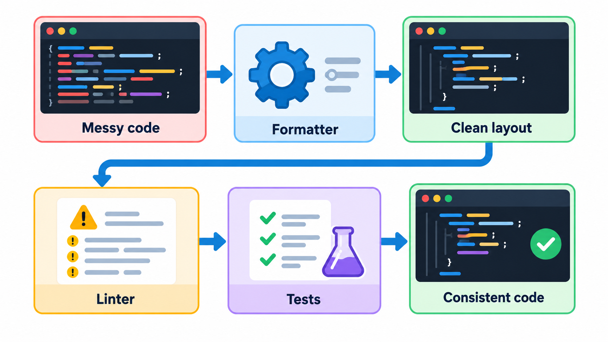
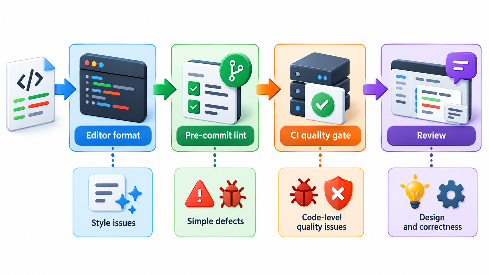
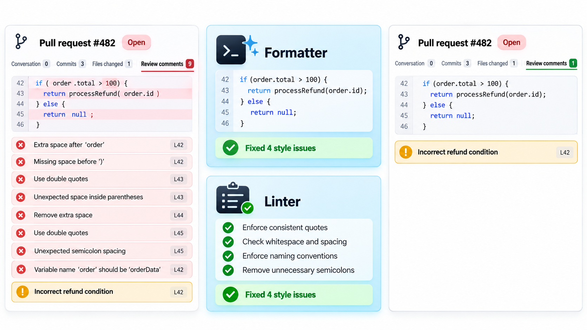
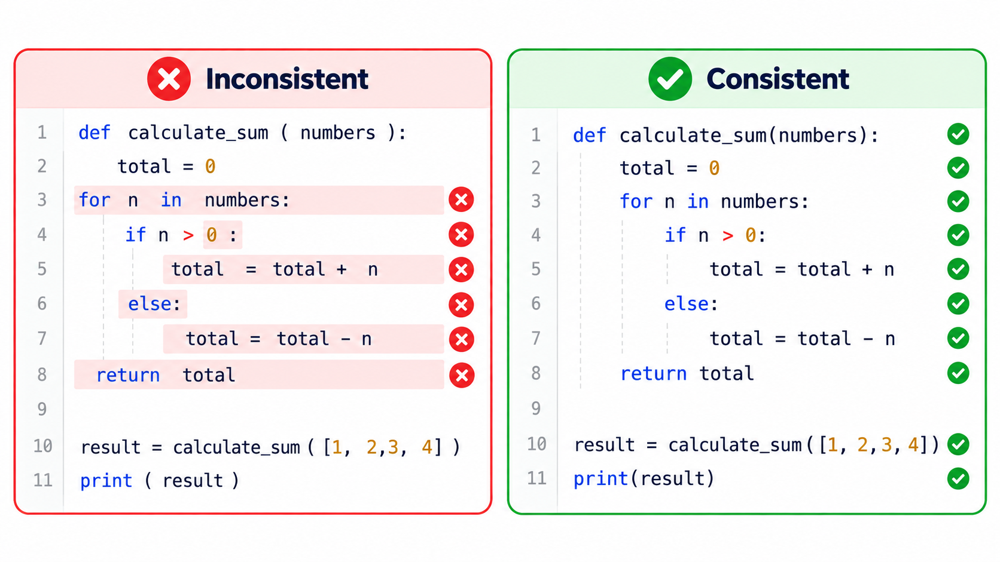
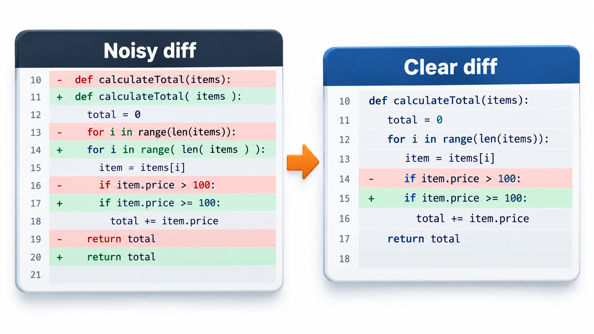

## Arguments About Style Are the Cheapest to End

Teams routinely lose hours to arguments that have nothing to do with the software. Whether to put a brace on the same line or the next. Whether to use four spaces or tabs. Whether a variable should be written one way or another. Reviews fill with comments about style, which hide the comments about logic, and a change that reformats a file produces a diff of three hundred lines in which the one real change is impossible to find.

The cure is to write the agreement down once, as a **coding standard**, and to let a program enforce it. Some languages go so far as to ship a formatter with no options at all, on the principle that nobody likes the one style best, but everybody likes having one. This topic covers both: what a standard contains, and how linters and formatters end the arguments.

The arithmetic of the waste is easy to estimate. If five developers each spend ten minutes a day discussing or correcting style, that is about four hours a week for the team, or well over a hundred hours a year, spent on something a tool can do in seconds.

## What a Coding Standard Covers

A standard is a short document, or a configuration file, that records the team's choices about how code should look and be written. It usually covers:

- **Layout**: indentation, line length, spacing and where blank lines go.
- **Naming**: the style for variables, functions, classes and constants (`snake_case`, `CamelCase`, `UPPER_CASE`).
- **Structure**: how files are organised and how imports are ordered.
- **Practices**: things to avoid, such as bare exceptions or global variables, and things to prefer, such as early returns.
- **Documentation**: where docstrings and comments are expected.

Rather than invent one, most teams adopt a widely used standard for their language: PEP 8 for Python, the Google Java Style Guide, the Airbnb JavaScript guide, or `gofmt` for Go. A familiar standard also means that new people already know it.

| Level of rule | Example | Enforced by |
| --- | --- | --- |
| **Layout** | Four spaces; lines under 88 characters | A formatter |
| **Naming** | Functions in `snake_case` | A linter |
| **Safety** | No bare `except`; no unused variables | A linter |
| **Design** | Functions short; classes with one job | Code review (hard to automate) |
| **Process** | Every change reviewed; tests required | The merge pipeline |

Notice that the machine-checkable rules sit at the top and the judgement-based rules at the bottom. Automation should handle the top so that human attention is spent on the bottom.

## Linters and Formatters

Two kinds of tool turn a standard into something automatic.

A **formatter** rewrites the code to the standard layout. You run it, and the layout is correct. Examples are Black for Python, Prettier for JavaScript and `gofmt` for Go. Because it makes all the choices, there is nothing left to argue about.

A **linter** reads the code, without running it, and reports problems. Some are about style (a line that is too long, a badly named function). Many are about likely bugs: a variable that is never used, a function that can return nothing on some path, a comparison that is always true, an `import` that does nothing. Examples are Flake8 and Ruff for Python and ESLint for JavaScript.

| Tool kind | Does what | Changes the code? | Examples |
| --- | --- | --- | --- |
| **Formatter** | Rewrites layout to the standard | Yes, automatically | Black, Prettier, gofmt |
| **Linter** | Reports rule violations and suspicious code | No: reports only (some can fix) | Flake8, Ruff, ESLint |
| **Type checker** | Checks that values are used consistently with their types | No | mypy, TypeScript |
| **Security scanner** | Looks for known risky patterns | No | Bandit, CodeQL |

A linter is a program that checks code against agreed rules and reports each place that breaks them. Take a very small one with three rules the team agreed: no trailing spaces at the end of a line, no line longer than 60 characters, and function names written in lower case with underscores. Run on a short sample of five lines, it reports:

| Line | Problem found |
| --- | --- |
| 2 | Trailing spaces, invisible to the eye and a nuisance in diffs |
| 4 | The function name is not written in lower case |
| 5 | The line is 95 characters, beyond the limit of 60 |

Three problems are found without anyone having to read the code. Long lines force sideways scrolling and are hard to compare in side-by-side reviews. Real linters check hundreds of rules, but each works in this way, and a failed rule can stop a build.

<!-- Visual: an automated standards check running on every change. -->

## What Linters Catch Beyond Style

The more valuable linter rules find probable bugs.

| Finding | Why it matters | Example consequence |
| --- | --- | --- |
| Variable assigned but never used | A leftover, or a typo for another name | The intended variable is never updated |
| Comparison that is always true | Logic that cannot work | A check that never rejects anything |
| Unreachable code | Code after a return | A fix placed where it can never run |
| Missing return on some path | The function returns nothing in a case | A caller receives "nothing" and fails later |
| Overly broad exception handler | Hides unrelated errors | A real fault swallowed silently |
| Mutable default argument (in Python) | A list shared between calls | Data leaking from one call to the next |

Reading a long list of linter output teaches a beginner many of the common traps, because each rule is the memory of a bug that someone once had.

## Where the Tools Run

The value comes from running them automatically, at three points:

1. **In the editor**, as you type, with the problem underlined.
2. **Before a commit**, with a hook that checks or formats the changed files.
3. **In continuous integration**, where a failed lint check blocks the merge.

The third is essential because it does not depend on every developer having set things up. With it in place, style comments disappear from code review. A reviewer who sees a formatting problem is looking at a failure of the tool, not of the person.

<!-- Visual: a review comment list with eight style comments and one logic comment, beside the same review after a formatter and linter run in CI, where only the logic comment remains. Save as images/78_review_before_after_linter.png. -->

## Introducing Standards to an Existing Codebase

Adopting a formatter on a large old codebase is a one-time cost that is worth paying carefully.

| Step | Reason |
| --- | --- |
| 1. Agree the standard and the tools as a team | People follow what they helped choose |
| 2. Format the whole codebase in one dedicated change, with no other edits | The huge diff is understood to be mechanical |
| 3. Record that commit so blame tools can skip it | History for real changes stays readable |
| 4. Turn on the checks in CI at the same time | Nothing slips back |
| 5. Introduce linter rules gradually, fixing existing warnings in batches | A wall of thousands of warnings is ignored |

## What a Linter Cannot Do

A linter is a first reader that never tires and has no opinions about the design. It cannot tell you whether a function is well named, whether the algorithm is right, or whether the structure is sound. It also sometimes reports **false positives**: warnings about code that is actually fine. Teams handle these by configuring the tool: switching off rules that do not apply, and marking a line with a note that says "ignore this rule here, because...". The danger is letting warnings pile up until nobody reads them. A practical policy is that the main branch has zero warnings, so that a new one is always noticed.

<!-- Visual: A formatting comparison showing the same code in two layouts. -->

## Standards Are About People

The best standards are short, agreed by the people who use them, and explain their reasons. A rule that cannot be defended gets ignored, and a hundred-page document is never read. A good habit is to adopt a standard, then change it only when a real problem shows up, in a discussion with a short note of the reasoning. The aim is to spend the team's attention on the design and the logic, and none on whether a bracket belongs on the same line.

<!-- Visual: Formatting differences hiding the real change in a diff. -->

## Five Misreadings of Coding Standards

**"A standard restricts creativity."** It removes decisions that do not matter, so that attention goes to the ones that do.

**"Which style we choose is important."** Having one is important. Which one is mostly a matter of habit.

**"A linter finds bugs."** It finds some kinds, such as unused variables and suspicious comparisons. It cannot tell you that your logic is wrong.

**"Zero warnings is unrealistic."** For a tool you have tuned, it is realistic, and it is the only level at which a new warning stands out.

**"Enforcement is a matter of trust."** Automatic checks are impartial. They check every change in the same way and no one is made to feel criticised by a colleague.
