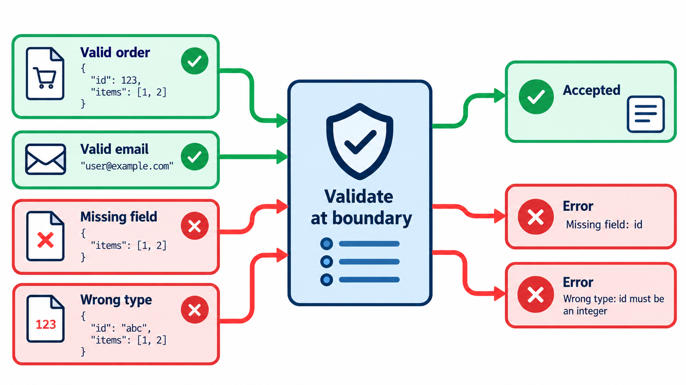
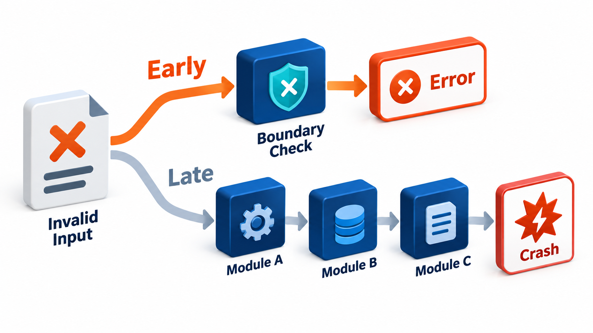
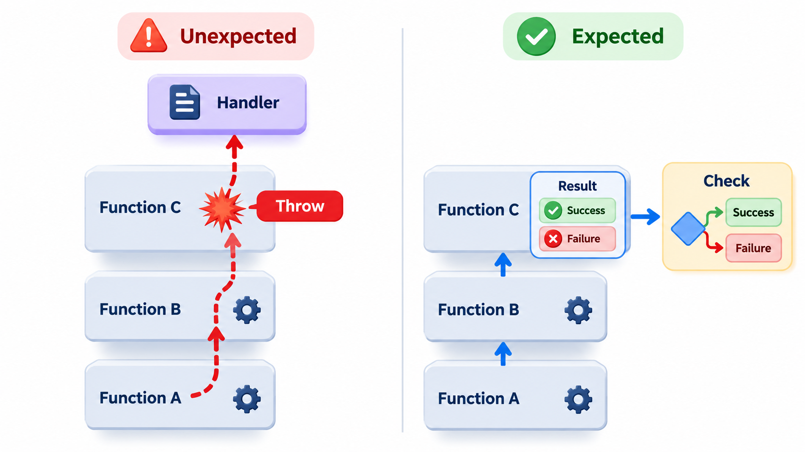
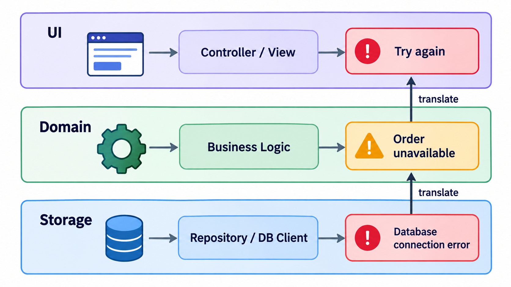
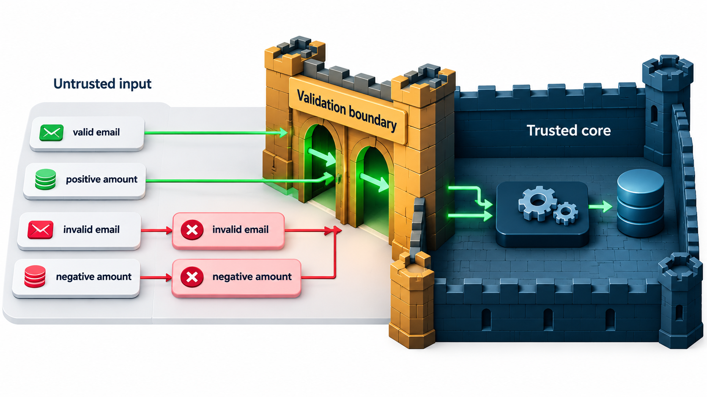

## Assume Something Will Go Wrong

A single unreliable input, taken as the truth, can destroy something that worked for months. A sensor gives a brief false signal while a mechanism settles, and software that remembers it and believes it makes the wrong decision at the worst moment. The software did what it was written to do. What it lacked was *suspicion*: a rule such as "ignore this signal while the mechanism is still settling", or a check of another fact before believing the sensor.

**Defensive programming** is the habit of writing code that does not trust its inputs, its callers or its surroundings more than it should. It assumes that mistakes happen, that data is sometimes wrong, and that what "cannot happen" occasionally does. This topic covers its main tools: checking inputs, failing fast, handling errors in a way that helps, and choosing between exceptions and returned results.

The word "defensive" comes from defensive driving: you do not assume other drivers will behave correctly, and you leave room for their mistakes. The cost is a little more attention. The gain is that other people's errors do not become yours.

## Check at the Boundary

Wherever data enters a program (a form, a file, a network message, a command-line argument), it should be checked before it is used. Data inside a trusted part of the program has already been checked. The skill is to know where the border is and to put the check there. A web form says "age" and a user types "abc", or "-5", or nothing. A file expected to have three columns has four. A value from another system arrives as `null`.

Checks have a few standard forms: the **type** (is this a number?), the **range** (is it between 0 and 100?), the **format** (does it look like an email address?), the **presence** (is it empty?) and the **consistency** (does the end date come after the start?). The validation belongs near the entry, so that the rest of the code can rely on clean data and not check it again.

| Check | Question | Example input | Verdict |
| --- | --- | --- | --- |
| Type | Is it a number? | "abc" | Reject |
| Range | Between 0 and 100? | 250 | Reject |
| Format | Looks like an email? | "asha@" | Reject |
| Presence | Is it provided? | (empty) | Reject, or use a documented default |
| Consistency | Does the end follow the start? | start 10 June, end 5 June | Reject |
| Length | Short enough to store? | 10,000 characters in a name field | Reject |

Validation means checking that data is acceptable. A related defence, **sanitising**, means making dangerous data safe, for example by escaping special characters before putting text into a web page or a database command. Both are needed. Validation says "this is a valid roll number", and sanitising ensures that whatever a user types cannot be interpreted as a command.

<!-- Visual: validation at the boundary where untrusted data enters a program. -->

## Fail Fast

When something is wrong, the best moment to say so is as early as possible, close to its cause. A function that receives an impossible argument should refuse it at once, with a clear message, and not carry on and produce a strange result three layers later. Compare "marks must be between 0 and 100, got 250" at the point of entry with a negative grade point average on a printed report. The first costs a minute to fix. The second costs an investigation.

The opposite habit, covering up errors, is the dangerous one. An empty `catch` block that swallows an exception, a function that returns a default value when something goes wrong, or a log message that nobody reads all hide the problem and let the system continue in a state that nobody understands. A visible failure is a gift: it points at the fault.

| Approach | What happens to bad input "250 marks" | Where the problem is found | Effort to diagnose |
| --- | --- | --- | --- |
| **Fail fast** | Refused at entry with a clear message | At the entry point | Minutes |
| **Silently clamp to 100** | Quietly changed | Perhaps never; the data is wrong forever | Hours or never |
| **Pass it on** | Used in calculations | In a wrong report, days later | Hours of tracing |
| **Swallow the error** | Nothing visible happens | Unknown | Very high |

<!-- Visual: A fail-fast function stopping at the first sign of bad input. -->

## Exceptions or Results?

Languages offer two main ways to report a failure.

**Exceptions** are raised when something goes wrong and travel up the call stack until some code handles them. They keep the normal path clean, and an unhandled one stops the program loudly. The risk is that they can be forgotten: a caller may not know that a function can fail.

**Result values** return a value that says whether the operation succeeded, either a pair of "ok and value" or a special type. They force the caller to look at the answer. The cost is more code at each call.

Both styles can handle the same job: reading a mark from text. In the exception style, bad input raises an error, which the caller must handle or the program stops loudly. In the result style, the function returns a pair, "worked" or "did not work" together with the value or the message, so the caller is forced to look at the outcome. Both check two things at the boundary: that the text is made of digits, and that the number is not above 100.

| Entry | Outcome |
| --- | --- |
| "78" | Accepted: 78 |
| "7x" | Rejected: marks must be a whole number, got '7x' |
| "250" | Rejected: marks cannot be more than 100, got 250 |

The messages say what was wrong and what was received. "got '7x'" is far more helpful than "invalid input". Each check fails fast, with its own message. Neither style is correct everywhere. Exceptions suit surprising failures that most callers cannot fix. Results suit expected failures, such as user input, where handling the bad case is part of normal flow.

| Situation | Better fit | Reason |
| --- | --- | --- |
| User types an invalid mark | Result | Expected; the caller handles it and asks again |
| Database connection lost | Exception | Unexpected; most callers cannot fix it |
| File not found when the file is optional | Result | A normal possibility |
| Programmer passes an impossible argument | Exception (or assertion) | A bug that should stop loudly |

<!-- Visual: exception handling arranged in layers, each handling what it can. -->

## Handling Errors in Layers

Not every layer should handle every error. Each should deal with what it understands and pass on the rest.

| Layer | Errors it can sensibly handle | What it does with others |
| --- | --- | --- |
| **Low level (file or network)** | A single retry for a momentary failure | Reports the failure upward with context |
| **Business logic** | Rule violations, such as insufficient balance | Converts technical errors into business terms |
| **Top level (the edge of the program)** | Anything left over | Logs full detail; shows the user a safe, plain message; keeps the program alive |

Two habits help. **Add context** as an error travels up ("could not save receipt for roll 1042: database timed out"). And **clean up** whatever was started, such as files opened or locks held, whether the operation succeeds or fails.

## Writing Errors People Can Use

An error message is read by someone under stress, often at night. A good one says what happened, where, with which value, and, if possible, what to do about it. "Payment failed" is poor. "Payment of 5,000 for roll number 1042 was declined by the bank (code 51: insufficient funds). The student can try another card." is useful. For users, the message should be in plain language without technical detail. For developers, the log should include the detail. Never put secrets such as passwords or full card numbers in a message.

## Assertions and Limits

An **assertion** states something that must be true at a point in the code: a statement that the total is not negative. If it is false, the program stops. Assertions are for catching the programmer's own mistakes, the "this cannot happen" cases, and not for checking user input, which can legitimately be wrong. Other defensive habits include setting timeouts on every external call, limiting the size of inputs, using the narrowest permissions needed, and treating every external system as something that will sometimes fail.

The balance is important. Defensive code can be overdone: a check at every line makes code noisy, and a check that can never fail is clutter. Put the strongest defences at the boundaries, and trust the interior that they protect.

<!-- Visual: a program drawn as a castle with a wall of validation at the boundary, trusted code inside, and arrows showing bad input stopped at the gate with a clear message. Save as images/79_boundary_castle.png. -->

## Five Misreadings of Defensive Programming

**"Defensive means catching every error."** Catching what you cannot handle just hides it. Catch errors where you can do something sensible.

**"A default value is a safe fallback."** A default can quietly produce wrong results. Sometimes stopping is safer.

**"Validation is the user interface's job."** The interface helps users. The server must validate anyway, since anyone can send a request without using the interface.

**"Assertions are for checking input."** They catch bugs in the program. Input errors are expected and need proper handling.

**"If it passed the tests, the inputs are fine."** Tests cover the cases you thought of. Defensive code covers the ones you did not.
