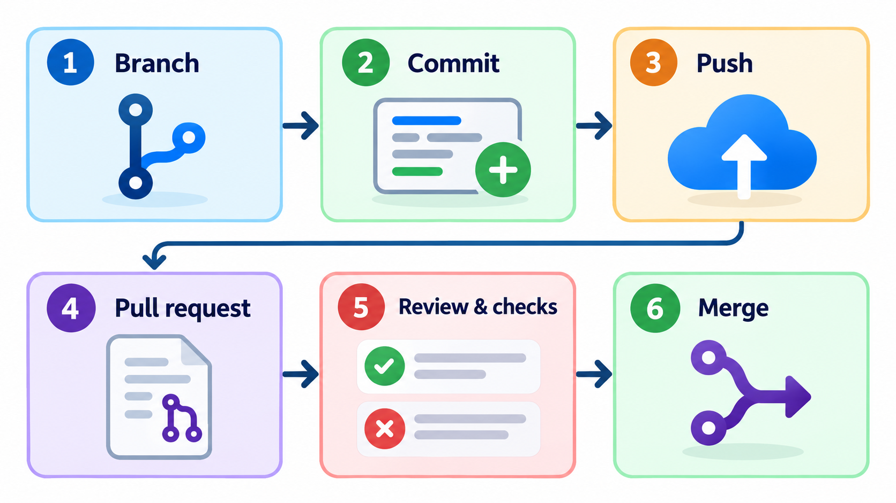
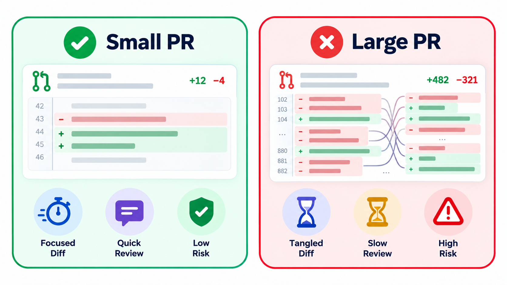
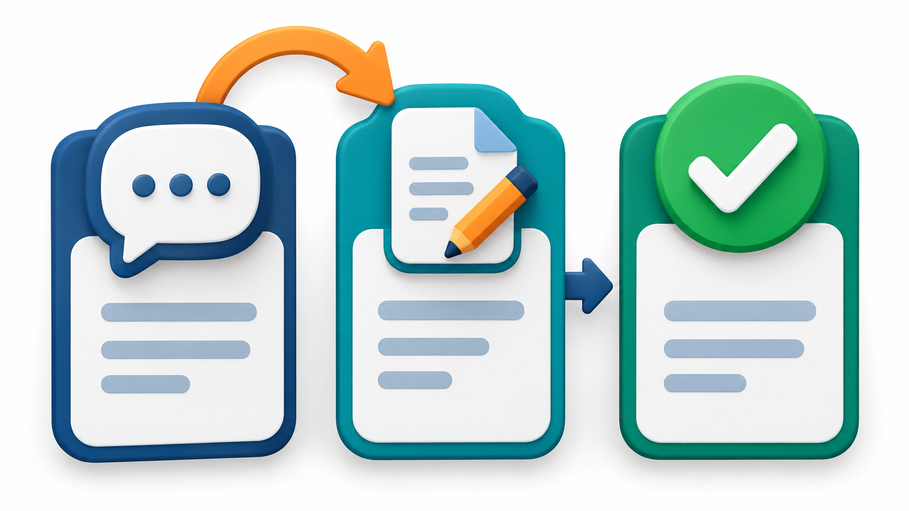
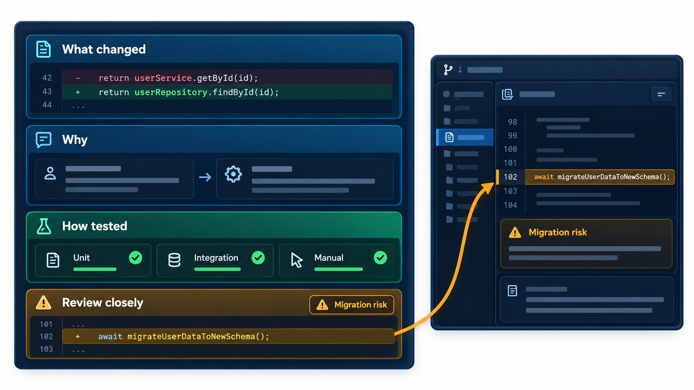
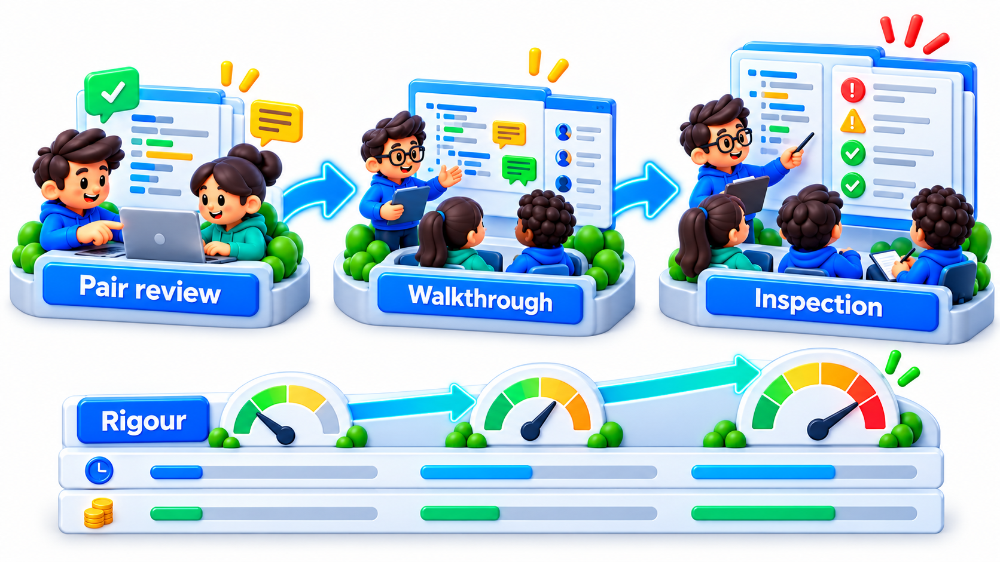

## Review Is a Conversation, Not a Net

The usual belief about code review is that its purpose is to find bugs. Studies of how it works in practice found something more interesting. Developers expect reviews to find defects, but the comments they receive are mostly about other things: improvements to the code, small fixes, questions about why something was written in a certain way, and suggestions for better approaches. Reviews are also a way for the team to know what the others are doing, to spread knowledge, and to share responsibility for the code.

Review is not a bug-finding net with large holes. It is a conversation between people about a change, and its value is wider: better code, shared understanding, shared standards, and a second pair of eyes on the risky parts. This topic describes how reviews are done, what to look for, how to give and receive feedback, and the rules that keep the process fast.

## The Purposes of Review

Because review does several jobs at once, a team that sees it only as bug-catching will run it badly. Four purposes are worth keeping in mind.

| Purpose | What it produces | Example |
| --- | --- | --- |
| **Quality** | Fewer defects and a better design | A reviewer spots a missing check for an empty list |
| **Knowledge sharing** | More than one person understands each part | A newcomer learns how fees are calculated by reviewing a change to it |
| **Consistency** | Shared conventions across the codebase | Everyone names things the same way |
| **Shared ownership** | The team, not one person, answers for the code | A second approver has accepted responsibility |

## How a Review Works Today

Most teams review changes through a **pull request** (PR), sometimes called a merge request. A developer finishes a change on a separate branch and opens a pull request that proposes merging it into the main line. The tool shows the exact lines that changed. One or more colleagues read it, leave comments on particular lines, ask questions or suggest edits, and finally approve it or request changes. The author replies, updates the code, and when the approvals are in, the change is merged. Automated checks run alongside: tests, linters and builds.

This flow has a rhythm. The author prepares, with a clear description of what and why. The reviewer reads, ideally within a day. The conversation continues until both are satisfied. The result is recorded: who looked, what was said, and what was decided.

<!-- Visual: A pull request workflow from branch to merge. -->

## What to Look For

A reviewer's attention is limited, so it helps to have an order. A common one starts at the top and moves down.

1. **Is the change right for the purpose?** Does it do what the issue asked? Is anything missing?
2. **Is the design sound?** Does it fit the structure of the system? Would a simpler approach do?
3. **Is the logic correct?** Edge cases, empty inputs, errors, boundaries, concurrency.
4. **Are there tests?** Do they cover the new behaviour, including the awkward cases?
5. **Is it readable?** Names, structure, comments that explain why.
6. **Is it safe?** Input handling, permissions, secrets, injection.
7. **Are the small things right?** Style, formatting, spelling, which tools should be checking anyway.

Many teams keep a short **checklist** so nothing is forgotten, such as "Does it handle the empty list? Are errors reported clearly? Is anything logged that should not be?". A checklist is most useful for the things that are easy to forget and costly to miss.

| Checklist item | The failure it prevents |
| --- | --- |
| Empty, one and many inputs handled | Crash on an empty list; off-by-one on a single item |
| Errors reported clearly | Silent failure, uninformative messages |
| No secrets in code or logs | Leaked passwords and keys |
| Changes to stored data are reversible | A migration that cannot be undone |
| Tests added for the new behaviour | Regression the next time the code is touched |
| Existing callers still work | A renamed or changed function breaking elsewhere |

## Reading a Change: A Worked Example

Suppose a pull request changes how late fines are calculated. A reviewer working through the list might produce comments like these.

| Area | Comment | Kind |
| --- | --- | --- |
| Purpose | The issue also asked for a cap on the fine. I do not see it. | Must fix |
| Design | The rate is hard-coded in two files. Could it live in one place? | Suggestion |
| Logic | What happens when the due date is in the future? The result looks negative. | Must fix: a bug |
| Tests | Tests cover three days late but not zero days or a leap day. | Must fix |
| Readability | `d` could be `days_late`. | Nit |
| Safety | No problem seen. | None |

Three comments need action, one is a suggestion and one is a nit. The labels matter: they tell the author which comments block the merge and which are optional.

## Small Changes, Fast Reviews

The most important factor in review quality is the size of the change. A change of fifty lines can be understood in ten minutes. A change of fifteen hundred lines cannot be reviewed at all. The reviewer skims, trusts the author and approves, and the review becomes a formality. Research and experience agree that attention falls sharply after a few hundred lines and after an hour of reading.

So teams aim for **small pull requests**: one idea, a few hundred lines at most, with a clear description. Large work is split into a sequence of small changes that each keeps the system working. The result is faster reviews, fewer mistakes, easier rollbacks and less pain from merge conflicts.

| Size of change | Typical review | Likely outcome |
| --- | --- | --- |
| Under 100 lines | 10 to 20 minutes, careful | Real feedback; fast merge |
| 100 to 400 lines | 30 to 60 minutes | Good if the description is clear |
| Over 800 lines | Skimmed | Approval without understanding |

<!-- Visual: A small pull request that can be understood and reviewed quickly. -->

## Rules the Team Agrees On

Teams enforce their review practice in the hosting tool.

- **Required reviews.** The main branch accepts no change without at least one (often two for risky areas) approving review.
- **Code owners.** A file lists who owns each part of the code, and a change to that part needs approval from its owner. The people who understand a module see every change to it.
- **Passing checks.** Tests and linters must pass before merging.
- **No self-approval.** An author cannot approve their own change.

A team can write its merge policy down and have it applied automatically: a change must be small enough to review well (not over 400 lines), must have at least one approval, and must be approved by the code owner. Applied to four changes:

| Change | Lines | Approvals | Owner approved | Decision |
| --- | --- | --- | --- | --- |
| Fix rounding in fee | 12 | 1 | Yes | Merge |
| Rewrite reports module | 1,450 | 2 | Yes | Blocked: too big to review well, split it |
| Add SMS reminder | 180 | 2 | No | Blocked: code owner has not approved |
| Update README | 6 | 1 | Yes | Merge |

"Rewrite reports module" has two approvals but is 1,450 lines, so the policy blocks it with a reason that tells the author what to do. "Add SMS reminder" has two approvals but the owner has not looked, so it waits. Automating the policy means the rules are applied the same way to everyone, and no reviewer has to be the one to say "this is too big".

## Giving and Receiving Feedback

Review is a human exercise, and tone matters. A few habits make it constructive.

For reviewers: comment on the code, not the person ("this function does two things" and not "you wrote a messy function"). Ask questions when unsure ("what happens if the list is empty?"). Explain the reason for a suggestion. Separate what must change from what is a preference, using a label such as "nit:" for the small stuff. Praise good work too, since it teaches as well as criticism does.

| Instead of | Try |
| --- | --- |
| "This is wrong." | "I think this fails when the list is empty. Could you check?" |
| "Why did you do it this way?" | "I am trying to understand the choice here. What does this approach give us over a loop?" |
| "Rename this." | "nit: `days_late` would be clearer than `d`." |
| (nothing) | "Nice use of an early return here; it reads much better." |

<!-- Visual: A review conversation with questions, suggestions and replies. -->

For authors: remember that the review is of the code and not of you. Keep the change small and the description clear. Read comments as help. If you disagree, say why, calmly. If a discussion goes on for more than a few messages, talk face to face or on a call and write down what you decide.

<!-- Visual: a pull request description template showing the sections: what changed, why, how it was tested, and anything the reviewer should look at closely. Save as images/80_pull_request_template.png. -->

## Review Speed and Its Costs

A change waiting for review is work that is finished but not delivered. Slow reviews cost more than they appear.

| Waiting time | Cost |
| --- | --- |
| A few hours | Negligible |
| One day | The author moves on to something else; switching back costs time |
| Three days | Merge conflicts appear as others change the same files |
| A week | Context is lost; the author has half forgotten the change |

Many teams set an expectation, such as a first response within one working day, and make reviewing a normal part of the day and not something done when other work runs out.

## The Range of Review Styles

Pull-request review is one of several. **Pair programming** is review in real time. A **walkthrough** has the author guide others through the code. A formal **inspection** uses defined roles, a checklist and recorded defects, as in safety-critical work. Teams choose by the risk. A typo fix needs a glance and a payment system's core needs more.

<!-- Visual: the spectrum of review from informal comments to formal inspection. -->

