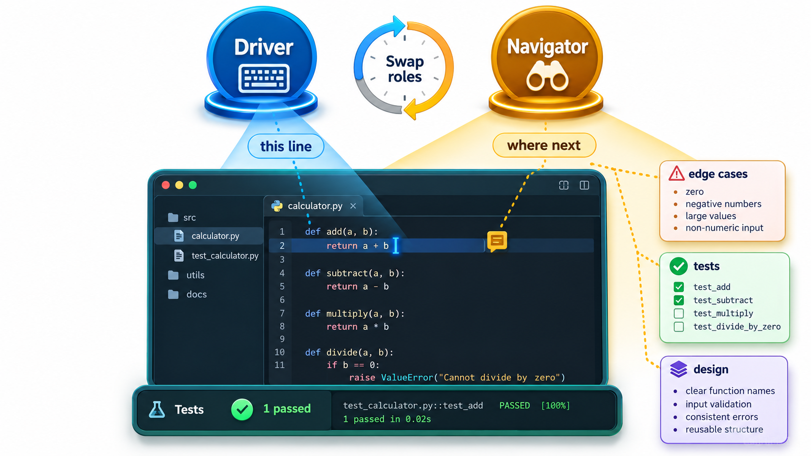
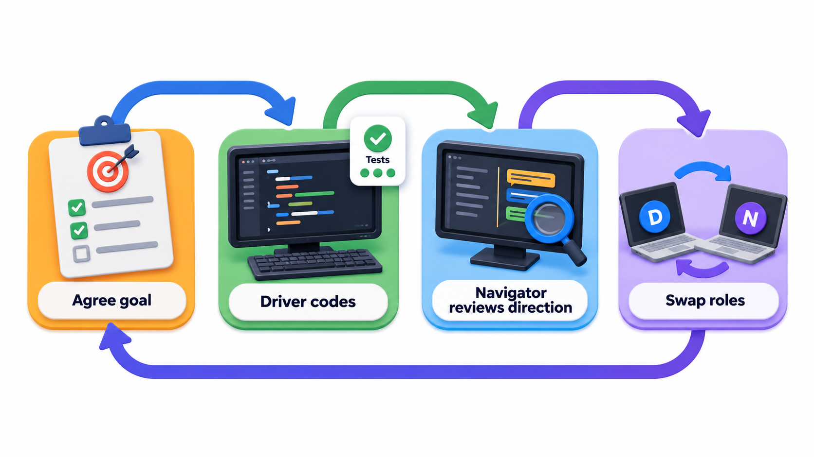
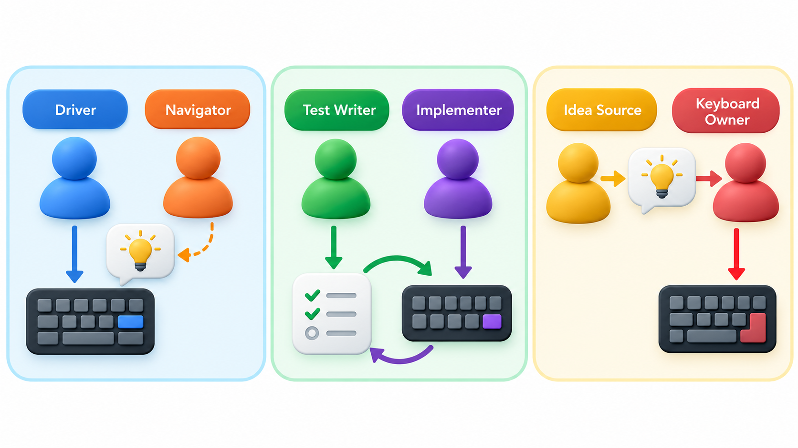
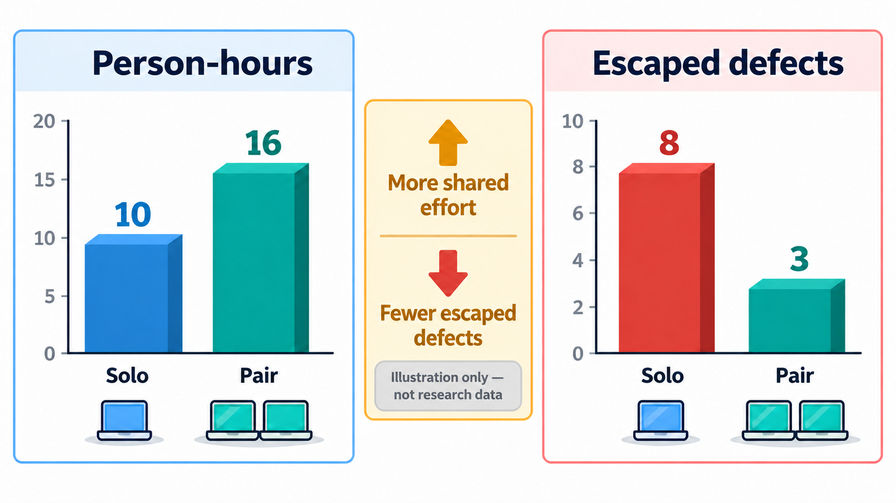
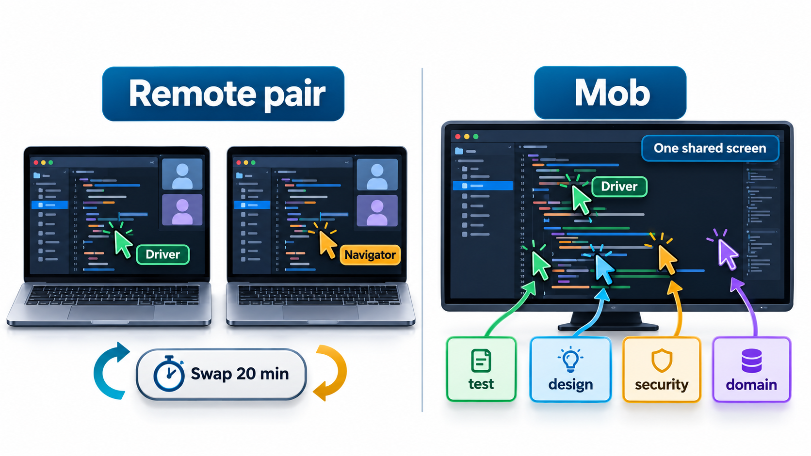

## Two People, One Task: Is It Twice the Cost?

It looks wasteful: two people working at one computer on one task, where each could be working on something different. Studies of pairing have found something less obvious. The pair uses more person-hours in total than one person would, but the work tends to have fewer defects, finishes in less elapsed time on hard problems, and teaches both people something. Later studies found mixed results, depending on the task, the experience of the pair and the way it was measured, but the shape of the finding has held up.

**Pair programming** is the practice of two people working on one task together, one typing (the driver) and one watching, thinking ahead and catching mistakes (the navigator). This topic describes how it works, the arithmetic of the trade, and the situations in which it pays.

## How It Works

In **pair programming**, two developers work together at a single computer (or a shared screen) on one task. They take two roles.

- The **driver** has the keyboard. They write the code and think about the detail of the line in front of them.
- The **navigator** watches, reads the code as it appears, and thinks about the bigger picture: where the code is going, what edge case is coming, whether this is the right approach. They catch typos and wrong turns, look things up and keep the goal in view.

The roles are swapped often, every ten or thirty minutes or at natural breaks, so that both stay engaged. A popular variation combines pairing with test-driven development and is called **ping-pong**: one writes a failing test, the other writes the code to make it pass and then writes the next failing test, and so on, passing the keyboard back and forth.

The conversation is the essence. A pair constantly explains, questions and decides aloud. Ideas that would sit unexamined in one person's head get argued about, and the better one wins.

<!-- Visual: two people at one workstation, one labelled driver with hands on the keyboard and a note "thinks about this line", the other labelled navigator with a note "thinks about the direction, the edge cases and what is coming". Save as images/81_driver_and_navigator.png. -->

## A Session, Step by Step

A pairing session has a recognisable shape. Take a pair adding a late-fine rule.

| Time | Driver | Navigator | What happens |
| --- | --- | --- | --- |
| 0 to 5 min | Opens the files | States the goal: "fine of Rs 5 a day, capped at Rs 200" | Agreed target and a first list of cases |
| 5 to 15 min | Writes a failing test for 3 days late | Suggests also testing 0 days and 60 days | The test list grows before any code is written |
| 15 to 25 min | Writes the rule | Notices the cap is missing and raises it | Caught at once, not in review |
| 25 min | Swap | Swap | Fresh eyes on the code just written |
| 25 to 40 min | Navigator now drives; adds the remaining tests | Former driver reads, asks "why 200?" | A question that uncovers an assumption to check with the client |
| 40 to 45 min | Both | Both | Tidy names, run all tests, commit with a shared message |

Notice what the navigator contributed: the extra test cases, the missed cap and the challenge to an assumption. Each would otherwise have been found later and at greater cost.

## Styles of Pairing

| Style | How it works | Best for |
| --- | --- | --- |
| **Driver and navigator** | One types, one thinks ahead; swap regularly | General work |
| **Ping-pong** | One writes a failing test, the other makes it pass, then they swap | Test-driven work |
| **Strong-style** | The driver may only type what the navigator says | Teaching a newcomer: the idea passes through the navigator's words |
| **Unstructured** | Two people sit together and talk as needed | Light collaboration |

## The Arithmetic of the Trade

Pairing uses two people on one task, so it looks twice as expensive. The case for it is that fewer mistakes are made and found later, and that the work finishes sooner. Put rough numbers on it with an illustrative model: a task would introduce 20 defects; a person working alone catches 40 per cent of them, and a navigator brings that to 60 per cent. A solo task of 10 hours takes the pair about 65 per cent of the elapsed time, but with two people.

| | Solo | Pair |
| --- | --- | --- |
| Person-hours | 10 | 10 x 2 x 0.65 = 13 |
| Defects caught while writing | 8 of 20 | 12 of 20 |
| Defects that escape | 12 | 8 |

For 3 extra person-hours, the pair stops 4 more defects before they reach testing. If a defect costs even an hour or two to find and fix later, the extra effort is repaid, and fixing a defect after release costs far more. The catch rates are assumptions chosen to show the method, not measured facts. Change the assumptions and the answer changes: for simple, well-understood work, the navigator catches few extra defects and the cost is not repaid. That is why the next section matters.

| If a late defect costs... | Extra cost of pairing | Saved by 4 fewer defects | Net |
| --- | --- | --- | --- |
| 1 hour | 3 hours | 4 hours | +1 hour |
| 2 hours | 3 hours | 8 hours | +5 hours |
| 0.5 hours (trivial bugs) | 3 hours | 2 hours | -1 hour |
| 10 hours (found in production) | 3 hours | 40 hours | +37 hours |

The result depends on what defects cost, which is why pairing is attractive for risky code and unattractive for trivial code.

## When Pairing Pays

Pairing is a tool for particular situations, not a rule for all work.

- **Hard or unfamiliar problems.** Two minds find the way faster, and mistakes are costly.
- **High-risk code.** Payment logic, security checks and data migration, where a defect is expensive.
- **Onboarding.** Pairing a newcomer with an experienced colleague transfers knowledge, conventions and context much faster than documents.
- **Spreading knowledge.** A part of the system that only one person understands is a risk. Pairing on it creates a second expert.
- **Getting unstuck.** Explaining a problem to a partner often reveals the answer.

It pays less for routine, well-understood changes, where one person can proceed without risk, and for tasks that need quiet, deep thought alone. Many teams pair for a part of the day and work alone for the rest.

| Task | Pair? | Reason |
| --- | --- | --- |
| Design of a new payment flow | Yes | High risk; ideas benefit from debate |
| Renaming a variable across files | No | Mechanical |
| Onboarding a new graduate | Yes | Fast knowledge transfer |
| Writing documentation | Sometimes | Often better alone, then reviewed |
| Debugging an intermittent failure | Yes | A second view helps; explanation exposes assumptions |
| Routine copy changes | No | Low risk |

## Making It Work

Pairing is a skill. A few habits help. Agree on the goal of the session before starting. Swap roles on a timer. The navigator speaks in terms of intent ("we need to handle the empty list") and avoids dictating each keystroke. The driver explains as they type. Take breaks, since the work is more tiring than it looks. Change partners regularly, so that knowledge spreads and no pair becomes a closed club. And respect differences of pace and experience: an expert who takes the keyboard from a novice teaches nothing.

Problems arise when one partner dominates, when a senior person does all the driving, when partners are mismatched in a way that frustrates both, or when pairing is imposed on people who find it draining. A team is better served by trying it, discussing what worked and adjusting, than by mandating it.

| Problem | Sign | Remedy |
| --- | --- | --- |
| One partner dominates | The other says little, only watches | Swap roles on a timer; ask the quieter person to drive |
| Navigator disengages | Checking a phone | Shorter sessions; the navigator takes notes of cases to test |
| Large skill gap | Expert types, novice nods | Strong-style: the novice drives, the expert instructs |
| Fatigue | Tired after two hours | Limit sessions; take breaks; do solo work in between |
| Disagreement | Arguing over approach | Try both briefly, or make a time-boxed spike and compare |

## Remote Pairing and Mobbing

Pairing works across distance with a shared screen or a shared editor and a voice or video call. Tools that let both people edit the same file at once make it close to being in the same room. Remote pairing needs a bit more discipline: a clear way of handing over control, regular breaks, and attention to the time zone when partners are far apart.

<!-- Visual: a bar chart of person-hours and defects escaped for solo and paired work, with a note that the numbers are an illustration and not data. Save as images/81_solo_vs_pair_chart.png. -->

A larger form is **mob programming**, in which the whole team works on one task at one computer, with one driver and everyone else navigating. It is a surprisingly effective way to share knowledge and get a hard problem solved, and costly when the work is easy. Teams that use it often do so for a day a week or for specific problems.

<!-- Visual: a remote pair with a shared editor on screen, a video window, and a visible timer for swapping driver and navigator, beside a mob of five people around one screen. Save as images/81_remote_and_mob.png. -->

## Pairing and Code Review

Pairing is review happening as the code is written. A change produced by a pair has already had a second reader, so many teams treat it as reviewed and merge it with a lighter formal review. This does not remove the value of a third pair of eyes on risky changes, but for routine work it saves a waiting step.

| Aspect | Pull-request review | Pair programming |
| --- | --- | --- |
| When the second view arrives | After the code is written | While it is written |
| Cost of a found problem | Rework of finished code | Corrected as typed |
| Time cost | Reviewer time, plus waiting | Both people throughout |
| Knowledge sharing | Reviewer learns the result | Both learn the reasoning |
| Best for | Most routine changes | Hard or risky work |

## Five Misreadings of Pair Programming

**"Pairing halves the output."** It does cost more hours. But the code has fewer defects, needs less rework and the knowledge is shared, so the net effect is often small or positive.

**"It is only for beginners."** Experts gain from it as well, on hard problems. But beginners gain the most from pairing with someone who knows more.

**"The navigator just watches."** The navigator is thinking ahead, checking the design and spotting errors. A navigator who switches off makes the pair a single person with an audience.

**"Pairing means all the time."** Most teams pair on selected tasks and work alone on the rest.

**"If it does not work for us, pairing is bad."** It depends on the pair, the task and the habits. Try a different partner, task or format before deciding.
