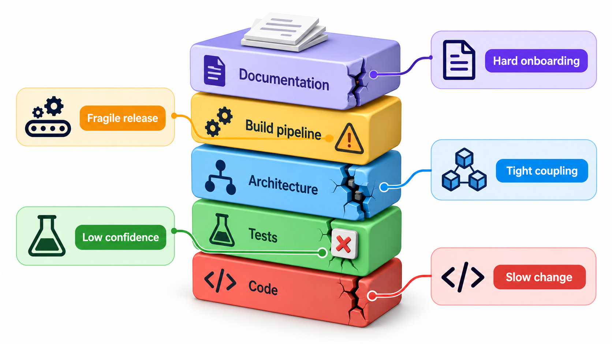
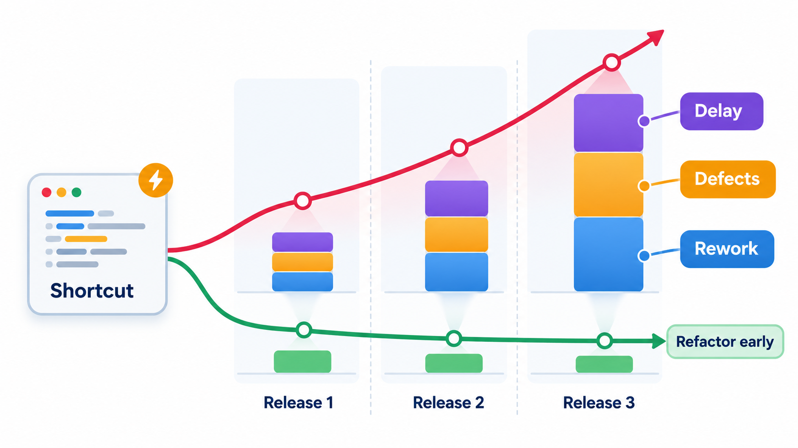
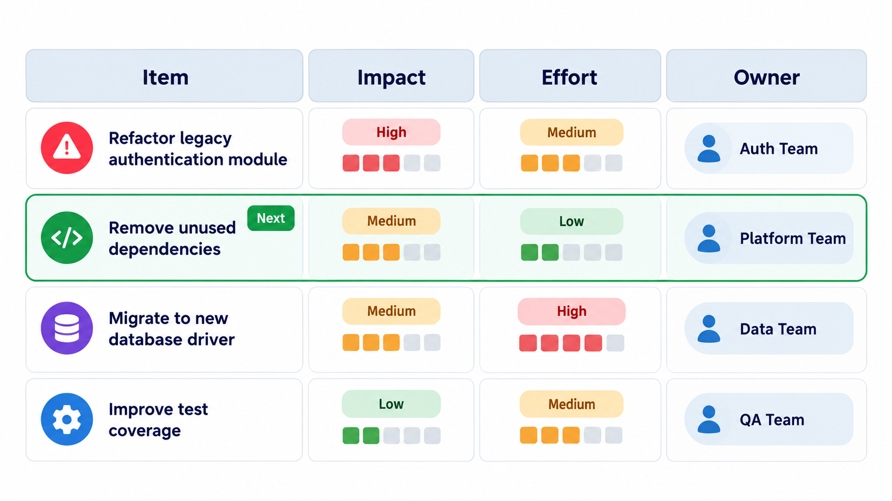
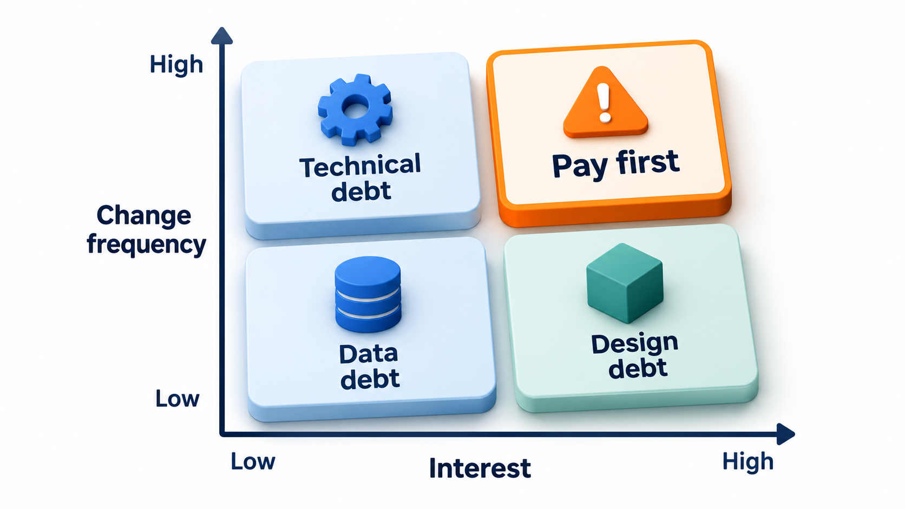
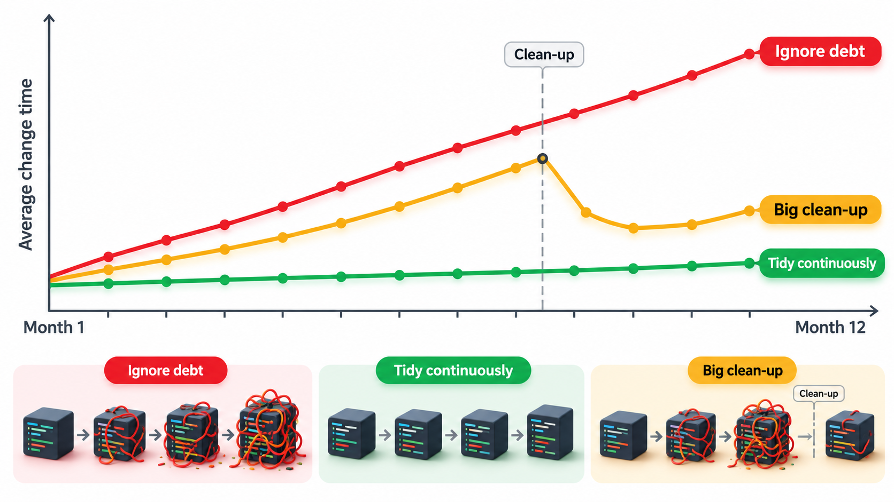

## Shortcuts Charge Interest

A shortcut taken today, such as skipping a clean design, copying a block or leaving a confusing name, saves time now and costs a little on every later change. Like a loan, it carries interest, and like a loan it can stay invisible for years. For a long time nothing goes wrong. Then a stress arrives, a surge in demand, an urgent change or a systems failure, and the accumulated shortcuts and delayed upgrades set the size of the damage.

In software, that accumulated cost is called **technical debt**. It is a useful metaphor because it makes the invisible visible: debt can be taken on deliberately, measured, repaid early or late, and discussed with people who do not read code. This topic covers what the debt really costs, how teams decide what to repay first, and how to negotiate the time to do it.

## Debt in the Code

The metaphor, introduced by Ward Cunningham, treats a shortcut as a loan. It lets you deliver sooner, and you then pay *interest* in the form of extra effort on every later change, until you repay the *principal* by fixing the underlying problem. The metaphor suits software because the interest is real: a tangled module slows down everyone who touches it, produces bugs and frightens newcomers.

At the level of code, debt shows up as familiar smells: duplicated logic, giant functions, unclear names, missing tests, outdated libraries and workarounds that nobody dares remove. The important feature is that it is not a single event. It is a rate. A team in debt moves more slowly each month, and the cost grows with every change that is built on top of the mess.

## Where Debt Hides

Debt is not only in the code. It collects in several places, and each has its own interest.

| Kind | Example | The interest paid |
| --- | --- | --- |
| **Code debt** | Duplicated and tangled logic | Slow, risky changes |
| **Design debt** | Boundaries in the wrong places | Every feature crosses several modules |
| **Test debt** | Missing or flaky tests | Fear of change; bugs reach users |
| **Documentation debt** | Missing or false explanations | Slow onboarding; wrong assumptions |
| **Dependency debt** | Old libraries not upgraded | Security risk; upgrades become harder every month |
| **Infrastructure debt** | Manual deployments, fragile servers | Releases are slow and scary |
| **Knowledge debt** | One person understands a module | A resignation becomes a crisis |

## Deliberate and Accidental

Not all debt comes from the same place. Two questions sort it.

| | Deliberate | Accidental |
| --- | --- | --- |
| **What it is** | A conscious shortcut: "we know this is not ideal, but we must ship by Friday" | A result of not knowing better: poor design chosen in good faith, or ignorance of a better approach |
| **Is it a problem?** | Not by itself: it is a business decision, if recorded and planned for | Yes, because nobody knows it is there |
| **How to handle** | Record it, with an owner and a date to revisit | Find it by review, metrics and by listening to people who dread certain files |

A third kind, **bit rot**, comes simply from time. A system that was once well designed slips into debt as the world changes around it: libraries become obsolete, new requirements fit the old structure badly and the team forgets how it all works. No one did anything wrong, and the debt is there anyway.

Deliberate debt can be healthy. A start-up that ships a rough first version to learn whether customers want it is borrowing wisely. The danger is borrowing and not recording it, or borrowing again and again without ever repaying.

<!-- Visual: technical debt adding weight to every later feature. -->

## Interest: What the Debt Really Costs

It helps to see the interest as a number. Compare three ways of handling the same shortcut over twelve changes. Each change takes 4 hours of real work, plus the extra hours that the debt adds, which begin at 1 hour per change. Left alone, the mess spreads and the extra grows by 0.3 hours with each change. If the team tidies as it goes, each change repays a little and cuts the extra by 0.2 hours. If it stops and repays all at once, it pays 10 hours at the third change and the interest drops to zero.

| Approach | What happens to the extra cost | Total hours over 12 changes |
| --- | --- | --- |
| Ignore it | Grows from 1 to 4.3 hours per change | 79.8 |
| Tidy as you go | Falls to zero after five changes | 51.0 |
| One big repayment | Zero after the third change, at a cost of 10 hours | 61.0 |

The real work alone is 48 hours. Ignoring the debt costs 31.8 hours more than that. Tidying as you go stays close to the real work. The big repayment beats ignoring the debt but loses to tidying, because it paid late and in one lump. The numbers are invented, and real debt does not behave so neatly. The pattern is realistic: leaving it costs the most, and small regular repayment usually costs the least.

## Measuring Debt

Debt cannot be read from a single gauge, but several signals together make it visible.

| Signal | What it shows | How to collect |
| --- | --- | --- |
| **Time to make a typical change** | Whether interest is rising | Track cycle time per ticket over months |
| **Defect rate by module** | Where debt causes bugs | Count bugs per module |
| **Code churn plus complexity** | Busy and tangled files, the costliest debt | Version history combined with complexity measures |
| **Test coverage and flakiness** | How safe change is | Coverage reports; failure rates of tests |
| **Age of dependencies** | Upgrade debt | Dependency-checking tools |
| **Developer survey** | Where people feel pain | Ask "which part of the code do you dread?" |

The last is often the most informative. People who work in the code every day know exactly where it hurts, and asking them costs nothing.

## Repayment Strategies

The comparison above points to the usual options.

**The boy scout rule.** Leave the code a little better than you found it. When you change a file, tidy the nearby mess: a clearer name, a smaller function, a missing test. No separate project is needed and the debt falls steadily where the team is working, which is where the interest is highest.

**Refactor before you add.** When a new feature will have to go through a messy area, spend the first part of the work making the area ready, then build the feature.

**Scheduled repayment.** Reserve a share of each iteration, say fifteen or twenty per cent, for paying down known debt from the register. This keeps repayment visible and protects it from being squeezed out by deadlines.

**Targeted projects.** For debts too big for the other methods, such as replacing an obsolete library, plan a project with its own scope and justification. Sell it by its benefit, such as fewer outages or faster delivery.

**Prevention.** Reduce the rate at which new debt is created by tests, code review, standards and design discussion. It is cheaper than repaying.

<!-- Visual: A debt register listing items, their cost and their priority. -->

## Which Debt to Repay First

Money is limited, so choose. The best guide is the interest rate: repay first the debt that costs most per week. That means the code that changes often and causes bugs. A hideous module that no one has touched in three years can wait. A moderately untidy module that is changed every week should be improved first. Combine the frequency of change with the pain it causes to rank the list.

| Item | Changes per quarter | Extra hours per change | Quarterly interest | Cost to repay | Priority |
| --- | --- | --- | --- | --- | --- |
| Tangled fee module | 24 | 3 | 72 hours | 40 hours | 1: pays back in under a quarter |
| Old report generator | 2 | 8 | 16 hours | 80 hours | 3: costly to fix, little interest |
| Missing tests in login | 6 | 2 | 12 hours, plus risk of outage | 20 hours | 2 |
| Ugly legacy importer | 0 | 10 | 0 hours | 60 hours | 4: leave alone |

The fee module is the best investment: repaying 40 hours saves 72 a quarter. The importer, though the ugliest, costs nothing because nobody touches it.

<!-- Visual: technical debt prioritised by its interest and how often the code changes. -->

## Talking About It

Debt is easier to discuss when it is visible. A written register, a label on tickets and a periodic review all help. When asking for time, tie the request to a business effect: slower releases, more incidents, longer onboarding. "This payment module is touched twelve times a quarter, each change costs an extra day and it caused three of our last five incidents" is an argument. "The code is ugly" is not.

<!-- Visual: a line chart of how long an average change takes over twelve months for three teams: one ignoring debt (rising), one tidying as it goes (flat), one that ignores it and then does a big clean-up (rising then dropping). Save as images/82_change_time_over_year.png. -->

