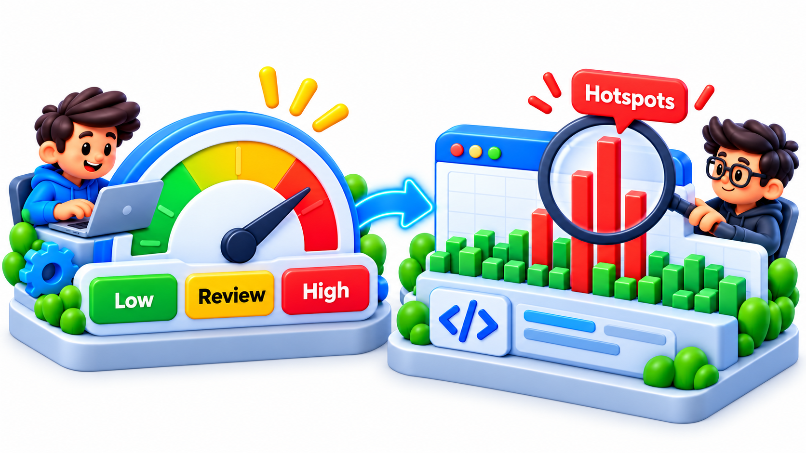
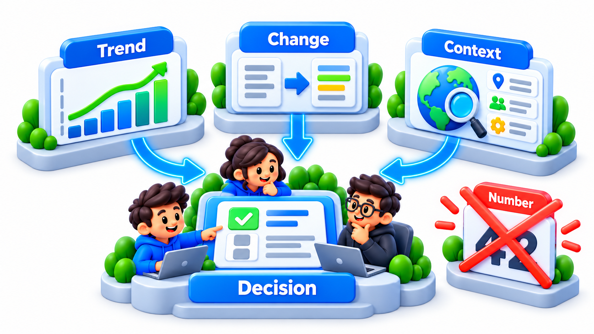
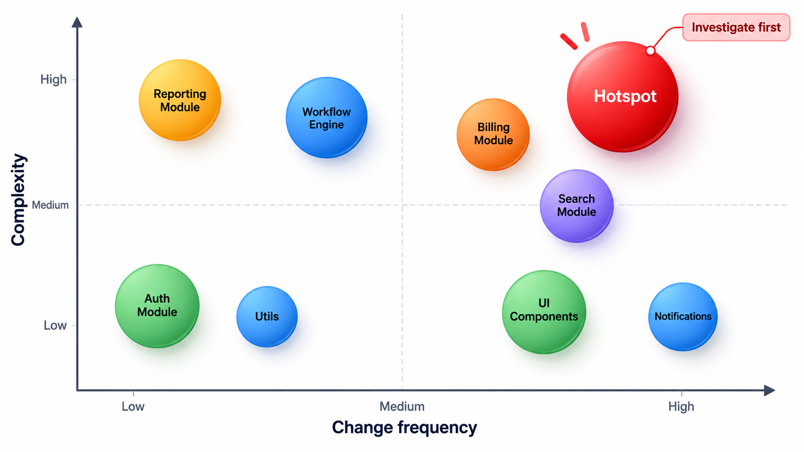
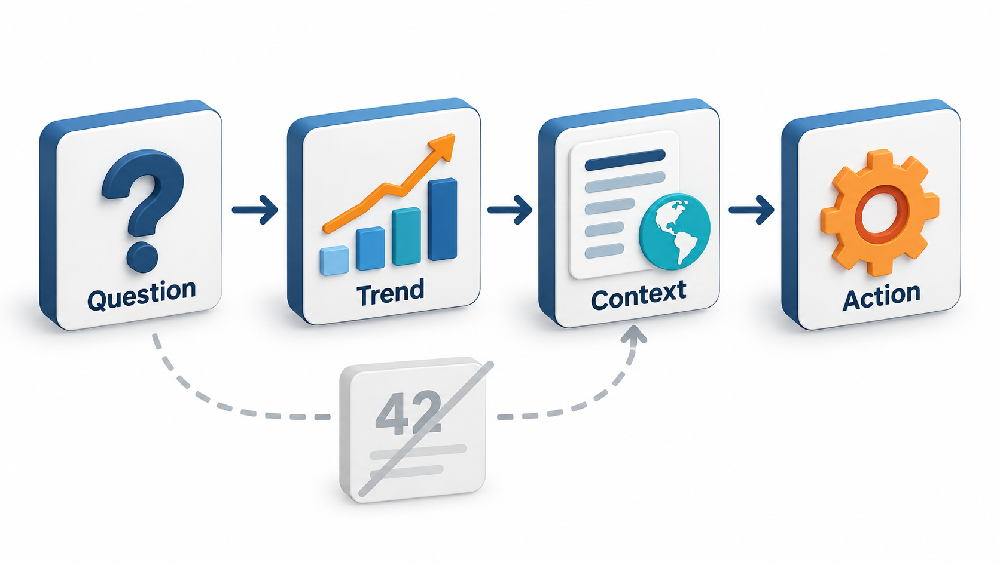
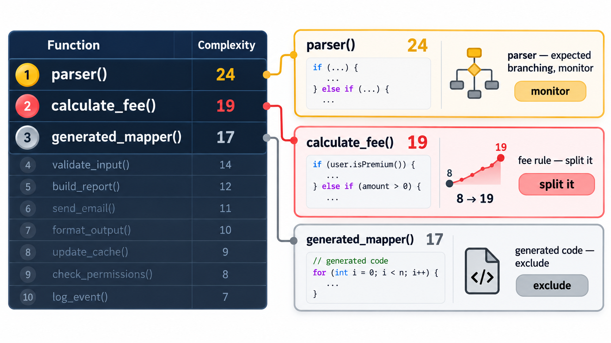

## Putting a Number on Code That Feels Hard

Every programmer feels that some code is hard to read, change and trust, and that other code is not. Metrics try to turn that feeling into a number. The best known is **cyclomatic complexity**, the count of independent paths through a function. A program is a set of paths from start to finish, and every decision, an if, a loop or a case, adds a path. The more paths there are, the more tests are needed to cover them, and the harder the function is to understand and to get right. A long-standing rule of thumb says a function above 10 is too complex and should be split up.

It is one of a small family of measures. This topic covers the main ones, what they are good for and, importantly, how they mislead.

## Why Measure Code at All

Opinions about code quality can be argued all day. A measure gives the discussion something to point at. It can highlight the handful of functions out of ten thousand that deserve a closer look. It can show a trend: is the code getting more or less complex over the months? And it can serve as an automatic check in a build, so that a very complex function is noticed at the moment it is written and not three years later.

A metric is a signal, not a verdict. It points at places to look, and a person still has to look.

Metrics also give an honest answer to a question that is hard to settle by feel: is the new code any better than the old? A team that wants to know whether a clean-up helped can compare the numbers before and after, as long as it remembers which numbers are meaningful.

## Cyclomatic Complexity

Cyclomatic complexity starts at 1 for a function with no decisions. Each `if`, `elif`, `for`, `while`, `case`, and each `and` or `or` in a condition, adds one. A function with a complexity of 5 needs at least five tests to cover each path. Compare two functions using a teaching threshold of 5, which is stricter than the usual 10.

| Function | Decisions found | Complexity | Advice |
| --- | --- | --- | --- |
| Grade a student: tests marks and attendance, then marks or fees paid, then loops over bonuses with a further test | if, and, elif, or, for, if (6 decisions) | 6 + 1 = 7 | Split it up |
| Add two numbers | None | 1 | Fine |

A complexity of 7 means at least seven test cases are needed to cover every path, which is a practical way to see why high numbers matter. Real tools count the same decisions by reading the code properly, so they are not fooled by the word "if" inside a comment or a string.

The meaning of the score is usually read from a banded table.

| Complexity | Reading | Typical response |
| --- | --- | --- |
| 1 to 5 | Simple | Leave alone |
| 6 to 10 | Moderate | Acceptable; watch it |
| 11 to 20 | Complex | Consider splitting; needs many tests |
| Over 20 | Very complex | Likely hard to test and understand; refactor |

The effect on testing is easy to see. A function with n independent decisions has at least n + 1 paths to test. A complexity of 20 means at least twenty test cases to cover each path once, and the number of combinations of paths is far larger.

<!-- Visual: A complexity gauge showing a function moving from simple to risky as its paths multiply. -->

## Cognitive Complexity

Cyclomatic complexity treats all decisions as equal, but a human does not. Five `if` statements in a row are easy to follow. Five nested inside one another are hard. **Cognitive complexity**, proposed by the code analysis company SonarSource, tries to measure how hard a function is to *understand*. It adds a cost for each break in the linear flow, and an extra cost for each level of nesting. A flat `switch` counts lightly. A loop inside a condition inside a loop counts heavily. It agrees with a reader's feel for tangled code more closely than cyclomatic complexity does.

| Structure | Cyclomatic complexity | Cognitive complexity |
| --- | --- | --- |
| Five `if` statements one after another | 6 | About 5 (each counts once) |
| Five `if` statements nested five deep | 6 | About 15 (each nested level adds a penalty) |

The same count of decisions, but very different to read. The second figure explains why deeply nested code feels hard.

## Duplication, Size and Maintainability

Other common measures are easy to understand.

- **Duplication.** The share of code that appears more than once. A tool compares blocks of lines and reports the percentage, and where the copies are. High duplication predicts that a fix will miss a copy.
- **Size.** Lines per function, functions per class, parameters per function. Large units are harder to grasp and to test, and they correlate with defects, although a large function is not proof of a bad one.
- **Coupling.** How many other modules a module depends on.
- **Test coverage.** The share of code executed by tests. It shows what is *untested*, and not what is well tested.
- **Maintainability index.** A single number that combines complexity, size and other factors into a score, often from 0 to 100. Tools show it as a colour. It is easy to read and easy to over-trust, since it hides what went into it.

Static analysis platforms such as SonarQube gather these into a dashboard and add a count of **issues**: bugs, vulnerabilities and smells that rules have found. Trends and the number of new issues in recently changed code are more useful than the absolute totals.

<!-- Visual: A metric used with its context rather than as a bare number. -->

## What Each Metric Is Good For

| Metric | Best question it answers | Weakness |
| --- | --- | --- |
| Cyclomatic complexity | How many tests does this function need? | Treats all decisions alike |
| Cognitive complexity | How hard is this to understand? | Tool-specific; a judgement built into a formula |
| Duplication | Where will one fix need repeating? | Cannot tell harmless from harmful copies |
| Size | Where are the big units? | Big is not always bad |
| Coupling | Which modules are entangled? | Needs context about intended structure |
| Coverage | What is never exercised? | Says nothing about test quality |
| Churn (how often a file changes) | Which files are busy? | Busy may be healthy |
| Defect density | Where do bugs cluster? | Depends on how bugs are recorded |

## Combining Measures: Churn and Complexity

Individually, the numbers are weak guides. Together they point to the places that matter most. A very complex file that nobody ever changes is a sleeping risk. A simple file that changes daily is no problem. A file that is both complex and busy is where most defects and delays live.

| File | Complexity | Changes in 6 months | Reading |
| --- | --- | --- | --- |
| `fee_rules.py` | 38 | 52 | Hotspot: complex and busy; refactor first |
| `legacy_import.py` | 45 | 1 | Complex but stable; leave unless it must change |
| `receipt.py` | 6 | 40 | Busy but simple; fine |
| `utils.py` | 9 | 3 | Calm |

Teams that find their hotspots this way concentrate effort where it pays, instead of tidying the files that look worst.

## Metrics Can Lie

Every metric can be gamed and misread, and a few cautions matter more than the formulas.

**A measure used as a target gets gamed.** If developers are rewarded for low complexity, they will split functions in ways that add no clarity. The number improves and the code does not. Metrics are for finding where to look, and not for judging people.

**Context matters.** A parser with complexity 25 may be fine, since a parser is inherently a mass of cases, whereas the same number in a fee calculation is a warning. A number means little without the knowledge of what the code does.

**Coverage is not quality.** A test can execute a line without checking anything about it. A hundred per cent coverage with weak assertions finds few bugs.

**A single score hides its parts.** A maintainability index of 72 might come from one nightmare function and a lot of easy ones. Look at the distribution and the worst items.

**Trends beat snapshots.** The change in a metric over time, and the metric on new code, say more than a single reading. A team that holds new code to a standard stops the problem from growing, even if the old code stays as it is.

<!-- Visual: deciding what to do with a metric reading depends on context and change over time. -->

## Using Metrics Well

A practical approach is to choose a few measures that match real concerns, to set limits as warnings in the build for new code, to look at the top ten worst functions every few weeks, and to ask of each flagged item whether it is a real problem. The metrics direct attention. The judgement is human.

| Practice | Why it works |
| --- | --- |
| Measure new code, not just old | Stops the problem growing without a huge clean-up |
| Report trends | A rising line is a conversation starter |
| Rank, do not grade | "Top ten worst" focuses effort; a grade invites gaming |
| Pair numbers with a human check | Each flagged item gets a yes or no from a person |
| Choose few measures | Ten dashboards are ignored; three are read |

<!-- Visual: a table of ten functions ranked by complexity, with the top three circled and a note beside each saying "a parser, fine", "a fee rule, split it" and "generated code, ignore". Save as images/83_ranked_functions_with_context.png. -->

