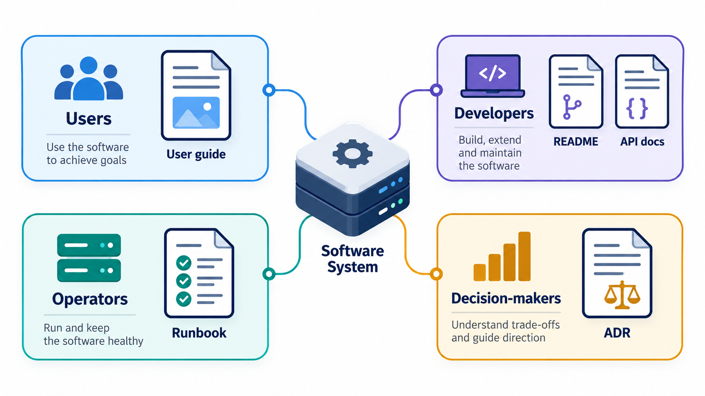
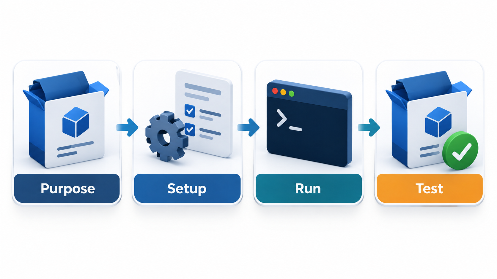
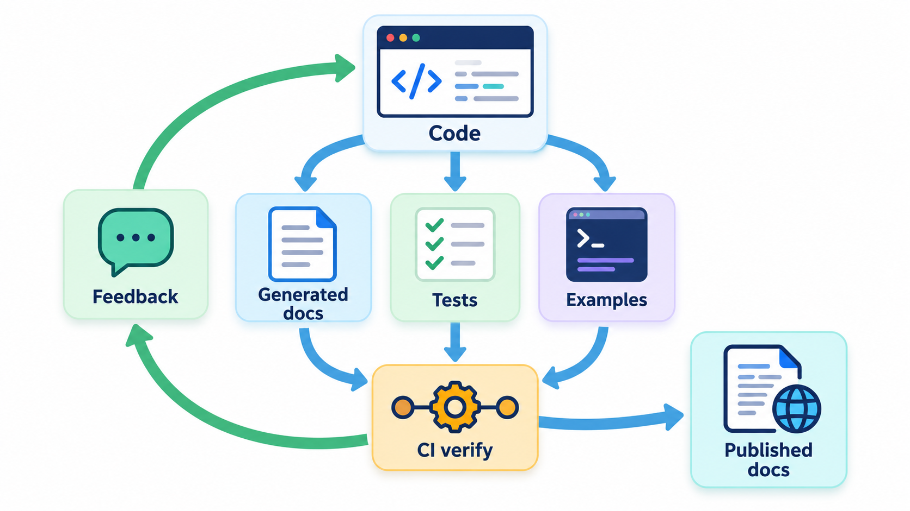
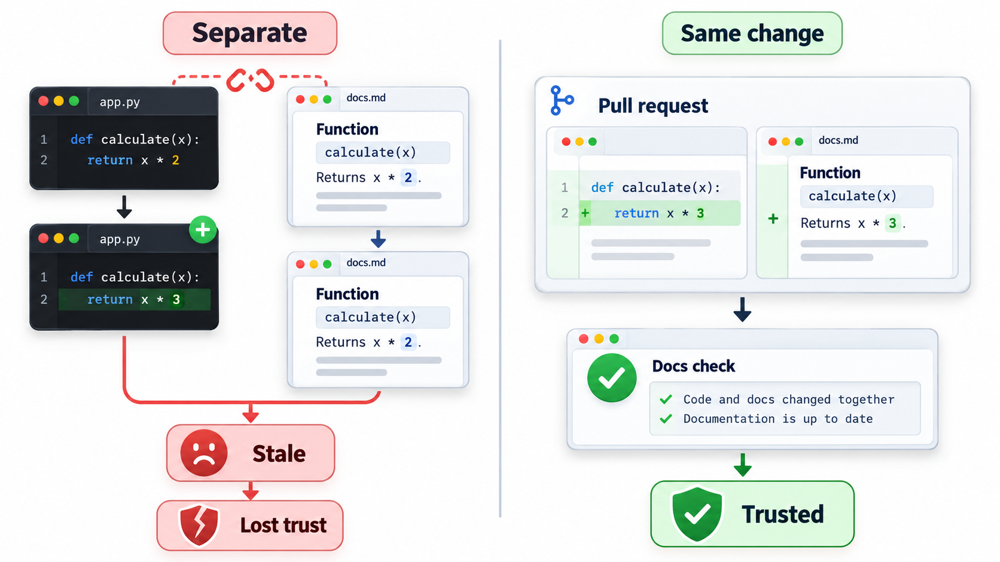
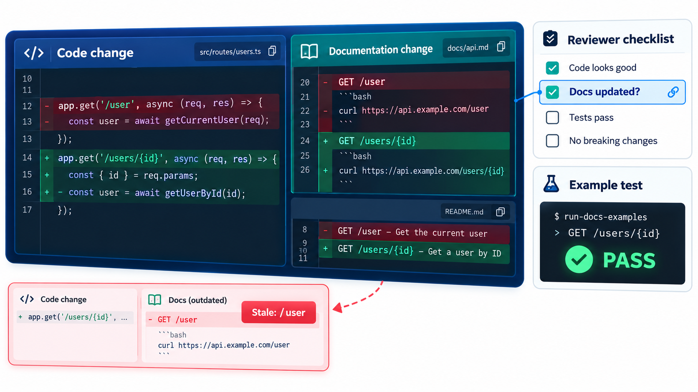

## The Documentation Nobody Wrote Is the One You Needed

Many projects have excellent code that nobody can use, because nobody knows how to start it, what it requires, or what its pieces do. The usual order of work is to write the code and, if there is time, the documentation, and the usual result is that there is no time. Yet documentation is the part of a system that explains it to the people who are not its author, and that includes the author a year later.

One practical idea is to write the short file at the top of a project, the README, before any code: if you cannot explain what you are building clearly in a page, the design is probably confused. This topic covers the main kinds of documentation, how they differ and how to keep them accurate.

The cost of missing documentation is rarely visible, because it is paid in small pieces: the hour a newcomer spends finding how to run the tests, the question asked three times in chat, the wrong assumption about a field that causes a bug. Added up over a team and a year, the hours are large.

## Who Is Reading and What Do They Need?

Documentation fails when it is written for nobody in particular. The useful question is who will read it and what they want to do.

| Reader | They want to | The document |
| --- | --- | --- |
| **New user** | Know what it is and try it in five minutes | README, getting-started guide |
| **Regular user** | Do a specific task | How-to guides |
| **Developer calling an API** | Know exactly what each function takes and returns | API reference |
| **Maintainer** | Understand why the code is the way it is | Architecture notes, decision records, comments |
| **Operator** | Install, configure and fix it at 2 a.m. | Runbooks, configuration reference |
| **Contributor** | Know how to propose a change | Contributing guide |

A system of any size needs several. The same text rarely serves two of these readers.

<!-- Visual: A map of document types and the readers they serve. -->

## Four Kinds of Documentation

A useful framework, widely adopted in open-source projects, sorts documentation into four kinds by what the reader needs at the moment.

| Kind | Reader's state | Answers | Style |
| --- | --- | --- | --- |
| **Tutorial** | Learning, new to it | "Can you show me how to begin?" | A guided lesson with a result at the end |
| **How-to guide** | Has a task | "How do I do X?" | Steps for one goal |
| **Reference** | Needs a fact | "What exactly does this take?" | Complete, dry, accurate |
| **Explanation** | Wants understanding | "Why is it designed this way?" | Discussion and background |

Problems arise when the kinds are mixed. A reference page padded with tutorial chatter is slow to scan. A tutorial interrupted by design theory loses the learner. Keeping each kind separate lets each do its job.

## The README: The Front Door

The README is the first thing most people read, and a good one answers a handful of questions in order: what is this and what problem does it solve; how do I install and run it (with commands that work); a minimal example; where is more information; how do I get help or contribute; and what is the licence. Keep it short, and link out for detail. A reader who finds the README unhelpful rarely looks further.

| Section | Question | Test of quality |
| --- | --- | --- |
| **Title and summary** | What is this? | A stranger can say what it does after two sentences |
| **Installation** | How do I get it running? | A newcomer reaches a working result by copying the steps |
| **Quick example** | What does using it look like? | Works as written |
| **Links** | Where do I find more? | Links are not broken |
| **Contributing and help** | How do I get involved or ask? | A contact and a process exist |
| **Licence** | May I use it? | Stated |

The best test of a README is to give it to someone who has never seen the project and watch whether they get it running. Where they stumble is where the README is wrong.

<!-- Visual: A reader's path through a README from first line to a working example. -->

## Docstrings and API Documentation

Inside the code, a **docstring** (or doc comment) documents a function, class or module in the place where it is written. It states what the function does, what its parameters mean, what it returns and what errors it raises. Because it sits beside the code, a person changing the function sees it and can update it. Tools can collect docstrings from the whole code base and produce a browsable **API reference**. Python's built-in help and Java's Javadoc work this way.

The best documentation of a function includes **examples**. A short example shows the intended use better than a paragraph of description. Some tools even let the examples be *executable*, so a machine checks them. Take a late-fine function documented with one summary line and three examples.

| Example in the documentation | Expected answer |
| --- | --- |
| Fine for 0 days late | 0 |
| Fine for 3 days late | 15 |
| Fine for 40 days late | 100 (the fine is never more than 100) |

When the checker runs, it takes each example, runs it and compares the actual answer with the written one. Three examples are checked and none fail. If someone changes the fine to 6 rupees a day and forgets the documentation, the three-day example would return 18 where the documentation says 15. The check would fail, and the out-of-date documentation would be caught. That is the whole point: documentation that is checked by a machine cannot silently go wrong, which is the usual fate of documents kept apart from the code.

A complete docstring covers a few standard elements.

| Element | What it says | Example for the fine function |
| --- | --- | --- |
| **Summary** | One line on what it does | "Return the late fine for a number of days." |
| **Parameters** | Meaning, type, and units | "days_late: whole days after the due date; zero or more" |
| **Returns** | What comes back | "The fine in rupees, never above 100" |
| **Raises** | What can go wrong | "A negative number of days is refused" |
| **Examples** | Typical and boundary cases | The three above |

## Docs as Code

The same idea applies to larger documents: treat them like code. Keep them in the repository, in a simple text format such as Markdown. Review changes to them in pull requests. Build them automatically and publish them with each release. Run checks that find broken links and failing examples. When documentation changes in the same pull request as the code it describes, the two stay together, and a reviewer can ask "where is the doc change?" just as they ask "where is the test?".

This is called **docs as code**, and it is how most open source projects and many companies now work. It also lowers the barrier for contributions: anyone who can edit a text file can fix a typo.

<!-- Visual: living documentation kept next to the code and updated with it. -->

## Keeping Documentation True

Out-of-date documentation is worse than none, because it misleads confidently. A few practices help.

- **Put it near the code.** The closer the document is to the thing it describes, the more likely it is updated.
- **Document the stable and the surprising.** Interfaces, architecture and reasons last. Details that the code states clearly need no prose.
- **Generate what you can.** API references, command help and configuration tables can come from the code itself.
- **Test it.** Run examples. Check links. Fail the build when they break.
- **Make ownership clear.** A document with no owner decays.
- **Delete what is wrong.** A short, accurate set beats a large, doubtful one.

| What can be generated | From | Benefit |
| --- | --- | --- |
| API reference | Docstrings in code | Cannot disagree with the code |
| Command-line help | The definition of the options | Always lists current options |
| Configuration tables | The configuration schema | New settings appear automatically |
| Diagrams of structure | Text descriptions or the code | Reviewed and versioned |
| Changelog | Commit messages or pull request titles | Release notes need little writing |

<!-- Visual: a pull request showing a code change and a documentation change side by side, with a review comment asking "did you update the docs?", and a green check for the doctest run. Save as images/84_docs_in_the_pull_request.png. -->

## Writing Clearly

Good documentation is clear before it is complete. A few habits matter.

| Habit | Example |
| --- | --- |
| Lead with the answer | "To reset a password, open Settings and choose Reset" before the background |
| Use the reader's words | "Sign in" if users say that, not "authenticate" |
| One idea per paragraph | Short paragraphs that can be scanned |
| Show, then explain | The example first, the rule after |
| Say what happens next | "You will receive an email within a minute" |
| Date and version it | "Applies to version 3.2" |
