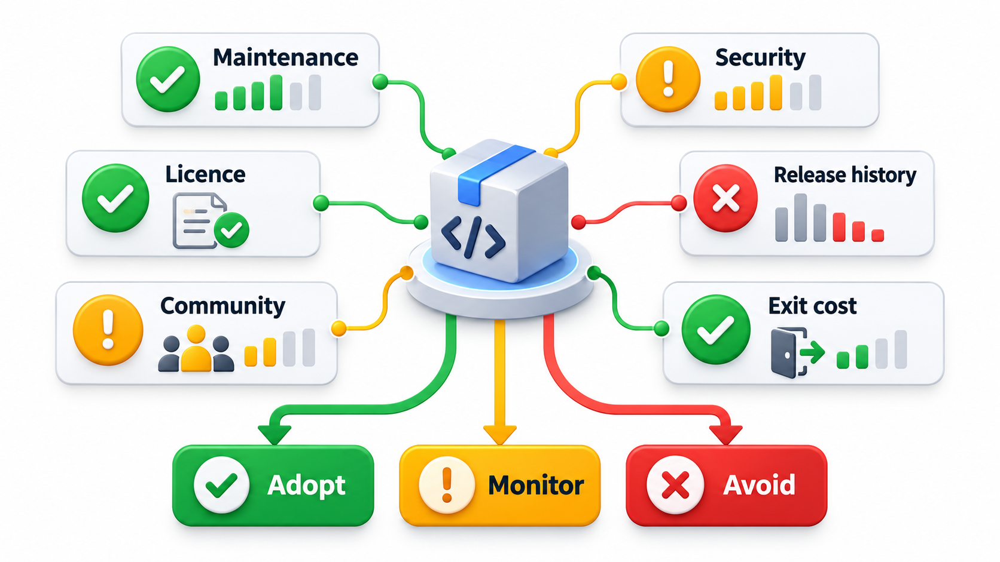
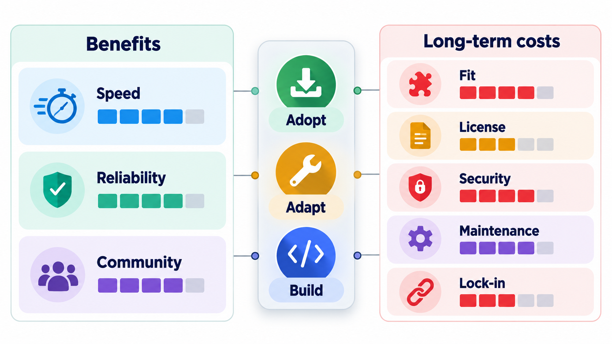
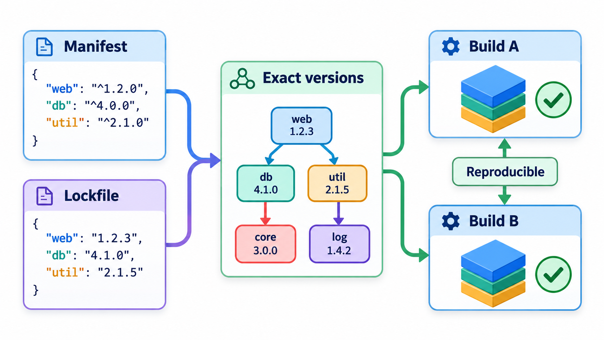
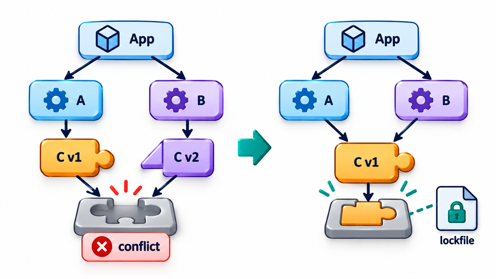
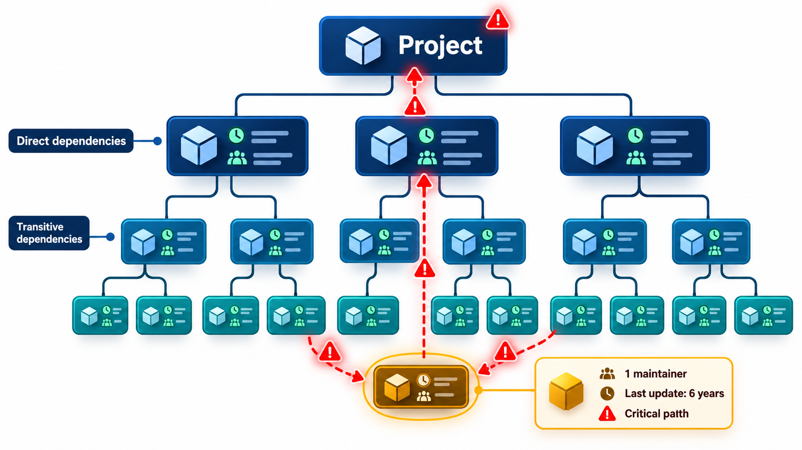

## Almost Every Program Is Mostly Other People's Code

A typical web application pulls in hundreds or thousands of libraries, directly and through each other, written by strangers who owe the user nothing. If one of those authors removes a package, publishes a broken update, or simply stops maintaining it, every program that depends on it feels the effect, sometimes the same morning, because builds that accept new versions automatically will pick up a bad one without anyone deciding to.

The decision to depend on a library is a decision to trust its author, today and at every future update. **Dependency management** is the practice of making that decision with care and keeping it under control: checking a library before adopting it, fixing the versions you use, and watching for problems.

The scale is easy to underestimate. A small project that lists ten direct dependencies may, once everything those ten need is counted, include several hundred packages. Each is code that runs with the same permissions as your own, written by someone you have never met.

## Why Depend at All

Using libraries is usually the right choice. A mature library for dates, encryption or parsing represents years of work and testing that a team cannot match in a week. Writing your own cryptography is a classic mistake. The aim is not to avoid dependencies, but to depend on the right ones, knowingly.

Every dependency carries costs: you must keep it updated, watch for security problems, accept its licence, put up with its bugs and its direction, and, if it is abandoned, take over its upkeep or replace it. A tiny library that does something you could write in ten lines, like left-padding a string, has the same costs as a big one and much less benefit.

| Situation | Better choice | Reason |
| --- | --- | --- |
| Encryption, password hashing | Use a well-known library | Easy to get subtly wrong; experts have already tested the library |
| Date and time with time zones | Use a library | Rules are intricate and keep changing |
| Padding a string | Write it yourself or use the standard library | Ten lines are cheaper than a dependency |
| A small utility used once | Consider copying the idea | A dependency for one function is poor value |
| A framework for the whole application | Choose carefully | It shapes everything; switching later is expensive |

## Before You Adopt: A Health Check

A few facts, all available from the package's page or repository, say more than the number of downloads.

| Question | A healthy sign | A warning |
| --- | --- | --- |
| **How recently was it released?** | Within the last year | No release for several years |
| **How many people maintain it?** | Several, or a company behind it | One person, who may leave |
| **How actively are problems handled?** | Issues answered, fixes merged | Hundreds of open issues with no replies |
| **How widely is it used?** | Many projects depend on it | Few users, so bugs go unfound |
| **What does it depend on?** | A few, trusted libraries | A deep tree of small packages |
| **What is the licence?** | A permissive, clear one | None, or one that conflicts with yours |
| **How does it treat change?** | Clear versions and a changelog | Breaking changes without notice |

Turn the checklist into a table for three candidate libraries. The warnings are: no release for more than two years, fewer than two maintainers, fewer than 50 thousand weekly downloads, and no licence. The libraries and numbers are invented.

| Library | Years since last release | Maintainers | Weekly downloads | Licence | Verdict |
| --- | --- | --- | --- | --- | --- |
| date-helper | 0.3 | 2 | 40 thousand | MIT | Risk: little real-world use |
| fast-csv | 2.5 | 1 | 12,000 thousand | MIT | Risks: no release for 2.5 years; only one maintainer |
| old-parser | 6.0 | 0 | 90 thousand | None | Risks: no release for 6 years; no maintainer; no licence |

`date-helper` is recent but little used, which means bugs are likely to be undiscovered. `fast-csv` is popular, but two and a half years have passed since the last release and there is one maintainer, which is a risk of abandonment even though many depend on it. `old-parser` has most of the warnings, including no licence, which in many countries means you are not allowed to use it at all. The thresholds are a team's choice. The list does not decide, but it makes the team look at the facts before adopting.

<!-- Visual: the reuse decision weighing a library's benefit against its costs and risks. -->

## Licences

A library's licence says what you may do with it. Ignoring it can create legal trouble for your employer.

| Kind | What it allows | Obligation | Examples |
| --- | --- | --- | --- |
| **Permissive** | Use, change and include in commercial software | Keep the copyright notice | MIT, BSD, Apache 2.0 |
| **Weak copyleft** | Use freely; changes to the library itself must be shared | Share changes to that library | LGPL, MPL |
| **Strong copyleft** | Use, but software that includes it must be released under the same licence | Release your combined work in the same way | GPL, AGPL |
| **No licence** | Nothing: the default is that you may not use it | Ask the author | (unlicensed code) |

A company building a commercial product usually keeps a list of approved licences and checks every new dependency against it, often with a tool that scans the whole tree.

## Versions, Lockfiles and Upgrades

Libraries change, and their users must decide how to follow. Most use **semantic versioning**, a convention in which a version number is three parts, major.minor.patch. A patch change (1.4.2 to 1.4.3) fixes bugs. A minor change (1.4 to 1.5) adds features without breaking anything. A major change (1.x to 2.0) may break existing users. The convention is only as reliable as the author who follows it.

| Change | Example | Safe to take automatically? |
| --- | --- | --- |
| Patch | 1.4.2 to 1.4.3 | Usually, with tests |
| Minor | 1.4 to 1.5 | Usually, with tests |
| Major | 1.x to 2.0 | No: read the changelog and plan the move |

A **lockfile** records the exact versions that were installed, including the libraries that the libraries depend on. With it, every developer and every build gets the same set, and an update happens only when someone chooses to make it. Without a lockfile, a build today and a build next week can differ, because something was released between them. Committing the lockfile is among the cheapest and most valuable habits in the business.

<!-- Visual: A lockfile pinning exact dependency versions to make builds repeatable. -->

The other half of the habit is to upgrade regularly. A project that never updates falls behind, accumulates security holes, and finds that moving up one day means leaping across years of changes. Small, frequent updates, reviewed and tested through the project's own tests, are far less painful than rare large ones. Tools can open a pull request automatically when a new version appears, so that updating is a routine task and not a project.

| Upgrade habit | Effort per upgrade | Risk | After two years |
| --- | --- | --- | --- |
| Update monthly, small steps | Small | Low: each step is easy to test | Current |
| Never update | None now | Rising: unpatched flaws | Several major versions behind; a painful project |
| Update everything once a year | Large | Medium: many changes at once, cause of failure unclear | Slightly behind |

## Transitive Dependencies and Conflicts

Your dependencies have dependencies. If your program uses libraries A and B, and both use library C, but A needs C version 1 and B needs version 2, you have a **conflict**. Different tools resolve it in different ways, and sometimes it cannot be resolved. The deeper the tree, the greater the exposure: a single issue in a small library at the bottom can reach thousands of programs. This is also why security problems in common libraries, such as the Log4j flaw of 2021, are so costly: nobody knows all the places where the library is hiding.

<!-- Visual: A dependency diamond in which two libraries need different versions of a third. -->

## Knowing What You Depend On

When a flaw is announced, the first question is "do we use it, and where?" A **software bill of materials (SBOM)** is a list of every component in a product, with versions. Teams that keep one can answer in minutes. Teams that do not search for days.

| Tool or practice | What it does |
| --- | --- |
| Dependency scanning | Compares your versions with databases of known vulnerabilities and raises alerts |
| SBOM generation | Produces the full list of components for each release |
| Licence scanning | Flags licences outside the approved list |
| Automated update pull requests | Proposes upgrades continuously |
| Pinned builds | Ensures the scanned versions are the ones shipped |

## Vendoring, Pinning and Abandoned Packages

Several strategies reduce the exposure.

- **Pinning.** Fix a dependency to an exact version, so surprises cannot arrive.
- **Vendoring.** Copy the dependency's source into your own repository. You then control the code and are protected from deletion, at the cost of taking on the updates yourself.
- **A private mirror.** An internal copy of the package registry, from which the company's builds draw, so an outage or removal upstream does not stop work.
- **Replacing abandoned packages.** When a library has no maintainer, the options are to switch to an alternative, to fork it and maintain your own copy, or, for a small one, to write the little you need.
- **Reducing the count.** Each dependency removed is a risk removed. Before adding a library for a minor job, consider whether the standard library already does it.

<!-- Visual: a tree of dependencies with the project at the top, direct libraries below it and many smaller transitive libraries below those, with one small library at the bottom circled as "one maintainer, last updated 6 years ago". Save as images/85_dependency_tree_risk.png. -->

## Five Misreadings of Dependency Management

**"More downloads means safer."** Popularity helps. But popular packages with one tired maintainer have been abandoned or hijacked.

**"Always take the latest version."** Automatic updates can bring breaking changes or worse. Update deliberately, with tests.

**"Never update, if it works."** The problems accumulate. Security fixes miss you and the eventual jump becomes a project.

**"A small library is lower risk."** Every dependency has fixed costs, and tiny ones often have the least review.

**"The lockfile is clutter."** It is what makes your build repeatable. Commit it.
